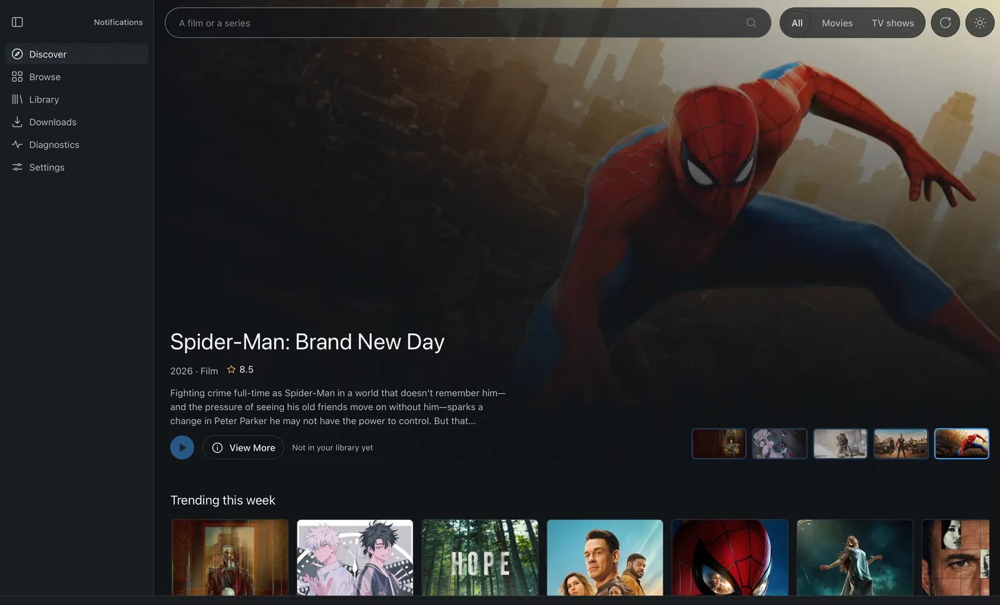

# Peregrine

**One desktop app for finding, downloading, and watching your own media.**

Peregrine does the job of a Prowlarr, Radarr, Sonarr, qBittorrent, and Jellyfin stack in a single window: search a title, pick a release, download it, play it. It is built for people who want the file on their own disk and their own server.



> **Status: v1.0 release candidate, unsigned.** Discovery, acquisition, library scanning, episode-level playback, watch state, the watchlist, and scheduled downloads work end to end on macOS. The release workflow builds macOS, Windows, and Linux bundles, but they are unsigned, unnotarised, and unpublished; Windows and Linux have not been run. Subtitle search/download, mpv subtitle selection, casting to a device, and accounts still do not exist. Treat it as a release candidate, not a supported release.

## What works today

- **Discover** — TMDB-backed rails, search, and title pages with seasons and episodes, cached in SQLite so screens open from disk.
- **Acquire** — search your indexers, rank releases against a quality profile, and download the one you pick. Peregrine can install and run a managed Prowlarr for you, or use one you already have.
- **Download queue** — live progress with pause, resume, and removal, and deletion that plans before it acts.
- **Play while it downloads** — a download is playable once its file list is known, served from the torrent engine through a loopback HTTP server.
- **Your library** — point it at folders you already have. Filenames are parsed and matched to titles, with manual matching for the ones it cannot place. Scanned titles get their own **My library** rail on Discover, and the Library screen searches and filters them. A scanned title still carrying no provider id is matched automatically in the background: the app searches the configured provider by name and kind on its next pass, then fills in the poster and metadata. Nothing is moved or renamed without asking.
- **Cast** — each refreshed title carries its top-billed cast from TMDB, portraits included, drawn as a rail on the title page. Clicking a person opens their page: the titles in your library that credit them, plus the rest of their credits from TMDB.
- **Watchlist** — save a title from its page. A bookmark marks it on every rail and grid, and Discover's **My list** rail collects the saved titles.
- **Playback** — pick an episode and play that episode, not the title's first file. mpv for containers the webview cannot demux, resume, and continue watching that reopens the exact episode.
- **Subtitles** — `.srt/.vtt/.ass/.ssa/.sub` sidecars beside a video are indexed and offered in the webview player, served from the same session token as the media. WebVTT renders in-page; SRT/ASS may not, and mpv does not yet receive a selected sidecar. Provider search and download are not built.
- **Watch state** — a bar along each episode's still fills as you watch and completes when you finish; the first unfinished episode is marked **Next up**, and Settings carries the full viewing history.
- **Scheduled downloads** — an unreleased episode or title offers Schedule instead of Download; the app fetches it on its release date and the Scheduled list in Downloads cancels it.
- **Profiles** — a local selector with DiceBear avatars or an uploaded photo. It is device-local scaffolding for the local accounts and parental gating in the roadmap, not a security boundary.
- **Safety gate** — every torrent is inspected before a byte is written: path traversal, executables, symlinks, unicode spoofing, and size and file-count caps. Downloaded media is never opened with the OS handler.
- **Notifications** — an in-app centre, because OS delivery can fail silently.

## Roadmap

Packaging and signed releases come first, then subtitles, casting to a device, air-date monitoring with watchlist auto-acquire, local accounts with parental gating (a parent curates a child's library by rating and by hand, and the child cannot download), MCP access for agents, and a Jellyfin-compatible API so other clients can play from Peregrine.

After that, a headless server with a browser client, installable with Docker or on NAS platforms such as UmbrelOS, Unraid, and TrueNAS. Once the core is stable, TV and mobile playback clients: Android TV, Tizen, iOS, and Android, in the way Jellyfin and Plex offer theirs. The full plan, with phases and exit criteria, is in [docs/PLAN.md](docs/PLAN.md).

## Scope

Peregrine hosts and distributes nothing. The indexers it searches are examples or sources you configure yourself, and what you download and keep is your responsibility. It is not a streaming site, and it is not a headless server yet.

## Why Peregrine

Self-hosted media is usually five services: an indexer manager, a film manager, a series manager, a torrent client, and a media server, each with its own configuration. Wrapper dashboards put one interface over all five. Peregrine replaces the path itself: the torrent engine, the library, and the player live in the app. The only external service is Prowlarr, which the app can install and run for you, or you can point it at one you already have.

| | Peregrine | *arr + Jellyfin | Wrapper dashboard | Streaming add-on |
| --- | --- | --- | --- | --- |
| What you install | one desktop app | five services | five services plus a UI | a player plus an add-on |
| Config surfaces | one setup flow, in progress | one per service | one per service | an add-on URL and an account |
| Torrent engine | in the app | a separate client | a separate client | external |
| Player | in the app | Jellyfin or another | Jellyfin or another | external |
| Play while downloading | yes | no | no | yes, without keeping the file |
| Keeps the file, works offline | yes | yes | yes | no |

The wins worth stating: a native app rather than a web console; one configuration surface rather than five; an engine and a player that can coordinate, which is what makes play-while-downloading possible; and an inspection before any byte is written.

The honest limits: Peregrine is an unsigned release candidate, verified only on macOS, and its bundles are neither signed nor notarised, while the stacks above have years of maturity. The first-run setup wizard exists, but there are no real accounts yet: profiles are local names and pictures, not scoped libraries. The bundled mpv and ffprobe remove the separate install on macOS and Windows; the Linux bundle still has no player.

## Build from source

Prerequisites: Rust 1.95 or newer, Node 22 or newer, and pnpm. The build fetches the pinned mpv and ffprobe sidecars itself (`pnpm sidecars:fetch`), so no separate mpv install is needed; a development build falls back to `PATH` when a sidecar has not been staged.

Release builds are compiled with a shared TMDB token supplied as `PEREGRINE_TMDB_TOKEN` at build time, so a fresh install can search without a key. The token is never in the repository. A key saved in Settings takes precedence, and a local build without the variable simply asks for one.

The release workflow produces four bundles — DMGs for both macOS architectures, an NSIS installer, and a deb plus an AppImage — and an unsigned v1.0 release candidate is published with a `SHA256SUMS` file. Signed releases wait for the signing secrets; the maintainer procedure is in [docs/RELEASE.md](docs/RELEASE.md).

```bash
pnpm install
pnpm tauri dev
```

The gates this repository is held to:

```bash
cargo xtask check-arch      # the dependency rules
cargo test --workspace      # the Rust suite
pnpm typecheck && pnpm lint && pnpm test   # the frontend
```

## How it is built

A Tauri v2 shell, a Rust core, and a React front end. The core owns all state and the UI projects it; every external system sits behind a trait so it can be replaced with a fake in tests. Design, module map, and rejected alternatives are in [docs/ARCHITECTURE.md](docs/ARCHITECTURE.md) and the [ADRs](docs/adr/).

## Documentation

| Document | Contents |
| --- | --- |
| [ARCHITECTURE.md](docs/ARCHITECTURE.md) | System design, module map, IPC contract, caching, concurrency, performance budgets |
| [DATA_MODEL.md](docs/DATA_MODEL.md) | Schema, indices, invariants, migrations, retention |
| [FLOWS.md](docs/FLOWS.md) | End-to-end sequence diagrams and state machines |
| [PLAN.md](docs/PLAN.md) | Phases, exit criteria, effort model, risk register |
| [TASKS.md](docs/TASKS.md) | The backlog: what each task still owes, and its acceptance criteria |
| [RELEASE.md](docs/RELEASE.md) | Cutting and verifying a release, the unsigned RC policy, and the signing secrets |
| [SECURITY.md](SECURITY.md) | Threat model, controls, accepted risks, reporting policy |
| [AGENTS.md](AGENTS.md) | The engineering contract, for human and AI contributors alike |

## Privacy

No telemetry, no accounts, no remote code. The app contacts the metadata and indexer services you configure, the BitTorrent swarm for torrents you add, and nothing else. Provider keys live in the OS keyring and are redacted from logs and diagnostics. See [SECURITY.md](SECURITY.md).

## Contributing

Read [AGENTS.md](AGENTS.md) first. Pick a task from [docs/TASKS.md](docs/TASKS.md), keep the pull request small, and keep the gates green. Commits follow the conventional format and carry a DCO sign-off.

## Licence

Dual-licensed under either **MIT** or **Apache-2.0**, at your option. Third-party components and bundled sidecars keep their own licences; see [DEPENDENCIES.md](docs/DEPENDENCIES.md) and the bundled `NOTICE` file.

The name "Peregrine" and the mark are the project's identity. Forks are welcome; builds that change behaviour should be renamed to avoid confusion about what is official.

## Acknowledgements

Built on [mpv](https://github.com/mpv-player/mpv), [FFmpeg](https://ffmpeg.org/), [librqbit](https://github.com/ikatson/rqbit), [Tauri](https://tauri.app/), and [TMDB](https://www.themoviedb.org/). Poster and backdrop images are provided by TMDB.

Architectural lessons, and specific mistakes to avoid, came from [qBittorrent](https://github.com/qbittorrent/qbittorrent), [seerr](https://github.com/seerr-team/seerr), [VLC](https://github.com/videolan/vlc), [Peeri](https://github.com/Aayush9029/Peeri), and [torlink](https://github.com/baairon/torlink); the licence analysis of each is in [docs/research/reference-codebases.md](docs/research/reference-codebases.md).

> This application uses TMDB and the TMDB APIs but is not endorsed, certified, or otherwise approved by TMDB.
