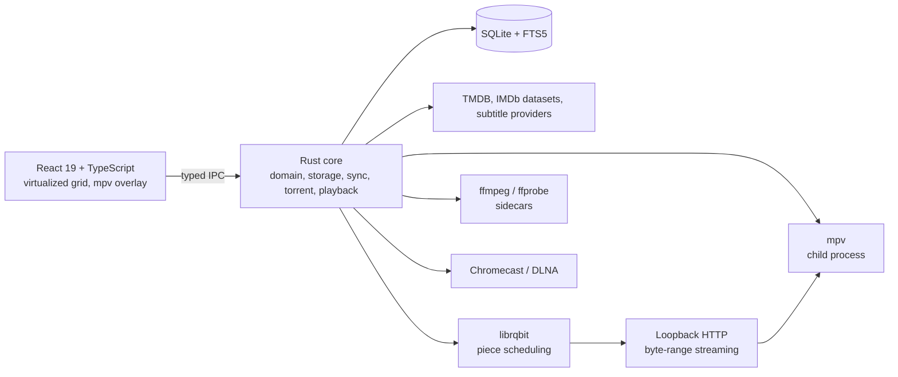

# Peregrine

A fast, native-feeling desktop app for discovering, collecting, and watching your own media — across macOS, Windows, and Linux.

Peregrine browses a catalogue from free metadata providers, keeps it in sync locally so it never waits on the network, downloads what you choose with a safety gate in front, manages a library you already have, and plays it back with resume, subtitles, and casting.

> **Status: Phase 0 in progress.** Peregrine runs a real runtime: it opens its SQLite database, runs the scheduler, streams job progress over IPC at a bounded rate, writes redacted JSON logs, and drains all of it on exit. A Diagnostics screen starts a hello job, watches it, cancels it, and reads the journal and log; Discover is still an empty shell and the discovery, acquisition, library, and playback workflows are not implemented. [TASKS.md](./docs/TASKS.md#implementation-status) records implementation status, remaining work, and verification limits.

---

## Contents

- [What it does](#what-it-does)
- [What it is not](#what-it-is-not)
- [How it is built](#how-it-is-built)
- [Roadmap](#roadmap)
- [Building from source](#building-from-source)
- [Repository layout](#repository-layout)
- [Documentation](#documentation)
- [Privacy](#privacy)
- [Legal](#legal)
- [Contributing](#contributing)
- [Licence](#licence)
- [Acknowledgements](#acknowledgements)

---

## What it does

The features below describe the planned product; current implementation status is tracked in [TASKS.md](./docs/TASKS.md#implementation-status).

| | |
| --- | --- |
| **Discovery** | Movies, series, and anime from TMDB, with posters, backdrops, episode stills, cast, trailers, and IMDb ratings that refresh daily. Filter by genre, year, rating, runtime, language, country, network, and availability; save smart collections. |
| **Instant** | Cache-first: every screen renders from local data in under 100 ms, then fills in from the network. Nothing blocks on a request, and everything works offline. |
| **Acquisition** | Search releases across indexers you configure, rank them against quality profiles, and download with per-file progress on the card and in a dedicated queue. |
| **Play while it downloads** | A download is playable from the moment its file list is known, not when it finishes — the interaction uTorrent calls Stream. Pieces are scheduled around the player's read position, the first and last pieces are fetched first so the container index exists and seeking works immediately, and the player shows real buffer health instead of a spinner. |
| **Safety gate** | Every torrent is inspected before a single byte is written: path traversal, executables and scripts, symlinks, unicode spoofing, size and file-count caps. Downloaded media is never opened with the system handler. |
| **Your library** | Point it at folders you already have. Filenames are parsed and matched to episodes and movies, with manual matching for anything ambiguous. Nothing is ever moved or renamed without asking. |
| **Playback** | mpv under the hood: essentially every container and codec, hardware decoding, audio and subtitle track switching, chapters, and a real buffer-health readout for streaming sources. |
| **Resume** | Continue watching, resume where you left off, mark watched, and auto-advance to the next episode in the ordering you chose. |
| **Subtitles** | Search, match by file hash, download, sync the offset live, extract embedded tracks, and remember your language per show. Bitmap formats burn in. |
| **Casting** | Chromecast and DLNA, with an honest capability model: direct play when possible, remux when needed, transcode only when the renderer forces it. Off by default. |
| **Notifications** | Native OS notifications with per-event control, sound on or off, quiet hours, and an in-app centre so nothing is lost when the system cannot deliver. Consent is asked, not assumed. |
| **Accounts** | Each person gets their own account with a name and an avatar picked at setup — a built-in mark, their initials, a photo, or a default. Separate watch history and continue-watching for everyone, plus one shared Guest account for visitors that keeps no history and has no name or picture to personalise. A parent curates a child's content by rating and hand-picked titles; the child cannot download anything and can only ask, and leaving their account needs Touch ID, Windows Hello, or the device password. Entirely local — no account server, no email. |
| **Watching** | Put a movie or a show on watch and Peregrine tracks its air dates and release windows, tells you when a new episode airs and again when it is actually obtainable, and keeps a calendar of what is coming. Notify-only by default; auto-acquire is opt-in per item. |
| **Agent access (MCP)** | Optional Model Context Protocol server so agent tools can search your library, check what is upcoming, and request downloads. Off by default, paired per client, read-only unless you grant more, and every download needs your click. |
| **Themes** | Light, dark, system, and Midnight out of the box, following your OS accent colour. Community themes are a single JSON file. |

## What it is not

- **Not a streaming site.** Peregrine hosts nothing and indexes nothing by default. It is a client for data you own and for services you configure.
- **Not an account system.** No sign-in, no cloud library, no analytics. Optional Trakt progress sync is opt-in and post-1.0.
- **Not a plugin platform.** Extensibility is compile-time adapters behind traits. No third-party code runs inside an app that handles magnets and untrusted media.
- **Not a headless server — in 1.0.** The desktop app is a client, and no port stays open unless you are casting. A server mode is planned after 1.0: folder export and DLNA first, then a Jellyfin-compatible API so Jellyfin clients can play from Peregrine, plus a headless service. Not a Plex server, ever — Plex clients can only talk to Plex's own server ([why](./docs/adr/0018-media-server.md)).

## How it is built



Tauri v2 shell, Rust workspace core, React front end. The Rust core owns all state; the UI is a projection. Everything external sits behind a trait so it can be faked in tests. Rationale and rejected alternatives: [docs/TECH_STACK.md](./docs/TECH_STACK.md) and [docs/adr/](./docs/adr/).

## Roadmap

| Version | Content | Documented in |
| --- | --- | --- |
| `v0.1.0` | Walking skeleton: shell, storage, scheduler, IPC, themes, CI on three platforms | [PLAN.md](./docs/PLAN.md) Phase 0 |
| `v0.2.0` | Discovery: providers, sync, images, browse, search, detail, seasons and episodes | Phase 1 |
| `v0.3.0` | Acquisition: torrent engine, safety gate, indexers, queue, library scan, deletion | Phase 2 |
| `v0.4.0` | Playback: mpv, streaming, resume, next-up, subtitles, language preferences | Phase 3 |
| `v0.5.0`–`v0.9.0` | Motion and polish, casting, full settings, permissions, packaging, signing, updates | Phase 4 |
| `v1.0.0` | Hardening, accessibility, internationalization, diagnostics, release engineering | Phase 5 |
| `v1.1.0` | Monitoring: watchlists that watch back — air dates, release windows, availability state, a calendar, and digest notifications | Phase 6 |
| `v1.2.0` | Agent access: an MCP server with paired clients, scoped tools, in-app consent for anything that spends bandwidth, and a full audit trail | Phase 6 |
| `v1.3.0` | Sharing: a scan-friendly library tree for Jellyfin and Plex (naming, NFO, artwork, subtitles), plus a DLNA server for TVs and consoles | Phase 7 |
| `v1.4.0` | Jellyfin-compatible API subset and a headless service, so Jellyfin clients browse and play from Peregrine | Phase 7 |
| `v1.5.0` | Client mode: browse and play an existing Jellyfin or Plex library, with progress written back | Phase 7 |
| `v1.6.0` | Accounts: several people with their own avatars, content, and history; a child account a parent curates which cannot download; and account switching gated by Touch ID, Windows Hello, or the device password | Phase 8 |

The full 1.0 backlog estimates ~1 120 ideal days. The earlier core estimate of ~577 ideal days still needs re-baselining for the added integration and schema tasks; [PLAN.md](./docs/PLAN.md) §4 records the scope and calendar assumptions.

## Building from source

The workspace declares Rust 1.95 or newer; the current audit ran the Rust gates on 1.99.0 (macOS arm64) and the frontend gates on Node 24. Platform window verification remains under `PG-E0-03`, and supply-chain findings remain under `PG-E0-14`.

```bash
cargo build --workspace        # crates, one per module map entry
cargo test --workspace
cargo xtask check-arch         # dependency direction and pure-crate sources
cargo xtask check-migrations   # migrations are append-only
cargo xtask check-todos        # every deferral names a task or an issue
cargo xtask check-dead-deps    # unused Rust dependencies (needs cargo-machete on PATH)
cargo xtask backlog-stats      # docs/TASKS.md roll-up, recomputed
```

The frontend workspace builds, typechecks, lints and tests on its own:

```bash
pnpm install
pnpm -r build
pnpm typecheck && pnpm lint && pnpm test
```

Running the desktop app uses the same install:

```bash
pnpm tauri dev
```

Requirements: Rust 1.95 or newer, Node 22+ with pnpm, and the platform build tools and Tauri system dependencies. Sidecar bundling is planned under `PG-E26-01`; this scaffold does not yet bundle mpv, ffprobe, or ffmpeg.

## Repository layout

```
apps/desktop/     Tauri shell and React application
crates/           Rust core, one crate per module
packages/         ui, theme, ipc-client, player-ui, i18n
assets/           branding and shipped themes
docs/             architecture, data model, flows, plan, tasks, ADRs, research
xtask/            repository checks, codegen, release helpers
```

## Documentation

| Document | Contents |
| --- | --- |
| [ARCHITECTURE.md](./docs/ARCHITECTURE.md) | System design, module map, IPC contract, caching, concurrency, security, performance budgets, platform matrix |
| [DATA_MODEL.md](./docs/DATA_MODEL.md) | Schema, indices, invariants, migrations, retention, disk accounting |
| [FLOWS.md](./docs/FLOWS.md) | Twelve end-to-end sequence diagrams and four state machines |
| [TECH_STACK.md](./docs/TECH_STACK.md) | Every technology choice with its rejected alternatives |
| [DEPENDENCIES.md](./docs/DEPENDENCIES.md) | Pinned versions, licences, update policy, redistribution obligations |
| [PLAN.md](./docs/PLAN.md) | Phases, exit criteria, effort model, risk register, release checklist |
| [TASKS.md](./docs/TASKS.md) | 474 tasks through 1.0, plus the written post-1.0 roadmap, with acceptance criteria and estimates |
| [DESIGN_SYSTEM.md](./docs/DESIGN_SYSTEM.md) | Tokens, colour, typography, motion, components, theming, accessibility |
| [adr/](./docs/adr/) | Decision records with the alternatives each decision beat |
| [research/](./docs/research/) | Reference-codebase lessons, dependency verification, data sources, desktop UX |
| [AGENTS.md](./AGENTS.md) | The rules every contribution follows, human or AI |
| [SECURITY.md](./SECURITY.md) | Threat model, controls, accepted risks, reporting policy |

## Privacy

No telemetry, no accounts, no remote code. The app contacts metadata and subtitle providers you enable, the BitTorrent swarm for torrents you add, and nothing else. Crash reporting is opt-in, self-hostable, and scrubbed; with no DSN configured, it makes no network call at all. API keys live in the OS keyring and are redacted from logs and diagnostics bundles.

The full threat model, including what is deliberately accepted, is in [SECURITY.md](./SECURITY.md).

## Legal

Peregrine is a media client. It does not host, index, or distribute content.

- Metadata comes from the TMDB API and the official IMDb datasets, downloaded by you to your machine and never redistributed by this project.
- Built-in indexer adapters ship **disabled**. Enabling one is your decision and your responsibility, and the app tells you so plainly before it happens.
- The planned `mpv` and `ffmpeg` sidecars are separate executables, invoked as subprocesses and never linked into the app. `mpv` ships as upstream's GPL build (an LGPL-only build has no Linux X11 video output) and `ffmpeg` as an LGPL-only build. Their licence texts, build configurations, and source offers ship alongside them and are listed in [DEPENDENCIES.md](./docs/DEPENDENCIES.md).
- Nothing from the project's dependencies is copied into this codebase. VLC and Jellyseerr-informed patterns were studied for architecture only; see [docs/research/reference-codebases.md](./docs/research/reference-codebases.md) for the licence analysis of each reference.

## Contributing

Read [AGENTS.md](./AGENTS.md) first — it is the engineering contract and it applies to AI-assisted contributions identically. Then pick a task from [docs/TASKS.md](./docs/TASKS.md), open a small pull request, and keep the gates green.

Commits follow the conventional format and require a DCO sign-off. Every change ships with its tests and the documentation it invalidates.

## Licence

Dual-licensed under either of **MIT** or **Apache-2.0**, at your option. Third-party components and bundled sidecars are covered by their own licences; see [DEPENDENCIES.md](./docs/DEPENDENCIES.md) and the bundled `NOTICE` file.

The name "Peregrine" and the mark are the project's identity; forks are welcome, but builds that change behaviour should be renamed to avoid confusion about what is official.

## Acknowledgements

Built on the shoulders of [mpv](https://github.com/mpv-player/mpv), [FFmpeg](https://ffmpeg.org/), [librqbit](https://github.com/ikatson/rqbit), [Tauri](https://tauri.app/), and [TMDB](https://www.themoviedb.org/).

Architectural lessons — and specific mistakes to avoid — were drawn from [qBittorrent](https://github.com/qbittorrent/qbittorrent) (torrent session and queue management, sequential download), [seerr](https://github.com/seerr-team/seerr) (metadata provider layering), [VLC](https://github.com/videolan/vlc) (stream semantics and hardware decode negotiation), [Peeri](https://github.com/Aayush9029/Peeri), and [torlink](https://github.com/baairon/torlink). Each is documented with its licence implications in [docs/research/reference-codebases.md](./docs/research/reference-codebases.md). The play-while-downloading interaction model follows what uTorrent popularised.

> This application uses TMDB and the TMDB APIs but is not endorsed, certified, or otherwise approved by TMDB.

The TMDB logo is used to identify that use, as its terms require.
