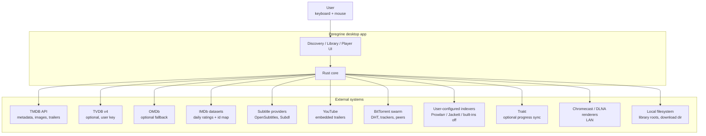
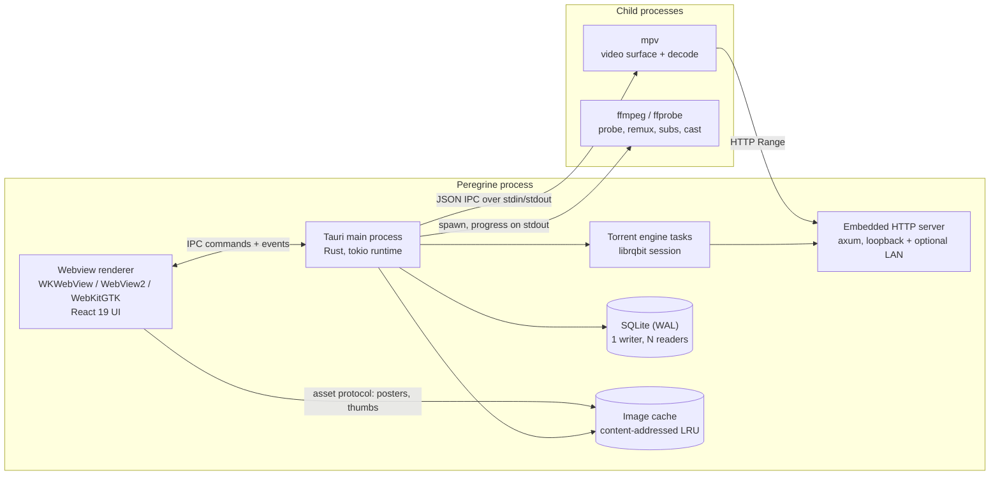
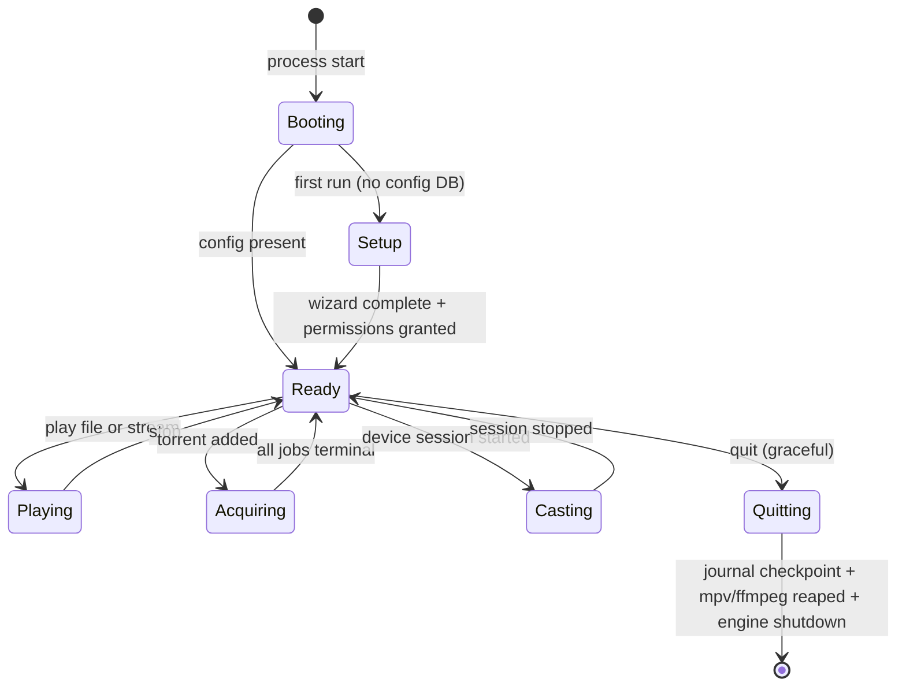
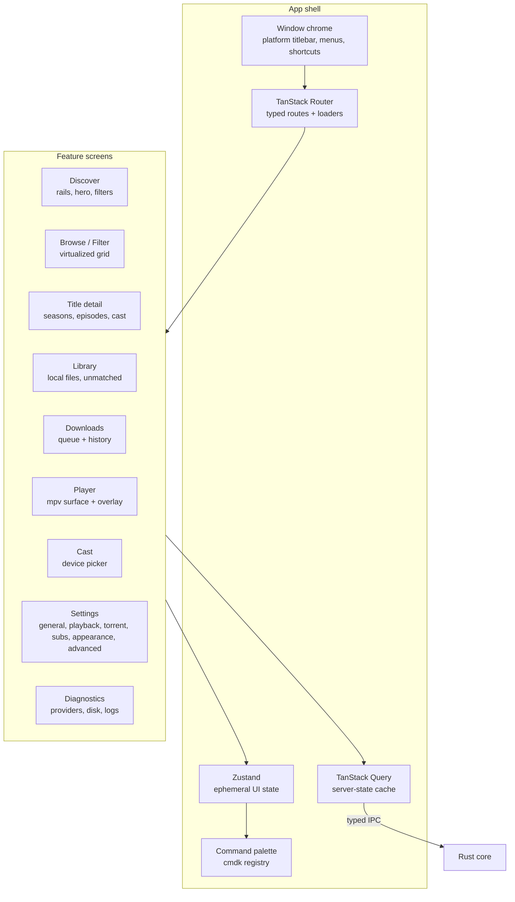
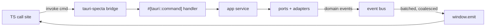
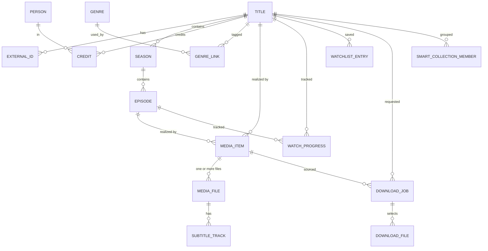
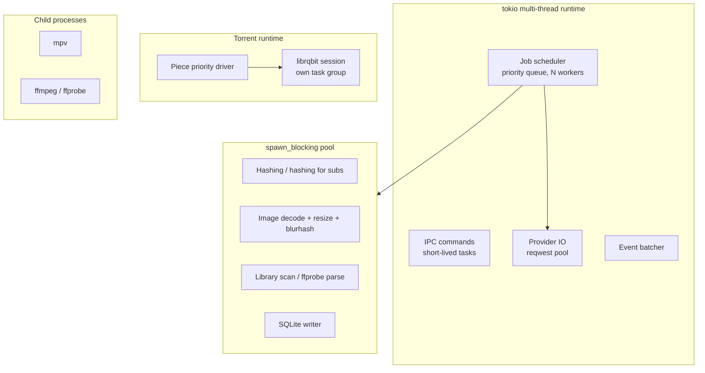
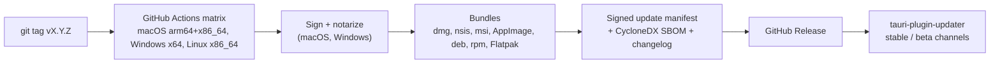

# Peregrine — System Architecture

Peregrine is a cross-platform desktop application for media discovery, library management, torrent acquisition, and playback. This document is the architectural source of truth. Data structures live in [DATA_MODEL.md](./DATA_MODEL.md), dynamic behaviour in [FLOWS.md](./FLOWS.md), decisions and their rejected alternatives in [adr/](./adr/), the backlog in [TASKS.md](./TASKS.md).

Status: target architecture, partially implemented. [TASKS.md](./TASKS.md#implementation-status) records the code inventory and remaining runtime integration. The behaviours below are requirements, not claims that every subsystem is available. Every load-bearing claim that still needs empirical confirmation is tagged `SPIKE-n` and listed in [§21](#21-open-spikes).

---

## 1. Scope

### In scope

- Discovery of movies, series, and anime from free metadata providers, with cached, instant, filterable browsing.
- Local library: scan, match, organize, play, delete.
- Torrent acquisition with quality profiles, a queue, and progress surfaced per card and in a dedicated screen.
- Playback through mpv with resume, next-up, subtitles, audio-track and language management.
- Watchlist, watch progress, collections.
- Casting to Chromecast and DLNA renderers.
- Settings, first-run setup, permissions, themes.
- macOS, Windows, Linux (X11 and Wayland), packaged and auto-updating.

### Explicit non-goals

| Non-goal | Why |
| --- | --- |
| Hosting or indexing content ourselves | Legal exposure and operational cost. Any indexer integration is user-configured — including its URL, with no default domain list shipped — and disabled by default. |
| User accounts, cloud sync of library contents | The app is local-first. Optional third-party progress sync (Trakt) is the only outbound identity. |
| A plugin runtime that executes third-party code | Remote code execution inside a torrent client is the single worst security decision available to us. Extensibility is compile-time traits, not loaded scripts. |
| Telemetry by default | Opt-in crash reports only, scrubbed, self-hostable. |
| Transcoding on the desktop playback path | mpv plays essentially every container and codec directly. Transcoding burns CPU for no benefit. Transcode exists only for casting, where the renderer forces it. |
| A media server for other devices **in 1.0** | Not in scope for 1.0: the desktop app stays a client. A server mode is planned for Phase 7 and specified in [adr/0018](./adr/0018-media-server.md) — folder export and DLNA first, then a Jellyfin-compatible API subset and a headless service. It is deliberately after 1.0 because a long-lived listener is a different security posture and depends on the core being stable |

---

## 2. Design principles

| # | Principle | Enforcement |
| --- | --- | --- |
| P1 | **The Rust core owns truth.** The UI is a projection of core state, never the origin of it. | All mutations flow through typed IPC commands. No business logic in TypeScript. |
| P2 | **Domain is pure.** Entities, invariants, scoring, naming parsers, and state machines live in a crate with no IO, no async, no clock. | `peregrine-domain` forbids `tokio`, `sqlx`, `reqwest`, `tauri`, `std::fs` by dependency allowlist check in `xtask`. |
| P3 | **Ports and adapters.** Every external system (TMDB, librqbit, mpv, ffmpeg, keyring, indexer) sits behind a trait in the core and an adapter in a leaf crate. | Adapters are the only crates allowed to name third-party client types. |
| P4 | **URLs and IDs in the database, bytes in a disposable cache.** Never store an image we can refetch. | Poster rows store provider path, dimensions, and a ~40-byte blurhash. Only the LQIP placeholder is durable; image CDN paths are immutable and never revalidated. |
| P5 | **Cache-first, always renderable, never blank.** Every screen has a cached state; the network only ever fills in. | TanStack Query with persisted cache; skeletons require a cached placeholder, not a spinner. |
| P6 | **Local-first, offline-tolerant.** With the network unplugged, library, playback, subtitles already stored, and downloads in progress all keep working. | Offline mode degradation matrix in [§15](#15-degradation-and-error-model). |
| P7 | **No unsafe.** | `#![forbid(unsafe_code)]` in every crate. A single FFI crate may opt out with a written justification; there is currently no such crate. |
| P8 | **No surprise network egress.** Every host we contact is enumerable and user-inspectable. | Provider registry is a single manifest; a diagnostics screen lists every endpoint contacted. |
| P9 | **Latency is a feature.** Budgets are enforced in CI, not aspirational. | [§14](#14-performance-architecture) budgets wired into benches and E2E assertions. |
| P10 | **Destructive actions are reversible or confirmed.** | Deleting media requires typed confirmation listing files and bytes; nothing else deletes user data. |
| P11 | **Every module is testable without a GUI or a network.** | Fakes for every port; `wiremock` fixtures for HTTP; loopback seeder for torrents. |
| P12 | **Zero comments that restate code.** Names and types carry intent; comments carry only non-obvious *why*. | Review rule in `AGENTS.md`. |

---

## 3. System context

Who and what Peregrine talks to.



### Trust boundaries

| Boundary | Trust | Controls |
| --- | --- | --- |
| Webview ↔ Rust core | Semi-trusted | Tauri v2 capabilities per window, strict CSP, typed IPC, no `eval`, no remote content loaded into the app window. Trailer playback happens in a separate sandboxed child webview limited to `youtube-nocookie.com`. |
| Core ↔ metadata providers | Untrusted input | Every response deserialized into a validating model; oversized payload caps; no HTML rendering of provider strings; image bytes sniffed and decoded only through the image crate with dimension limits. |
| Core ↔ swarm | Hostile | Torrent inspection gate, extension allowlist, path traversal rejection, size and file-count caps, never execute or open with system handler, never symlink. |
| Core ↔ local HTTP server | Local processes | Loopback bind, ephemeral port, per-session bearer token in path, no directory listing, no upload routes. |
| Core ↔ LAN (casting) | LAN peers | Off by default, explicit opt-in, per-session token, single-file scoped routes, optional PIN, bind restricted to the selected interface. |
| Core ↔ filesystem | User data | `PathGuard` canonicalization, roots allowlist, symlink escape rejection, unlink only for files recorded in the DB. |
| Core ↔ OS keyring | Trusted | API keys and Trakt tokens only ever in the platform keyring; redacted in logs and diagnostics. |

---

## 4. Container and runtime view

Peregrine is one process tree, not a client/server system. There is no daemon, no background service, and no port that stays open unless casting or streaming is active.



| Runtime element | Technology | Why this shape |
| --- | --- | --- |
| Shell | Tauri v2 | ~10–15 MB installers, native webview per OS, real permission model, Rust backend. |
| UI | React 19 + TypeScript + Vite, static bundle | Fast iteration on a visually rich, animation-heavy UI without rebuilding a native toolkit's primitives. |
| Media playback | **mpv as a child process**, driven by JSON IPC, with a per-platform video surface | Crash isolation (a decoder fault kills the video surface, not the app), no copyleft in our process (a separate executable is an aggregate), and mpv's own huge format/codec coverage. Surface specifics in [adr/0013](./adr/0013-mpv-distribution-and-video-surface.md); `SPIKE-1`, `SPIKE-2` |
| Torrent engine | librqbit in-process | Pure Rust, memory-safe, per-file selection, sequential streaming, magnet + DHT. In-process avoids a second IPC hop and lets piece priorities be driven directly. `SPIKE-3` |
| Probe / remux / subtitles / cast transcode | ffmpeg child process | Never linked, never in the app's address space; licence boundary is a `NOTICE` file plus a source offer. |
| Persistence | SQLite via `sqlx` in WAL mode | Single-file, transactional, FTS5 for search, no server. |
| Secrets | OS keyring via `keyring` | Keychain / Credential Manager / Secret Service. Never a plaintext config file. |

### Process lifetime



Quit is always graceful. Close-to-tray and "keep seeding" are opt-in settings; with seeding enabled, quit shows the active-seed count and offers *Stop and quit* / *Keep seeding in background* (the latter keeps the process alive with a tray icon).

---

## 5. Module map

Cargo workspace at the root, pnpm workspace for the frontend. Dependency direction is one-way and mechanically enforced.

```mermaid
graph TD
    subgraph Frontend["packages/"]
        WebApp["apps/desktop/src<br/>React app"]
        UIPkg["packages/ui<br/>design system"]
        ThemePkg["packages/theme<br/>tokens + themes"]
        ClientPkg["packages/ipc-client<br/>generated bindings"]
        PlayerWeb["packages/player-ui<br/>overlay + controls"]
    end

    subgraph Backend["crates/"]
        IPC["peregrine-ipc<br/>commands, events, DTOs"]
        App["peregrine-app<br/>services, orchestration"]
        Domain["peregrine-domain<br/>pure types + rules"]
        Storage["peregrine-storage<br/>SQLite, migrations, FTS"]
        Providers["peregrine-providers<br/>TMDB, TVDB, OMDb, IMDb, subs"]
        Sync["peregrine-sync<br/>scheduler, cache, images"]
        Torrent["peregrine-torrent<br/>engine + inspection"]
        Indexers["peregrine-indexers<br/>Prowlarr, Jackett, built-ins"]
        Monitor["peregrine-monitor<br/>watches + availability"]
        Mcp["peregrine-mcp<br/>stdio bridge, tool schemas"]
        Playback["peregrine-playback<br/>mpv, probe, sessions"]
        Cast["peregrine-cast<br/>mDNS, SSDP, castv2, DLNA"]
        Stream["peregrine-stream<br/>loopback + LAN HTTP"]
        Secrets["peregrine-secrets<br/>keyring, redaction"]
        Platform["peregrine-platform<br/>paths, permissions, tray, badges"]
        Xtask["xtask<br/>checks, codegen, release"]
    end

    WebApp --> UIPkg
    WebApp --> ThemePkg
    WebApp --> ClientPkg
    WebApp --> PlayerWeb
    IPC --> App
    App --> Domain
    App --> Storage
    App --> Providers
    App --> Sync
    App --> Torrent
    App --> Indexers
    App --> Monitor
    App --> Playback
    App --> Cast
    App --> Stream
    App --> Secrets
    App --> Platform
    Providers --> Domain
    Sync --> Domain
    Torrent --> Domain
    Indexers --> Domain
    Monitor --> Domain
    Mcp -.->|"local socket, post-1.0"| App
    Playback --> Domain
    Cast --> Domain
    Storage --> Domain
    Stream --> Domain
    Xtask -.->|"generates"| ClientPkg
```



| Crate | Responsibility | May depend on | Hard rules |
| --- | --- | --- | --- |
| `peregrine-domain` | Entities, value objects, invariants, quality-profile scoring, release-name and library-name parsing, subtitle-timing math, state machines, domain events. | `serde`, `jiff`, `ulid`, `thiserror` only | No IO, no async, no clock, no randomness. All time and IDs are injected. |
| `peregrine-storage` | Migrations, **account-scoped** repositories (ports from `app`), FTS5 search, KV settings, job journal, cache tables. | `domain`, `sqlx` | Repositories never contain business rules. Every catalogue and library read takes an `AccountScope`. All writes go through a single writer connection. |
| `peregrine-providers` | `MetadataProvider`, `SubtitleProvider` adapters; response normalization; matching/scoring; rate limiting; conditional requests. | `domain`, `reqwest`, `governor` | No provider type escapes the adapter module. Every response passes through a size-capped, validating decode. |
| `peregrine-sync` | Job scheduler, priority queues, resource token buckets, incremental change sync, IMDb dataset ingestion, image cache manager, blurhash generation. | `domain`, `storage`, `providers`, `image` | Cooperative cancellation on every job; no job may hold a write transaction across a network call. |
| `peregrine-torrent` | `TorrentEngine` port + librqbit adapter; torrent/magnet ingestion; the safety inspection pipeline; piece-priority policy for streaming; per-file selection; seeding policy. | `domain`, `librqbit` | Never touches the filesystem outside the configured download root. Inspection runs before any byte is written. |
| `peregrine-indexers` | `Indexer` port + Prowlarr, Jackett, local `.torrent`/magnet, and built-in adapters (disabled by default, no bundled domain list); result normalization and info-hash de-duplication; release-name and quality scoring feeds. | `domain`, `providers` | Never polls a rate-limited endpoint on a schedule. No bundled default domains. Adapters ship disabled. |
| `peregrine-monitor` | `Monitor` port plus the watching policy: per-scope monitors, the availability state machine, evidence-based transitions, dedupe keys, per-source cadence, and the daily digest. Enqueues jobs rather than scheduling its own polls. Post-1.0 ([adr/0016](./adr/0016-monitoring-and-availability.md)). | `domain`, `sync`, `providers` | A state transition without recorded evidence is a bug. Never polls a source faster than it can change. |
| `peregrine-mcp` | The stdio MCP server that agent clients launch: JSON-RPC framing, protocol-version negotiation, tool schemas, and a bridge to the running app over a per-user local socket. Contains no business logic and no database access. Post-1.0 ([adr/0017](./adr/0017-mcp-server.md)). | `domain` | Never opens the database. Every call goes through the app's services so scopes, approvals, and audit cannot be bypassed. |
| `peregrine-playback` | `PlayerBackend` port + mpv adapter; session state machine; probe cache; resume policy; next-up; watch-progress reporting; ffmpeg sidecar orchestration. | `domain`, `sync`, `stream` | No decode in-process. Position writes are throttled and coalesced. |
| `peregrine-stream` | axum router serving byte-range media, subtitle sidecars, and cast streams; token auth; per-session lifetime; bandwidth accounting. | `domain`, `torrent`, `axum` | Loopback and LAN listeners are separate bind addresses with separate token scopes. LAN listener only exists while casting. |
| `peregrine-cast` | Discovery (`mdns-sd` for Chromecast, `rupnp` for DLNA), renderer capability model, Chromecast CASTV2 and DLNA AVTransport adapters, delivery-mode decisions, playback-state reconciliation. Reuses `playback`'s sidecar supervisor for remux and transcode. | `domain`, `stream`, `playback` | Off by default. Never scans the whole subnet beyond the standard discovery protocols. |
| `peregrine-secrets` | Keyring read/write, in-memory `Secret` wrappers, log redaction filter. | `domain`, `keyring`, `secrecy` | Secret values are never `Debug`-printed, never serialized to the DB, never included in error strings. |
| `peregrine-platform` | Path resolution per OS, the production `Clock`, permission requests, tray, dock/taskbar badges, autostart, notifications, power-save inhibition during playback, and the `OsAuthenticator` adapters (LocalAuthentication, Windows Hello, polkit and fprintd). | `domain` | One `cfg`-gated module per OS behind a common interface. Authentication adapters report which mechanism answered, and report unavailability rather than faking success. |
| `peregrine-app` | The runtime that composes the above — logging, the database, the scheduler, and the event bus — plus the services that use them: `LibraryService`, `DiscoveryService`, `AcquisitionService`, `PlaybackService`, `SubtitleService`, `SettingsService`, `CastService`, `NotificationService`, `AccountService`, `MaintenanceService`. | everything above | Services are the only place where multiple ports are combined, and `Runtime` is the only place they are assembled. |
| `peregrine-ipc` | Tauri commands, event emitters, DTO mapping, error mapping, `specta` type export, and the one place the runtime is served over Tauri. | `app` | Commands are ≤20 lines: parse, call one service, map result. No logic. |
| `xtask` | Dependency-edge check, migration lint, IPC binding generation, release notes, bench harness, performance budget gate. | dev tooling | Runs in CI, never shipped. |

### Enforced rules

- `xtask check-arch` parses every `Cargo.toml` and fails the build on a disallowed edge (for example `storage → app`, or `domain → tokio`). The allowlist is a TOML file checked into the repo, so the architecture is reviewable in a diff.
- `xtask check-migrations` fails if a migration is edited after being merged, or if a new migration is not listed in the journal.
- `xtask gen-ipc` regenerates TypeScript bindings from Rust types; CI fails if the regenerated file differs from the committed one.

---

## 6. Frontend architecture



### State ownership

| State kind | Owner | Never |
| --- | --- | --- |
| Library, metadata, downloads, progress, settings | Rust core + SQLite | Duplicated as a mutable source of truth in the UI |
| Server-state cache (queries, optimistic overlays) | TanStack Query | Persisted to `localStorage` |
| Ephemeral UI state (open menus, hover, selection, scroll anchors) | Zustand slices | Sent over IPC |
| Window geometry, sidebar width, rail collapse | `tauri-plugin-window-state` + settings | Reimplemented |

Rules that keep it fast:

1. **One query per entity, keyed by domain ID.** No derived caches; selectors compute.
2. **Rails render from a single paginated query per rail**, hydrated from cache first (`staleTime` long, `refetchOnMount: false`), then revalidated in the background.
3. **Virtualize everything longer than ~60 items** with TanStack Virtual, fixed tile aspect ratios so the scrollbar is stable and there is no layout shift.
4. **Images:** `` with `src` pointing at the asset protocol, `loading="lazy"`, `decoding="async"`, explicit `width`/`height`, `fetchpriority="high"` only for the hero, and a blurhash CSS background that is replaced on `load` (cross-fade 160 ms). No spinners for images.
5. **Animations touch only `transform` and `opacity`.** `will-change` is set on interaction start and removed on settle. Layout-affecting animation is a review reject.
6. **No page-level route transition that unmounts the shell.** The chrome, sidebar, and player surface persist across navigation.
7. **Progress events are coalesced in Rust to ≤4 Hz per job**, and the UI animates between samples rather than re-rendering per event.

### Routing map

| Route | Screen | Notes |
| --- | --- | --- |
| `/` | Discover | Hero + rails: top 10 today, on the air, upcoming, top rated, continue watching, because-you-watched. |
| `/browse/:type?` | Browse | Full filter surface + saved smart collections. |
| `/search` | Search | Local FTS5 instant results, remote fallback after 250 ms of idle. |
| `/title/:kind/:id` | Detail | Movie or show; seasons, episodes, cast, availability, actions. |
| `/library` | Library | All local media, unmatched files, storage usage, re-scan. |
| `/downloads` | Queue | Active, queued, seeding, completed, failed; global limits. |
| `/player/:sessionId` | Player | Own window/fullscreen; mpv child surface + HTML overlay. |
| `/cast` | Cast | Devices, session control, capability report. |
| `/settings/:section?` | Settings | `Cmd/Ctrl+,`; sections mirror the settings registry. |
| `/diagnostics` | Diagnostics | Provider health, disk budget, log tail, endpoint list. |

### Feature folder convention

```
apps/desktop/src/
  app/            shell, router, providers, error boundaries
  features/
    discover/     components, hooks, queries, types (colocated)
    title/
    library/
    downloads/
    player/
    settings/
  lib/            ipc client wiring, formatters, keyboard, theme runtime
```

A feature never imports another feature's internals. Cross-feature reuse is promoted into `packages/ui` or `lib/`, which keeps the dependency graph reviewable.

---

## 7. IPC contract

Rust types are the single source of truth. `specta` + `tauri-specta` generate `packages/ipc-client/src/generated/bindings.ts`; the UI never hand-writes a DTO.



### Command surface (initial)

| Namespace | Commands | Shape |
| --- | --- | --- |
| `discover` | `get_home_rails`, `browse`, `search`, `get_recommendations` | Paged request → paged DTO |
| `title` | `get_title`, `get_season`, `get_episode`, `get_cast`, `refresh_metadata` | ID → DTO |
| `library` | `scan_library`, `list_library`, `get_unmatched`, `match_file`, `delete_media`, `reveal_in_file_manager`, `get_storage_usage` | ID lists → job ID + progress events |
| `acquire` | `search_releases`, `inspect_torrent`, `start_download`, `pause`, `resume`, `remove_download`, `set_file_selection`, `list_jobs` | Job-scoped |
| `playback` | `start_session`, `stop_session`, `seek`, `set_track`, `set_speed`, `report_position`, `get_resume_point`, `play_next` | Session-scoped |
| `subtitles` | `search_subtitles`, `download_subtitle`, `set_subtitle_offset`, `extract_embedded`, `get_language_prefs` | Title/episode-scoped |
| `cast` | `discover_devices`, `start_cast`, `stop_cast`, `get_cast_capabilities` | Device-scoped |
| `watchlist` | `add`, `remove`, `list`, `reorder` | Optimistic |
| `settings` | `get_schema`, `get_values`, `set_value`, `reset_section`, `export_config`, `import_config` | Schema-driven; the UI renders from the registry |
| `jobs` | `start_hello`, `cancel`, `list` | Job-scoped: a start returns an ID and streams `job://progress` and `job://state`; `cancel` records the request before it trips the token; `list` is a capped page of the journal |
| `system` | `get_permissions`, `request_permission`, `open_path`, `get_disk_budget`, `health`, `log_tail`, `export_diagnostics` | `health` reports the scheduler's and the event bus's counters, `log_tail` the newest lines of the redacted log |

### Rules

1. **Payload small.** Commands return IDs and DTOs, never blobs. Images and media bytes travel over the asset protocol or the loopback HTTP server. Any response over 64 KB is a design error.
2. **Long work returns a job ID** and streams `job://progress` events. No command blocks longer than 100 ms; anything slower is a job.
3. **Errors are structured**: `{ code, message, detail?, retryable, cause? }` where `code` is a stable enum shared with the UI. `detail` never contains secrets or absolute home paths.
4. **Events are versioned and namespaced**: `job://progress`, `job://state`, `download://stats`, `library://changed`, `player://state`, `cast://state`, `sync://health`, `notification://raised`.
5. **High-frequency streams are coalesced** in a `tokio::time::interval` batcher with a max rate per stream and a dropped-update counter so the UI can detect starvation.
6. **Cancellation is explicit**: every job-scoped command has a `cancel` counterpart; dropping the last subscriber does not silently cancel user-visible work.

---

## 8. Data model

Full schema, indices, and invariants: [DATA_MODEL.md](./DATA_MODEL.md). Summary of the shape:



Key modelling decisions:

- **`title` is one table for movies and shows** (`kind` discriminator) so discovery, watchlist, and progress code paths are uniform; season/episode detail hangs off it.
- **`external_id` is a separate table** keyed by `(provider, value)` so a title can carry TMDB, IMDb, TVDB, and AniDB IDs simultaneously and resolution is a join, not a column guess.
- **`media_item` is the library's notion of "we have this"**, distinct from the metadata title. One episode can have several `media_file` rows (a 1080p and a 4K copy); the player picks by preference and the library counts it once.
- **Everything cached from a provider is `provider_cache` or `image_ref`.** JSON resources carry TTL plus `ETag`/`Last-Modified` for revalidation; artwork carries an immutable path and is evicted by LRU size alone. Either way the cache is droppable at any time without data loss.
- **Watch progress is per `(account, title|episode)`**, so multi-account support (phase 2) is a schema-compatible addition rather than a migration of user data.
- **`job` is a durable journal**, so a crash mid-download resumes with correct state after restart, and the queue screen can show history.

---

## 9. Core flows

Twelve end-to-end sequence diagrams — onboarding, discovery hydration, search, incremental sync, release resolution, acquisition with the safety gate, streaming playback, local scan/match, subtitles, watch progress and next-up, casting, and deletion — live in [FLOWS.md](./FLOWS.md), together with the download, availability, playback-session, and job state machines.

The three that constrain the most design decisions, summarised:

| Flow | Constraint it imposes |
| --- | --- |
| **Incremental sync** ([FLOWS F4](./FLOWS.md#f4--incremental-metadata-sync)) | The UI must never wait for the network. Sync writes into `provider_cache` and the job appends a `library://changed` invalidation; the UI refetches only affected keys. Polling `/changes` windows is cheap; full catalogue walks are not. |
| **Acquisition** ([FLOWS F6](./FLOWS.md#f6--acquisition-with-the-safety-gate)) | Inspection is a hard gate *before* the engine is handed the torrent, so a hostile torrent never produces a file on disk. The gate result is persisted with the job, not recomputed. |
| **Streaming playback** ([FLOWS F7](./FLOWS.md#f7--streaming-playback)) | The player is dependency-inverted around a byte source. Local file and torrent stream paths are the same `MediaSource` trait, so the session state machine, resume logic, and subtitle pipeline are written once. |

---

## 10. Concurrency and resource model



| Resource | Policy |
| --- | --- |
| DB writers | Exactly one write connection, serialized through a channel. Readers use a pool sized to `min(4, cores)`. `busy_timeout = 5s`, WAL, `synchronous = NORMAL`. |
| Network | Global concurrency cap (default 8) plus per-host token buckets (metadata 8 rps, images 12 rps, subtitle 1 rps). A 429 or `Retry-After` parks the bucket; it never retries into a wall. |
| CPU | `desired_cpu_budget` setting (default: leave one core free) drives hashing threads, image decode concurrency, torrent hashing threads, and ffmpeg `-threads`. |
| Disk | Free-space floor (default 5 GB) blocks new downloads and pauses image-cache growth. Writes are `fsync`-batched by SQLite itself; torrent piece flushing uses librqbit's own policy. |
| Bandwidth | Global down/up caps, per-job caps, and a "pause all when playing" setting that reserves headroom for streaming. |
| Child processes | Reaped on drop via a guard; orphans killed at startup by PID+start-time match recorded in the journal (never `pkill` by name). |
| Cancellation | Every job carries a `CancellationToken`; services check it between steps; adapters accept it in their IO calls. |
| Backpressure | The event batcher drops intermediate progress frames and counts drops; the UI shows a "live" indicator degraded rather than stalling. |

Long tasks never run on the main thread, and no `await` is held across an SQLite write transaction. The two rules together are what keep the UI at 60/120 fps while downloading and seeding.

---

## 11. Caching architecture

Five tiers. Only tier 3 costs real disk, and every tier is disposable.

| Tier | Store | Contents | Eviction | Budget |
| --- | --- | --- | --- | --- |
| 1 | In-memory LRU (`moka`) | Hot title DTOs, search results, provider responses | Size-bounded (default 64 MB) | RAM |
| 2 | SQLite | Normalized entities, `provider_cache` with ETag + TTL, job journal, FTS5 index, resume points | TTL per resource class; rows pruned when unreferenced | DB ≤ 300 MB typical |
| 3 | Disk image cache | Poster/backdrop/still bytes, downloaded subtitles, ffprobe JSON results | LRU by bytes, hard cap, size-variant aware | Default 1 GB, user-set |
| 4 | Disk dataset | IMDb ratings only: 8.7 MB compressed, ~45 MB in SQLite | Replaced wholesale on refresh | 60 MB cap; alt titles are a separate opt-in with a 2.5 GB cap, disabled by default |
| 5 | HTTP conditional | `If-None-Match` / `If-Modified-Since` on every provider call | 304 refreshes TTL without transferring bytes | — |

Rules:

- **Tier 3 stores bytes keyed by content hash of `(provider, path, variant)`**, so renaming a provider path does not leak old files, and a cache wipe is always safe.
- **Treat every image path as immutable.** TMDB's CDN returns no usable `ETag`, ignores `If-None-Match`, and answers `If-Modified-Since` with `200` regardless, so there is nothing to revalidate and eviction is LRU by size. Conversely, a JSON cache row without its `ETag` is a bug: that revalidation would be a full transfer.
- **`provider_cache` rows record `fetched_at`, `expires_at`, `etag`, and `schema_version`.** A schema version bump invalidates the row rather than crashing the deserializer.
- **Prefetch is bounded and idle-driven**: the next rail's posters (max 12) prefetch on `requestIdleCallback`, never during scroll, never while a download saturates the link and "don't prefetch while streaming" is on.
- **Disk budget guardrail**: Settings → Diagnostics shows per-tier usage with one-click clear. Exceeding the cap evicts immediately; the DB is never evicted to reclaim space.

---

## 12. Security architecture

Full threat model, controls, and test plan: [../SECURITY.md](../SECURITY.md). Architectural commitments:

| Area | Commitment |
| --- | --- |
| Torrent ingestion | Sniff metadata → validate every file path → extension allowlist → cap file count (default 500) and total size (default 2× free-space floor) → reject symlinks, absolute paths, `..`, Windows reserved names, and unicode-spoofed executable extensions → produce a `SafetyReport`. Executables and scripts are blocked with no override; nested archives and disk-image files are blocked by default with an explicit advanced opt-in. |
| Content execution | Downloaded media is never opened with the OS default handler. Playback goes through mpv with a hardened flag set (`--no-config`, `--load-scripts=no`, `--no-ytdl`, `--sub-auto=no`, empty `--script-opts`). |
| Path handling | All filesystem operations go through `PathGuard::resolve`, which canonicalizes, rejects symlink escapes, requires containment within a configured root, and returns a typed `SafePath` that the fs layer accepts. There is no other way to obtain a writable path. |
| Secrets | OS keyring for all API keys and tokens; `Secret<T>` wrapper with no `Debug`/`Display`; a `tracing` layer that redacts known key shapes and any value registered as a secret. |
| Webview | Strict CSP with no `unsafe-eval`, no remote origin in the main window, `asset:` protocol scoped to cache and media roots, and a dedicated sandboxed child webview for YouTube trailers. Tauri capabilities are per window and minimal; the player window gets no filesystem commands. |
| Local HTTP | Loopback listener: ephemeral port, per-session token, routes scoped to one file, no listing, `Cache-Control: no-store` on subtitle routes, session dies with the player. LAN listener: exists only during casting, bound to the chosen interface, separate token, optional PIN, and rate-limited. |
| Deletion | Two-step confirmation that enumerates the exact file paths and byte counts, plus a checkbox for permanent delete (default: move to OS trash for library files; torrent payloads go to trash too when the trash is available). A typed phrase is required only for bulk deletion of more than 10 items or more than 20 GB. |
| Dependencies | `cargo-deny` (licences, ban list, advisories), `cargo-audit`, `osv-scanner`, `pnpm audit`, `knip` for dead deps, `cargo-machete` for unused crates, and a CycloneDX SBOM attached to every release. |
| Updates | Signed update manifests verified with a public key embedded in the binary; the updater refuses downgrades outside an explicit beta channel. Optional component packs (for example the full ffmpeg build) download only on an explicit user action, are verified against a pinned checksum and signature, and never run with elevated privileges. |
| Notifications | The user is asked before we notify them, and the answer is respected. Toast content is treated as public: media titles appear only while "show titles" is on, adult-flagged titles never appear, and no notification carries a filesystem path, secret, magnet URI, tracker URL, or infohash. Every event is also written to the in-app centre, so nothing depends on the OS delivering it. |
| Accounts and gating | Content scope is enforced in the query layer, not the UI, and fails closed: unrated content is hidden from a restricted account. A blocked title is indistinguishable from a nonexistent one. Capability checks live in the services, so no UI path, deep link, agent call, or media-server request can make a child account acquire media. Account switching is gated both ways by the OS credential where one exists ([adr/0019](./adr/0019-local-accounts-and-parental-gating.md)). |
| Agent access (MCP) | Off by default and loopback-only. Clients are paired, named, scoped, and revocable; `read` is the only default scope; anything that spends bandwidth, disk, or privacy requires an in-app approval dialog naming the requesting client; every call is audited. Externally sourced strings are returned to agents inside a labelled `untrusted` wrapper, and no tool output can trigger a tool call. |
| Permissions | First-run wizard requests folders, network, notifications, and (optionally) autostart, each with a plain-language explanation and a "not now" path. macOS entitlements are minimal and notarized; Windows signing documented; Linux provides AppImage, deb/rpm, and a Flatpak manifest with a documented portal-based file access story. |

---

## 13. Extensibility

Five extension points, all compile-time traits with a conformance test suite:

| Port | Trait | Add a new one by | Required tests |
| --- | --- | --- | --- |
| Metadata | `MetadataProvider` | Implementing capabilities (`search`, `get_title`, `get_season`, `get_episode`, `trending`, `changes`, `images`, `videos`), normalizing into domain types, declaring a rate limit and a cache policy | Recorded fixture replay, field-normalization snapshots, rate-limit behaviour, malformed/oversized payload rejection |
| Subtitles | `SubtitleProvider` | `search(query) -> Vec<SubtitleCandidate>`, `download(candidate) -> Bytes`, declaring auth and quota | Fixture replay, encoding-detection cases, quota-exhaustion behaviour |
| Torrent engine | `TorrentEngine` | Session lifecycle, add/select/stream/stats/limits | Local seeder↔leecher integration test over loopback, cancellation, restart recovery |
| Player backend | `PlayerBackend` | Launch/stop, command channel, state stream, position stream, track enumeration | Fake backend conformance suite; real backend smoke test per OS |
| Indexer | `Indexer` | `search(ReleaseQuery) -> Vec<Release>` | Fixture replay, result de-duplication and ranking property tests, disabled-by-default assertion |

The MCP interface ([adr/0017](./adr/0017-mcp-server.md)) is a **consumer** of these ports, not a sixth extension point. It exposes existing services to agents; it cannot add behaviour, load code, or reach past the service layer. Nothing in the extension model may depend on it.

A `conformance` test crate runs each provider's fixtures against shared invariants, so "does this adapter behave like the others" is a test, not a review opinion. Adding a provider should touch exactly three files: the adapter, its fixture directory, and the provider registry manifest.

---

## 14. Performance architecture

### Budgets (enforced, not aspirational)

| Metric | Target | Measured by |
| --- | --- | --- |
| Cold start → interactive | ≤ 1200 ms (Apple silicon), ≤ 2000 ms (Windows mid-tier) | Startup trace in CI on a fixed machine class + manual per-OS release check |
| Warm start → interactive | ≤ 400 ms | Same |
| Discover first paint from cache | ≤ 100 ms | E2E assertion via `performance.mark` |
| Browse grid scroll | ≥ 60 fps at 5 000 items, ≥ 110 fps on a 120 Hz display | Playwright trace + frame-time histogram |
| Search keystroke → results | ≤ 16 ms p50, ≤ 50 ms p95 (local FTS5) | Criterion bench on the query path + UI measurement |
| Memory, idle | ≤ 250 MB RSS total (excluding mpv/ffmpeg), webview heap ≤ 120 MB | `sysinfo` sampling in a soak test |
| IPC payload | ≤ 64 KB per response; progress events ≤ 4 Hz per job | Assertion in the IPC layer + contract tests |
| Image cache hit latency | ≤ 8 ms for a cached 342 px poster | Bench on the asset handler |
| Installer size | Base install (app, mpv, minimal ffprobe): macOS ≤ 85 MB, Windows ≤ 75 MB, Linux AppImage ≤ 130 MB. The full ffmpeg pack adds ~50 MB and is downloaded on demand, not shipped | Release CI budget gate |

### Rules that produce those numbers

1. Cache-first rendering; a screen is never blank and never shows a full-page spinner.
2. Virtualized grids and rails with fixed geometry; no measurement-driven relayout during scroll.
3. Composite-only animation; no layout or paint in the interaction path.
4. IPC carries IDs and deltas; blobs go over the asset protocol or loopback HTTP.
5. Image variants are requested at the size they are displayed (no 1280 px backdrop in a 300 px tile) and resized once into the disk cache.
6. All playback and probe work happens out of process; a stalled stream degrades the player, never the UI.
7. Every hot path has a bench that fails CI on regression beyond 15%.

---

## 15. Degradation and error model

| Condition | Behaviour |
| --- | --- |
| No network at start | Discover shows cached rails with an "offline, last updated 3 h ago" banner. Library, downloads in progress, playback, and stored subtitles work fully. |
| Provider 429 / 5xx | Token bucket parks; the job is rescheduled with exponential backoff and jitter; the UI shows a provider-health dot in Diagnostics, not an error modal. |
| Provider schema drift | Decode failure is isolated to the affected resource; the row is marked `stale` and the title renders from cache with a "metadata refresh failed" affordance. Never a crash, never a blank screen. |
| Torrent stalled | Piece-starvation detection surfaces "no peers" with actionable detail (DHT nodes, tracker status, port reachability), plus the option to try an alternative release. |
| Disk full | New downloads blocked, active ones paused (not failed) with a resume affordance, image cache trimmed automatically, and a clear banner with the required bytes. |
| mpv crash | Session state machine moves to `failed`, UI shows the exit code and stderr tail, offers retry from the last known position. The app itself never dies. |
| DB locked / corrupt | `PRAGMA integrity_check` at startup; on corruption, quarantine the damaged file and its write-ahead files beside the database — never deleted — recreate a clean schema, and signal that the library must be reimported by scanning (`Health.rescanRequired`). A lock another process holds is reported as a busy error rather than as damage. Provider caches are simply refetched. |
| Subtitle provider quota exhausted | Falls through the preference chain, then reports "no subtitles found — quota reached for OpenSubtitles, next reset 04:00". |
| Cast device disappears | Session ends gracefully, position is written back, and local playback can resume at that point. |
| Update check fails | Silent; retried on the next launch; never blocks startup. |

---

## 16. Observability

| Signal | Collection | Retention |
| --- | --- | --- |
| Structured logs | `tracing` JSON to rotating files in the app log dir, redacted | 7 days / 20 MB |
| Job history | `job` table with timings, attempt counts, and failure reasons | 90 days |
| Provider metrics | Per-provider request count, latency histogram, error rate, rate-limit hits, cache hit ratio (in-memory, aggregated, persisted hourly) | 30 days |
| Player telemetry | Startup latency, dropped frames (from mpv `--stats` JSON), decoder, hw-decode path, audio underruns | Current session + last 20 |
| Diagnostics screen | Provider health, disk budget per tier, endpoint list, top slow queries, log tail with copy/export | On demand |
| Crash reports | Opt-in, scrubbed, self-hostable Sentry-compatible DSN (empty by default) | Per deployment |

Nothing leaves the machine unless the user opts in, and the export bundle (logs + diagnostics + config-minus-secrets) is inspectable before sending.

---

## 17. Cross-platform matrix

| Capability | macOS | Windows | Linux X11 | Linux Wayland | Notes |
| --- | --- | --- | --- | --- | --- |
| Window chrome | Full native controls; overlay titlebar with traffic-light inset | `titleBarStyle: overlay`, custom caption buttons with snap-layouts support | Custom headerbar matching GNOME/KDE conventions | Same | Per-OS chrome components behind one `WindowChrome` interface |
| mpv video surface | App-positioned borderless child window (`--wid` is unimplemented on Cocoa) | `--wid` with the child window's `HWND` | `--wid` on the X11 window | Degraded hand-off: mpv in its own toplevel, webview video region hidden | Windows and X11 are siblings of the webview child window, so resize, move, and z-order are synchronized explicitly ([adr/0013](./adr/0013-mpv-distribution-and-video-surface.md)) |
| Hardware decode | VideoToolbox | D3D11VA / NVDEC | VA-API | VA-API | Detected at probe time, surfaced in Diagnostics, overridable |
| Tray / menu bar extra | Menu bar item | System tray | AppIndicator | AppIndicator | Optional; required if "keep seeding after close" is enabled |
| Dock/taskbar progress | `NSDockTile` badge | Taskbar overlay icon | Unity launcher API when present | — | Download progress mirroring |
| Notifications | `notify-rust` via UNUserNotificationCenter; system sounds or a bundled file by name | Windows toast; **requires an installed app** (dev builds show the PowerShell identity), `.wav` path for sound, clicks only reported while the toast is on screen | libnotify over D-Bus; XDG theme sound name as the `sound-name` hint | Same as X11 | Desktop has **no permission prompt at the plugin level** — `request_permission` returns Granted unconditionally, so consent is asked in-app and verification is a test notification. Grouping and scheduling are ignored on desktop, so coalescing is ours. Nothing can be retracted on macOS or Windows |
| Autostart | Launch agent (SMAppService) | Registry Run key | XDG autostart | XDG autostart | Off by default |
| Deep links | `peregrine://` via Launch Services | Protocol registration | `.desktop` handler | Same | `peregrine://title/tmdb/123`, `peregrine://magnet/...` |
| Trash-based delete | Native trash | Recycle Bin | XDG trash | XDG trash | Fallback to permanent delete with explicit confirm |
| Casting | Chromecast + DLNA | Chromecast + DLNA | Chromecast + DLNA | Chromecast + DLNA | AirPlay out of scope (see [adr/0010](./adr/0010-casting-scope.md)) |
| Account gate (Phase 8) | `LAContext`: Touch ID, Apple Watch, or device password | Windows Hello via `UserConsentVerifier` | polkit agent, then fprintd over D-Bus, then app PIN | Same as X11 | App PIN is the documented fallback and the UI says it is weaker; with a shared OS login this is a usability boundary, not a security boundary |
| Media server (Phase 7) | LAN listener over Wi-Fi or Ethernet, interfaces selectable; headless service via launchd | Same, via a Windows service | Same, via a systemd unit | Same; Wi-Fi is the normal case and mDNS is the dependable discovery path | No WAN exposure by default. Transcode capacity is limited by the LGPL ffmpeg build ([adr/0018](./adr/0018-media-server.md)) |
| Homelab deployment (Phase 9) | Not a target: the daemon runs on the server, the desktop app connects to it as a client | Not a target, for the same reason | The primary target: the headless daemon as a container image or a NixOS module, with no display server, webview, or desktop session | Same as Linux X11 | Four patterns, not nine products: OCI with Compose (Debian, Ubuntu Server, OpenMediaVault, TrueNAS SCALE, Unraid, umbrelOS, CasaOS), Podman under systemd (Fedora), a guest on a hypervisor (Proxmox VE, XCP-ng), and Nix. One glibc image for `amd64` and `arm64`, non-root with `PUID`/`PGID`, one state directory, secrets from an explicitly chosen backend, and a browser console still to come ([adr/0020](./adr/0020-homelab-deployment.md)) |
| Agent access (MCP) | stdio sidecar; optional loopback Streamable HTTP | Same, launching a `.exe` sidecar | Same | Same | Identical on every OS because it is a local socket or loopback HTTP. Post-1.0, [adr/0017](./adr/0017-mcp-server.md) |
| System accent color | `NSColor.controlAccentColor` | Accent palette API | GNOME accent / KDE color scheme | Same | Feeds the theme's accent token when "follow system" is on |
| Code signing | Apple Developer ID + notarization | Azure Trusted Signing or EV cert | — | — | Unsigned Linux builds are the distribution default |

Known gaps, stated honestly:

- Wayland video embedding is the highest-risk platform item. The plan assumes a fallback path ships in the first release rather than blocking on it. `SPIKE-1`
- WebKitGTK on Linux renders text and scrolling differently from WebKit/Chromium; the design tokens include a Linux-specific font stack and the perf budget for Linux assumes no GPU compositing of large blurred layers.
- Windows Defender SmartScreen will warn on unsigned builds; the README documents this rather than pretending it doesn't happen.

---

## 18. Packaging, distribution, updates



| Concern | Decision |
| --- | --- |
| Update mechanism | `tauri-plugin-updater`, signed manifests, in-app "restart to update" prompt, never a forced restart during playback or an active download. |
| Sidecars | **Base install carries mpv and a minimal ffprobe** — enough to play anything and to probe codecs, HDR, and tracks. **Full ffmpeg is an on-demand component pack**, because a complete build is 40–60 MB per platform and transcoding only matters when casting. Both base sidecars are signed and versioned with their own licence files and a source offer. The optional pack is fetched with an explicit user action, verified against a pinned checksum and signature, and never executed with elevated privileges. |
| Reproducibility | Locked `Cargo.lock` and `pnpm-lock.yaml`; `cargo-vet`-style audit trail via `cargo-deny` + SBOM; release builds use `--locked` and `--offline` where possible. |
| Linux packages | AppImage (default), `.deb`, `.rpm`, Flatpak manifest in-repo with portal-based file access. |
| Channels | `stable` and `beta`, selected in Settings → Advanced; the beta channel is opt-in and clearly labelled. |
| Rollback | The updater keeps the previous version's bundle for one release cycle so a bad update can be reverted offline. |

---

## 19. Testing architecture

| Layer | Tooling | What it must prove |
| --- | --- | --- |
| Domain unit + property | `cargo-nextest`, `proptest`, `insta` | Release-name parsing, quality scoring, path guards, subtitle timing, state machines, invariants. This crate targets ~95% line coverage and 100% of public invariants property-tested. |
| Storage | `nextest` + temp-file SQLite + migration fixtures | Migrations from every prior schema version, FTS5 search correctness, single-writer serialization, crash-mid-transaction recovery. |
| Providers | `wiremock` + recorded fixtures + `insta` | Normalization snapshots, 429/5xx/timeout/malformed/oversized handling, ETag revalidation, cap enforcement. |
| Torrent | Loopback seeder↔leecher integration | Sequential streaming read-ahead, file selection, cancellation, restart recovery, inspection gate rejection cases. |
| Playback | Fake `PlayerBackend` conformance + per-OS smoke test against a fixture file | Session state machine, resume policy, next-up, track switching, position coalescing. |
| Casting | Stub renderer (in-repo fake) + manual device checklist | Capability negotiation, remux trigger decisions, position reconciliation, session teardown. |
| UI unit | `vitest` + Testing Library + `msw` for IPC | Component behaviour, keyboard operability, focus management, reduced-motion paths. |
| E2E (web layer) | Playwright against the Vite build with a mocked IPC bridge | Critical flows: onboarding, browse→detail→download, queue, library scan, settings, deletion confirmation. |
| E2E (packaged app) | `tauri-driver` where supported; scripted per-OS smoke suite otherwise | Window lifecycle, menus, deep links, updater, playback smoke, tray. |
| Performance | `criterion` benches + budget gate in CI + frame-time assertions in E2E | The table in [§14](#14-performance-architecture). |
| Soak / chaos | 72 h download+stream soak on a nightly schedule; fault injection for disk-full, network flap, corrupt torrent, provider outage | Memory growth, file-descriptor leaks, orphan child processes, recovery behaviour. |

Fixture policy: only public-domain or explicitly licensed sample media (Big Buck Bunny, Sintel, Tears of Steel, public-domain trailers) is committed, and always as a tiny synthesized clip where the mechanism under test does not need real content. No copyrighted posters are committed — image fixtures are generated placeholders with a schema-identical shape.

---

## 20. Repository layout

```
peregrine/
  apps/desktop/            Tauri app: src (React), src-tauri (thin shell), capabilities, icons
  crates/                  per §5, one directory per crate
  packages/                ui, theme, ipc-client, player-ui, i18n
  assets/branding/         logo, app icon sources, previews
  assets/themes/           shipped theme token files
  docs/                    architecture, data model, flows, roadmap, tasks, adr, research
  xtask/                   arch check, migration check, IPC codegen, release helpers
  .github/                 workflows, issue and PR templates, CODEOWNERS
  AGENTS.md                rules for human and agent contributors
  SECURITY.md              threat model and vulnerability reporting
  README.md
```

## 21. Open spikes

These are the questions that could change a decision. Each is a time-boxed experiment with a written outcome appended to the relevant ADR.

| ID | Question | Time box | Decision it unblocks |
| --- | --- | --- | --- |
| SPIKE-1 | Per-platform surface quality: `--wid` embedding plus overlay z-order on Windows and X11, an app-positioned child window on macOS (resize, fullscreen, Spaces, display change), and the Wayland degraded hand-off | 3 days | Confirms [adr/0013](./adr/0013-mpv-distribution-and-video-surface.md); decides whether a render-API ADR is worth opening |
| SPIKE-2 | Does mpv's `--stats` JSON plus `--term-status-msg` give us frame drops, hw-decode path, and audio underruns without a render API? | 1 day | Player diagnostics |
| SPIKE-3 | Verify, on the pinned librqbit 9.0.1 and all three OSes, the capabilities the registry confirms exist: per-file streaming with a steerable read-ahead window, `only_files` selection and later `update_only_files`, SOCKS5 and `bind_device_name`, and clean shutdown with restart reattachment. Also test whether SOCKS5 covers **UDP tracker** traffic, which is unverified | 3 days | Torrent engine ADR, VPN binding feature |
| SPIKE-4 | Blurhash vs thumbhash vs a 16 px WebP LQIP: decode cost, size, and visual quality at 342 px poster width. | 1 day | Placeholder strategy |
| SPIKE-5 | FTS5 ranking quality on 100 k titles with alt titles and cast, versus a trigram index; measure p95 latency. | 2 days | Search implementation |
| SPIKE-6 | Encoder ladder on reference hardware: direct play, HLS remux, then hardware H.264 versus `libopenh264` for the MKV/H.265/AC3 cases. Produces the published capability matrix | 2 days | Cast pipeline scope, [adr/0014](./adr/0014-ffmpeg-build-and-transcode.md) |
| SPIKE-7 | Cost of a full library scan + ffprobe on 2 000 files, and whether ffprobe can be avoided for common containers. Registry evidence says it cannot for HDR metadata, so this measures throughput only | 2 days | Library scan architecture |
| SPIKE-8 | Trakt device-OAuth progress sync round-trip and conflict handling with local progress. | 1 day | Sync scope for v1 |
| SPIKE-17 | OS authentication reality: Touch ID, Apple Watch, and device password on macOS; Windows Hello with PIN, fingerprint, and face plus clean unavailability reporting; and what GNOME and KDE actually offer (polkit agent, fprintd, both, or neither) including the message when neither exists | 2 days | [adr/0019](./adr/0019-local-accounts-and-parental-gating.md) |
| SPIKE-18 | Gating completeness audit: a permanent leak suite that tries to reach blocked content through search suggestions, similar titles, continue-watching, notification bodies, direct item IDs, the casting server, the Jellyfin API subset, and a hand-written MCP call | 3 days | Phase 8 exit criteria |
| SPIKE-14 | Export against reality: generate the scan-friendly tree and confirm a real Jellyfin and a real Plex install pick up items with correct metadata, artwork, and subtitle tracks without manual matching | 2 days | Phase 7 scope, [adr/0018](./adr/0018-media-server.md) |
| SPIKE-15 | Jellyfin client reality: connect the API subset to two real clients (one mobile, one TV) and record what each needs beyond the subset | 3 days | The true v1.4 scope |
| SPIKE-16 | Measure a 4K remux over 2.4 GHz, 5 GHz, and Ethernet, and record where direct play stops being viable | 1 day | Link-budget thresholds in the server design |
| SPIKE-12 | MCP conformance: `server/discover` and version negotiation against one handshake-era client (`2025-11-25`) and one current client (`2026-07-28`), schema acceptance, the `pending_approval` round trip, revocation mid-session, and the prompt-injection fixture | 3 days | [adr/0017](./adr/0017-mcp-server.md), Phase 6 scope |
| SPIKE-13 | Monitoring signal quality: real air-date-to-release latency for ten shows with and without an indexer, and how often providers disagree about a date | 2 days | UI copy and cadence defaults for [adr/0016](./adr/0016-monitoring-and-availability.md) |
| SPIKE-11 | Per-OS notification reality check: the working sound value for each event class; whether an omitted sound is genuinely silent on macOS, Windows, GNOME Shell, and dunst; whether a packaged macOS build prompts from `Notification.requestPermission()`; Linux behaviour with no notification daemon; and the Windows click-reporting window | 1 day | Notification policy, [adr/0015](./adr/0015-native-notifications.md) |
| SPIKE-10 | Find the real sustained rate limits: ramp TMDB at 5/10/20/40 rps for 60 s and record the first `429`, and probe TVDB v4's undocumented limit with a key. Decides whether per-host limiters can be constants or must adapt | 2 days | Provider rate-limit policy, sync cadence |
| SPIKE-9 | `specta` + `tauri-specta` at the pinned `2.0.0-rc.25`: generate bindings for a representative command surface, confirm enums, `Option`, and nested generics round-trip, and confirm the generated client compiles in the frontend. There is no stable 2.x, so the fallback is hand-written DTOs plus a generation check | 2 days | The IPC contract's code-generation choice |
