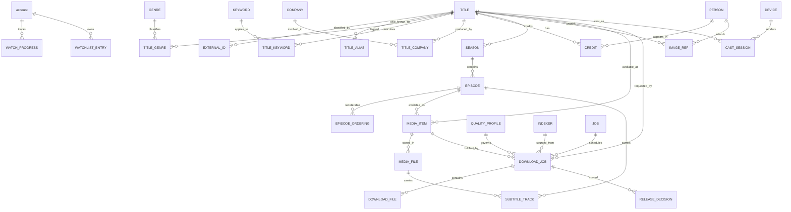

# Peregrine — Data Model

Storage is a single SQLite database in WAL mode, owned exclusively by `peregrine-storage`. This document defines the schema, the invariants the domain layer relies on, and the migration policy. Behaviour that writes these tables is in [FLOWS.md](./FLOWS.md).

Conventions:

- `snake_case` names, plural-free table names (`title`, not `titles`).
- Every table has `id INTEGER PRIMARY KEY` unless it is a pure join or cache table, in which case it has a natural composite key.
- Timestamps are `INTEGER` Unix milliseconds UTC. Durations are `INTEGER` milliseconds. Sizes are `INTEGER` bytes.
- Booleans are `INTEGER NOT NULL CHECK (x IN (0,1))`.
- Enumerations are `TEXT` with a `CHECK` constraint; the matching Rust enum is the source of truth and both are asserted equal in a test.
- Provider-relative paths (for example a TMDB `poster_path`) are stored as-is; the provider is always stored alongside them, because path shapes differ per provider.

---

## 1. Entity relationship overview



---

## 2. Schema

### 2.1 Identity and preferences

```sql
CREATE TABLE account (
  id             INTEGER PRIMARY KEY,
  name           TEXT    NOT NULL,
  kind           TEXT    NOT NULL DEFAULT 'adult' CHECK (kind IN ('adult','child','guest')),
  avatar_kind    TEXT NOT NULL DEFAULT 'initials'
                 CHECK (avatar_kind IN ('builtin','initials','custom','default')),
  avatar_ref     TEXT,                  -- builtin mark id, or the local file path for a custom image
  avatar_blurhash TEXT,
  accent_color   TEXT,
  -- Content scope
  rating_ceiling TEXT,                  -- highest content rating this account may see, NULL = unrestricted
  curated_only   INTEGER NOT NULL DEFAULT 0 CHECK (curated_only IN (0,1)),
  -- Capabilities
  can_acquire    INTEGER NOT NULL DEFAULT 1 CHECK (can_acquire IN (0,1)),
  can_delete     INTEGER NOT NULL DEFAULT 0 CHECK (can_delete IN (0,1)),
  can_manage     INTEGER NOT NULL DEFAULT 0 CHECK (can_manage IN (0,1)),
  can_cast       INTEGER NOT NULL DEFAULT 1 CHECK (can_cast IN (0,1)),
  can_use_agents INTEGER NOT NULL DEFAULT 0 CHECK (can_use_agents IN (0,1)),
  can_see_queue  INTEGER NOT NULL DEFAULT 1 CHECK (can_see_queue IN (0,1)),
  -- Locking
  lock_policy    TEXT NOT NULL DEFAULT 'none'
                 CHECK (lock_policy IN ('none','app_pin','os_auth')),
  pin_hash       TEXT,                  -- only for lock_policy = 'app_pin'
  idle_lock_minutes INTEGER,            -- NULL = never auto-lock
  is_default     INTEGER NOT NULL DEFAULT 0 CHECK (is_default IN (0,1)),
  created_at     INTEGER NOT NULL,
  last_used_at   INTEGER,
  -- A restricted account must have a ceiling or explicit curation; an unrestricted
  -- child account would be a configuration mistake, not a feature.
  CHECK (kind <> 'child' OR rating_ceiling IS NOT NULL OR curated_only = 1),
  CHECK (kind <> 'child' OR can_acquire = 0)
);

CREATE TABLE settings (
  key        TEXT PRIMARY KEY,
  value_json TEXT NOT NULL,
  updated_at INTEGER NOT NULL
);

-- A pointer to a keyring entry. The secret value itself never enters the database.
CREATE TABLE secret_ref (
  key             TEXT PRIMARY KEY,
  keyring_service TEXT NOT NULL,
  keyring_account TEXT NOT NULL,
  created_at      INTEGER NOT NULL
);
```

`settings` holds only user preferences. Anything derivable, cached, or provider-owned lives elsewhere so the database can be reconstructed.

### 2.2 Catalogue

```sql
CREATE TABLE title (
  id                  INTEGER PRIMARY KEY,
  kind                TEXT    NOT NULL CHECK (kind IN ('movie','show')),
  subtype             TEXT    NOT NULL DEFAULT 'standard'
                              CHECK (subtype IN ('standard','anime','documentary','reality')),
  name                TEXT    NOT NULL,
  original_name       TEXT,
  sort_name           TEXT    NOT NULL,
  overview            TEXT,
  tagline             TEXT,
  status              TEXT    CHECK (status IN ('rumored','planned','in_production','returning',
                                                'ended','canceled','released','upcoming')),
  release_date        TEXT,                      -- ISO date for movies
  first_air_date      TEXT,                      -- ISO date for shows
  last_air_date       TEXT,
  runtime_minutes     INTEGER,
  episode_runtime_minutes INTEGER,
  original_language   TEXT,                      -- BCP-47
  origin_country      TEXT,                      -- JSON array of ISO-3166 alpha-2
  content_rating      TEXT,
  imdb_rating         REAL,
  imdb_votes          INTEGER,
  tmdb_rating         REAL,
  tmdb_votes          INTEGER,
  popularity          REAL,
  adult               INTEGER NOT NULL DEFAULT 0 CHECK (adult IN (0,1)),
  in_production       INTEGER NOT NULL DEFAULT 0 CHECK (in_production IN (0,1)),
  season_count        INTEGER,
  episode_count       INTEGER,
  -- Denormalized primary artwork: the browse grid reads only these columns.
  poster_provider     TEXT,
  poster_path         TEXT,
  poster_blurhash     TEXT,
  backdrop_provider   TEXT,
  backdrop_path       TEXT,
  backdrop_blurhash   TEXT,
  logo_path           TEXT,
  trailer_site        TEXT,
  trailer_key         TEXT,
  trailer_language    TEXT,
  trailer_published_at TEXT,
  homepage            TEXT,
  metadata_state      TEXT    NOT NULL DEFAULT 'stub'
                              CHECK (metadata_state IN ('stub','partial','complete','stale','failed')),
  last_synced_at      INTEGER,
  created_at          INTEGER NOT NULL,
  updated_at          INTEGER NOT NULL
);

CREATE INDEX title_kind_popularity_idx ON title (kind, popularity DESC);
CREATE INDEX title_kind_release_idx    ON title (kind, release_date DESC, first_air_date DESC);
CREATE INDEX title_imdb_rating_idx     ON title (imdb_rating DESC) WHERE imdb_rating IS NOT NULL;
CREATE INDEX title_sort_name_idx       ON title (sort_name);
CREATE INDEX title_sync_idx            ON title (metadata_state, last_synced_at);

CREATE TABLE title_alias (
  id        INTEGER PRIMARY KEY,
  title_id  INTEGER NOT NULL REFERENCES title(id) ON DELETE CASCADE,
  alias     TEXT    NOT NULL,
  region    TEXT,
  kind      TEXT NOT NULL DEFAULT 'alternative' CHECK (kind IN ('alternative','working','original')),
  UNIQUE (title_id, alias, region)
);
CREATE INDEX title_alias_alias_idx ON title_alias (alias);

CREATE TABLE external_id (
  id          INTEGER PRIMARY KEY,
  title_id    INTEGER REFERENCES title(id) ON DELETE CASCADE,
  person_id   INTEGER REFERENCES person(id) ON DELETE CASCADE,
  season_id   INTEGER REFERENCES season(id) ON DELETE CASCADE,
  episode_id  INTEGER REFERENCES episode(id) ON DELETE CASCADE,
  provider    TEXT NOT NULL CHECK (provider IN ('tmdb','imdb','tvdb','anidb','mal','trakt','wikidata')),
  value       TEXT NOT NULL,
  is_primary  INTEGER NOT NULL DEFAULT 0 CHECK (is_primary IN (0,1)),
  fetched_at  INTEGER NOT NULL,
  -- Exactly one owner column is set.
  CHECK ((title_id IS NOT NULL) + (person_id IS NOT NULL)
       + (season_id IS NOT NULL) + (episode_id IS NOT NULL) = 1),
  UNIQUE (provider, value)
);
CREATE INDEX external_id_title_idx  ON external_id (title_id);
CREATE INDEX external_id_episode_idx ON external_id (episode_id);

CREATE TABLE genre (
  id   INTEGER PRIMARY KEY,
  name TEXT NOT NULL UNIQUE
);

CREATE TABLE title_genre (
  title_id INTEGER NOT NULL REFERENCES title(id) ON DELETE CASCADE,
  genre_id INTEGER NOT NULL REFERENCES genre(id) ON DELETE CASCADE,
  PRIMARY KEY (title_id, genre_id)
);

CREATE TABLE keyword (
  id   INTEGER PRIMARY KEY,
  name TEXT NOT NULL UNIQUE
);

CREATE TABLE title_keyword (
  title_id   INTEGER NOT NULL REFERENCES title(id) ON DELETE CASCADE,
  keyword_id INTEGER NOT NULL REFERENCES keyword(id) ON DELETE CASCADE,
  PRIMARY KEY (title_id, keyword_id)
);

CREATE TABLE company (
  id         INTEGER PRIMARY KEY,
  name       TEXT NOT NULL,
  logo_path  TEXT,
  provider   TEXT,
  external_id TEXT,
  UNIQUE (name, provider)
);

CREATE TABLE title_company (
  title_id   INTEGER NOT NULL REFERENCES title(id) ON DELETE CASCADE,
  company_id INTEGER NOT NULL REFERENCES company(id) ON DELETE CASCADE,
  role       TEXT NOT NULL CHECK (role IN ('network','production','distributor','studio')),
  PRIMARY KEY (title_id, company_id, role)
);

CREATE TABLE person (
  id                  INTEGER PRIMARY KEY,
  name                TEXT NOT NULL,
  sort_name           TEXT NOT NULL,
  known_for_department TEXT,
  profile_provider    TEXT,
  profile_path        TEXT,
  profile_blurhash    TEXT,
  updated_at          INTEGER
);
CREATE INDEX person_name_idx ON person (name);

CREATE TABLE credit (
  id          INTEGER PRIMARY KEY,
  title_id    INTEGER NOT NULL REFERENCES title(id) ON DELETE CASCADE,
  episode_id  INTEGER REFERENCES episode(id) ON DELETE CASCADE,
  person_id   INTEGER NOT NULL REFERENCES person(id) ON DELETE CASCADE,
  kind        TEXT NOT NULL CHECK (kind IN ('cast','crew','guest')),
  character   TEXT,
  job         TEXT,
  department  TEXT,
  order_index INTEGER,
  episode_count INTEGER,
  UNIQUE (title_id, person_id, kind, job, character)
);
CREATE INDEX credit_title_order_idx ON credit (title_id, kind, order_index);
CREATE INDEX credit_person_idx      ON credit (person_id);
```

`kind` is a `CHECK` rather than a boolean because anime and documentary subtypes affect ordering and provider selection, and widening a `CHECK` is a cheap migration whereas boolean-driven branching is permanent.

### 2.3 Seasons, episodes, ordering

```sql
CREATE TABLE season (
  id             INTEGER PRIMARY KEY,
  title_id       INTEGER NOT NULL REFERENCES title(id) ON DELETE CASCADE,
  season_number  INTEGER NOT NULL,
  name           TEXT,
  overview       TEXT,
  air_date       TEXT,
  poster_provider TEXT,
  poster_path    TEXT,
  poster_blurhash TEXT,
  episode_count  INTEGER,
  is_specials    INTEGER NOT NULL DEFAULT 0 CHECK (is_specials IN (0,1)),
  updated_at     INTEGER NOT NULL,
  UNIQUE (title_id, season_number)
);

CREATE TABLE episode (
  id                  INTEGER PRIMARY KEY,
  title_id            INTEGER NOT NULL REFERENCES title(id) ON DELETE CASCADE,
  season_id           INTEGER NOT NULL REFERENCES season(id) ON DELETE CASCADE,
  season_number       INTEGER NOT NULL,
  episode_number      INTEGER NOT NULL,
  absolute_number     INTEGER,          -- anime / absolute ordering convenience
  name                TEXT,
  overview            TEXT,
  air_date            TEXT,
  runtime_minutes     INTEGER,
  still_provider      TEXT,
  still_path          TEXT,
  still_blurhash      TEXT,
  vote_average        REAL,
  vote_count          INTEGER,
  episode_type        TEXT CHECK (episode_type IN ('standard','special','finale','mid_season','premiere')),
  production_code     TEXT,
  updated_at          INTEGER NOT NULL,
  UNIQUE (title_id, season_number, episode_number)
);
CREATE INDEX episode_air_date_idx ON episode (title_id, air_date);
CREATE INDEX episode_absolute_idx ON episode (title_id, absolute_number);

-- Alternate orderings never overwrite the canonical aired order.
CREATE TABLE episode_ordering (
  episode_id    INTEGER NOT NULL REFERENCES episode(id) ON DELETE CASCADE,
  scheme        TEXT NOT NULL CHECK (scheme IN ('aired','dvd','absolute','anime')),
  season_number INTEGER NOT NULL,
  episode_number INTEGER NOT NULL,
  PRIMARY KEY (episode_id, scheme)
);
CREATE INDEX episode_ordering_lookup_idx ON episode_ordering (scheme, season_number, episode_number);
```

**Ordering model.** Canonical `episode.season_number`/`episode_number` always holds the *aired* order as published by the primary provider. Any other scheme (absolute for anime, DVD, broadcast) is an `episode_ordering` row. UI-facing code asks a `EpisodeOrderingStrategy` for a display list; it never reads numbers from two places. This is the answer to "how do we handle seasons" — canonical plus overlay, never in-place rewriting, because rewriting breaks every already-matched file.

### 2.4 Library

```sql
CREATE TABLE media_item (
  id            INTEGER PRIMARY KEY,
  title_id      INTEGER NOT NULL REFERENCES title(id) ON DELETE CASCADE,
  episode_id    INTEGER REFERENCES episode(id) ON DELETE CASCADE,
  state         TEXT NOT NULL CHECK (state IN ('wanted','downloading','available','partial','failed')),
  origin        TEXT NOT NULL CHECK (origin IN ('scan','torrent','manual')),
  preferred_file_id INTEGER,
  quality_label TEXT,                     -- best-known quality of the primary file
  created_at    INTEGER NOT NULL,
  updated_at    INTEGER NOT NULL
);
-- A movie item has episode_id NULL; a show item always has one. Season packs fan out into
-- one media_item per episode at insert time, so this holds without a join-based CHECK.
CREATE UNIQUE INDEX media_item_movie_uq  ON media_item (title_id) WHERE episode_id IS NULL;
CREATE UNIQUE INDEX media_item_episode_uq ON media_item (episode_id) WHERE episode_id IS NOT NULL;

CREATE TABLE media_file (
  id              INTEGER PRIMARY KEY,
  media_item_id   INTEGER NOT NULL REFERENCES media_item(id) ON DELETE CASCADE,
  path            TEXT NOT NULL UNIQUE,   -- absolute, canonical
  root_id         INTEGER REFERENCES library_root(id),
  size_bytes      INTEGER NOT NULL,
  mtime_ms        INTEGER NOT NULL,
  added_at        INTEGER NOT NULL,
  missing_since   INTEGER,
  container       TEXT,
  duration_ms     INTEGER,
  video_codec     TEXT,
  video_profile   TEXT,               -- ffprobe's profile: "High", "Main 10"
  width           INTEGER,
  height          INTEGER,
  bit_depth       INTEGER,
  hdr_format      TEXT CHECK (hdr_format IN ('sdr','hdr10','hdr10_plus','hlg','dolby_vision')),
  frame_rate      REAL,
  bitrate_kbps    INTEGER,
  audio_codec     TEXT,
  audio_channels  INTEGER,
  audio_layout    TEXT,
  audio_languages TEXT,                   -- JSON array of BCP-47
  subtitle_format TEXT,
  probe_version   INTEGER,                -- invalidates cached probe output
  probe_json      TEXT,                   -- raw ffprobe output, gzip-compressed
  quality_label   TEXT,                   -- derived: 2160p HDR, 1080p, 720p ...
  updated_at      INTEGER NOT NULL
);
CREATE INDEX media_file_item_idx    ON media_file (media_item_id);
CREATE INDEX media_file_missing_idx ON media_file (missing_since) WHERE missing_since IS NOT NULL;

CREATE TABLE library_root (
  id          INTEGER PRIMARY KEY,
  path        TEXT NOT NULL UNIQUE,
  kind        TEXT NOT NULL CHECK (kind IN ('movies','shows','mixed','downloads')),
  scan_mode   TEXT NOT NULL DEFAULT 'incremental' CHECK (scan_mode IN ('incremental','scheduled','manual')),
  last_scan_at INTEGER,
  created_at  INTEGER NOT NULL
);

-- Files the scanner could not confidently attribute to an episode or movie.
CREATE TABLE unmatched_file (
  id            INTEGER PRIMARY KEY,
  path          TEXT NOT NULL UNIQUE,
  size_bytes    INTEGER NOT NULL,
  mtime_ms      INTEGER NOT NULL,
  parsed_title  TEXT,
  parsed_year   INTEGER,
  parsed_season INTEGER,
  parsed_episode INTEGER,
  confidence    REAL,
  reason        TEXT,
  suggested_title_id   INTEGER REFERENCES title(id),
  suggested_episode_id INTEGER REFERENCES episode(id),
  first_seen_at INTEGER NOT NULL
);
```

`media_item` vs `media_file` is the distinction that makes "one episode, two qualities" work: the item is the library's answer to *do we have this*, and files are the copies including duplicates and upgrades. Deleting a file downgrades the item to `partial` or removes it, and never silently touches the title row.

### 2.5 Subtitles

```sql
CREATE TABLE subtitle_track (
  id                  INTEGER PRIMARY KEY,
  media_file_id       INTEGER REFERENCES media_file(id) ON DELETE CASCADE,
  episode_id          INTEGER REFERENCES episode(id) ON DELETE CASCADE,
  origin              TEXT NOT NULL CHECK (origin IN ('embedded','external','downloaded','generated')),
  format              TEXT NOT NULL CHECK (format IN ('srt','ass','ssa','vtt','sub','pgs','vobsub')),
  language            TEXT NOT NULL,           -- BCP-47
  label               TEXT,
  is_forced           INTEGER NOT NULL DEFAULT 0 CHECK (is_forced IN (0,1)),
  is_sdh              INTEGER NOT NULL DEFAULT 0 CHECK (is_sdh IN (0,1)),
  is_default          INTEGER NOT NULL DEFAULT 0 CHECK (is_default IN (0,1)),
  stream_index        INTEGER,                 -- for embedded tracks
  path                TEXT,                    -- for external tracks
  provider            TEXT,
  provider_subtitle_id TEXT,
  provider_url        TEXT,
  release_name        TEXT,
  encoding            TEXT,
  offset_ms           INTEGER NOT NULL DEFAULT 0,
  hash_matched        INTEGER NOT NULL DEFAULT 0 CHECK (hash_matched IN (0,1)),
  downloaded_at       INTEGER,
  last_used_at        INTEGER,
  CHECK (media_file_id IS NOT NULL OR episode_id IS NOT NULL)
);
CREATE INDEX subtitle_track_file_idx    ON subtitle_track (media_file_id, language);
CREATE INDEX subtitle_track_episode_idx ON subtitle_track (episode_id, language);

-- Which file each provider download was matched to, so re-downloads are idempotent.
CREATE TABLE subtitle_download (
  id           INTEGER PRIMARY KEY,
  media_file_id INTEGER REFERENCES media_file(id) ON DELETE CASCADE,
  episode_id   INTEGER REFERENCES episode(id) ON DELETE CASCADE,
  provider     TEXT NOT NULL,
  provider_subtitle_id TEXT NOT NULL,
  language     TEXT NOT NULL,
  score        REAL NOT NULL,
  score_reasons TEXT,
  created_at   INTEGER NOT NULL
);
CREATE UNIQUE INDEX subtitle_download_uq ON subtitle_download (
  provider, provider_subtitle_id, COALESCE(media_file_id, -1), COALESCE(episode_id, -1)
);
```

### 2.6 Watch state

```sql
CREATE TABLE watch_progress (
  id           INTEGER PRIMARY KEY,
  account_id   INTEGER NOT NULL REFERENCES account(id) ON DELETE CASCADE,
  title_id     INTEGER NOT NULL REFERENCES title(id) ON DELETE CASCADE,
  episode_id   INTEGER REFERENCES episode(id) ON DELETE CASCADE,
  entity_key   TEXT GENERATED ALWAYS AS (
                 CASE WHEN episode_id IS NULL THEN 't' ELSE 'e' END
                 || CASE WHEN episode_id IS NULL THEN title_id ELSE episode_id END
               ) STORED,
  position_ms  INTEGER NOT NULL DEFAULT 0,
  duration_ms  INTEGER,
  percent      REAL NOT NULL DEFAULT 0,
  watched      INTEGER NOT NULL DEFAULT 0 CHECK (watched IN (0,1)),
  watched_at   INTEGER,
  play_count   INTEGER NOT NULL DEFAULT 0,
  updated_at   INTEGER NOT NULL,
  source       TEXT NOT NULL DEFAULT 'local' CHECK (source IN ('local','trakt','manual')),
  device_label TEXT,
  UNIQUE (account_id, entity_key)
);
CREATE INDEX watch_progress_continue_idx
  ON watch_progress (account_id, updated_at DESC)
  WHERE watched = 0 AND percent BETWEEN 0.02 AND 0.95;

CREATE TABLE watchlist_entry (
  account_id INTEGER NOT NULL REFERENCES account(id) ON DELETE CASCADE,
  title_id   INTEGER NOT NULL REFERENCES title(id) ON DELETE CASCADE,
  added_at   INTEGER NOT NULL,
  position   INTEGER,
  note       TEXT,
  auto_acquire INTEGER NOT NULL DEFAULT 0 CHECK (auto_acquire IN (0,1)),
  PRIMARY KEY (account_id, title_id)
);
CREATE INDEX watchlist_added_idx ON watchlist_entry (account_id, added_at DESC);

CREATE TABLE smart_collection (
  id          INTEGER PRIMARY KEY,
  name        TEXT NOT NULL,
  icon        TEXT,
  query_json  TEXT NOT NULL,
  sort        TEXT NOT NULL,
  pinned      INTEGER NOT NULL DEFAULT 0 CHECK (pinned IN (0,1)),
  created_at  INTEGER NOT NULL
);
```

The partial index on `watch_progress` is what makes the Continue Watching rail a single cheap index scan rather than a filter over the whole table — the rail is on the first screen, so it must never be a table scan.

### 2.7 Acquisition

```sql
CREATE TABLE quality_profile (
  id            INTEGER PRIMARY KEY,
  name          TEXT NOT NULL UNIQUE,
  is_default    INTEGER NOT NULL DEFAULT 0 CHECK (is_default IN (0,1)),
  rules_json    TEXT NOT NULL,      -- resolutions, sources, codecs, audio, size caps, groups
  cutoff_rank   INTEGER NOT NULL,   -- stop upgrading at or above this rank
  upgrade_allowed INTEGER NOT NULL DEFAULT 1 CHECK (upgrade_allowed IN (0,1)),
  updated_at    INTEGER NOT NULL
);

CREATE TABLE indexer (
  id           INTEGER PRIMARY KEY,
  kind         TEXT NOT NULL CHECK (kind IN ('prowlarr','jackett','builtin','torznab','rss','local')),
  name         TEXT NOT NULL,
  base_url     TEXT,
  api_key_ref  TEXT REFERENCES secret_ref(key) ON DELETE SET NULL,
  enabled      INTEGER NOT NULL DEFAULT 0 CHECK (enabled IN (0,1)),
  priority     INTEGER NOT NULL DEFAULT 100,
  categories   TEXT,
  rate_limit_json TEXT,
  health_state TEXT NOT NULL DEFAULT 'unknown' CHECK (health_state IN ('unknown','ok','degraded','failing','disabled')),
  last_check_at INTEGER,
  UNIQUE (kind, name)
);

CREATE TABLE download_job (
  id                 INTEGER PRIMARY KEY,
  job_id             INTEGER REFERENCES job(id) ON DELETE SET NULL,
  title_id           INTEGER NOT NULL REFERENCES title(id) ON DELETE CASCADE,
  episode_id         INTEGER REFERENCES episode(id) ON DELETE CASCADE,
  media_item_id      INTEGER REFERENCES media_item(id) ON DELETE SET NULL,
  quality_profile_id INTEGER REFERENCES quality_profile(id) ON DELETE SET NULL,
  indexer_id         INTEGER REFERENCES indexer(id) ON DELETE SET NULL,
  state              TEXT NOT NULL CHECK (state IN ('queued','inspecting','metadata','downloading',
                                                    'paused','seeding','completed','failed','blocked','removed')),
  priority           INTEGER NOT NULL DEFAULT 100,
  is_upgrade         INTEGER NOT NULL DEFAULT 0 CHECK (is_upgrade IN (0,1)),
  release_title      TEXT NOT NULL,
  release_source     TEXT,
  release_group      TEXT,
  resolution         TEXT,
  video_codec        TEXT,
  hdr_format         TEXT,
  audio_summary      TEXT,
  reported_size_bytes INTEGER,
  info_hash          TEXT,
  magnet_uri         TEXT,
  torrent_file_path  TEXT,
  save_path          TEXT NOT NULL,
  downloaded_bytes   INTEGER NOT NULL DEFAULT 0,
  uploaded_bytes     INTEGER NOT NULL DEFAULT 0,
  progress_permille  INTEGER NOT NULL DEFAULT 0,
  download_rate_bps  INTEGER NOT NULL DEFAULT 0,
  upload_rate_bps    INTEGER NOT NULL DEFAULT 0,
  peers_connected    INTEGER NOT NULL DEFAULT 0,
  peers_swarm        INTEGER NOT NULL DEFAULT 0,
  eta_seconds        INTEGER,
  ratio              REAL,
  safety_report_json TEXT,           -- persisted verdict, never recomputed
  engine_state_json  TEXT,           -- resume data for the engine
  error_code         TEXT,
  error_message      TEXT,
  added_by           TEXT NOT NULL DEFAULT 'user' CHECK (added_by IN ('user','auto')),
  added_at           INTEGER NOT NULL,
  started_at         INTEGER,
  completed_at       INTEGER,
  seeding_until      INTEGER,
  removed_at         INTEGER
);
CREATE INDEX download_job_active_idx ON download_job (state, priority)
  WHERE state IN ('queued','inspecting','metadata','downloading','paused');
CREATE INDEX download_job_title_idx  ON download_job (title_id, episode_id);
-- At most one *live* job per info hash. A terminal job (completed, failed, blocked,
-- removed) is history, so re-downloading a release after a removal is a new job rather
-- than a conflict. The live set is the same one `download_job_active_idx` uses, plus
-- `seeding`, because a seeding job's torrent is still in the engine.
CREATE UNIQUE INDEX download_job_hash_uq ON download_job (info_hash)
  WHERE info_hash IS NOT NULL
    AND state IN ('queued','inspecting','metadata','downloading','paused','seeding');

CREATE TABLE download_file (
  id                INTEGER PRIMARY KEY,
  download_job_id   INTEGER NOT NULL REFERENCES download_job(id) ON DELETE CASCADE,
  torrent_file_index INTEGER NOT NULL,
  path              TEXT NOT NULL,         -- relative, validated by the inspection gate
  size_bytes        INTEGER NOT NULL,
  selected          INTEGER NOT NULL DEFAULT 1 CHECK (selected IN (0,1)),
  is_media          INTEGER NOT NULL DEFAULT 0 CHECK (is_media IN (0,1)),
  blocked_reason    TEXT,
  UNIQUE (download_job_id, torrent_file_index)
);

-- Why a release won. Kept so ranking is auditable and regressions are explainable.
CREATE TABLE release_decision (
  id             INTEGER PRIMARY KEY,
  download_job_id INTEGER REFERENCES download_job(id) ON DELETE CASCADE,
  title_id       INTEGER NOT NULL REFERENCES title(id) ON DELETE CASCADE,
  episode_id     INTEGER REFERENCES episode(id) ON DELETE CASCADE,
  release_title  TEXT NOT NULL,
  indexer        TEXT,
  score          REAL NOT NULL,
  rank_position  INTEGER NOT NULL,
  chosen         INTEGER NOT NULL DEFAULT 0 CHECK (chosen IN (0,1)),
  reasons_json   TEXT NOT NULL,     -- per-rule contributions
  created_at     INTEGER NOT NULL
);
CREATE INDEX release_decision_title_idx ON release_decision (title_id, created_at DESC);
```

### 2.8 Caches, jobs, operations

```sql
CREATE TABLE provider_cache (
  key            TEXT PRIMARY KEY,   -- sha256(provider|resource|params)
  provider       TEXT NOT NULL,
  resource       TEXT NOT NULL,
  etag           TEXT,
  last_modified  TEXT,
  fetched_at     INTEGER NOT NULL,
  expires_at     INTEGER NOT NULL,
  schema_version INTEGER NOT NULL,
  body           BLOB NOT NULL,      -- gzip-compressed JSON
  size_bytes     INTEGER NOT NULL
);
CREATE INDEX provider_cache_expiry_idx ON provider_cache (expires_at);
CREATE INDEX provider_cache_resource_idx ON provider_cache (provider, resource);

CREATE TABLE image_cache (
  key          TEXT PRIMARY KEY,     -- sha256(provider|path|variant)
  provider     TEXT NOT NULL,
  path         TEXT NOT NULL,
  variant      TEXT NOT NULL,
  disk_path    TEXT NOT NULL,
  bytes        INTEGER NOT NULL,
  width        INTEGER,
  height       INTEGER,
  created_at   INTEGER NOT NULL,
  last_used_at INTEGER NOT NULL,
  hits         INTEGER NOT NULL DEFAULT 0
);
CREATE INDEX image_cache_lru_idx ON image_cache (last_used_at);

CREATE TABLE image_ref (
  id           INTEGER PRIMARY KEY,
  owner_kind   TEXT NOT NULL CHECK (owner_kind IN ('title','season','episode','person','company')),
  owner_id     INTEGER NOT NULL,
  role         TEXT NOT NULL CHECK (role IN ('poster','backdrop','logo','still','profile')),
  provider     TEXT NOT NULL,
  path         TEXT NOT NULL,
  -- ISO 639-1, or '' when the provider gives none. Never NULL: SQLite treats NULLs as
  -- distinct in a UNIQUE constraint, so a nullable language would let the same artwork
  -- be stored twice.
  language     TEXT NOT NULL DEFAULT '',
  width        INTEGER,
  height       INTEGER,
  vote_average REAL,
  is_primary   INTEGER NOT NULL DEFAULT 0 CHECK (is_primary IN (0,1)),
  blurhash     TEXT,
  UNIQUE (owner_kind, owner_id, role, provider, path, language)
);

CREATE TABLE job (
  id            INTEGER PRIMARY KEY,
  kind          TEXT NOT NULL,        -- metadata.refresh, imdb.sync, library.scan, probe, image.prefetch ...
  state         TEXT NOT NULL CHECK (state IN ('queued','running','succeeded','failed','canceled','deferred')),
  priority      INTEGER NOT NULL DEFAULT 100,
  dedupe_key    TEXT,                 -- coalesces duplicate work; unique among non-terminal jobs
  payload_json  TEXT NOT NULL,
  progress_permille INTEGER NOT NULL DEFAULT 0,
  attempts      INTEGER NOT NULL DEFAULT 0,
  max_attempts  INTEGER NOT NULL DEFAULT 3,
  next_attempt_at INTEGER,
  last_error_code TEXT,
  last_error    TEXT,
  created_at    INTEGER NOT NULL,
  started_at    INTEGER,
  finished_at   INTEGER,
  cancel_requested INTEGER NOT NULL DEFAULT 0 CHECK (cancel_requested IN (0,1))
);
CREATE UNIQUE INDEX job_dedupe_uq ON job (kind, dedupe_key)
  WHERE dedupe_key IS NOT NULL AND state IN ('queued','running','deferred');
CREATE INDEX job_ready_idx ON job (state, priority, next_attempt_at);

CREATE TABLE dataset_state (
  name            TEXT PRIMARY KEY,   -- imdb.ratings, imdb.basics, tmdb.changes.movie ...
  version         TEXT,
  etag            TEXT,
  last_modified   TEXT,
  rows            INTEGER,
  size_bytes      INTEGER,
  last_checked_at INTEGER,
  last_updated_at INTEGER,
  error           TEXT
);

CREATE TABLE event_log (
  id          INTEGER PRIMARY KEY,
  at          INTEGER NOT NULL,
  kind        TEXT NOT NULL,          -- media.added, media.deleted, download.failed, ...
  subject_kind TEXT,
  subject_id  INTEGER,
  detail_json TEXT
);
CREATE INDEX event_log_at_idx ON event_log (at DESC);

CREATE TABLE notification (
  id             INTEGER PRIMARY KEY,
  event          TEXT NOT NULL,          -- download.completed, torrent.blocked, disk.low ...
  severity       TEXT NOT NULL DEFAULT 'normal' CHECK (severity IN ('normal','critical')),
  title          TEXT NOT NULL,
  body           TEXT,
  deep_link      TEXT,                   -- peregrine://... routed on click
  subject_kind   TEXT CHECK (subject_kind IN ('title','episode','download','device','update')),
  subject_id     INTEGER,
  dedupe_key     TEXT,                   -- event plus subject; coalesces repeats inside the window
  group_key      TEXT,                   -- burst grouping, ours because desktop ignores OS grouping
  sound          TEXT,                   -- resolved per-OS sound value; NULL means sound off
  delivery_state TEXT NOT NULL DEFAULT 'pending'
                 CHECK (delivery_state IN ('pending','delivered','suppressed','failed')),
  suppressed_reason TEXT CHECK (suppressed_reason IN
                 ('disabled','quiet_hours','duplicate','focus_suppressed','rate_limited','permission_denied')),
  native_id      INTEGER,                -- int32, as the notification plugin requires
  delivered_at   INTEGER,
  delivery_error TEXT,
  clicked_at     INTEGER,
  created_at     INTEGER NOT NULL,
  read_at        INTEGER,
  dismissed_at   INTEGER,
  -- A suppressed notification always records why; it is never silently dropped.
  CHECK (delivery_state <> 'suppressed' OR suppressed_reason IS NOT NULL)
);
CREATE INDEX notification_centre_idx ON notification (created_at DESC) WHERE dismissed_at IS NULL;
CREATE INDEX notification_unread_idx ON notification (created_at DESC) WHERE read_at IS NULL;
CREATE INDEX notification_dedupe_idx ON notification (dedupe_key, created_at DESC)
  WHERE dedupe_key IS NOT NULL;
CREATE INDEX notification_pending_idx ON notification (delivery_state) WHERE delivery_state = 'pending';

CREATE TABLE device (
  id            INTEGER PRIMARY KEY,
  protocol      TEXT NOT NULL CHECK (protocol IN ('chromecast','dlna')),
  device_uid    TEXT NOT NULL,
  name          TEXT NOT NULL,
  model         TEXT,
  address       TEXT,
  port          INTEGER,
  capabilities_json TEXT,
  trusted       INTEGER NOT NULL DEFAULT 0 CHECK (trusted IN (0,1)),
  last_seen_at  INTEGER NOT NULL,
  UNIQUE (protocol, device_uid)
);

CREATE TABLE cast_session (
  id            INTEGER PRIMARY KEY,
  device_id     INTEGER NOT NULL REFERENCES device(id) ON DELETE CASCADE,
  media_file_id INTEGER REFERENCES media_file(id) ON DELETE SET NULL,
  episode_id    INTEGER REFERENCES episode(id) ON DELETE SET NULL,
  state         TEXT NOT NULL CHECK (state IN ('connecting','loading','playing','paused','buffering','ended','failed')),
  stream_url    TEXT,
  delivery      TEXT NOT NULL CHECK (delivery IN ('direct','remux_hls','transcode_hls','burn_in')),
  ffmpeg_args   TEXT,
  position_ms   INTEGER NOT NULL DEFAULT 0,
  started_at    INTEGER NOT NULL,
  ended_at      INTEGER,
  error_message TEXT
);
```

`event_log.kind` and `event_log.subject_kind` are not free text. Every value a repository writes
comes from the declared event vocabulary in `peregrine-domain`
(`crates/peregrine-domain/src/event.rs`): `NewEvent` holds the domain type rather than a string,
so a name the vocabulary does not declare is a compile error rather than a typo that reaches the
table, and the vocabulary's own test pins each name. `subject_kind` names the table the subject
row lives in — `download_job`, `title`, or `episode` — and `subject_id` is that row's id, so
every event is about something. The vocabulary covers the download-job state machine (SM1) and
the watch-progress writes of F10 today. `media.added` and `media.deleted` — the library import of
F8 and the deletion of F12, owed by PG-E14 and PG-E15 — are named by the flows and the comment
above but not yet declared, because nothing performs them yet; each extends the vocabulary in the
change that implements it. Note that `notification.subject_kind` spells the same download row
`download` where this column uses `download_job`; the two columns are independent and reconciling
them is a migration.

### 2.9 Full-text search

```sql
CREATE VIRTUAL TABLE title_fts USING fts5 (
  name,
  original_name,
  aliases,
  overview,
  keywords,
  cast_names,
  content='',
  tokenize="unicode61 remove_diacritics 2 tokenchars '''&'",
  prefix='2 3 4'
);
```

`title_fts` is a **contentless** table maintained explicitly by the repository layer inside the same transaction as the catalogue write, rather than by triggers. Reasons: triggers cannot cheaply aggregate aliases, keywords, and cast names, and contentless FTS5 avoids duplicating the corpus on disk. Rebuild is a supported operation (`xtask rebuild-fts`) performed after IMDb dataset reimports and migrations.

Search contract:

| Query shape | Plan |
| --- | --- |
| `<16 ms` local prefix match | `name` prefix index |
| Multi-token | `AND` of prefix terms, ranked by `bm25(title_fts, 10.0, 6.0, 4.0, 1.0, 2.0, 2.0)` then `popularity` as a tiebreak |
| Exact external ID (`tt0111161`, `tmdb:278`) | Direct `external_id` lookup path, bypassing FTS entirely |
| Non-Latin / fuzzy | Trigram fallback table (`title_trigram`) used when the FTS hit count is 0 and the query is ≥ 4 chars |

`SPIKE-5` decides whether the trigram fallback is worth its index cost or whether an FTS5 `trigram` tokenizer table replaces it.

### 2.10 Monitoring

A monitor is a long-lived, scoped watch ([adr/0016](../docs/adr/0016-monitoring-and-availability.md)). `monitor_event` is the durable evidence log: every state transition and every notification traces back to a row here, which is what makes "why does it say this is available?" answerable and makes double-notification impossible.

```sql
CREATE TABLE monitor (
  id             INTEGER PRIMARY KEY,
  account_id     INTEGER NOT NULL REFERENCES account(id) ON DELETE CASCADE,
  scope          TEXT NOT NULL CHECK (scope IN ('movie','show','season','episode')),
  title_id       INTEGER NOT NULL REFERENCES title(id) ON DELETE CASCADE,
  season_number  INTEGER,
  episode_id     INTEGER REFERENCES episode(id) ON DELETE CASCADE,
  state          TEXT NOT NULL DEFAULT 'scheduled'
                 CHECK (state IN ('scheduled','airing','released','release_found','in_library',
                                  'paused','ended','blackholed')),
  notify_policy  TEXT NOT NULL DEFAULT 'all'
                 CHECK (notify_policy IN ('all','available_only','digest_only','none')),
  acquire_policy TEXT NOT NULL DEFAULT 'notify_only'
                 CHECK (acquire_policy IN ('notify_only','auto_acquire')),
  quality_profile_id INTEGER REFERENCES quality_profile(id) ON DELETE SET NULL,
  sources_json   TEXT NOT NULL,        -- which providers and feeds to poll for this target
  next_check_at  INTEGER,
  last_check_at  INTEGER,
  last_signal_at INTEGER,
  waiting_since  INTEGER,              -- powers the "waiting longer than expected" list
  state_reason   TEXT,                 -- the evidence behind the current state, human readable
  created_at     INTEGER NOT NULL,
  updated_at     INTEGER NOT NULL,
  CHECK ((scope IN ('movie','show') AND season_number IS NULL AND episode_id IS NULL)
      OR (scope = 'season'  AND season_number IS NOT NULL AND episode_id IS NULL)
      OR (scope = 'episode' AND episode_id IS NOT NULL))
);
CREATE UNIQUE INDEX monitor_target_uq ON monitor (
  account_id, scope, title_id, COALESCE(season_number, -1), COALESCE(episode_id, -1)
);
CREATE INDEX monitor_due_idx ON monitor (next_check_at)
  WHERE state NOT IN ('paused','ended','blackholed');
CREATE INDEX monitor_title_idx ON monitor (title_id);

CREATE TABLE monitor_event (
  id              INTEGER PRIMARY KEY,
  monitor_id      INTEGER NOT NULL REFERENCES monitor(id) ON DELETE CASCADE,
  kind            TEXT NOT NULL CHECK (kind IN ('air_date_set','air_date_moved','episode_aired',
                                                'release_appeared','release_type_reached',
                                                'acquired','state_changed','source_failed','gave_up')),
  from_state      TEXT,
  to_state        TEXT,
  source          TEXT NOT NULL,       -- tmdb, tvdb, trakt, simkl, indexer_rss, manual
  evidence_json   TEXT NOT NULL,       -- the provider field, release title, or feed item
  dedupe_key      TEXT NOT NULL,       -- monitor + subject + kind
  notified_at     INTEGER,
  notification_id INTEGER REFERENCES notification(id) ON DELETE SET NULL,
  created_at      INTEGER NOT NULL,
  UNIQUE (dedupe_key)
);
CREATE INDEX monitor_event_monitor_idx ON monitor_event (monitor_id, created_at DESC);
CREATE INDEX monitor_event_unnotified_idx ON monitor_event (created_at DESC) WHERE notified_at IS NULL;
```

### 2.11 Agent access (MCP)

Client registrations, the audit trail, and the approval queue for agent tools ([adr/0017](../docs/adr/0017-mcp-server.md)). Tokens are stored hashed, never in the clear.

```sql
CREATE TABLE mcp_client (
  id                INTEGER PRIMARY KEY,
  name              TEXT NOT NULL,
  transport         TEXT NOT NULL CHECK (transport IN ('stdio','streamable_http')),
  client_version    TEXT,
  scopes            TEXT NOT NULL,     -- JSON array of granted scopes
  token_hash        TEXT,              -- sha256 of the bearer token; NULL for stdio clients
  pairing_code_hash TEXT,              -- short-lived, cleared once paired
  paired_at         INTEGER,
  last_seen_at      INTEGER,
  revoked_at        INTEGER,
  created_at        INTEGER NOT NULL,
  UNIQUE (name, transport)
);

CREATE TABLE mcp_call (
  id               INTEGER PRIMARY KEY,
  client_id        INTEGER NOT NULL REFERENCES mcp_client(id) ON DELETE CASCADE,
  tool             TEXT NOT NULL,
  args_summary     TEXT,               -- redacted and size-capped
  outcome          TEXT NOT NULL CHECK (outcome IN ('ok','denied','pending_approval','approved',
                                                    'rejected','rate_limited','error','revoked')),
  error_code       TEXT,
  duration_ms      INTEGER NOT NULL,
  protocol_version TEXT,
  created_at       INTEGER NOT NULL
);
CREATE INDEX mcp_call_client_idx ON mcp_call (client_id, created_at DESC);
CREATE INDEX mcp_call_notable_idx ON mcp_call (created_at DESC) WHERE outcome <> 'ok';

CREATE TABLE approval_request (
  id             INTEGER PRIMARY KEY,
  client_id      INTEGER NOT NULL REFERENCES mcp_client(id) ON DELETE CASCADE,
  kind           TEXT NOT NULL CHECK (kind IN ('download')),
  payload_json   TEXT NOT NULL,        -- title, release, size, quality, reasons
  state          TEXT NOT NULL DEFAULT 'pending'
                 CHECK (state IN ('pending','approved','denied','expired')),
  remember_scope TEXT CHECK (remember_scope IN ('once','client_title','client_session')),
  remember_until INTEGER,
  decided_at     INTEGER,
  created_at     INTEGER NOT NULL,
  expires_at     INTEGER NOT NULL
);
CREATE INDEX approval_pending_idx ON approval_request (created_at) WHERE state = 'pending';
```

### 2.13 Accounts, curation, and requests

Accounts and their gating are specified in [adr/0019](../docs/adr/0019-local-accounts-and-parental-gating.md). Everything here is local: no email, no password reset over a network, no remote identity.

```sql
-- Curation and restriction rules. One row per rule; a title is visible when it satisfies
-- the ceiling, is not denied, and — if the account is curated_only — is explicitly allowed.
-- Exactly one guest account may exist; its name is fixed and is rendered from a
-- translation key, and it is not editable. Enforced here rather than by convention.
CREATE UNIQUE INDEX account_single_guest_uq ON account (kind) WHERE kind = 'guest';

CREATE TABLE account_content_rule (
  id         INTEGER PRIMARY KEY,
  account_id INTEGER NOT NULL REFERENCES account(id) ON DELETE CASCADE,
  kind       TEXT NOT NULL CHECK (kind IN ('allow_title','deny_title','allow_collection',
                                           'allow_genre','deny_genre','deny_keyword','allow_root')),
  target_id  INTEGER,          -- title, genre, keyword, or library root id where a row exists
  target_value TEXT,           -- used for keyword and genre names, which are free text
  created_by INTEGER REFERENCES account(id) ON DELETE SET NULL,
  created_at INTEGER NOT NULL,
  UNIQUE (account_id, kind, COALESCE(target_id, -1), COALESCE(target_value, ''))
);

-- Every gated switch attempt: rate limiting and the parent-visible audit.
CREATE TABLE account_unlock_attempt (
  id          INTEGER PRIMARY KEY,
  account_id  INTEGER NOT NULL REFERENCES account(id) ON DELETE CASCADE,
  method      TEXT NOT NULL CHECK (method IN ('os_biometric','os_password','app_pin','unavailable')),
  outcome     TEXT NOT NULL CHECK (outcome IN ('granted','denied','cancelled','error')),
  platform_detail TEXT,        -- which OS mechanism actually answered
  created_at  INTEGER NOT NULL
);
CREATE INDEX account_unlock_recent_idx ON account_unlock_attempt (account_id, created_at DESC);

-- A child asks; an adult decides. Approval is what authorises the acquisition.
CREATE TABLE content_request (
  id                INTEGER PRIMARY KEY,
  requested_by      INTEGER NOT NULL REFERENCES account(id) ON DELETE CASCADE,
  title_id          INTEGER NOT NULL REFERENCES title(id) ON DELETE CASCADE,
  episode_id        INTEGER REFERENCES episode(id) ON DELETE CASCADE,
  state             TEXT NOT NULL DEFAULT 'pending'
                    CHECK (state IN ('pending','approved','denied','expired','acquired')),
  note              TEXT,                       -- the child's reason, optional
  decided_by        INTEGER REFERENCES account(id) ON DELETE SET NULL,
  decision_reason   TEXT,                       -- shown to the child when denied
  download_job_id   INTEGER REFERENCES download_job(id) ON DELETE SET NULL,
  created_at        INTEGER NOT NULL,
  decided_at        INTEGER,
  expires_at        INTEGER
);
CREATE INDEX content_request_pending_idx ON content_request (created_at) WHERE state = 'pending';
CREATE UNIQUE INDEX content_request_open_uq ON content_request (requested_by, title_id, COALESCE(episode_id, -1))
  WHERE state = 'pending';
```

### 2.12 Sharing and devices

The export manifest ([adr/0018](../docs/adr/0018-media-server.md)) is the reason a share is a job rather than a script: every exported path is recorded, so an upgrade updates its link instead of leaving a duplicate, and a share can be removed without guessing which files it owns.

```sql
CREATE TABLE share (
  id              INTEGER PRIMARY KEY,
  name            TEXT NOT NULL,
  dest_root       TEXT NOT NULL,       -- export destination, user-chosen and PathGuard-resolved
  mode            TEXT NOT NULL DEFAULT 'hardlink' CHECK (mode IN ('hardlink','copy')),
  naming_template TEXT NOT NULL,
  include_nfo     INTEGER NOT NULL DEFAULT 1 CHECK (include_nfo IN (0,1)),
  include_artwork INTEGER NOT NULL DEFAULT 1 CHECK (include_artwork IN (0,1)),
  include_subs    INTEGER NOT NULL DEFAULT 1 CHECK (include_subs IN (0,1)),
  placeholders    INTEGER NOT NULL DEFAULT 0 CHECK (placeholders IN (0,1)),
  enabled         INTEGER NOT NULL DEFAULT 0 CHECK (enabled IN (0,1)),
  last_sync_at    INTEGER,
  created_at      INTEGER NOT NULL,
  updated_at      INTEGER NOT NULL
);

CREATE TABLE share_library (
  share_id INTEGER NOT NULL REFERENCES share(id) ON DELETE CASCADE,
  root_id  INTEGER NOT NULL REFERENCES library_root(id) ON DELETE CASCADE,
  PRIMARY KEY (share_id, root_id)
);

-- One row per exported item: the durable manifest and the proof of ownership.
CREATE TABLE share_entry (
  id            INTEGER PRIMARY KEY,
  share_id      INTEGER NOT NULL REFERENCES share(id) ON DELETE CASCADE,
  media_item_id INTEGER NOT NULL REFERENCES media_item(id) ON DELETE CASCADE,
  media_file_id INTEGER REFERENCES media_file(id) ON DELETE SET NULL,
  rel_path      TEXT NOT NULL,         -- relative to dest_root; never returned absolute
  link_kind     TEXT NOT NULL CHECK (link_kind IN ('hardlink','copy','placeholder')),
  bytes         INTEGER NOT NULL,
  source_inode  INTEGER,               -- lets us prove a hardlink shares storage
  state         TEXT NOT NULL DEFAULT 'present'
                CHECK (state IN ('present','stale','missing','superseded')),
  synced_at     INTEGER NOT NULL,
  UNIQUE (share_id, media_item_id)
);
CREATE INDEX share_entry_state_idx ON share_entry (share_id, state) WHERE state <> 'present';

CREATE TABLE share_device (
  id           INTEGER PRIMARY KEY,
  account_id   INTEGER NOT NULL REFERENCES account(id) ON DELETE CASCADE,  -- the scope this device sees
  name         TEXT NOT NULL,
  kind         TEXT NOT NULL CHECK (kind IN ('jellyfin','plex','dlna','jellyfin_client','other')),
  token_hash   TEXT NOT NULL,
  scopes       TEXT NOT NULL,          -- which libraries, stream-only or browsable
  pin_hash     TEXT,
  paired_at    INTEGER,
  last_seen_at INTEGER,
  revoked_at   INTEGER,
  UNIQUE (token_hash)
);
```

---

## 3. Invariants

These are required invariants. Implemented schema constraints are tested in `peregrine-storage`; service, repository, and domain test mappings are tracked under PG-E4-20. Unimplemented rows are requirements, not verification claims. Schema defects in the current migrations are tracked under PG-E3-19; existing migrations remain immutable.

| # | Invariant | Enforced by |
| --- | --- | --- |
| I1 | Exactly one `external_id` row per `(provider, value)`; a title never claims another title's ID. | `UNIQUE (provider, value)` |
| I2 | A `media_item` for an episode exists at most once per episode; a movie item exists at most once per movie. | Partial unique indices |
| I3 | A `media_file.path` is unique and canonical. Two items never claim one file. | `UNIQUE (path)` |
| I4 | Every non-terminal `download_job` has a `safety_report_json` before `state` advances past `inspecting`. | `download::transition` in the domain makes it a type: the only events that reach `metadata` carry a `SafetyReport`, which only `TorrentInspector::inspect` or the persisted JSON can produce. The repository calls that guard rather than re-deciding (PG-E4-11) |
| I5 | No `download_file.path` may be absolute, contain `..`, or escape the job's `save_path`. | Validated at insert; re-validated on read of the persisted report |
| I6 | `watch_progress.percent = position_ms / duration_ms`, and `watched = 1` implies `percent ≥ 0.92` unless set manually. **This is a floor, not the playback threshold:** [FLOWS](./FLOWS.md) F10 marks a title watched at ≥ 0.95 or at the credits, and the lower bound here exists so that a manual or imported mark between the two is representable. | Domain function is the only writer |
| I7 | `episode.season_number`/`episode_number` are unique within a title. | `UNIQUE (title_id, season_number, episode_number)` |
| I8 | A `secret_ref` never coexists with a plaintext secret in `settings`. | Test that serializes all settings and greps for key-shaped values |
| I9 | `provider_cache` and `image_cache` rows are always droppable without loss of user data. | Rebuild test: wipe both, assert the app still renders from the catalogue |
| I10 | Deleting a `title` cascades to seasons, episodes, credits, and library rows, but never to files on disk. | Repository deletes only the row, and the media-file deletion path is a separate explicit call |
| I11 | `media_file.missing_since` is set when the path is absent at scan time, and the row is kept so watch progress survives a re-download. | Scan behaviour + test |
| I12 | Terminal `job` rows are never used for dedupe. | Partial unique index includes only non-terminal states |
| I13 | A suppressed notification always records a reason; nothing is dropped silently. | `CHECK (delivery_state <> 'suppressed' OR suppressed_reason IS NOT NULL)` |
| I14 | A `critical` notification ignores event disablement and quiet hours; consent, deduplication, focus suppression, and rate limits still apply under ADR 0015, and OS focus modes are never bypassed. | Policy function is the only writer; asserted by table-driven test |
| I15 | No notification `title`, `body`, or `deep_link` contains a filesystem path, secret, magnet URI, tracker URL, or infohash, and no adult-flagged title name appears in one. | Redaction pass before insert, plus a scanning test over every event template |
| I16 | A monitor's state only advances with recorded evidence: every transition writes a `monitor_event` row first. | Repository transition guard; an event-less transition is a test failure |
| I17 | No monitored event can notify twice. | `UNIQUE (dedupe_key)` on `monitor_event`, where the key is monitor + subject + kind |
| I18 | MCP tokens exist only as hashes in the database; the clear value lives only in the client's configuration. | Hash on issue, never store the plaintext, assert by scanning the file for token-shaped strings |
| I19 | Every MCP tool call writes an `mcp_call` row before it returns, including denials, rate limits, and errors. | Single wrapper around tool dispatch; a fixture asserts a row for each outcome |
| I20 | A download cannot start without an approved `approval_request` for the requesting client. | Two-phase service path; the acquisition entry point requires an approval id |
| I21 | A share device can reach only the libraries in its scope, and no server response contains an absolute path. | Scope check on every route; a scanning test over server fixtures |
| I22 | One `share_entry` per media item per share, and its state is always one of the recorded values. | `UNIQUE (share_id, media_item_id)`; transitions are the only writers |
| I23 | A hardlinked entry shares storage with its source, verified by inode rather than assumed. | Inode comparison at link time, recorded in `source_inode`, asserted in tests |
| I24 | Removing a share deletes only paths that share created and that live inside its own `dest_root`. Source media is never touched. | Deletion path iterates `share_entry`, re-resolves through `PathGuard`, and refuses anything outside the root; adversarial test included |
| I25 | Every read of catalogue, library, episode, progress, watchlist, notification, or search data passes an `AccountScope`; no query returns an item outside it. | The scope is a parameter of every repository read, defaulting to unrestricted on a single-account installation |
| I26 | Content outside an account's scope is indistinguishable from content that does not exist. | Same 404, absent from counts, suggestions, continue-watching, and notification bodies; asserted by the leak suite (SPIKE-18) |
| I27 | Content with no rating, or a rating that cannot be mapped, is hidden from a restricted account until explicitly allowed. | Visibility function fails closed; the unrated case has a named test |
| I28 | A child account can never create a download job, whatever the request path. | Capability check in the acquisition service; UI, deep link, agent, and media-server paths all route through it |
| I29 | Every gated unlock attempt is recorded with its method and outcome, and attempts are rate limited with backoff. | Insert before the check completes; a burst test asserts the backoff |
| I30 | A `content_request` becomes a download only through an adult approval, and both the requester and the approver are recorded. | Acquisition requires an approved request id; `decided_by` is never null on an `acquired` row |
| I31 | An unauthenticated account switch may only narrow the effective scope: the target's scope must be a subset of the current account's. | `AccountService` compares scopes before switching and demands the gate when the target is broader; tested across guest, child, and adult combinations |
| I32 | Guest session state — progress, watchlist, and requests — is deleted when the guest session ends. | Session-end cleanup, asserted by a test that ends a guest session and then looks for the rows |
| I33 | A custom avatar is a raster image, bounded in size and dimensions, with EXIF and GPS stripped, and never an SVG or animated format. | Import path validates, decodes through the bounded image path, re-encodes without metadata, and rejects SVG outright |
| I34 | At most one `guest` account exists, its name is not editable, and it carries no custom avatar. | Partial unique index on `kind`; the service refuses a rename or avatar change for `guest` |
| I35 | Quality-profile size floors never exceed ceilings, and a release group cannot be both allowed and blocked. | Domain tests `contradictory_size_caps_are_rejected_at_construction`, `contradictory_group_rules_are_rejected_at_construction`, `contradictory_rules_are_rejected_during_deserialization`, and `a_group_on_both_lists_is_rejected_during_deserialization` |
| I36 | Artwork has at most one row per owner, role, provider, path, and language, where "no language" is the empty string rather than NULL; and at most one *live* download job exists per info hash, while terminal jobs may repeat. | `artwork_language_is_a_sentinel_and_never_null`, `the_info_hash_index_is_unique_among_live_jobs_only`, and the two upgrade tests in `peregrine-storage`'s `migrations` module |
| I37 | Content outside an account's scope is indistinguishable from content that does not exist: a restricted scope cannot see an adult-flagged title or one with no certification, and a read returns the same answer for a hidden title as for an absent one. | `a_restricted_scope_hides_adult_and_unrated_content`, `a_restricted_page_is_still_a_full_page`, `a_fresh_stub_is_not_visible_to_a_restricted_scope`, and `an_unrestricted_scope_sees_every_title` in `peregrine-storage`'s `catalogue` module; the scope itself is `peregrine-domain`'s `AccountScope` |
| I38 | The repository layer emits only declared events: `event_log.kind`, `subject_kind` and `subject_id` can hold no value that `peregrine-domain`'s event vocabulary does not name, and no API accepts a kind as a string. | The seal is a type, not a check: `NewEvent` holds `peregrine_domain::Event`, `Event::as_str` is an exhaustive match so an unnamed variant fails `cargo check`, and a `compile_fail` doctest in `peregrine-storage`'s `writer` module pins that the old string field cannot be constructed. `the_download_vocabulary_covers_the_machine` walks the download machine's own legal-cell matrix in both directions, and `an_appended_event_reads_back_as_the_declared_event` proves a written row parses back to the event that wrote it |

### What each invariant is enforced by today

The "Enforced by" column above states the *mechanism* an invariant is meant to have, which is not the same question as whether that mechanism exists. Audited against the tree (PG-E4-20):

- **Enforced, with a test that names it:** I1, I2, I3, I4, I6, I7, I9, I11, I12, I13, I28, I35, I36, I37, I38.
- **Enforced by tests that now name them:** I14 by `quiet_hours_never_hold_back_a_critical_event` and `a_critical_event_that_cannot_be_disabled_still_respects_focus`; I15 by `the_scanner_finds_each_forbidden_class`; I25, I26 and I27 by the scoped-read tests in `peregrine-storage`'s `catalogue` module. The enforcement was already real — only the cross-reference was missing, and it is cheaper to add than to ask a reader to trust the column.
- **Stated for a table that exists, where the promised mechanism is genuinely absent:** only **I10** — deleting a title must cascade to rows and never to files, and nothing deletes a title at all, because deletion is PG-E15's. Two others that first looked like this group were checked and are narrower than they appear:
  - **I5** is enforced **upstream**, not by the column. No repository writes `download_file` today, and it does not need to: `TorrentInspector` refuses `../escape.mkv` and absolute entries with a typed reason before any row could be written, so a traversing path cannot reach the table through the only path that exists. What the column promises — validating again at insert and on read — is defence in depth that lands with the `download_file` writer, and it should not be described as missing.
  - **I8** is **vacuously true**: nothing writes `settings` in production yet, so no plaintext secret can coexist with a `secret_ref` in it. The test the column promises would assert over an empty table and prove nothing; it belongs with the settings registry (PG-E20-01), which is where the values that could carry a secret start to exist.
  - I25's wider read set is the same shape as I5: the scope is genuinely enforced on every read that exists, and the invariant's remaining force is over library, episode, progress, watchlist, notification and search reads that have not been written yet.
- **Owed by a phase whose tables do not exist:** I16–I24 and I29–I34 belong to monitoring, agent access, the media server, and local accounts. Their tables are not in any migration, so no test is possible and their absence from the code is correct rather than a defect.

The distinction worth keeping: an invariant is only a gap when the code path that could violate it **exists** and does not guard. Where the path does not exist yet, the invariant is unenforceable rather than broken, and the guarantee comes from whatever upstream control already refuses the bad input.

---

## 4. Query patterns that the schema is shaped for

| Screen | Query | Expected cost |
| --- | --- | --- |
| Browse grid (filtered, sorted) | Covering index scan on `(kind, <sort column>)` + join filters, keyset pagination on `(sort_key, id)` | ≤ 5 ms for 60 rows |
| Continue Watching | Partial index `watch_progress_continue_idx`, join to titles for artwork | ≤ 2 ms |
| Next up for a show | `episode LEFT JOIN watch_progress` filtered by `watched = 0` ordered by air date, using `episode_air_date_idx` | ≤ 2 ms |
| Download queue | Partial index `download_job_active_idx` plus `download_file` by job | ≤ 2 ms |
| Library storage usage | `SUM(size_bytes) GROUP BY root_id, quality_label` | ≤ 30 ms for 20 k files |
| Unmatched files review | `unmatched_file` ordered by `confidence DESC`, joined to suggestions | ≤ 3 ms |
| Title detail | One title row + one season list + credits by `credit_title_order_idx` | ≤ 5 ms |

Keyset pagination (`WHERE (sort_key, id) < (?, ?)`) is required everywhere: `OFFSET` on a 100 k-row grid is the classic source of a janky scroll. `peregrine-storage`'s `PageRequest` is the shape every list query takes, and `cargo xtask check-offset` fails the build on the clause.

---

## 5. Migrations

| Rule | Detail |
| --- | --- |
| Tool | `sqlx::migrate!` with numbered, append-only files: `migrations/0001_init.sql`, `0002_...`. |
| Immutability | A merged migration is never edited. `xtask check-migrations` compares hashes against the file on the base branch and fails otherwise. |
| Upgrades | Every migration must apply cleanly on top of a fixture database from the previous minor release. A fixture set is stored under `crates/peregrine-storage/tests/fixtures/`. |
| Breaking changes | Expand-contract only: add the new column or table, dual-write, backfill in a job, then remove in a later release. Never a destructive change in the same release as the code that stops using it. |
| Downgrades | Not supported. The updater keeps the previous bundle, but the database is not reverted; on launch with a newer schema version, the app refuses to run rather than corrupting data, and offers to open the backup. |
| Backups | An existing database is copied beside itself before any pending migration, and the copies are rotated to keep the last three, newest first. The copy is taken with `VACUUM INTO`, so a `WAL` database yields one consistent file, and it is renamed into place once complete. A copy that cannot be taken stops the upgrade before it writes anything. |
| PRAGMAs | `journal_mode=WAL`, `synchronous=NORMAL`, `foreign_keys=ON`, `busy_timeout=5000`, `temp_store=MEMORY`, `mmap_size=256MB`, `page_size=8192` set at open time on every connection. |
| Crash-atomic writes | Every non-database write is temp-file-plus-rename so a half-written file is never observed under its final name. Settings and exports additionally keep a parallel previous-good file that is preferred on load after an unclean exit, following qBittorrent's `QSaveFile` plus `_new`-fallback pattern. |
| Per-item failure isolation | A single unreadable job, cache, or resume row logs an error and is skipped; it never aborts startup, blocks the queue, or fails the whole migration. One corrupt row is a diagnostic, not an outage. |

---

## 6. Retention and maintenance

| Data | Retention | Trigger |
| --- | --- | --- |
| `provider_cache` | TTL per resource class (metadata 7 d, change windows 24 h, discovery rails 6 h) | Opportunistic prune on idle; hard prune when the DB exceeds its budget |
| `image_cache` | LRU by bytes to the configured cap | Eviction after each write batch |
| `job` terminal rows | 30 days | Daily maintenance job |
| `event_log` | 90 days, or 10 000 rows | Daily |
| `notification` | 30 days read, 90 days dismissed | Daily |
| `monitor` | Until removed; `paused` and `ended` cost no polling | — |
| `monitor_event` | 180 days, or until the monitor is removed | Daily |
| `mcp_call` | 90 days | Daily |
| `approval_request` | 30 days after a decision | Daily |
| `share` / `share_library` / `share_entry` | While the share exists; removing a share deletes only its own links and copies | On user action |
| `share_device` | Until revoked, then kept dimmed until removed | — |
| `account_unlock_attempt` | 90 days | Daily |
| `content_request` | 1 year, or until the title leaves the library | Daily |
| `account_content_rule` | Until changed by an adult account | — |
| `release_decision` | 30 days | Daily |
| `download_job` completed | Kept until the user clears history; seeding rows kept while seeding | User action or `seeding_until` expiry |
| `watch_progress` | Forever | — |
| FTS index | Rebuilt on dataset reimport or `probe_version` schema change | Maintenance job |
| `VACUUM` | After bulk deletes exceeding 20% of the file, or monthly | Maintenance job, only while idle and not playing |
| `ANALYZE` | Weekly and after large imports | Maintenance job |

Automatic maintenance never runs while playback is active, never while a download is latency-sensitive and the user has enabled "don't disturb downloads", and always yields to user-initiated work.

---

## 7. Disk accounting model

Used by the storage screen and by the free-space floor guard.

| Component | Typical | Notes |
| --- | --- | --- |
| SQLite DB | 60–300 MB | 20 k titles with cast and credits; FTS adds roughly 15–25% |
| WAL | ≤ 32 MB | Checkpointed by SQLite |
| Image cache | ≤ 1 GB default | 342 px posters average 25–45 KB WebP; a 5 000-title library fully browsed is ~200 MB |
| Subtitles | 5–40 MB | Text files only; bitmaps are extracted on demand and cached per session |
| IMDb ratings dataset | ~60 MB | 8.7 MB compressed plus a ~45 MB SQLite table; the raw TSV is deleted after ingest |
| IMDb episode index | ≤ 400 MB | Only for titles in the user's library; never ingest all 9.9 M rows |
| IMDb alt titles (opt-in) | ≤ 2.5 GB | `title.akas` is 493 MB compressed; disabled by default and only useful for alt-title search. `title.basics` is deliberately not used, because TMDB `external_ids` supplies the IMDb id |
| Logs | ≤ 20 MB | Rotated |

`GET /diagnostics`-equivalent surfaces per-component usage with a clear button for each disposable tier, and the deletion path never touches user media.
