# Peregrine — Core Flows and State Machines

Sequence diagrams for the twelve flows that define the system, plus the four state machines they share. Types and tables referenced here are defined in [DATA_MODEL.md](./DATA_MODEL.md); module boundaries in [ARCHITECTURE.md](./ARCHITECTURE.md) §5.

Notation: `UI` is the React app, `IPC` is the thin Tauri command layer, services are `peregrine-app` service objects, and adapters are leaf crates.

---

## F1 — First-run setup and permissions

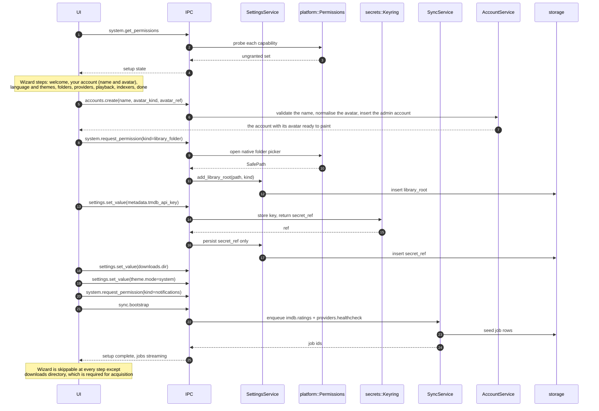

Rules: no permission is requested before the screen that explains it; a skipped step leaves the corresponding feature visibly disabled with a one-click "enable later" affordance rather than a silent failure. Nothing in the wizard blocks on network.

Tests: wizard resumability (kill mid-wizard, relaunch), missing keyring backend on Linux (falls back to an encrypted file with an explicit warning), permission revoked externally after setup (detected on next use and surfaced).

---

## F2 — Cold start and discovery hydration

Discover places search over the hero with a Movies / TV shows selector at the trailing edge. The `type` URL parameter selects a core-filtered rail and search projection; switching it does not fetch a fresh set of rails when the cache already holds a catalogue.

**The rails a launch draws come from `discover_rail`, the membership manifest a fetch writes whole** (`DATA_MODEL` §2.8): which titles each rail held, in that rail's order, with everything a rail *draws* read from the `title` row the list answer already wrote and the cached blob's path taken from the cache. A launch with a manifest draws the last fetch's rails and starts nothing — seven lists a provider publishes change on the provider's clock, not on the user's — and a launch without one enqueues the fetch, which is the same read-triggers-the-fetch rule below. What that enqueue is *not* conditional on is the credential read having finished: the read is blocking and runs off the startup path because a keychain can raise a prompt, so the fetch is enqueued and the job waits for the read rather than reporting a provider the user has as missing. `NoProvider` — "set a key up in Settings" — is answered only by a credential read that has finished.

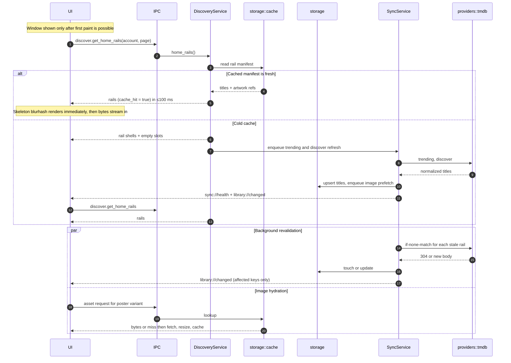

Why the UI never waits: the rail query reads only locally cached state and returns whatever exists. Network work is always a job whose completion invalidates cache keys. The blurhash is stored on the title row, so the very first paint has real colors — no grey boxes, no spinners.

Tests: cold-cache first paint under 100 ms with an empty DB (rail shells only), warm-cache first paint, offline cold start (empty state explains itself and offers retry), and a revalidation storm where 8 rails go stale simultaneously (must coalesce into one batched invalidation, not 8 refetches).

---

## F3 — Search

```mermaid
sequenceDiagram
    autonumber
    participant UI
    participant IPC
    participant Search as DiscoveryService
    participant FTS as storage::fts
    participant Sync as SyncService
    participant Provider as MetadataProvider

    UI->>IPC: discover.search(query, filters, cursor)
    IPC->>Search: search()

    alt Query matches an external id pattern
        Search->>FTS: external_id lookup
        FTS-->>Search: exact title
    else Local FTS
        Search->>FTS: MATCH prefix terms, bm25 + popularity
        FTS-->>Search: ranked rows with total count
    end
    Search-->>UI: local results in ≤50 ms p95
    Note over UI: Grid renders immediately; a remote row appears below if local is thin

    opt Local results are thin and the query has been stable for 250 ms
        Search->>Sync: enqueue search.remote with debounce key
        Sync->>Provider: search
        Provider-->>Sync: candidates
        Sync->>FTS: upsert as stub titles
        Sync-->>UI: library://changed search key
        UI->>IPC: discover.search(same query)
        Search-->>UI: merged results
    end
```

Rules: keystrokes never hit the network. The debounce key coalesces duplicates through the job dedupe index, so typing "breaking bad" one character at a time enqueues at most one remote search. Results are ranked locally, and the sort is stable across pages so keyset pagination cannot duplicate or skip a row.

Tests: property test that a query of 1–40 characters never panics or returns unordered results; a 100 k-title FTS bench (`SPIKE-5`); remote search failure leaves local results intact.

---

## F4 — Incremental metadata sync

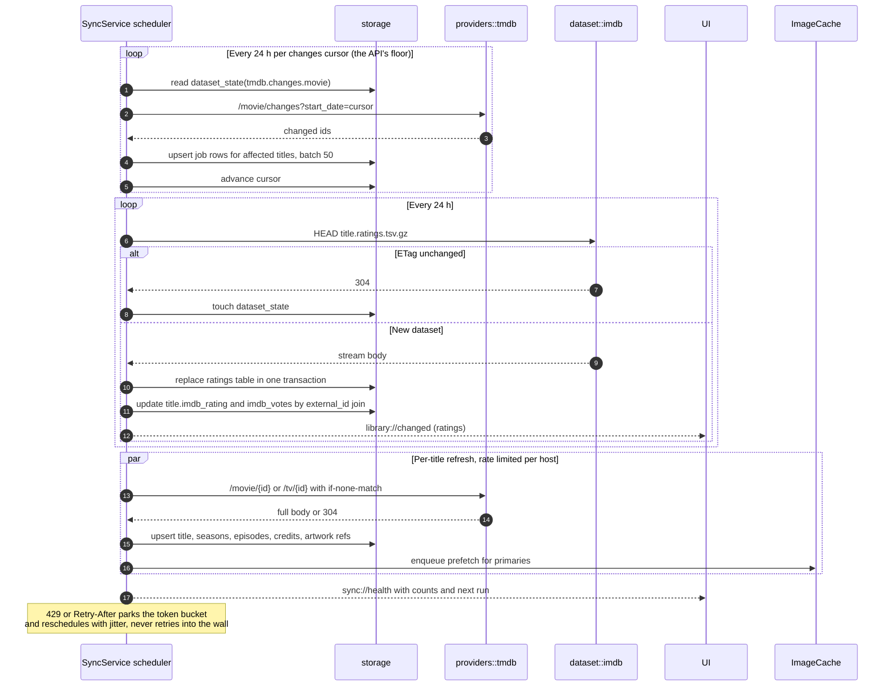

The cursor is persisted before the work is done, so a crash mid-window loses at most one window's worth of change detection, and the overlapping window (`start_date = cursor - 1 day`) makes that self-healing.

Tests: simulated 429 with `Retry-After`, provider 500 storm (circuit opens, health degrades, UI keeps serving cache), schema-drift fixture (unknown field, wrong type) must mark the row stale without losing the existing data, and a crash between cursor advance and title upsert.

---

## F5 — Release resolution and quality selection

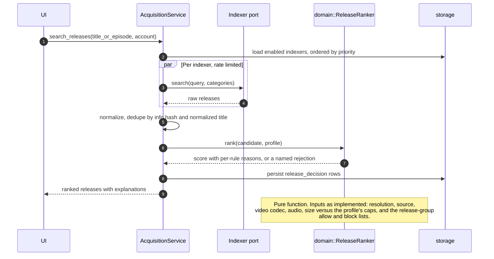

Ranking is a pure domain function so it can be property-tested and unit-tested exhaustively: monotonicity (a candidate the profile ranks higher on one criterion never scores lower), determinism (same inputs, same score, same reason order), and totality (every candidate comes back ranked or rejected, with no panic on any release name).

The score is an integer. A candidate loses one weighted step for each entry the profile's preference list ranks above the value it declares, and the weights are ordered resolution, source, video codec, audio, so one resolution step is worth more than every step below it combined. Size caps and the group rules gate rather than score: a candidate they refuse is a typed rejection naming the rule, never a low score, and it carries no reasons because scoring stopped at the first refusal. HDR, seeder count, and age are not scored yet — `QualityRules` has no input for them.

Auto-selection requires all of: the top candidate above the account's minimum score, seeders above the configured floor, size within caps, and the indexer healthy. Otherwise the UI presents the list.

---

## F6 — Acquisition with the safety gate

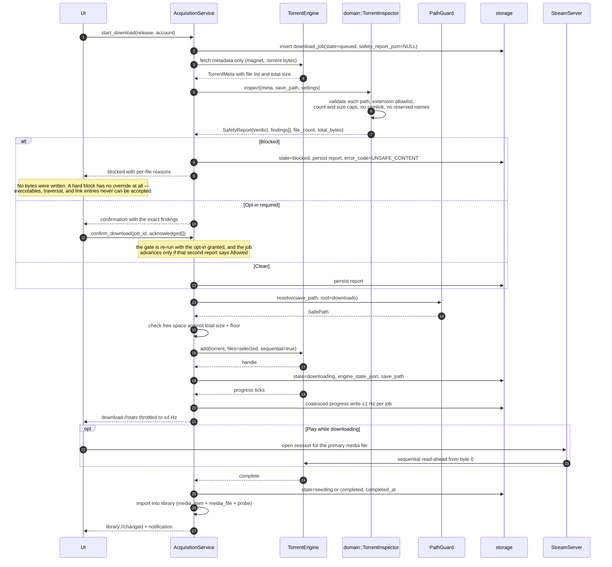

Critical ordering: **inspection precedes any byte written.** The engine is asked for metadata only; the file set is validated against the resolved `SafePath`; only then is the torrent handed over with an explicit file selection. The `SafetyReport` is persisted with the job so the UI can explain a block after a restart without re-fetching metadata.

Tests: hostile fixtures (traversal path, absolute path, `..%2f` encoded, symlink entry, Windows reserved name, unicode right-to-left spoofed `.exe`, 10 000-file torrent, 5 TB reported size, nested archive bomb), free-space boundary (exactly enough, one byte short), and an upgrade flow that keeps the old file until the new one is verified.

---

## F6.1 — Scheduled acquisition

An episode or title whose date has not arrived offers **Schedule** instead of Download. The request
is stored in `download_schedule` with the first date it may be fetched; a ticker on the app's own
thread runs once at startup and every five minutes.

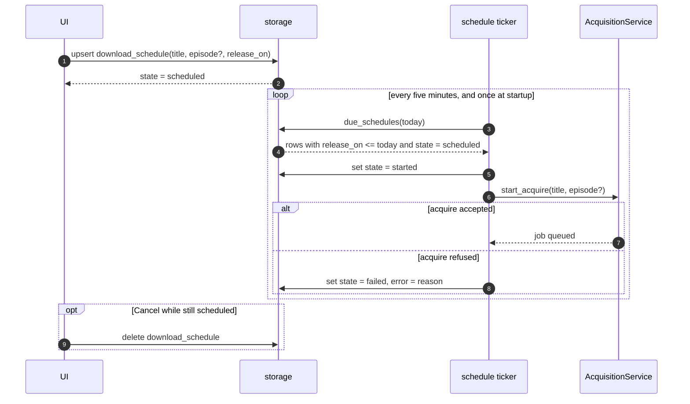

Three properties are deliberate. A due row is claimed **before** the acquire runs, so a tick that
overlaps another cannot start the same download twice. A failure is written on the row rather than
dropped, so the Scheduled list can say why nothing arrived. And a row already `started` is history,
not a retry: cancelling its job is the Transfer queue's Cancel, which is a different act from
deleting the request.

## F7 — Streaming playback

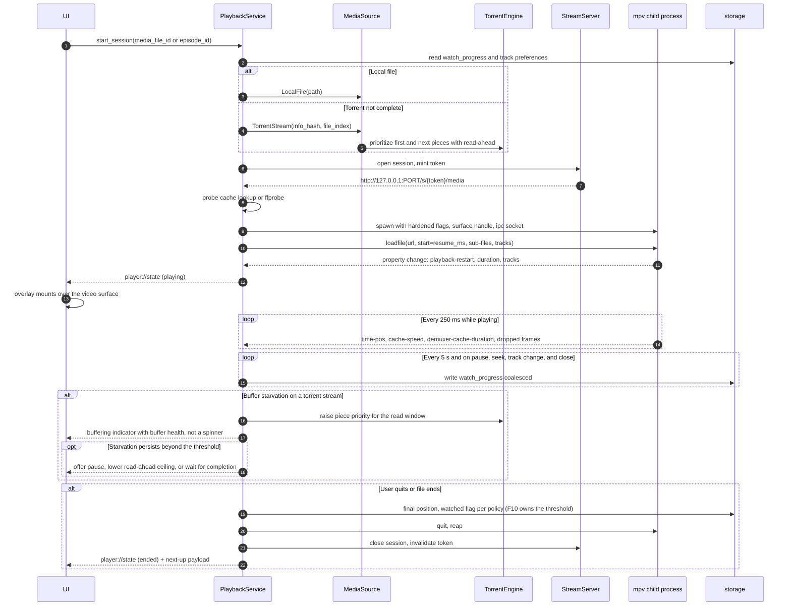

Both paths share one `MediaSource` abstraction, so resume, track selection, subtitle attachment, and progress reporting are implemented once. mpv runs with `--no-config` and a fixed flag set so a user's global mpv config cannot inject scripts into our session, and its video surface is attached per platform: `--wid` on Windows and X11, an app-positioned child window on macOS, and a documented degraded hand-off on Wayland ([adr/0013](./adr/0013-mpv-distribution-and-video-surface.md)).

### What 1.0 actually does, and how it differs

The diagram above is the target: an mpv session with tracks, resume, subtitles, progress, and next-up.
**What exists is the local-file path only, with the webview's own decoder as the player** ([adr/0023](./adr/0023-in-app-video-surface.md)),
and the differences are worth stating where the flow is, because they are what a reader will meet:

* **`PlaybackSession` replaces `PlaybackService` for now.** It opens the loopback listener for one file
  and answers two URLs; there is no probe, no resume, no track selection, and no `player://state` — the
  element's own events are the only state, and `watch_progress` is written by nobody.
* **The surface is a `<video>` element in the page, not an mpv child window.** So the container has to be
  one the platform's media stack demuxes: `peregrine_domain::LocalPlayback` answers that from the file's
  name before the press, and a title whose container needs mpv says so instead of going black.
* **The resume point is always the start.** `watch_progress` exists in storage and nothing writes it, so
  `start=resume_ms` has nothing to resume *from*.
* **A local file becomes its own poster.** When the core answers that a title has no poster to draw, the
  renderer captures a frame a tenth of the way in, posts it to the same listener, and the image cache
  keeps it under the title — so a freshly scanned folder of stubs has pictures before any provider is
  configured at all.

The torrent path, the mpv adapter, resume, tracks, subtitles, progress, and next-up are `PG-E16`'s and
`PG-E10`'s, unchanged.

Tests: resume at 2%, at 50%, at 99% (must not resume 3 s before credits), seek storm during buffering, mpv crash mid-playback (state becomes `failed`, app survives, retry resumes from the last known position), track selection persistence per show, and an EPIPE on the mpv IPC socket (treated as a crash, not a hang).

---

## F8 — Local library scan and match

```mermaid
sequenceDiagram
    autonumber
    participant UI
    participant Lib as LibraryService
    participant Scan as Scanner
    participant Parse as domain::LibraryName
    participant Probe as ProbeService
    participant DB as storage
    participant FF as ffprobe

    UI->>Lib: scan_library(roots, mode=incremental)
    Lib->>DB: insert job(library.scan)
    Lib->>Scan: walk roots with ignore rules
    Scan-->>Lib: candidate files with mtime and size

    Lib->>DB: skip files unchanged since last scan
    par Per file, bounded concurrency
        Lib->>Parse: parse(path text)
        Parse-->>Lib: LibraryName{title, year, season, episodes, absolute, numbering, extension, release} or NameError{name, reason}
        alt Confidence high
            Lib->>DB: match to existing title or create stub
        else Confidence low or ambiguous
            Lib->>DB: insert unmatched_file with suggestions
        end
        Lib->>Probe: probe(path)
        Probe->>FF: ffprobe -print_format json
        FF-->>Probe: streams and format
        Probe->>DB: cache by path + mtime + probe_version
    end

    Lib->>DB: reconcile media_item and media_file rows
    Lib->>DB: mark missing_since for absent paths
    Lib-->>UI: library://changed, unmatched count, storage delta
    Note over UI: Scan progress is a job; the UI stays fully interactive
```

Reconciliation never deletes watch progress or catalogue rows when a file disappears; it marks `missing_since` and keep the rows, so re-adding the file restores the item instead of recreating an orphan.

Tests: the parser half of the naming corpus is `crates/peregrine-domain/tests/library_corpus.rs` (PG-E4-04, 200+ names with expected parses, including anime absolute, multi-episode, season packs, year ambiguity, `S01E01E02`, `1x01`, `EP01`, `Season 1/01.mkv`, and the names it must refuse). The scanner half still owes sample files and extras folders, a file that changes size without changing mtime (hash fallback), a root that becomes unreachable (network volume), and 20 k files scanned within the time budget of `SPIKE-7`.

---

## F9 — Subtitle acquisition and live sync

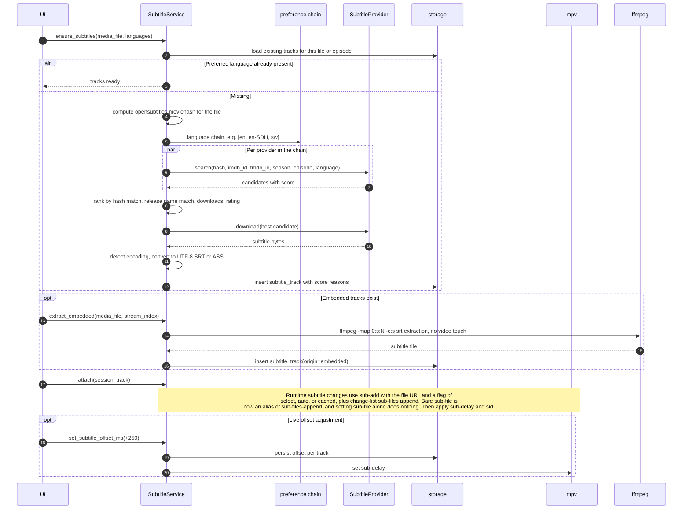

The provider chain, not the user, handles quota exhaustion: OpenSubtitles quota reached means the next provider in the chain is tried, and the UI only reports the fall-through when every provider fails. Per-title automatic fetching respects a "subtitles only for languages I watch" setting so a background scan cannot burn a provider quota on 2 000 files.

Tests: encoding matrix (UTF-8, UTF-8 BOM, CP1252, ISO-8859-1, Shift-JIS, UTF-16LE), ASS to SRT round-trip preserving italics, offset persistence across sessions, provider quota exhaustion fall-through, hash mismatch fallback to metadata scoring, and a 0-byte or HTML-error-body "subtitle" download rejected before persistence.

---

## F10 — Watch progress, resume, and next-up

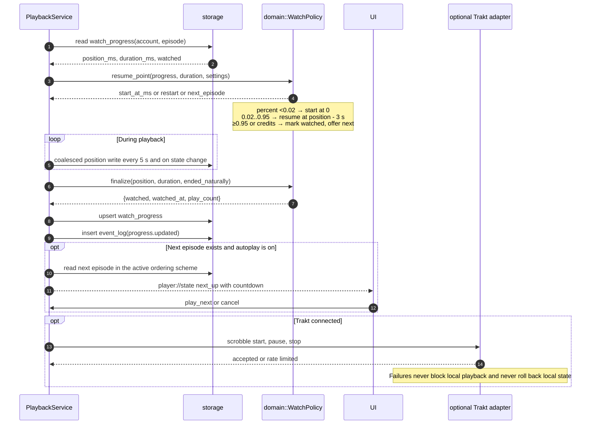

The watched policy is a pure function with the boundary cases pinned by tests: exactly at the threshold, a video shorter than the skip window, a manual "mark unwatched" that must survive the next finalize, and a re-watch that increments `play_count` without clearing `watched_at`.

**What the current build does.** A player session carries the episode id it opened, so `recordProgress` writes a row keyed to that episode and not to the title. The season read merges each episode's `watched` flag and fraction, which draws the bar under the still, marks the first unfinished episode **Next up**, and re-reads when the reader returns from the player. Settings carries the full history from the same rows. The autoplay-next countdown and the Trakt scrobbler in the diagram are still owed.

**The threshold above is the policy; the storage floor is lower, and they are not the same number.** The policy marks a title watched at ≥ 0.95, or when the credits are reached. The stored invariant, [DATA_MODEL](./DATA_MODEL.md) I6, is weaker on purpose: a row with `watched = 1` must carry `percent ≥ 0.92`, so that a manual mark and an imported mark — a Trakt row, or a user pressing "mark watched" at 93% — is representable without the database rejecting it. `0.95` is therefore what normal playback writes; `0.92` is the weakest row the database accepts. Neither number decides the other, and both boundaries are tested (`PG-E4-09` owns the policy's, `PG-E4-01` owns the invariant's). The continue-watching index band ends at 0.95 because a `watched = 0` row above it should not exist; the band is a query optimisation, not a rule.

---

## F11 — Casting session

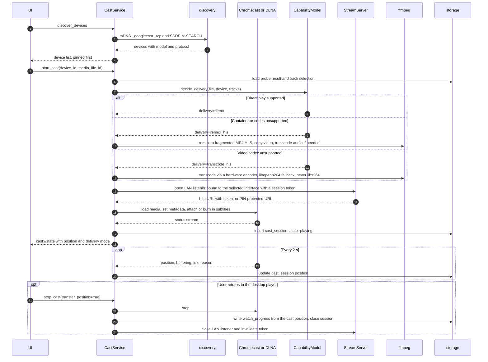

Casting is off by default. Turning it on binds a LAN listener, and the settings screen states plainly that any device on the same network could reach the token URL during a session, with a PIN option for shared networks. The listener is closed the moment the session ends — it is not a long-lived media server.

Tests: capability matrix fixtures per renderer class, remux decision correctness for MKV/H.265/AC3/DTS inputs, unsupported subtitle format paths (PGS must burn in), renderer disappearing mid-session, port conflict on the LAN bind, and the assertion that no LAN listener exists when casting has never been enabled.

---

## F12 — Deletion with confirmation

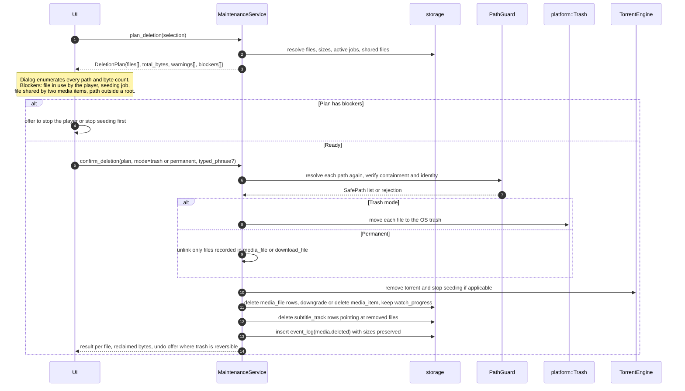

Deletion never cascades from a title to files unless the user explicitly selected "delete files" — removing something from the library and reclaiming disk are two distinct, separately confirmed actions.

Tests: path revalidation between plan and confirm (a symlink swapped in between must be refused), a file shared by two items (blocked with an explanation), a file currently playing, a seeding job (must be stopped first), trash unavailable on the filesystem (fall back to permanent with a distinct confirmation), and 500-file bulk deletion (progress job, cancelable, no partial DB state on cancel).

---

## F13 — Notifications, consent, and click routing

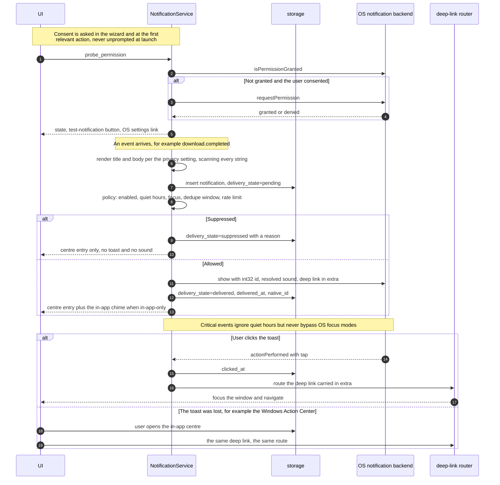

Invariants and tests for this flow:

- The centre entry is written **before** the OS call, so a crash between the two loses a toast and never the event. The copy is rendered — and therefore scanned — before the insert, because the row holds the same scanned text the toast carries.
- A notification is only shown with a listener registered; the handler is installed during startup, because the plugin neither displays nor reports actions without one, and notifications shown before it exists report nothing.
- The same deep link is reachable from the centre, so no capability depends on a toast being clicked. This matters on Windows, where a click is only reported while the toast is on screen.
- Sound-off is best-effort on Linux and Windows and the UI says so; the in-app chime is the only sound whose behaviour we control end to end.
- Tests: consent declined (the centre still works, no toast attempted); permission granted but delivery fails (state `failed` with an error, entry still present); quiet hours (non-critical suppressed with a reason, critical delivered); a burst of five completions (one summary toast, five centre entries); the window focused on the downloads screen (no toast); and a body that never contains a path, a magnet, an infohash, or an adult title.

---

## F14 — Monitoring and availability detection

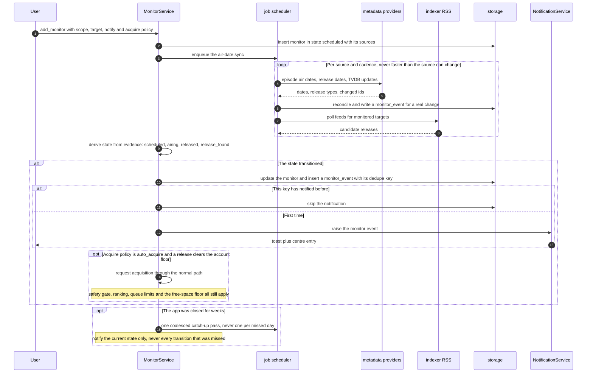

Invariants: the state only advances on recorded evidence, so an event-less transition is a test failure; the dedupe key is unique in the database, so a re-poll that re-derives the same state cannot notify twice; and a monitor in `paused`, `ended`, or `blackholed` costs no requests at all.

Tests: an air date that moves (one `air_date_moved` event, one notification, no duplicates on re-poll); a source that fails (state unchanged, `source_failed` recorded, no notification claiming availability); the app closed for a month (one catch-up pass, current state only); a release appearing before the air date (anime and early leaks must not be treated as an error); and a 20-monitor watchlist staying inside the documented request budget.

---

## F15 — MCP tool call with consent

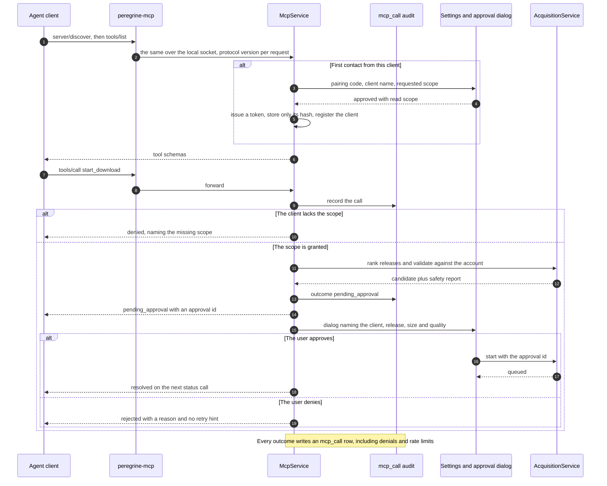

Invariants: a download cannot start without an approved request for the requesting client; every call is audited before it returns; results are size-capped and every externally sourced string is returned inside a labelled `untrusted` wrapper; and a revoked client fails its next call with a clear error rather than a silent no-op.

Tests: a poisonous title overview containing an instruction to download reaches the client as labelled data and cannot cause a download without a human click; a client with `read` only cannot call `start_download`; approving one request does not pre-approve the next; the audit log contains a row for all eight outcomes; and the HTTP transport rejects a mismatched protocol version and a non-loopback `Host`.

---

## F16 — Account switching, OS authentication, and content gating

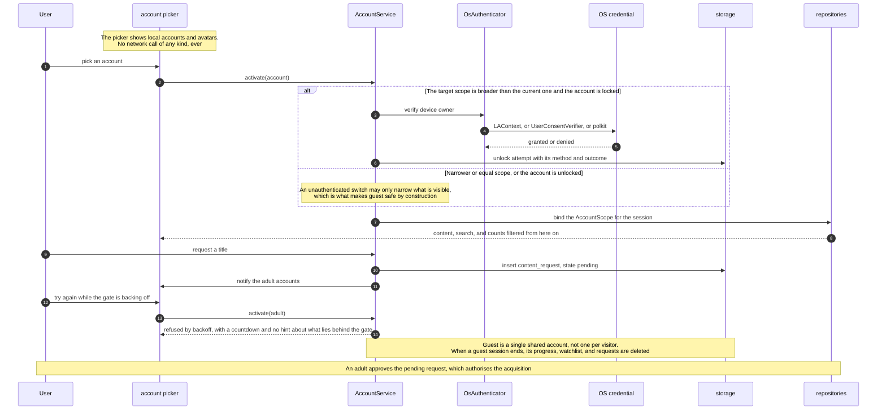

Invariants: an unauthenticated switch may only narrow the scope, so escaping into guest can never widen what a child sees; the scope is bound once at activation and never re-derived in the UI; blocked content is indistinguishable from absent content; a child account can never create a download job regardless of the request path; failures back off and are audited; and where no OS mechanism exists the account still works but the parent is told the gate is an app PIN.

Tests: every indirect leak path (suggestions, similar titles, counts, continue-watching, notification bodies, the media server, a hand-written MCP call) under a restricted scope; an unrated title hidden by default; a burst of failed unlocks; and switching to an adult account from the child account while the OS dialog is cancelled.

---

## State machines

### SM1 — Download job

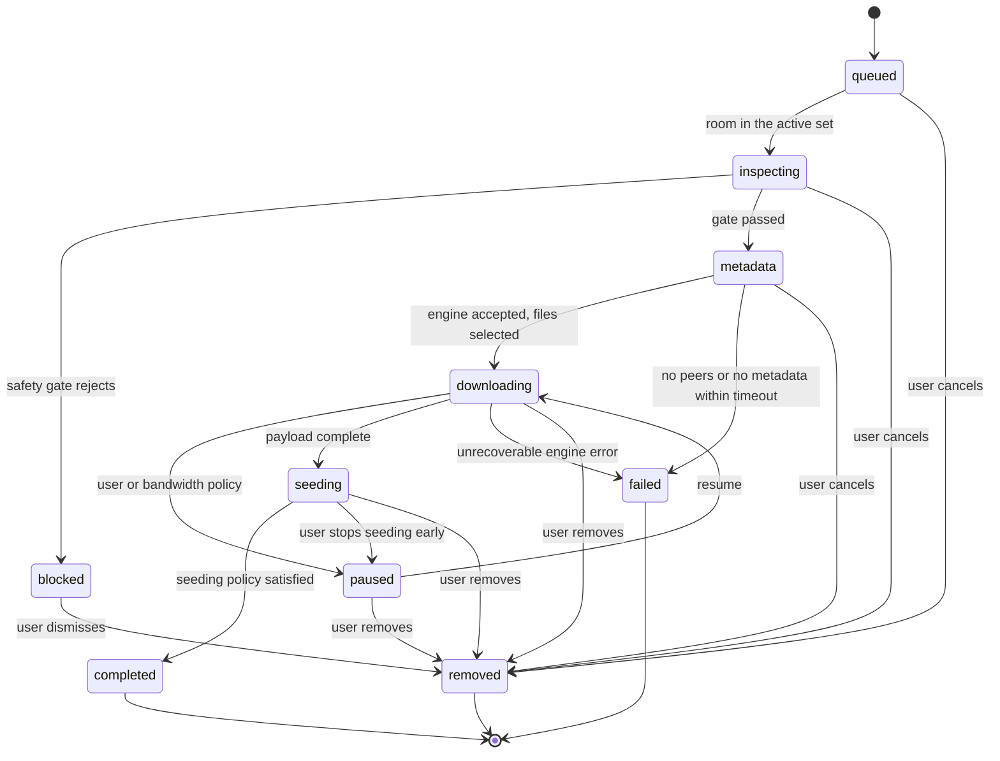

Terminal states: `completed`, `removed`, `failed`. Every state in which the engine is actually holding the torrent — `downloading`, `paused`, `seeding` — has a persisted `engine_state_json`, so a restart reattaches rather than restarting the transfer. The states before the engine has it (`queued`, `inspecting`, `metadata`, `blocked`) have none, which is F6's own order: the job row is inserted at `queued`, and the engine's state is written when it accepts the torrent. Progress writes are coalesced to at most 1 Hz per job.

A retry after a failure is **a new job, not an edge of this one**. `download_job_hash_uq` is unique over the live states, so a failed job vacates its infohash and the retry is inserted fresh with its own `safety_report_json`; that is deliberate, because re-inspecting the same torrent on a retry is how a gate gets skipped. `download::transition` therefore treats `failed` as absorbing, and the diagram above no longer draws a `failed --> queued` arrow it does not have.

`removed` is reachable from **every** non-terminal state, because a user has to be able to cancel a job they are still waiting for. Without the edges from `queued`, `inspecting`, and `metadata`, a job parked behind the active-set limit — which can be hours — has no way out, and a download manager that cannot cancel a queued download is not one. `download::transition` (PG-E4-11) implements all seven, `Event::download_edge` names each of them, and `a_job_can_be_removed_from_every_non_terminal_state` is the test that holds the row.

### SM2 — Media availability

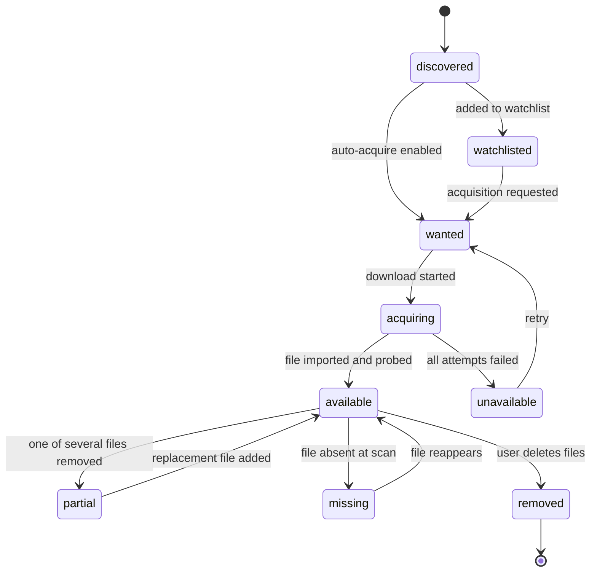

This state is what the poster overlays, badges, and the availability filter read. It is derived from `media_item`, the item's job set, and its file set (`availability::availability`, PG-E4-12) rather than read back out of the column it caches, and it is computed once per invalidation rather than per render. Evidence decides in a fixed order: a file row answers first (every row present `available`, some present `partial`, none present `missing`), because a present copy is playable whatever a transfer is doing; with no file row at all, a job that is not terminal answers `acquiring`; then the newest terminal job (`failed` is `unavailable`, `completed` with the rows gone is `removed`); then `media_item.state` as the record of what happened before; and last what was asked for. "Newest" is the greatest `(added_at, id)` the caller supplies, because the domain reads no clock, so the instant arrives as a value and the row id breaks a same-millisecond tie. Availability is a superset of `media_item.state`, which has no spelling for `missing`, `removed`, `acquiring`, `unavailable`, `discovered`, or `watchlisted` and collapses the last three of those with `wanted` into one `wanted`; the watchlist is title-scoped, so the state before a file or a job exists arrives as a parameter rather than being guessed from a row that does not record it.

### SM3 — Player session

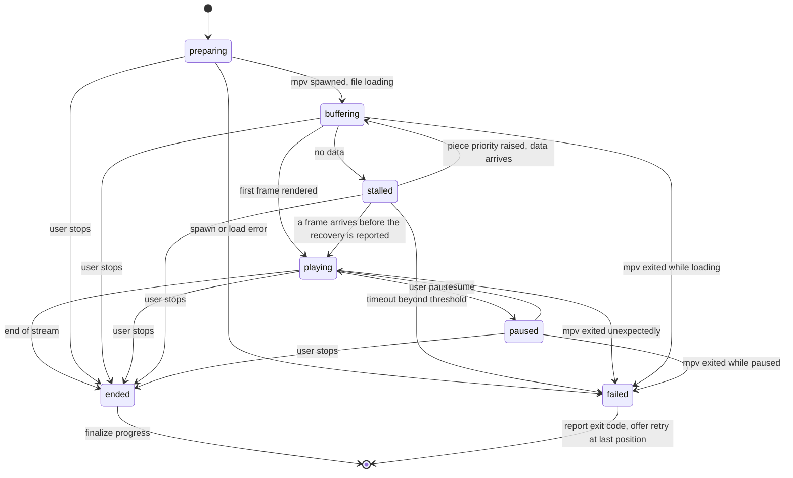

`playing` is only entered on the first rendered frame, which is what makes the "time to first frame" metric meaningful for torrent streams. Every transition out of a live state writes progress, so a crash at any point loses at most 5 seconds.

A stop reaches `ended` from **every** live state, because F7's "user quits" happens wherever the session is, and a torrent with no peers parks in `preparing` or `stalled` — a player that cannot be closed from there is not one. `ended` and `failed` are absorbing, so a duplicate stop, or an exit reported after the user closed the player and mpv was reaped, changes nothing rather than reinterpreting an ending that has already finalised progress. For the same reason `failed` is reachable from every live state: an mpv that dies is the same event whether it was loading, playing, or paused, and a session that could not report it would sit there with a dead child behind it.

A retry after a failure is **a new session, not an edge of the failed one**: the mpv process the failed session owned is gone, and the state it reached is history. The failed session keeps the position it last held, so the retry resumes there instead of at the start — and that position is also what the exit path hands to the watched policy.

Mid-playback starvation is not `stalled`. F7 shows a buffer-health indicator over a session that is still `playing`, and every progress write keys off `playing`, so leaving it would stop the writes exactly when the user is most likely to close the player. `stalled` is the load that produced no frame; a frame that arrives before the recovery is reported is stronger evidence that data arrived than the cache statistic is, and it is what leaves that state for `playing`.

`peregrine-domain::session` implements this machine (PG-E4-13): `Session::apply` is the only function that computes a next state, the legal cells are declared once and pinned by its tests, and a frame-rendered event is the only entry into `playing` from a session that has not played.

### SM4 — Job scheduler

```mermaid
stateDiagram-v2
    [*] --> queued
    queued --> running: worker acquired, resource token available
    running --> succeeded: completed
    running --> deferred: rate limit or retryable error
    running --> failed: non-retryable or attempts exhausted
    running --> canceled: cancellation requested
    deferred --> queued: backoff elapsed, tokens available
    succeeded --> [*]
    failed --> [*]
    canceled --> [*]
```

Resource acquisition happens before `running`, and a token is released on every exit path including panic (a guard type, tested with an injected panic). Terminal rows are excluded from the dedupe index, so a new request for the same work after a failure is not silently swallowed.
