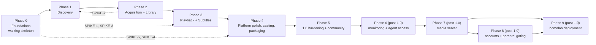

# Peregrine — Delivery Plan

Scope, sequencing, exit criteria, and the risk register. The granular backlog and [current implementation status](./TASKS.md#implementation-status) are in [TASKS.md](./TASKS.md); the architectural constraints that make the sequencing necessary are in [ARCHITECTURE.md](./ARCHITECTURE.md).

---

## 1. Delivery strategy

Four rules govern the order of work.

1. **Walking skeleton first.** Phase 0 ships a real, signed-if-unpolished app that opens a window, runs the scheduler, writes to SQLite, streams a log, and renders one themed screen. Every later phase is an increment on a working binary, never a big-bang integration.
2. **Vertical slices, not horizontal layers.** "Browse works end to end" (provider → cache → DB → IPC → grid → detail) lands before "all providers are implemented". A slice that is not demoable is not started.
3. **Contract before adapter.** The trait (`MetadataProvider`, `TorrentEngine`, `PlayerBackend`, `Indexer`) and its conformance tests exist before the first real adapter, so the second adapter is cheap and the fake used by other tests is trustworthy.
4. **The risky thing goes first.** Wayland video embedding, librqbit streaming behaviour, and Chromecast codec support are the three items that can invalidate a design. Their spikes are scheduled in Phase 0 and Phase 2, not discovered in Phase 4.

---

## 2. Phases and exit criteria

Effort is in ideal engineering days for one experienced Rust + React developer, excluding review latency. The calendar conversion factor used in §4 is 0.65.

### Phase 0 — Foundations (walking skeleton) · 118 ideal days · `v0.1.0`

| Deliverable | Detail |
| --- | --- |
| Repository | Cargo workspace, pnpm workspace, `xtask` with `check-arch` and `check-migrations`, CI running lint + test + build on all three OSes, commit conventions, PR template, CODEOWNERS |
| App shell | Tauri v2 app, per-OS window chrome, single instance, window state restore, graceful shutdown, tray stub |
| IPC | `specta` type export pipeline, command and event registration, structured `AppError`, event batcher with coalescing, generated TS client committed and CI-verified |
| Storage | SQLite open with the PRAGMA set, migration 0001 (settings, account, job, event_log), single-writer pool, integrity check on boot, backup-on-migration |
| Domain | Skeleton crate with `ExternalId`, `QualityProfile`, `ReleaseName` parser, `PathGuard`, and the clock and id ports, with their property tests |
| Observability | `tracing` with redaction filter, rotating file logs, log tail command, Diagnostics screen shell |
| Scheduler | Job queue with priority, dedupe, backoff, cancellation tokens, and an injected-panic test that proves token release |
| Theme | Token pipeline, three shipped themes plus system, theme runtime that swaps without re-render |
| Notifications | Consent step in the wizard, `NotificationService` with the event catalogue and per-event sound, in-app centre as the authoritative record, click routing, and per-OS sound behaviour verified by SPIKE-11 |
| Spikes | SPIKE-1 (mpv embedding), SPIKE-3 (librqbit streaming), SPIKE-4 (placeholder format), SPIKE-11 (notification sound and delivery per OS) — written outcomes appended to the ADRs |

**Exit criteria:** the packaged app launches on macOS, Windows, and Linux; a theme switch is instant; a "hello" job runs through the scheduler with visible progress; logs tail in Diagnostics; `xtask check-arch` fails on a deliberately illegal dependency in a test fixture; CI is green on all three OSes; and a completed download raises exactly one notification, with sound when enabled, that routes to the title when clicked and is also present in the in-app centre.

### Phase 1 — Discovery · 135 ideal days · `v0.2.0`

| Deliverable | Detail |
| --- | --- |
| Providers | `MetadataProvider` trait + conformance suite, TMDB adapter complete, OMDb fallback, TVDB optional, provider registry manifest |
| Matching | Title matching and normalization (external ID resolution, alias handling, anime subtype detection) |
| Sync | Job-based incremental sync, TMDB `/changes` cursors, ETag revalidation, token buckets, provider health |
| Ratings | IMDb ratings ingestion (8.7 MB compressed, ~45 MB in SQLite), daily refresh, joined to titles through the IMDb id already captured from TMDB `external_ids`, with disk budget accounting. Bulk `title.basics` import is deliberately **not** part of the design |
| Images | Content-addressed image cache with variants, LRU eviction, blurhash generation, asset protocol wiring |
| Discovery UI | Discover rails, hero, browse grid with the full filter surface, virtualization at 5 000 items, saved smart collections |
| Search | FTS5 index, ranking, debounced remote enrichment, command palette |
| Detail | Title page: hero, overview, cast, genres, availability, actions, trailer in a sandboxed child webview |
| Episodes | Season and episode model with the ordering overlay, season selector, episode list with stills and air dates |
| Watchlist | Add, remove, reorder, optimistic UI |

**Exit criteria:** cold start to an interactive Discover screen under budget; browse and search usable with the network unplugged; a 5 000-title library maintains 60 fps while scrolling; every provider failure mode in §15 of the architecture is exercised by a test; the detail page renders a show's full season structure from cache.

### Phase 2 — Acquisition and library · 146 ideal days · `v0.3.0`

| Deliverable | Detail |
| --- | --- |
| Torrent engine | `TorrentEngine` trait, librqbit adapter, session lifecycle, restart reattachment, limits and caps |
| Safety gate | `TorrentInspector` with the full hostile fixture suite, persisted `SafetyReport`, blocked and warned UI paths |
| Indexers | `Indexer` trait, Prowlarr and Jackett adapters, local `.torrent` and magnet ingest, built-in providers present but disabled with no bundled default domain list |
| Ranking | Pure `ReleaseRanker`, quality profiles, `release_decision` audit trail, auto-selection rules |
| Queue | Downloads screen: active, queued, seeding, completed, failed; per-card progress ring; global and per-job limits; bandwidth policy |
| Library scan | Scanner, name parser, probe pipeline, reconciliation, `missing_since` handling, unmatched review UI with manual matching |
| Deletion | `DeletionPlan`, blockers, trash-first deletion, confirmation UX, storage usage screen |
| Import | Completed download → library import with quality labelling and upgrade handling |

**Exit criteria:** a magnet from a local seeder downloads, streams, imports, and plays; every hostile fixture is blocked with no bytes written; a 20 k-file library scans within budget and can be fully managed; deletion is reversible through the OS trash wherever the platform supports it.

### Phase 3 — Playback and subtitles · 66 ideal days · `v0.4.0`

| Deliverable | Detail |
| --- | --- |
| Player | `PlayerBackend` trait + fake conformance, mpv adapter, per-platform video surface ([ADR 0013](./adr/0013-mpv-distribution-and-video-surface.md)), Wayland hand-off path, hardened flags |
| Sources | `MediaSource` for local file and torrent stream, sequential read-ahead policy, buffer-health reporting |
| Session | Player state machine, overlay UI, keyboard and shortcut model, track and audio device selection, playback speed, next-up countdown |
| Progress | Watch progress, resume policy, Continue Watching rail, per-episode progress, mark watched/unwatched, history |
| Subtitles | `SubtitleProvider` trait, OpenSubtitles adapter with hash matching, fallback chain, encoding detection and conversion, embedded extraction, on-player search and offset control |
| Language | Preference chain, per-show overrides, audio and subtitle language memory |
| Diagnostics | Player telemetry (dropped frames, decoder, hw path), buffering detail, provider health |

**Exit criteria:** resume is correct at every boundary case; playback of a torrent stream survives a stall, an mpv crash, and a network flap; subtitles can be found, attached, offset, and remembered for a show; a full season can be watched back-to-back without a single UI stall.

### Phase 4 — Platform and distribution · 97 ideal days core, 135 with casting, 327 at the full quality bar · `v0.5.0` → `v0.9.0`

| Deliverable | Detail |
| --- | --- |
| Motion system | Token-driven transitions, shared-element poster-to-detail, rail choreography, reduced-motion paths, frame-time budget gate in CI |
| Casting | Device discovery, capability model, Chromecast and DLNA adapters, HLS remux and transcode pipeline, LAN server hardening, session transfer |
| Settings | Full registry-driven settings surface: general, appearance, playback, subtitles and language, torrent and network, indexers, storage, advanced, diagnostics |
| Permissions | First-run wizard, per-permission explanations, revocation detection, macOS entitlements, Linux Flatpak portal story |
| Platform integration | Tray and keep-seeding, dock/taskbar progress, notifications, deep links, autostart, open-with, badges |
| Packaging | Signed and notarized macOS, signed Windows, AppImage/deb/rpm/Flatpak, sidecar bundling with licence files, SBOM, updater with channels and rollback |
| Accessibility | Full keyboard operability, screen-reader labels for the grid and player, high contrast, focus visibility, hit-target audit |
| i18n | Message extraction, RTL layout correctness, locale-aware dates and numbers, translator documentation |
| Hardening | Dependency audit gates, fuzz targets for parsers, soak and chaos runs, security review pass against [SECURITY.md](../SECURITY.md) |

**Exit criteria:** installers under budget on every platform, auto-update verified from the previous release, a 72 h soak with downloads and playback shows no memory or descriptor growth, the accessibility audit passes, and the casting pipeline handles the codec matrix with documented limitations.

### Phase 5 — 1.0 hardening and community · 15 ideal days core, 58 full · `v1.0.0`

| Deliverable | Detail |
| --- | --- |
| Multi-account | account-scoped watch state, watchlist, and library visibility; account switch without restart |
| Progress sync | Trakt device OAuth, conflict resolution, offline queue |
| Automation | Watchlist auto-acquire, scheduled searches, new-episode detection and notification, RSS ingest |
| Extensibility docs | Provider and indexer authoring guide, conformance suite documentation |
| Documentation | README, architecture docs kept current, troubleshooting guide, FAQ, contributing rules |
| Release engineering | Release checklist, changelog automation, issue triage templates, security policy, support matrix |
| Performance | Final budget pass on mid-tier hardware per OS, regression benches locked |

**Exit criteria:** the 1.0 release checklist in §6 passes on a clean machine per OS; documentation lets a new contributor add a metadata provider without asking a maintainer; no known data-loss or security defect is open.

### Phase 6 — Roadmap: monitoring and agent access · 66 ideal days · `v1.1.0`–`v1.2.0`

Committed roadmap, tracked separately and **excluded from the 1.0 figures**. Both features are specified in full: [adr/0016](./adr/0016-monitoring-and-availability.md) and [adr/0017](./adr/0017-mcp-server.md).

`v1.1.0` — Monitoring (E30, 10 tasks, ~29 ideal days):

| Deliverable | Detail |
| --- | --- |
| Monitors | Scoped watches (movie, show, season, episode) with the availability state machine, per-target sources, notify and acquire policy, and a durable evidence log |
| Detection | Air dates from TMDB, incremental updates from TVDB, release-window tracking by release type, and availability from indexer feeds against the account floor |
| Notifications | Five events wired into the existing catalogue, with an evening digest for aired episodes so a 20-show watchlist is not a metronome |
| Calendar | Month and week views plus the three lists that make gaps visible: aired but not in the library, below the quality cutoff, and waiting longer than expected |
| Discipline | No source polled faster than it can change; monitors enqueue jobs into the existing scheduler rather than running their own; auto-acquire stays opt-in and still passes the safety gate |

`v1.2.0` — Agent access (E31, 12 tasks, ~37 ideal days):

| Deliverable | Detail |
| --- | --- |
| MCP server | Off by default; stdio sidecar first, optional loopback Streamable HTTP; revision `2026-07-28` negotiated per request |
| Tools | Read-first catalogue across catalogue, library, queue, watchlist, monitors, and progress, with library-relative identifiers only |
| Consent | Two-phase approval for `start_download`, with per-title and per-session remembers that expire, resolved in the app window naming the requesting client |
| Identity | Paired clients, named, scoped, revocable; `read` is the only default scope |
| Audit | Every call recorded with a redacted argument summary and a filterable activity view |
| Safety | Untrusted content labelled as data, size-capped results, per-client rate limits, and a permanent prompt-injection test proving content alone cannot trigger a download |

**Exit criteria:** a monitor added today notifies exactly once when the episode airs and exactly once when a release meets the account; a month offline produces one catch-up pass and one current-state notification; a paired agent can search the library and request a download, and that download does not start until a human clicks approve; revoking the client stops the next call; and disabling agent access leaves no listening socket on any interface.

### Phase 7 — Roadmap: media server · ~90 ideal days · `v1.3.0`–`v1.5.0`

Committed roadmap, tracked separately and **excluded from the 1.0 figures**. The analysis, the four integration shapes, and what we refuse are in [adr/0018](./adr/0018-media-server.md). **v1.3 is the active sub-phase and is broken down as E32 (12 tasks, 39 ideal days). v1.4 and v1.5 are scoped but not yet broken down.** Remote access is out of scope: LAN only, VPN for remote.

`v1.3.0` — Sharing and DLNA (~39 ideal days) · E32, active

| Deliverable | Detail |
| --- | --- |
| Scan-friendly export | A library tree in the conventions Jellyfin and Plex both read: `Movie Name (2005) [imdbid-tt…]`, `Season 01/S01E01`, NFO sidecars from our normalized metadata, local artwork at the filenames they look for, and external subtitle suffixes |
| Disk discipline | Hardlinks when the share is on the same filesystem, copy otherwise, with the cost stated before the user commits and a verifiable manifest so the share is a job rather than a script |
| Placeholders | Optional `.disc` files so a monitored title exists in Jellyfin before it is on disk |
| DLNA server | SSDP announce, `ContentDirectory` Browse with DIDL-Lite, over the existing range-capable HTTP server — reuse, not a second streaming stack |
| Wi-Fi-first networking | Interface selection with detected LAN addresses, mDNS as the dependable discovery path, QR and short-URL pairing always available, and copy that names access-point isolation when a client cannot reach us |

`v1.4.0` — Jellyfin-compatible API and headless service (~30 ideal days)

| Deliverable | Detail |
| --- | --- |
| Headless mode | `peregrine-server`: the same core with no GUI, installed as a launchd agent, systemd unit, or Windows service, with a local config and a status endpoint |
| API subset | `System/Info`, authentication, `Items` browse and detail, `Items/{id}/PlaybackInfo`, images, and the stream endpoints with Range — enough for a real client to browse and press play |
| Delivery decisions | Direct play, remux, or transcode, decided from the measured link budget and the client's declared capabilities |
| Security | Per-device tokens, library scoping, audit, rate limits, LAN-only default, and a documented reverse-proxy path for TLS |

`v1.5.0` — Client mode (~21 ideal days)

| Deliverable | Detail |
| --- | --- |
| Consume a server | Browse and play an existing Jellyfin or Plex library through mpv, with progress written back to that server |
| Unified sources | Local library, torrent-derived library, and remote servers behind one source model so search and play behave the same |

**Exit criteria:** `SPIKE-14` shows a real Jellyfin and a real Plex install picking up the exported tree with correct metadata, artwork, and subtitles and no manual matching; `SPIKE-15` shows two real Jellyfin clients browsing and playing from the API subset; `SPIKE-16` has measured where 4K direct play stops working over 2.4 GHz and 5 GHz, and those numbers are the shipped thresholds; and no configuration in the server mode binds a WAN address.

### Phase 8 — Roadmap: local accounts and parental gating · 43 ideal days · `v1.6.0`

Committed roadmap, excluded from the 1.0 figures, specified in [adr/0019](./adr/0019-local-accounts-and-parental-gating.md). The only part pulled into 1.0 is the `AccountScope` seam in the repository layer, because gating retrofitted onto a finished read path is the expensive version of this feature.

| Deliverable | Detail |
| --- | --- |
| Accounts | Several people, one installation: independent watch state, watchlist, and continue-watching. Each account is made with a name and an avatar — an original built-in mark, generated initials, a photo from disk, or the generic default — and chosen from a picker |
| Guest | Exactly one shared account named Guest, created once, unrenameable, with the generic avatar: no history retained, no capabilities, no gate, and a scope that can never exceed the current account's without authenticating |
| Curation | A parent sets a rating ceiling and curates a collection; unrated content is hidden by default and can be allowed explicitly |
| Gating | Content scope lives in the query layer and fails closed; blocked content is indistinguishable from absent content everywhere, including counts and suggestions |
| Child account | Cannot acquire, cannot delete, cannot change settings, cannot see the queue, cannot grant an agent access — enforced in the services, not the UI |
| Requests | A child asks, an adult approves, and the approval is what authorises the acquisition; the child sees the parent's reason when refused |
| Switching | Both directions gated by the OS credential where one exists: Touch ID or the device password on macOS, Windows Hello on Windows, polkit or fprintd on Linux, with an app PIN as a documented fallback |
| Honesty | The parental settings state once that this stops account switching in Peregrine but does not protect files on a shared OS login; separate OS accounts are the real separation |

**Exit criteria:** `SPIKE-17` confirms each OS mechanism on real hardware, including the case where none exists; `SPIKE-18`'s leak suite passes with every indirect path covered and is permanent; a child account cannot create a download job through any route; and a denied switch leaves the child account active with no hint about what was behind the gate.

### Phase 9 — Roadmap: homelab deployment · 56 ideal days written (E36) · `v2.0.0`

Committed roadmap, excluded from the 1.0 figures, specified in [adr/0020](./adr/0020-homelab-deployment.md). Homelab support is the headless daemon that Phase 7 v1.4 already requires, made installable and operable on a machine with no display. The target is the four deployment patterns in that record rather than a list of distributions: **OCI with Compose** (Debian, Ubuntu Server, OpenMediaVault, TrueNAS SCALE, Unraid, umbrelOS, CasaOS), **Podman under systemd** (Fedora Server and CoreOS), **a guest on a hypervisor** (Proxmox VE, XCP-ng), and **Nix** (NixOS). **v2.0 is the active sub-phase and is broken down as E36 (17 tasks, 56 ideal days). E37 (browser console) and the App Store submission are scoped but not yet broken down.**

`v2.0.0` — Deployment (~56 ideal days) · E36, active

| Deliverable | Detail |
| --- | --- |
| Deployment configuration | One config file plus a documented environment overlay: state root, media and download roots, port, bind interfaces, `PUID`/`PGID`, and log level. Precedence stated once and validated at startup, with every failure naming the value that is wrong |
| Secrets without a keyring | An explicit backend selection — keyring, owner-only file, or environment — with no silent fallback to the weakest option, and plain wording about what a file-backed store does and does not protect |
| Container image | glibc-based, `amd64` and `arm64`, non-root with `PUID`/`PGID`, one state directory, one injected port, an unauthenticated health endpoint, and grace-period shutdown that drains jobs and closes the torrent session |
| Platform packaging | Generated from one metadata source rather than hand-written per host: the image labels, the Compose file, the Quadlet/systemd unit, the umbrelOS package, the Unraid template, the CasaOS descriptor, and the NixOS module defaults |
| GPU transcode | `/dev/dri` and the render group passed through when present, the capability detected and shown per host, and an honest fallback when a host has no usable encoder ([adr/0018](./adr/0018-media-server.md) §5) |
| Desktop as a client | A "connect to a server" mode in the existing GUI, bridging the same IPC surface to a remote daemon over the LAN instead of inventing a second client |
| NixOS | A derivation plus a NixOS module: user and group, state directory, hardened systemd unit, and a firewall rule for the configured port only. `nix-ld` and `appimage-run` documented for the desktop build as a community path, not a supported artifact |
| Hypervisors and NAS hosts | Proxmox VE as an unprivileged LXC container or a VM, XCP-ng as a guest, TrueNAS SCALE datasets and ACLs, and OpenMediaVault's Compose plugin — each with the warning that the container runtime does not belong on a hypervisor host |
| Honesty in the UI | Read-only media roots reported before an operation depends on them, unavailable actions named rather than failing mid-job, and desktop-only features (per-OS notifications, tray, trash-based delete) stated as absent rather than silently inert |

**Exit criteria:** `SPIKE-19` installs the image on a real umbrelOS host, a real Unraid host, a Proxmox unprivileged LXC container, and a TrueNAS SCALE host, through the platform's own UI where one exists, with no SSH afterwards, and records volume ownership, ZFS ACL behaviour, GPU transcode, state across an update, the no-keyring case, and a clean stop inside the platform timeout; the NixOS module starts the daemon on a clean host with the state directory created and only the configured port opened; the same state root, port, and media root behave identically through the config file, the environment overlay, Compose, and the module; `xtask check-notices` passes against the image's contents; and disabling the server leaves no listening socket on any interface.

---

## 3. Milestone dependency rationale

| Ordering decision | Why it cannot move earlier or later |
| --- | --- |
| Storage and scheduler before any provider | Every provider result is cached and every fetch is a job. Building providers first means rewriting them once the job model lands. |
| Discovery before acquisition | Acquisition UI needs the title model, artwork, and episode structure to attach jobs to. Without discovery, the queue has nothing to show. |
| Safety gate before the engine adapter is wired to the UI | Once a "download" button exists, the gate is the only thing between a hostile torrent and disk. Shipping the button first creates pressure to skip the gate. |
| Library scan after acquisition | Import from a completed download is the easy path and it validates `media_item`/`media_file` before the messier scan and reconcile path. Both write the same tables. |
| Playback after acquisition | Streaming playback needs sequential read-ahead, which needs the engine. Local-only playback could come earlier, but building the source abstraction twice is waste. |
| Casting last among features | It depends on probe, player track selection, subtitles, and the HTTP server — all of which exist by then — and it is the feature with the highest chance of a documented limitation instead of full parity. |
| Monitoring after 1.0 | It multiplies the notification, scheduler, and acquisition surfaces that must already be stable, and its value depends on a library that exists. Building it earlier would put long-lived persisted state on top of an unfinished schema |
| Homelab deployment after the media server, not alongside it | A container is a delivery mechanism for a program, and the program it delivers is the headless `peregrine-server` from [adr/0018](./adr/0018-media-server.md) §3. Health checks, port injection, bind-interface selection, and a graceful stop cannot be packaged or tested before that mode exists, so the image would be guessing at an interface |
| | Polish and motion before 1.0, not after | Motion, focus behaviour, and platform chrome change component structure. Retrofitting animation onto a finished UI is how apps end up feeling like websites. |

---

## 4. Effort model

The phase figures below are the previous **critical-path** estimate for a usable, shippable app. They have not yet been re-estimated to include PG-E0-19 (runtime integration) and PG-E3-19 (schema correction); the full backlog total includes both. TASKS.md does not currently tag individual tasks as core versus full scope, so the core subtotal is a planning baseline rather than a mechanically checked roll-up. They exclude quality breadth (casting, full i18n, an accessibility audit, soak and chaos programmes, fuzzing programmes, per-OS package breadth, portable mode, multi-account, collections) that the full backlog also prices.

| Phase | Ideal days (midpoint) | Reasonable band | Cumulative |
| --- | --- | --- | --- |
| 0 Foundations | 118 | 100–136 | 118 |
| 1 Discovery | 135 | 115–155 | 253 |
| 2 Acquisition and library | 146 | 124–168 | 399 |
| 3 Playback and subtitles | 66 | 56–76 | 465 |
| 4 Platform and distribution (casting excluded) | 97 | 82–112 | 562 |
| 5 Hardening and community | 15 | 12–17 | 577 |
| **Subtotal, critical path** | **577** | 490–663 | |
| Contingency for integration, unknowns, and review | +30% | | |
| **Core 1.0, budgeted** | **≈ 750** | 638–860 | |

| Scope | Tasks | Ideal days | Content |
| --- | --- | --- | --- |
| Core 1.0 | 225 | ≈ 750 budgeted | Discovery, acquisition with the safety gate, library, playback with subtitles and resume, notifications with consent, signed installers and updates |
| Full quality bar | 474 | ≈ 1 120 | Everything in TASKS.md, including casting, full i18n, an accessibility audit, soak and chaos programmes, per-OS package breadth, accounts, Trakt |

The Phase 6 roadmap in §2 is **not** in these figures: monitoring and agent access add 22 tasks and ~66 ideal days on top, the media server adds roughly 90 more, accounts with parental gating add 43, and homelab deployment adds 56, all tracked separately so the 1.0 numbers keep their meaning.

Calendar conversion. An "ideal day" is focused, uninterrupted work. A realistic full-time developer delivers about four effective days per week across a year once interruptions, review, debugging, and learning are counted, so budget **≈ 200 effective days per person-year**.

| Team | Core 1.0 (≈ 750 ideal days) | Full quality bar (≈ 1 120 ideal days) |
| --- | --- | --- |
| Solo, part-time (≈ 90 effective days/year) | ≈ 8.3 years | not viable |
| Solo, full-time (≈ 200 effective days/year) | ≈ 3.8 years | ≈ 5.6 years |
| Two developers, full-time | ≈ 1.9 years | ≈ 2.8 years |
| Three developers, full-time | ≈ 1.3 years | ≈ 1.9 years |

These numbers are uncomfortable and they are the honest bottom-up result. Perspective on why: comparable open-source media clients are 80 000–150 000 lines of production code, and this scope spans torrent engine integration, a piece-scheduling streaming layer, a playback stack, a scraper with incremental sync, a library manager with filename matching, casting, and three platforms' packaging and signing. Any estimate of a few months for this describes a demo, not a release.

What actually shrinks the number, in order of leverage:

1. **Cut the platforms for 1.0.** macOS plus Linux X11 first; Windows and Wayland in 1.1. This removes a large share of Phase 4 and roughly a quarter of every other phase.
2. **Keep casting out of 1.0.** It is the most expensive feature per unit of user value here and has the highest chance of shipping with documented limitations.
3. **Defer i18n and the accessibility audit to 1.1.** Keep keyboard operability and correct semantics from the start, because retrofitting those is expensive; translating and auditing can wait.
4. **Ship manual release selection before quality profiles with upgrade automation.** The queue is essential; automated upgrade churn is not.
5. **Do not cut Phase 0, the safety gate, or the test infrastructure.** Those are why the result is trustworthy rather than merely finished.

Re-baseline after Phase 0 with measured velocity: if its 58 core tasks take materially longer than 118 ideal days, scale the later phases by the observed factor instead of quietly dropping quality.

These are planning figures, not commitments. The risk register below is the honest counterweight.

---

## 5. Risk register

| ID | Risk | Likelihood | Impact | Mitigation | Early warning trigger |
| --- | --- | --- | --- | --- | --- |
| R1 | mpv cannot embed acceptably on Wayland | High | High | SPIKE-1 in Phase 0; ship a documented fallback (separate always-on-top surface with overlay handoff) rather than blocking Linux support | Spike shows tear-out or focus loss that cannot be worked around |
| R2 | librqbit lacks a capability we need (per-file read-ahead control, interface or proxy binding, clean shutdown) | Medium | High | `TorrentEngine` trait keeps the door open for a libtorrent-based adapter; SPIKE-3 in Phase 0 | Spike cannot express a read-ahead window or a proxy bind |
| R3 | Provider terms or quotas make a feature impractical (IMDb dataset redistribution, TMDB image caching, subtitle quotas) | Medium | Medium | Ratings are downloaded by the user, never redistributed; images cached locally only; subtitle fallback chain across providers | A provider changes terms or rate limits mid-build |
| R4 | Legal exposure from indexer integrations | Medium | High | Indexers are user-configured, built-ins ship disabled, no content is hosted or indexed by the project, README states the position, and only documented APIs are used | Any request to bundle or enable a public indexer by default |
| R5 | Scope creep in Phase 2 (acquisition attracts features) | High | Medium | Phase exit criteria are the gate; anything not listed moves to the post-1.0 list in §7 | New acquisition features proposed during Phase 2 |
| R6 | Cross-platform packaging drags (notarization, SmartScreen, Flatpak portals) | High | Medium | Start packaging in Phase 0, not Phase 4; keep a signed build per commit on a nightly channel | First signed build attempt revealing entitlement problems |
| R7 | SQLite write contention with an aggressive download queue | Medium | Medium | Single-writer channel, coalesced progress writes, WAL, and a load test in Phase 2 that runs 20 concurrent jobs | Any `SQLITE_BUSY` in a soak run |
| R8 | Performance regressions accumulate invisibly | Medium | Medium | Budgets in CI from Phase 0, benches for hot paths, frame-time assertions in E2E | A budget gate fails twice in a row |
| R9 | Solo-maintainer bus factor and review fatigue | High | Medium | ADRs, conformance suites, and task-level acceptance criteria so context survives a pause; small PRs | A module with no test coverage that nobody wants to touch |
| R10 | Webview rendering differences on Linux WebKitGTK | Medium | Medium | Linux-specific font stack and effect budgets, visual regression check per OS in release checklist | Layout divergence found late in Phase 4 |
| R11 | Subtitle provider anti-automation measures | Medium | Low | Fallback chain, per-title policy, clear quota surfacing, no scraping beyond documented APIs | Quota or block encountered in normal use |
| R12 | Update mechanism bricking installs | Low | High | Signed manifests, staged rollout on beta, previous bundle retained, manual download link in the release notes | Any rollback report |

---

## 6. 1.0 release checklist

| Gate | Criterion |
| --- | --- |
| Build | Clean build on each OS from a fresh clone with locked dependencies, no warnings in CI (`-D warnings`), `cargo-deny` clean |
| Tests | Domain coverage ≥ 95%, storage ≥ 90%, providers ≥ 80% with fixtures, UI components ≥ 70%, all critical E2E flows green |
| Performance | Every budget in architecture §14 met on reference hardware per OS, with the measurement artifact linked in the release PR |
| Security | Threat model reviewed, fuzz targets run for 24 h without a crash, dependency audit clean, no secret in any log or export bundle, LAN server verified off by default |
| Data safety | Migration from each previous release fixture tested, backup and restore verified, deletion verified reversible where the OS supports trash |
| Accessibility | Keyboard-only walkthrough of every flow, screen-reader labels present, reduced motion honoured, contrast validated in all shipped themes |
| Platform | Signed and notarized artifacts install and launch on a clean machine per OS, auto-update verified from the prior release, uninstall leaves no orphan processes |
| Documentation | README accurate, architecture docs match the code, troubleshooting covers the top ten failure modes observed during beta |
| Legal | Licence files for all bundled sidecars, SBOM attached, README position on content and indexers, third-party attribution complete |

---

## 7. Deliberately deferred past 1.0

| Item | Why deferred | Prerequisite |
| --- | --- | --- |
| In-app torrent search across public indexers | Legal and maintenance cost is disproportionate to the benefit once Prowlarr integration exists | Legal review and a maintainer willing to own it |
| AirPlay and Google Cast from iOS remotes | AirPlay from Rust on non-Apple platforms is not realistic; the protocol reverse-engineering cost is high | Community contribution, perhaps via an mpv feature |
| Plugin system | Remote code execution in a torrent client is unacceptable | A sandboxed WASM runtime with a capability model, if ever |
| Cloud library sync | Contradicts local-first; accounts and Trakt cover the real need | — |
| Skip-intro detection | Requires an external intro database or audio fingerprinting | Sponsor or a maintained public intro dataset |
| Subtitle OCR for PGS and VobSub | Niche, heavy dependency, slow | An acceptable on-device OCR story |
| Built-in VPN management | OS-level leak safety is the user's to guarantee; a half-solution implies safety we cannot provide | — |
| Android TV or mobile clients | Different product surface entirely | Extracting the core into a headless service |
| A browser console for a homelab server, and the umbrelOS App Store listing that needs one | The deployment artifacts do not depend on it, and shipping a store listing whose page requires a terminal would fail the standard the store publishes. Scoped as E37 in [adr/0020](./adr/0020-homelab-deployment.md) §3 | E36, then its own record for the API and session model |

---

## 8. Definition of done (applies to every task)

A task is complete only when all of the following hold.

1. The behaviour is reachable from the UI or an IPC command, not only from a test.
2. Unit tests cover the logic, including at least one boundary and one failure case. Property tests are required for parsers, ranking, and path handling.
3. Provider, engine, or platform interactions are exercised through a fake or fixture, so the test suite runs offline and deterministically.
4. Errors follow the structured error model with a stable code, and the user-facing message says what to do next.
5. Logs are structured, redacted, and sufficient to diagnose the failure without reproducing it under a debugger.
6. The architecture rules still pass (`xtask check-arch`, no unsafe, no domain IO).
7. Performance impact is measured if the change touches a hot path (startup, grid render, search, IPC, scheduler).
8. User-facing strings are extracted for translation and the layout holds at 1.4× text expansion.
9. Documentation that the change invalidates is updated in the same PR.
10. No commented-out code, no `TODO` without an issue reference, no dead abstraction.

**Three of these ten cannot hold for Phase 0's foundation work, and saying so is better than letting a reader conclude the work is unjustified.** They are written for a task that reaches a user, and Phase 0 builds the layer underneath that:

- **Item 1 — reachable from the UI or an IPC command.** The command surface is six commands (`system::build_info`, `system::health`, `system::log_tail`, `jobs::start_hello`, `jobs::cancel`, `jobs::list`), and none of them calls the domain core built in Phase 0: the release and filename parsers, the quality ranker, the per-scheme ordering, the availability derivation, the session machine, or the event vocabulary. That is the design — the catalogue screen, the acquisition flow and the player are later phases — but it means a literal reading of item 1 marks the whole domain core undone. The honest statement is that the behaviour is reachable **from a test and from the services that will own it**, and item 1 starts to bite when the screens land.
- **Item 7 — performance measured on a hot path.** There is no bench harness in the tree and no `criterion` dependency in any manifest; `PG-E27-08` owns both. A hot-path change therefore cannot be measured today, and the figures in `TASKS.md`'s status section are one-off measurements explicitly recorded as *not* budgets. Note the asymmetry: item 7 is unsatisfiable rather than skipped, and `TASKS.md`'s `PG-E4-06` records the ranker as unbenchmarked for exactly this reason.
- **Item 8 — strings extracted, layout at 1.4×.** The domain layer produces no user-facing strings, so extraction has nothing to extract and the expansion check has no layout to measure. It applies to frontend work, where `@peregrine/i18n` and the chrome tests already exercise it.

The other seven hold and are enforced: tests with boundaries and failure cases, offline fakes for every port, the structured error model, `check-arch` and the determinism gate, the document-updating rule, and the dead-code gates (`check-todos`, `check-dead-deps`).

---

## 9. Development metrics worth watching

| Metric | Target | Where |
| --- | --- | --- |
| CI wall time on a PR | ≤ 12 min | GitHub Actions summary |
| Flaky test rate | ≤ 0.5% | Test retry report, weekly |
| Cold start (nightly, per OS) | Within budget | Nightly perf job artifact |
| Grid frame-time p95 (nightly) | Within budget | Nightly perf job artifact |
| Mean time to first frame for a torrent stream | Tracked, no absolute target | Player telemetry from soak runs |
| Open `TODO`s referencing issues | 100% | `xtask` grep gate |
| Unmatched library files after a scan of the corpus | ≤ 2% | Phase 2 scan report on the naming corpus |
