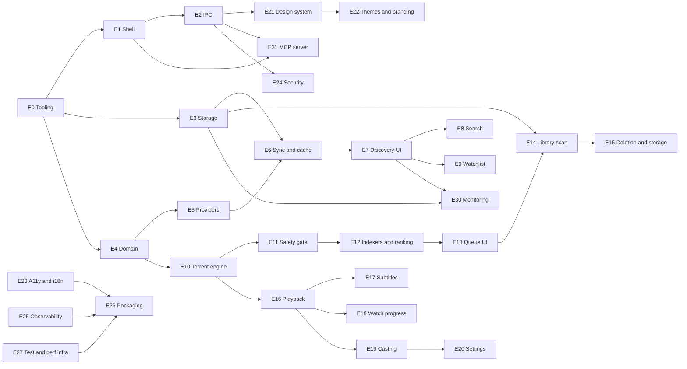
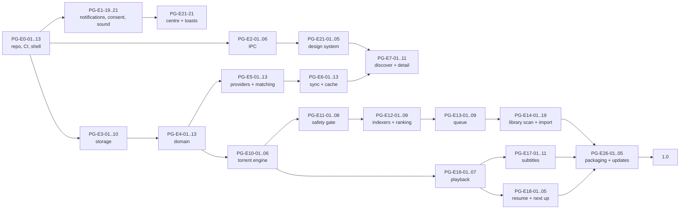

# Peregrine — Task Backlog

Granular, reviewable backlog. Phases and exit criteria come from [PLAN.md](./PLAN.md); the constraints that make these tasks necessary come from [ARCHITECTURE.md](./ARCHITECTURE.md).

## Conventions

| Field | Meaning |
| --- | --- |
| ID | `PG-E<epic>-<NN>`. Stable forever; never renumber, supersede instead. |
| Est | `XS` ≤ 0.5 d · `S` 1 d · `M` 2–3 d · `L` 4–5 d · `XL` 6–10 d |
| Deps | Task IDs that must be done first. Empty means startable immediately. |
| Plat | `all` unless noted: `mac`, `win`, `lin`, `lin-wayland` |
| State | `todo` → `doing` → `review` → `done`. A task is `done` only when the global Definition of Done in PLAN §8 holds. The last column of every task table. |
| Effort roll-up | A row's day total sums the band midpoints (`XS` 0.5 · `S` 1 · `M` 2.5 · `L` 4.5 · `XL` 8) and rounds up to a whole day. `cargo xtask backlog-stats` recomputes every row from this file and fails when the declared table at the bottom drifts. |

Every task implicitly includes its tests, error handling, structured logging, and doc updates per PLAN §8. "Acceptance" states the observable proof beyond that.

## Epic dependency graph

---

# Phase 0 — Foundations

## E0 · Repository and tooling

| ID | Task | Acceptance | Deps | Est | State |
| --- | --- | --- | --- | --- |
| PG-E0-01 | Cargo workspace with one crate per module map entry | `cargo build --workspace` succeeds; arch allowlist file committed | — | S | done |
| PG-E0-02 | pnpm workspace: `apps/desktop`, `packages/{ui,theme,ipc-client,player-ui,i18n}` | `pnpm -r build` succeeds with placeholder exports | — | S | todo |
| PG-E0-03 | Tauri v2 scaffold with dev/build scripts and per-OS bundle identifiers | `pnpm tauri dev` opens a window on all three OSes | PG-E0-02 | S | todo |
| PG-E0-04 | `xtask check-arch` parses crate edges | Fails on a fixture violation, passes on the real tree | PG-E0-01 | M | done |
| PG-E0-05 | `xtask check-migrations` hashes against the base branch | Fails when a merged migration is edited | PG-E0-01 | S | done |
| PG-E0-06 | `xtask gen-ipc` regenerates TS bindings, CI diff gate | Committed bindings match regeneration byte-for-byte | PG-E2-01 | M | todo |
| PG-E0-07 | `xtask check-todos` requires an issue reference on every TODO | Fails on a bare TODO fixture | — | XS | done |
| PG-E0-08 | Rust formatting and lint policy | `cargo clippy -- -D warnings` clean; pedantic lints configured | PG-E0-01 | XS | done |
| PG-E0-09 | TypeScript strict config and lint stack | `tsc --noEmit` clean with `noUncheckedIndexedAccess`, `exactOptionalPropertyTypes` | PG-E0-02 | S | todo |
| PG-E0-10 | Pre-commit hooks: format, lint staged files, arch check | A commit with a formatting error is rejected locally | PG-E0-08, PG-E0-09 | S | todo |
| PG-E0-11 | Commit convention, PR template with perf and security checklists, CODEOWNERS | Template rendered on a test PR | — | XS | review |
| PG-E0-12 | Issue templates and label taxonomy, milestones mapped to phases | Templates produce labelled issues | — | XS | review |
| PG-E0-13 | CI matrix: lint, test, build on macOS arm64, Windows x64, Ubuntu 24.04 | Green on a trivial PR with cache warm | PG-E0-01 | M | todo |
| PG-E0-14 | Supply-chain gate: `cargo-deny`, `cargo-audit`, `osv-scanner`, `pnpm audit` | Build fails on an advisory fixture | PG-E0-13 | S | todo |
| PG-E0-15 | Dead-dependency gate: `knip`, `cargo-machete` | Build fails on an unused fixture dependency | PG-E0-13 | XS | todo |
| PG-E0-16 | Release workflow: bundles, SBOM, signed manifest, changelog | A tagged pre-release publishes artifacts and a manifest | PG-E0-13 | M | todo |
| PG-E0-17 | Automated dependency updates, grouped weekly | A grouped PR opens on schedule | PG-E0-13 | XS | todo |
| PG-E0-18 | `LICENSE`, `NOTICE`, third-party attribution scaffold | Attribution file lists every runtime dependency and sidecar | — | S | doing |

## E1 · App shell and platform

| ID | Task | Acceptance | Deps | Est | Plat | State |
| --- | --- | --- | --- | --- | --- |
| PG-E1-01 | Window creation with platform-appropriate chrome behind one `WindowChrome` component | Traffic lights on macOS, caption buttons on Windows, headerbar on Linux | PG-E0-03 | M | all | todo |
| PG-E1-02 | Window state persistence: size, position, maximized, per-monitor | Restores across restarts and monitor changes | PG-E1-01 | S | all | todo |
| PG-E1-03 | Custom drag regions, double-click-to-zoom, snap layouts | Drag and zoom behave natively; caption buttons hit-test correctly | PG-E1-01 | M | all | todo |
| PG-E1-04 | Single-instance enforcement with argument forwarding | Second launch focuses the first and forwards the deep link | PG-E1-01 | S | all | todo |
| PG-E1-05 | Graceful shutdown sequence | mpv and ffmpeg reaped, journal checkpointed, no orphan on next boot | PG-E1-01, PG-E16-02 | M | all | todo |
| PG-E1-06 | Orphan child-process reaper keyed by PID and start time | A killed app leaves no mpv behind after relaunch | PG-E1-05 | M | all | todo |
| PG-E1-07 | App menu and shortcuts: macOS app menu, Edit menu, Window, Help | Cut/copy/paste/select-all work in inputs on macOS | PG-E1-01 | M | mac | todo |
| PG-E1-08 | Shortcut registry with conflict detection and platform rendering | Shortcuts list in Settings is generated from the registry | PG-E1-07 | M | all | todo |
| PG-E1-09 | Tray or menu-bar extra with state-aware menu | Shows active downloads and seeding count; hidden when disabled | PG-E1-01 | M | all | todo |
| PG-E1-10 | Close-to-tray and keep-seeding-after-close policy with prompts | Quit dialog states the seed count and offers both options | PG-E1-09, PG-E10-09 | S | all | todo |
| PG-E1-11 | Deep link handling: `peregrine://title/...`, `peregrine://magnet/...` | Cold start and warm start both route correctly | PG-E1-04 | S | all | todo |
| PG-E1-12 | Native file and folder pickers wrapped in a typed API | Returns resolved paths, never raw strings | PG-E1-01 | S | all | todo |
| PG-E1-13 | Autostart registration per OS, off by default | Toggle survives reboot; removed cleanly on uninstall | PG-E1-09 | S | all | todo |
| PG-E1-14 | Native notification delivery through `tauri-plugin-notification`: `on_action` handler registered at startup, int32 ids from a persisted counter, resolved per-OS sound value, deep link in `extra`, delivery state written to the centre before the OS call | A toast routes to the right screen when clicked; the centre entry exists even when delivery fails; no notification is shown without a registered listener | PG-E1-09, PG-E1-19 | M | todo |
| PG-E1-19 | `NotificationService`: the event catalogue from [ADR 0015](./adr/0015-native-notifications.md), per-event policy, dedupe window, burst summaries, global rate limit, focus suppression, quiet hours with digest, severity handling, and the in-app centre as the authoritative record | Table-driven tests over the policy matrix: every suppression records a reason; critical events ignore quiet hours but not focus modes; five completions in a burst produce one summary toast and five centre entries | PG-E3-09 | L | todo |
| PG-E1-20 | Consent and permission handling: wizard step with per-event choice, `isPermissionGranted`/`requestPermission` probe, a test-notification button, an OS-settings deep link, denial fallback to the in-app centre, and revocation detection | A declined user is never asked again unprompted and still receives every event in the centre; the test button reports honestly whether a notification arrived; the resolved state and OS link are visible in Settings | PG-E1-19, PG-E1-12 | M | todo |
| PG-E1-21 | Sound policy per OS: verified sound values per event class, master and per-event switches, optional custom file validated per OS, honest "best effort" copy, and the synthesized WebAudio in-app chime (no bundled audio assets) | Sound on and off both verified by ear on each OS with the result recorded in SPIKE-11; a custom file that fails to load falls back with one non-modal notice; the chime never overlaps itself and respects the master switch | PG-E1-14 | M | all | todo |
| PG-E1-15 | Dock and taskbar progress badges driven by aggregate download progress | Badge clears when the queue is idle | PG-E1-09 | S | mac, win | todo |
| PG-E1-16 | Reveal-in-file-manager per OS, path-guarded | Refuses paths outside configured roots | PG-E1-12, PG-E24-03 | XS | all | todo |
| PG-E1-17 | Power-save inhibition during playback and active downloads | Screen does not sleep during playback; released on stop | PG-E1-05 | S | all | todo |
| PG-E1-18 | High-DPI, multi-monitor, and fractional-scaling correctness pass | No blurry text or clipped chrome at 125%, 150%, 200% | PG-E1-01 | M | all | todo |

## E2 · IPC layer

| ID | Task | Acceptance | Deps | Est | State |
| --- | --- | --- | --- | --- |
| PG-E2-01 | `specta` + `tauri-specta` export pipeline and generated client, pinned to the exact `2.0.0-rc.25` RC (no stable 2.x exists) with a written fallback to hand-written DTOs | One Rust type change propagates to a compiling TS call site; the RC pin is exact | PG-E0-03 | M | todo |
| PG-E2-02 | Structured `AppError` with stable codes and UI mapping | Every code has a message key and a retryability flag | PG-E2-01 | S | todo |
| PG-E2-03 | Command registration with a ≤20-line rule and a lint check | A fixture command with logic fails the check | PG-E2-01 | S | todo |
| PG-E2-04 | Event bus with namespaced, versioned topics | Topic names are declared in one manifest shared with TS | PG-E2-01 | M | todo |
| PG-E2-05 | Coalescing / rate-limiting event batcher with drop counters | A 1 kHz producer delivers ≤4 Hz with audit of drops | PG-E2-04 | M | todo |
| PG-E2-06 | Job-scoped command pattern: start returns job ID, progress streams | No command blocks >100 ms in a load test | PG-E2-04 | M | todo |
| PG-E2-07 | Cancellation API for every job-scoped command | Cancel mid-job leaves no partial DB state | PG-E2-06 | M | todo |
| PG-E2-08 | Typed asset protocol for cached images and local thumbs | Poster loads without base64 or IPC payloads | PG-E2-01 | M | todo |
| PG-E2-09 | Payload size guard: responses over 64 KB log a warning in dev | Fixture oversized response triggers the guard | PG-E2-01 | XS | todo |
| PG-E2-10 | IPC contract tests generated from the command registry | Every command has a test that exercises its error path | PG-E2-02 | M | todo |
| PG-E2-11 | Backpressure signal to the UI when events are dropped | UI shows a degraded live indicator instead of stalling | PG-E2-05 | S | todo |
| PG-E2-12 | Dev-only command timing instrumentation, surfaced in Diagnostics | p95 latency per command visible without a accountr | PG-E2-10, PG-E25-01 | S | todo |

## E3 · Storage

| ID | Task | Acceptance | Deps | Est | State |
| --- | --- | --- | --- | --- |
| PG-E3-01 | SQLite open path with PRAGMAs on every connection | WAL on, foreign keys on, busy timeout set; asserted in a test | PG-E0-01 | S | todo |
| PG-E3-02 | Single-writer channel and reader pool | 20 concurrent writers serialize without `SQLITE_BUSY` | PG-E3-01 | M | todo |
| PG-E3-03 | Migration 0001: settings, account, secret_ref, job, event_log | Applies on an empty database and is reversible in a test fixture | PG-E3-01 | S | todo |
| PG-E3-04 | Migration 0002: catalogue tables per DATA_MODEL §2.2 | Applies and satisfies the schema snapshot test | PG-E3-03 | M | todo |
| PG-E3-05 | Migration 0003: seasons, episodes, episode_ordering | Unique constraints proven by negative tests | PG-E3-04 | S | todo |
| PG-E3-06 | Migration 0004: library tables including partial unique indices | One movie item, one episode item invariants hold under concurrency | PG-E3-05 | M | todo |
| PG-E3-07 | Migration 0005: subtitles, progress, watchlist, smart collections | Generated column and partial index verified | PG-E3-06 | S | todo |
| PG-E3-08 | Migration 0006: acquisition tables including `release_decision` | Dedupe index proven to exclude terminal jobs | PG-E3-07 | M | todo |
| PG-E3-09 | Migration 0007: cache, image, dataset, notification, device, cast tables | Cache tables droppable with no user-data loss (invariant I9) | PG-E3-08 | S | todo |
| PG-E3-10 | Type-safe repositories per aggregate with row mappers | Round-trip property test for every entity | PG-E3-04 | L | todo |
| PG-E3-11 | Keyset pagination helper used by every list query | `OFFSET` is absent from the codebase, enforced by grep gate | PG-E3-10 | S | todo |
| PG-E3-12 | FTS5 contentless table with explicit maintenance and rebuild command | Rebuild reproduces identical search results | PG-E3-04 | M | todo |
| PG-E3-13 | Migration runner with pre-migration backup and rotation | A failing migration leaves the database untouched and backed up | PG-E3-03 | M | todo |
| PG-E3-14 | Integrity check on boot with corruption recovery path | Injected corruption rebuilds and rescan triggers | PG-E3-13 | M | todo |
| PG-E3-15 | Retention jobs per DATA_MODEL §6 | Old rows pruned; user data untouched | PG-E3-10 | S | todo |
| PG-E3-16 | Maintenance job: `VACUUM`, `ANALYZE`, FTS optimize, yielding to playback | Never runs during playback; asserted by test | PG-E3-15 | M | todo |
| PG-E3-17 | Disk accounting queries for per-tier usage | Diagnostics totals match filesystem measurement within 2% | PG-E3-10 | S | todo |
| PG-E3-18 | Fixture databases for every previous release, used in migration tests | CI tests upgrade from each fixture | PG-E3-13 | M | todo |

## E4 · Domain core

| ID | Task | Acceptance | Deps | Est | State |
| --- | --- | --- | --- | --- |
| PG-E4-01 | Core entities and value objects with validating constructors | Illegal states unrepresentable; construction failures are typed | PG-E0-01 | M | todo |
| PG-E4-02 | `ExternalId` with provider prefixes and parsing | Round-trip property test over generated ID shapes | PG-E4-01 | S | todo |
| PG-E4-03 | `ReleaseName` parser: resolution, source, codec, HDR, audio, group, repack, season pack, multi-episode | ≥ 95% correct on a 200-name corpus; no panics on fuzz input | PG-E4-01 | L | todo |
| PG-E4-04 | `NameParser` for library filenames and folders | Same corpus requirement as PG-E4-03 plus anime absolute and `1x01` forms | PG-E4-03 | L | todo |
| PG-E4-05 | `Qualityaccount` model with rules, caps, and cut-off rank | Serialization round-trip and validation of contradictory rules | PG-E4-01 | M | todo |
| PG-E4-06 | `ReleaseRanker` pure scoring with per-rule reason output | Monotonicity, determinism, and totality property tests | PG-E4-05, PG-E4-03 | L | todo |
| PG-E4-07 | `TorrentInspector` rules: extension allowlist, traversal, reserved names, caps, unicode spoofing | Each hostile fixture classified correctly, with reason strings | PG-E4-01 | L | todo |
| PG-E4-08 | `PathGuard` policy model, pure containment logic | Escape attempts rejected; property test over generated paths | PG-E4-01 | M | todo |
| PG-E4-09 | `WatchPolicy`: resume point, watched threshold, next-episode selection | Boundary tests at 0%, 2%, 50%, 92%, 95%, 99%, and zero-duration | PG-E4-01 | M | todo |
| PG-E4-10 | `EpisodeOrderingStrategy` for aired, absolute, DVD, anime | Ordering fixtures reproduce expected lists | PG-E4-07, PG-E3-05 | M | todo |
| PG-E4-11 | Download job state machine with guarded transitions | Illegal transitions rejected; every state reachable in a test | PG-E4-01 | M | todo |
| PG-E4-12 | Media availability derivation from items and jobs | Table-driven test over item and job combinations | PG-E4-11 | M | todo |
| PG-E4-13 | Player session state machine | Every transition and failure path covered | PG-E4-01 | M | todo |
| PG-E4-14 | Subtitle timing math: offset, frame-rate conversion, PAL speedup | Property test: offset then reverse offset is identity | PG-E4-01 | S | todo |
| PG-E4-15 | Subtitle format model and SRT/VTT/ASS writers | Round-trip of styling-bearing ASS preserves italics and positioning | PG-E4-14 | M | todo |
| PG-E4-16 | Domain event enum covering every state-changing operation | Repository layer emits only declared events | PG-E4-11, PG-E4-13 | S | todo |
| PG-E4-17 | `Clock` and `IdGenerator` ports for determinism in tests | No `SystemTime::now` or random call outside an adapter (grep gate) | PG-E4-01 | S | todo |
| PG-E4-18 | Fuzz targets for release-name, filename, and subtitle parsers | 24 h fuzz run without panic in Phase 4 | PG-E4-03, PG-E4-04, PG-E4-15 | M | todo |
| PG-E4-19 | `Conformance`-friendly fake implementations for all ports | Fakes live in `testkit`, usable from any crate's tests | PG-E4-17 | M | todo |
| PG-E4-20 | Domain documentation pass: invariants stated where enforced | Each invariant in DATA_MODEL §3 maps to a named test | PG-E4-01 | S | todo |

---

# Phase 1 — Discovery

## E5 · Metadata providers

| ID | Task | Acceptance | Deps | Est | State |
| --- | --- | --- | --- | --- |
| PG-E5-01 | `MetadataProvider` trait with declared capabilities and rate policy | Conformance suite defined; a fake provider passes it | PG-E4-01 | M | todo |
| PG-E5-02 | HTTP client stack: rustls, HTTP/2, compression, timeouts, retry, circuit breaker | 429/5xx/timeout fixtures behave per policy | PG-E5-01 | M | todo |
| PG-E5-03 | Per-host token buckets and global concurrency cap | Synthetic burst never exceeds the configured rate | PG-E5-02 | M | todo |
| PG-E5-04 | Conditional-request middleware with ETag and Last-Modified to `provider_cache` | Repeat call transfers zero bytes (304 path asserted) | PG-E5-02, PG-E3-09 | M | todo |
| PG-E5-05 | Response hygiene: size caps, content-type check, validating decode, unknown-field tolerance | Oversized, HTML, and drifted JSON fixtures rejected or marked stale | PG-E5-02 | M | todo |
| PG-E5-06 | TMDB adapter: configuration, genres, trending, discover with the full filter set | Fixture replay produces identical normalized output | PG-E5-01 | L | todo |
| PG-E5-07 | TMDB adapter: movie details, credits, videos, external ids, release dates | Normalization snapshot tests | PG-E5-06 | M | todo |
| PG-E5-08 | TMDB adapter: TV details, seasons, episodes, episode groups, content ratings | Season and episode normalization including specials | PG-E5-06 | L | todo |
| PG-E5-09 | TMDB `/changes` adapter for movie and TV windows with cursor handling | Overlapping-window test yields no duplicates | PG-E5-08 | M | todo |
| PG-E5-10 | TVDB v4 adapter behind a user-supplied key | Optional; skipped cleanly when unconfigured | PG-E5-01 | M | todo |
| PG-E5-11 | OMDb fallback adapter for ratings when IMDb dataset is unavailable | Used only on cache miss; never a primary path | PG-E5-01 | S | todo |
| PG-E5-12 | Provider registry manifest: enablement, priority, auth requirement, endpoints | Diagnostics lists exactly the endpoints contacted | PG-E5-01 | S | todo |
| PG-E5-13 | Title matching engine: external ID resolution, alias and year reconciliation | 100-case matching corpus with expected outcomes | PG-E5-08, PG-E4-04 | L | todo |
| PG-E5-14 | Anime detection and subtype classification, AniList/MAL id capture | Anime fixtures classified correctly and ordered absolutely | PG-E5-13 | M | todo |
| PG-E5-15 | Artwork normalization into `image_ref` with language and vote metadata | Primary selection deterministic across fixtures | PG-E5-13 | M | todo |
| PG-E5-16 | Trailer selection policy: official, language preference, recency, fallback | Fixture table of expected picks | PG-E5-07, PG-E5-08 | S | todo |
| PG-E5-17 | Provider fixture harness: record, redact, replay | No fixture contains an API key; a leak check runs in CI | PG-E5-02 | M | todo |
| PG-E5-18 | Provider contract tests run per adapter against the shared suite | Adding an adapter requires no new test scaffolding | PG-E5-01 | M | todo |
| PG-E5-19 | Attribution compliance: TMDB logo and notice in About and on detail pages | Visual check plus a test that the notice string exists | PG-E5-06 | XS | todo |
| PG-E5-20 | Key validation flow with a live "test connection" action | Invalid key produces an actionable error, not a generic failure | PG-E5-06 | S | todo |
| PG-E5-21 | Anime-specific providers research spike outcome applied or rejected with a written decision | ADR updated | PG-E5-14 | S | todo |
| PG-E5-22 | Rate-limit observability: remaining budget surfaced per provider | Diagnostics shows budget and last 429 | PG-E5-03, PG-E25-02 | S | todo |

## E6 · Sync and cache

| ID | Task | Acceptance | Deps | Est | State |
| --- | --- | --- | --- | --- |
| PG-E6-01 | Job scheduler: priority queues, worker pool, dedupe, backoff with jitter | Deferred jobs retry on schedule; dedupe proven | PG-E3-08, PG-E4-19 | L | todo |
| PG-E6-02 | Resource token acquisition with panic-safe release | Injected panic releases the token (guard test) | PG-E6-01 | M | todo |
| PG-E6-03 | Concurrency classes: metadata, image, dataset, subtitle, probe | Each class has an independent limit asserted under load | PG-E6-01 | M | todo |
| PG-E6-04 | Incremental change sync with persisted cursors and overlapping windows | Crash between cursor advance and upsert loses nothing | PG-E6-01, PG-E5-09 | M | todo |
| PG-E6-05 | IMDb ratings dataset download, checksum, parse, transactional swap | Header change or truncated file leaves the old dataset in place | PG-E6-01 | L | todo |
| PG-E6-06 | Ratings join into `title` via `external_id` | 100 k-title join completes within the DB budget | PG-E6-05 | M | todo |
| PG-E6-07 | Optional IMDb alt-title import (`title.akas`, 493 MB compressed, re-keyed through the TMDB `imdb_id`) behind an explicit opt-in. `title.basics` is deliberately excluded because TMDB `external_ids` already supplies the IMDb id | Disabled by default; the measured disk cost is shown before enabling; alt-title search improves measurably with it on | PG-E6-05 | M | todo |
| PG-E6-08 | Dataset disk accounting and quiet-hours scheduling | Never runs during playback when configured | PG-E6-05, PG-E3-16 | S | todo |
| PG-E6-09 | Image cache: content-addressed store, variant matrix, atomic writes | No partial file survives a crash (temp + rename) | PG-E2-08, PG-E3-09 | L | todo |
| PG-E6-10 | Image LRU eviction to the configured cap with pinned-item protection | Cache never exceeds the cap; in-use images never evicted | PG-E6-09 | M | todo |
| PG-E6-11 | Blurhash generation on ingest of a new primary artwork | Placeholder present before any bytes are fetched | PG-E6-09, PG-E4-19 | M | todo |
| PG-E6-12 | Idle-driven prefetch for the next rail, bounded and cancellable | Prefetch never runs during scroll or playback when configured off | PG-E6-09 | M | todo |
| PG-E6-13 | Cache invalidation contract: `library://changed` carries affected keys | UI refetches only affected queries (assertion in E2E) | PG-E6-04 | M | todo |
| PG-E6-14 | Sync health model: per-provider state, next run, error class | Diagnostics renders it without querying the network | PG-E6-01 | S | todo |
| PG-E6-15 | Stale-metadata policy, refresh-on-view, and the TMDB six-month cache compliance sweep | Title viewed after TTL enqueues a refresh; UI never blocks; a scheduled sweep refreshes or purges cached metadata at or before 180 days, with a purge path for the termination clause | PG-E6-04 | S | todo |
| PG-E6-16 | Offline detection and network-state model | Airplane-mode test: no job storm, no error modals | PG-E6-01 | M | todo |
| PG-E6-17 | Sync load test: 5 000 titles, 20 k images, throttled network | Completes within the DB and disk budgets without UI stall | PG-E6-09 | L | todo |
| PG-E6-18 | Full cache wipe and rebuild path exposed in Settings | App remains usable and repopulates | PG-E6-13 | S | todo |

## E7 · Discovery UI

| ID | Task | Acceptance | Deps | Est | State |
| --- | --- | --- | --- | --- |
| PG-E7-01 | App shell layout: sidebar, top bar, content area, persistent player surface | Shell never unmounts across navigation | PG-E2-01, PG-E21-05 | M | todo |
| PG-E7-02 | Router with typed routes and cache-first loaders | No route renders a full-page spinner | PG-E7-01, PG-E3-11 | M | todo |
| PG-E7-03 | Design-system primitives consumed from `packages/ui` | No ad-hoc styled element in a feature folder (review gate) | PG-E21-03 | M | todo |
| PG-E7-04 | Title card component: poster, blurhash, rating badge, availability overlay | Renders correctly at 5 sizes without layout shift | PG-E7-03 | M | todo |
| PG-E7-05 | Hover preview: dwell, scale, metadata panel, trailer peek toggle | Cancels cleanly on leave; no layout thrash measured | PG-E7-04, PG-E21-08 | M | todo |
| PG-E7-06 | Virtualized grid with fixed tile geometry | 5 000 items at ≥60 fps; blurhash fills first paint | PG-E7-04 | L | todo |
| PG-E7-07 | Horizontal rails with keyboard traversal and edge affordances | Arrow keys traverse; no scroll jank on 500-item rails | PG-E7-04 | M | todo |
| PG-E7-08 | Discover screen: hero, continue watching, top 10, on the air, upcoming, top rated, recommendations | Each rail has a defined empty state | PG-E7-07, PG-E18-04 | L | todo |
| PG-E7-09 | Filter surface: type, genre, year, rating, runtime, language, country, provider, status, availability, sort | Filter state is URL-encoded and shareable | PG-E7-06 | L | todo |
| PG-E7-10 | Smart collections: saved filter plus sort, pinned to the sidebar | Persisted, reorderable, applied in one click | PG-E7-09, PG-E3-07 | M | todo |
| PG-E7-11 | Title detail: hero expansion, backdrop cross-fade, actions, availability | Shared-element transition from card; reduced-motion path exists | PG-E7-03, PG-E21-09 | L | todo |
| PG-E7-12 | Cast and crew presentation with person pages | Person page lists credits and is reachable by keyboard | PG-E7-11 | M | todo |
| PG-E7-13 | Season selector and episode list with stills, air dates, progress | Specials marked; missing episodes indicated | PG-E7-11, PG-E4-10 | L | todo |
| PG-E7-14 | Trailer playback in a sandboxed child webview with privacy-enhanced embed | No third-party script loads in the main window (asserted) | PG-E7-11, PG-E24-06 | M | todo |
| PG-E7-15 | Recommendations and "because you watched" based on local history | Requires no server; degrades to trending when history is empty | PG-E7-08, PG-E18-04 | M | todo |
| PG-E7-16 | Empty, loading, and error states for every rail and grid | Every state has a designed treatment, not a spinner | PG-E7-08 | M | todo |
| PG-E7-17 | Grid selection model: click, cmd/ctrl-click, shift-range, context menu | Bulk actions operate on the selection | PG-E7-06 | M | todo |
| PG-E7-18 | Poster size and density control, persisted per screen | Applies without a full remount | PG-E7-06 | S | todo |
| PG-E7-19 | Keyboard navigation model: roving tabindex, Home/End, Page Up/Down, Escape layering | Keyboard-only walkthrough of Discover and Browse passes | PG-E7-06 | L | todo |
| PG-E7-20 | Frame-time budget gate for the grid in CI | Fails on a regression beyond 15% | PG-E7-06, PG-E27-08 | M | todo |
| PG-E7-21 | Visual regression snapshots per theme for the grid and detail screens | Divergence beyond threshold fails CI | PG-E7-11, PG-E22-05 | M | todo |
| PG-E7-22 | Discover screen instrumentation: time to first paint and rail hydration | Metrics visible in Diagnostics and asserted in E2E | PG-E7-08, PG-E25-01 | S | todo |

## E8 · Search

| ID | Task | Acceptance | Deps | Est | State |
| --- | --- | --- | --- | --- |
| PG-E8-01 | FTS5 query builder: prefix terms, ranking weights, filters | Injection-safe; parameterized only | PG-E3-12 | M | todo |
| PG-E8-02 | Ranking tuning with `bm25` weights and popularity tiebreak | Golden-result fixtures for 40 queries | PG-E8-01 | M | todo |
| PG-E8-03 | External-ID fast path (`tt…`, `tmdb:…`) bypassing FTS | Exact match returns the right title first | PG-E8-01 | XS | todo |
| PG-E8-04 | Trigram fallback for short or non-Latin queries | Fixture queries resolve; decision recorded from SPIKE-5 | PG-E8-01 | M | todo |
| PG-E8-05 | Debounced remote enrichment with job dedupe | Typing a 13-character query enqueues at most one remote search | PG-E8-01, PG-E6-01 | M | todo |
| PG-E8-06 | Search results screen with grouped results and filters | Keyboard-navigable, virtualized, no layout shift | PG-E8-01, PG-E7-06 | M | todo |
| PG-E8-07 | Command palette: navigation, actions, recent, fuzzy titles | Every app action is reachable from the palette | PG-E8-06, PG-E1-08 | L | todo |
| PG-E8-08 | Search perf bench and p95 gate | 100 k titles, p95 ≤ 50 ms in CI | PG-E8-02, PG-E27-08 | M | todo |

## E9 · Watchlist and collections

| ID | Task | Acceptance | Deps | Est | State |
| --- | --- | --- | --- | --- |
| PG-E9-01 | Watchlist commands with optimistic add and remove, plus rollback on failure | Toggle feels instant; a failed write reverts and reports | PG-E2-06, PG-E3-07 | M | todo |
| PG-E9-02 | Watchlist screen with sort, filter, and availability overlay | Availability derived per item, not per render | PG-E7-09 | M | todo |
| PG-E9-03 | Add-to-watchlist affordances: card hover action, context menu, detail page, keyboard shortcut | Every affordance reflects the same state | PG-E9-01, PG-E7-17 | S | todo |
| PG-E9-04 | Sidebar watchlist entry with count and a quick-add drop target | Count updates live without a full refetch | PG-E9-01, PG-E7-01 | S | todo |
| PG-E9-05 | Availability derivation for watchlist items: available, downloading, wanted, unavailable | Table-driven test over item and job combinations | PG-E4-12, PG-E9-02 | M | todo |
| PG-E9-06 | Bulk add and remove from a grid selection | 500-item bulk operation completes as a job with progress | PG-E9-01, PG-E7-17 | M | todo |
| PG-E9-07 | Manual reordering with a keyboard-accessible alternative | Reorder persists and works without a pointer | PG-E9-02, PG-E21-17 | M | todo |
| PG-E9-08 | Watchlist onboarding: empty state that suggests popular titles to seed it | New users reach a non-empty watchlist in one click | PG-E9-02, PG-E7-16 | S | todo |
| PG-E9-09 | Auto-acquire flag on watchlist entries, gated behind the post-1.0 automation epic | Flag persists; no acquisition occurs until the automation epic lands | PG-E9-05 | S | todo |
| PG-E9-10 | Watchlist scale test: 2 000 entries render and query within budget | Virtualized render at 60 fps; query ≤ 5 ms | PG-E9-02, PG-E27-08 | S | todo |

---

# Phase 2 — Acquisition and library

## E10 · Torrent engine

| ID | Task | Acceptance | Deps | Est | State |
| --- | --- | --- | --- | --- |
| PG-E10-01 | `TorrentEngine` trait: session, add, select, stream, stats, limits, remove | Fake engine passes the conformance suite | PG-E4-19 | M | todo |
| PG-E10-02 | librqbit adapter: session lifecycle, config, persistence path | Start/stop clean on all three OSes; SPIKE-3 outcome applied | PG-E10-01 | L | todo |
| PG-E10-03 | Metadata-only fetch for magnets with timeout and peer reporting | Returns the file list without writing payload bytes | PG-E10-02 | M | todo |
| PG-E10-04 | Per-file selection and deselection at add time and afterwards | Unselected files never appear on disk | PG-E10-02 | M | todo |
| PG-E10-05 | Per-job "download in order" toggle plus head-and-tail-first ordering and streaming read-ahead with a configurable, bitrate-derived window | First playable byte within the target time on a local swarm; the container index is present from the start so seeking works immediately; toggling off restores rarest-first outside the window | PG-E10-02 | L | todo |
| PG-E10-06 | Piece priority driver reacting to player read position and stalls | Starvation raises priority within one poll interval | PG-E10-05, PG-E16-06 | M | todo |
| PG-E10-07 | Progress and statistics stream: rates, peers, ETA, ratio, health | Stats accurate within 5% of engine counters | PG-E10-02 | M | todo |
| PG-E10-08 | Restart reattachment from `engine_state_json` | Kill and relaunch resumes without re-downloading verified pieces | PG-E10-02, PG-E3-08 | L | todo |
| PG-E10-09 | Seeding policy: ratio target, time target, stop-on-quit, keep-seeding | Terminates at the configured policy; survives restart | PG-E10-02 | M | todo |
| PG-E10-10 | Global and per-job limits: down, up, connections, active downloads | Applied at runtime without restarting the session | PG-E10-02 | M | todo |
| PG-E10-11 | Proxy and interface binding: `socks5h://` (so DNS resolves at the proxy), interface bind, explicit handling of DHT and UDP-tracker traffic while a proxy is set, **runtime re-resolution** of the bound interface, and **fail-closed** behaviour when it disappears | Engine peer and tracker IO stops entirely if the bound interface goes away, no silent fallback to the default route, and a VPN reconnect is picked up without an app restart (qBittorrent passes the unresolved interface through but never re-resolves it, so a dropped tunnel just grinds); asserted by killing and restoring the interface in a test | PG-E10-02 | M | todo |
| PG-E10-12 | Leak check tool: compare the tunnel-exit IP with the machine's non-tunnelled public IP via several echo endpoints | Reports the observed addresses and states plainly which protocols were verified; SOCKS5 UDP-associate coverage is explicitly reported as unverified until SPIKE-3 confirms it | PG-E10-11 | M | todo |
| PG-E10-13 | Port reachability check and UPnP/NAT-PMP decision, off by default | Diagnostics shows reachability; no silent router mutation | PG-E10-02 | M | todo |
| PG-E10-14 | Loopback seeder harness for integration tests | A test downloads from a local seeder deterministically | PG-E10-02 | M | todo |
| PG-E10-15 | Engine error taxonomy mapped to UI codes | No raw engine string reaches the UI | PG-E10-02 | S | todo |
| PG-E10-16 | Bandwidth reservation while playing and "pause on playback" policy | Streaming keeps headroom; verified under a saturating download | PG-E10-10, PG-E16-01 | M | todo |
| PG-E10-17 | RSS ingest adapter (Phase 5 prerequisite, engine side) | Parses a fixture feed and enqueues candidates | PG-E10-14 | M | todo |
| PG-E10-18 | IP-filter and blocklist support with **fail-closed** parse semantics: an unparseable filter blocks new peer traffic with a prominent error and requires an explicit "continue without blocklist" confirmation, never silently installing an empty blocklist. Plain-text and gzip formats, applied on file change without a restart | A corrupt filter file blocks new peer traffic and surfaces an actionable error (qBittorrent's parser installs an empty filter, which is fail-open); a valid edit applies live; both formats covered by fixtures | PG-E10-11 | M | todo |

## E11 · Safety gate

| ID | Task | Acceptance | Deps | Est | State |
| --- | --- | --- | --- | --- |
| PG-E11-01 | Extension allowlist and blocklist with content sniffing | A media file with a double extension is classified by content | PG-E4-07 | M | todo |
| PG-E11-02 | Path validation: relative-only, no traversal, no absolute, no reserved names | Every hostile path fixture rejected with a reason | PG-E4-07 | M | todo |
| PG-E11-03 | Unicode spoofing detection for right-to-left override and homoglyph extensions | Spoofed `.exe` fixtures rejected | PG-E11-02 | S | todo |
| PG-E11-04 | Caps: file count, total size, single-file size, free-space floor, plus **parser bounds applied before decoding untrusted bytes** — bencode nesting depth and token ceilings and a hard torrent-file size cap, following qBittorrent's proven limits (depth 100, 10 M tokens, 100 MiB file) | Each cap boundary tested at and one below the limit; a deeply nested or token-flooding bencode fixture is rejected before allocation, not after | PG-E11-01 | S | todo |
| PG-E11-05 | Archive and disk-image policy: blocked by default, advanced opt-in with warnings | Default build blocks; opt-in path logs an audit event | PG-E11-01 | M | todo |
| PG-E11-06 | `SafetyReport` construction, persistence, and rendering in the UI | Report survives restart and explains each finding | PG-E11-04, PG-E3-08 | M | todo |
| PG-E11-07 | Blocked and warned UI flows with per-file reasoning and no override for hard blocks | Attempting an override on a hard block is impossible via UI and IPC | PG-E11-06, PG-E13-06 | M | todo |
| PG-E11-08 | Pre-write guarantee test: engine never receives a torrent before a report exists | Assertion in the service layer plus an integration test | PG-E11-06, PG-E10-03 | M | todo |
| PG-E11-09 | Post-download verification: probe the media file and compare with the release claim | Mismatch raises a warning and updates the quality label | PG-E11-06, PG-E16-04 | M | todo |
| PG-E11-10 | Audit trail: every blocked and overridden decision in `event_log` | Diagnostics can filter to security events | PG-E11-07, PG-E3-15 | S | todo |
| PG-E11-11 | Fuzz and property suite for the inspector over generated file lists | 24 h run without panic or false allow | PG-E4-18, PG-E11-02 | M | todo |
| PG-E11-12 | Threat-model review pass against SECURITY.md with written findings | Findings triaged into tasks or explicitly accepted | PG-E11-08 | M | todo |
| PG-E11-13 | Never-open-with-system-handler enforcement and test | The `opener` plugin is not reachable for media paths | PG-E11-06, PG-E24-04 | S | todo |
| PG-E11-14 | Symlink and hardlink handling on all three platforms | Symlinked payload entries rejected on each OS in CI | PG-E11-02 | M | todo |

## E12 · Indexers and ranking

| ID | Task | Acceptance | Deps | Est | State |
| --- | --- | --- | --- | --- |
| PG-E12-01 | `Indexer` trait with capability, category, and rate declarations | Conformance suite defined with a fake indexer | PG-E4-19 | M | todo |
| PG-E12-02 | Prowlarr adapter using its documented API | Fixture replay yields normalized releases | PG-E12-01 | M | todo |
| PG-E12-03 | Jackett adapter using its documented API | Same normalization contract | PG-E12-01 | M | todo |
| PG-E12-04 | Local `.torrent` and magnet ingest with drag-and-drop | Dropped file is inspected then queued, never auto-started | PG-E12-01, PG-E11-06 | M | todo |
| PG-E12-05 | Built-in public provider adapters: present but disabled, with **no bundled default domain list** — the user supplies the URL — plus health reporting and a legal notice | Enabling requires an explicit confirmation naming the risk and a user-supplied base URL; no domain is hardcoded; endpoints rate-limit, so nothing polls them on a schedule | PG-E12-01 | L | todo |
| PG-E12-06 | Result normalization and de-duplication **keyed on the info hash**, with a normalized-title heuristic used only to catch cross-indexer duplicates that carry different hashes. A parse is never the dedupe key | Duplicate fixtures collapse to one canonical release; two indexers reporting the same hash collapse deterministically | PG-E12-01 | M | todo |
| PG-E12-07 | Quality profile editor UI with rule validation | Contradictory accounts rejected with an explanation | PG-E4-05, PG-E20-03 | M | todo |
| PG-E12-08 | Auto-selection rules: minimum score, seeder floor, size caps, indexer health | Table-driven test over decision inputs | PG-E4-06 | M | todo |
| PG-E12-09 | Upgrade policy: detect a better release, download alongside, swap on verification | Old file retained until the new one probes successfully | PG-E12-08, PG-E11-09 | L | todo |
| PG-E12-10 | `release_decision` audit persistence and a UI "why this release" panel | Explains score contributions per rule | PG-E12-08, PG-E3-08 | M | todo |
| PG-E12-11 | Manual release override in the queue with re-download semantics | Override replaces the job cleanly, no orphan files | PG-E12-10, PG-E13-04 | M | todo |
| PG-E12-12 | Search-across-indexers aggregation with per-indexer timeout and partial results | One slow indexer never blocks the others | PG-E12-02, PG-E12-03 | M | todo |
| PG-E12-13 | Indexer health checks and degraded-state surfacing | Failing indexer is marked and excluded from auto-selection | PG-E12-12 | S | todo |
| PG-E12-14 | Legal and documentation review of every shipped indexer adapter | Notice present; adapters off by default; ADR recorded | PG-E12-05 | S | todo |
| PG-E12-15 | Ranking golden fixtures for 20 title and account scenarios | Ranking changes require a fixture update in review | PG-E12-08 | M | todo |
| PG-E12-16 | Season pack handling: fan out to episode items, partial selection | Selecting three episodes downloads only those files | PG-E12-04, PG-E10-04 | L | todo |

## E13 · Queue and download UI

| ID | Task | Acceptance | Deps | Est | State |
| --- | --- | --- | --- | --- |
| PG-E13-01 | `download://stats` consumption with animated between-sample interpolation | Smooth ring animation at 4 Hz updates | PG-E2-05 | M | todo |
| PG-E13-02 | Progress ring and bar components on the title card | Percentage, rate, and ETA legible at card size | PG-E13-01, PG-E7-04 | M | todo |
| PG-E13-03 | Downloads screen: active, queued, seeding, completed, failed tabs | Each tab has a designed empty state | PG-E13-01 | M | todo |
| PG-E13-04 | Job actions: pause, resume, remove, force start, reorder priority, open folder | Every action is optimistic with rollback on failure | PG-E13-03, PG-E2-07 | M | todo |
| PG-E13-05 | Per-job detail: files, selection toggles, peers, trackers, speed graph | File selection changes apply without restarting the torrent | PG-E13-03, PG-E10-04 | M | todo |
| PG-E13-06 | Queue conflict resolution UI: existing download for the same episode | Offers replace, keep both, or cancel | PG-E13-04, PG-E3-08 | M | todo |
| PG-E13-07 | Global and per-job limit controls in the queue header | Changes apply live and persist | PG-E13-03, PG-E10-10 | M | todo |
| PG-E13-08 | Notification and tray integration for completion and failure | Click routes to the completed item | PG-E13-04, PG-E1-14 | S | todo |
| PG-E13-09 | Play-while-downloading entry point on the card, the queue row, and the detail page, available from the moment metadata is known rather than on completion (uTorrent-style Stream) | Playback starts from partial data; buffer health and stall state are shown honestly; the action is present but disabled with a reason when no file is selected or metadata is missing | PG-E13-02, PG-E16-01 | M | todo |
| PG-E13-10 | Download history with filters and clear actions | History retention respects settings | PG-E13-03, PG-E3-15 | S | todo |
| PG-E13-11 | Queue keyboard interactions and bulk operations | Keyboard-only queue management passes | PG-E13-04 | M | todo |
| PG-E13-12 | Aggregated queue stats feeding the dock badge and tray | Values match the queue screen | PG-E13-04, PG-E1-15 | S | todo |
| PG-E13-13 | Stall diagnostics panel: DHT nodes, trackers, port reachability, peers by client | Actionable guidance per failure mode | PG-E13-05, PG-E10-13 | M | todo |
| PG-E13-14 | 20-job concurrency soak with frame-time assertion | No visible jank and no `SQLITE_BUSY` | PG-E13-03, PG-E3-02 | L | todo |

## E14 · Library scan and match

| ID | Task | Acceptance | Deps | Est | State |
| --- | --- | --- | --- | --- |
| PG-E14-01 | Root management: add, remove, classify, rescan policy | Removing a root never deletes files or progress | PG-E3-06 | S | todo |
| PG-E14-02 | Scanner with ignore rules: samples, extras, trailers, hidden, temp files | Corpus scan skips the right files with reasons logged | PG-E14-01 | M | todo |
| PG-E14-03 | Incremental scan using mtime and size, with a hash fallback | Size-changed file with identical mtime is detected | PG-E14-02 | M | todo |
| PG-E14-04 | Parallel walk with bounded concurrency and cancellation | Cancelling mid-scan leaves consistent state | PG-E14-02 | M | todo |
| PG-E14-05 | Name-parsing match pipeline into catalogue with confidence scoring | ≥ 98% correct attribution on the naming corpus | PG-E4-04, PG-E5-13 | L | todo |
| PG-E14-06 | Sidecar metadata support: NFO, existing artwork, `.srt` siblings | NFO title and year win over filename parsing | PG-E14-05 | M | todo |
| PG-E14-07 | Episode matching: absolute, multi-episode, ranges, specials placement | Fixture table of 60 ambiguous cases with expected results | PG-E14-05, PG-E4-10 | L | todo |
| PG-E14-08 | Unmatched file queue with suggestions and manual matching UI | Manual match creates the item and remembers the rule | PG-E14-07, PG-E14-09 | M | todo |
| PG-E14-09 | Match-rule memory: user corrections become reusable patterns | Second occurrence auto-matches | PG-E14-08 | M | todo |
| PG-E14-10 | ffprobe pipeline with JSON cache keyed by path, mtime, and probe version | Repeat scan does not re-probe unchanged files | PG-E14-03, PG-E16-04 | M | todo |
| PG-E14-11 | Media file quality labelling from probe output | Labels match a fixture expectation table | PG-E14-10 | M | todo |
| PG-E14-12 | Duplicate detection across roots with a resolution preference | Duplicates reported, never auto-deleted | PG-E14-10 | M | todo |
| PG-E14-13 | Missing-file reconciliation with `missing_since` and progress retention | Removing and restoring a file preserves watch progress | PG-E14-10, PG-E3-06 | M | todo |
| PG-E14-14 | 20 k-file scan performance pass within the SPIKE-7 budget | Budget asserted in a bench | PG-E14-04, PG-E27-08 | M | todo |
| PG-E14-15 | Filesystem watcher for incremental updates with debounce | New file appears in the library within seconds | PG-E14-03 | M | todo |
| PG-E14-16 | Network and removable volume handling with unreachable-root state | Unplugging a drive never marks files deleted | PG-E14-13 | M | todo |
| PG-E14-17 | Library screen: local media grid with library-specific filters | Filters cover resolution, codec, HDR, size, added date | PG-E7-09, PG-E14-11 | M | todo |
| PG-E14-18 | Storage usage screen per root, quality, and media type | Totals within 2% of the filesystem | PG-E3-17, PG-E14-11 | M | todo |
| PG-E14-19 | Import from completed download into the library with probe and naming rules | Imported item plays and is labelled correctly | PG-E14-10, PG-E13-04 | M | todo |
| PG-E14-20 | Scan job UI with progress, cancellation, and a per-file log | Details are exportable for bug reports | PG-E14-04, PG-E25-03 | S | todo |

## E15 · Deletion and storage management

| ID | Task | Acceptance | Deps | Est | State |
| --- | --- | --- | --- | --- |
| PG-E15-01 | `DeletionPlan` builder: files, bytes, blockers, shared-file detection | Blockers correctly detected in fixture scenarios | PG-E3-06 | M | todo |
| PG-E15-02 | Confirmation dialog enumerating paths and bytes with trash-first default | No string is truncated; full path visible on hover | PG-E15-01, PG-E21-06 | M | todo |
| PG-E15-03 | Trash-based deletion per OS with permanent fallback and distinct confirmation | Restorable from the OS trash on each platform | PG-E15-02, PG-E1-05 | M | todo |
| PG-E15-04 | Path revalidation between plan and confirm | A symlink swapped in between is refused | PG-E15-01, PG-E4-08 | M | todo |
| PG-E15-05 | Player and seeding blockers with resolve actions | Cannot delete a file being played or actively seeded | PG-E15-01, PG-E16-02 | M | todo |
| PG-E15-06 | Bulk deletion progress job, cancellable, no partial DB state | Cancelling leaves a consistent DB and a clear report | PG-E15-02, PG-E2-07 | M | todo |
| PG-E15-07 | Reclaim accounting and an event-log record per deletion | Storage screen updates immediately and accurately | PG-E15-06, PG-E3-17 | S | todo |
| PG-E15-08 | "Remove from library" versus "delete files" as separate actions | Removing the entry alone never touches disk | PG-E15-02 | S | todo |
| PG-E15-09 | Empty-trash and orphan-file cleanup tool with dry run | Dry run lists exactly what would be removed | PG-E15-07 | M | todo |
| PG-E15-10 | Deletion safety review: no wildcard, no recursive delete outside a resolved plan | Code-level assertion plus adversarial tests | PG-E15-04 | M | todo |

---

# Phase 3 — Playback and subtitles

## E16 · Playback

| ID | Task | Acceptance | Deps | Est | State |
| --- | --- | --- | --- | --- |
| PG-E16-01 | `MediaSource` abstraction covering local file and torrent stream | Same session code path for both, asserted by a shared test suite | PG-E4-19, PG-E10-05 | M | todo |
| PG-E16-02 | `PlayerBackend` trait with state and position streams | Fake backend passes conformance | PG-E4-19 | M | todo |
| PG-E16-03 | mpv adapter: spawn with hardened flags, JSON IPC, event parsing | Session reaches playing on fixture media on each OS | PG-E16-02 | L | todo |
| PG-E16-04 | Probe integration: codec, tracks, duration, hw-decode capability | Track lists match ffprobe output | PG-E14-10, PG-E16-03 | M | todo |
| PG-E16-05 | Per-platform video surface: `--wid` embedding on Windows and X11 with explicit sibling-window resize, move, and z-order sync against the webview; app-positioned borderless child window on macOS (`--wid` is unimplemented on Cocoa) ([ADR 0013](./adr/0013-mpv-distribution-and-video-surface.md)) | Video fills the player region on each OS; resize, fullscreen, DPI change, display change, and Spaces switching keep the overlay aligned | PG-E16-03 | L | todo |
| PG-E16-06 | Wayland degraded hand-off: mpv toplevel in theatre mode with the webview video region hidden, never a black rectangle | Playback usable on Wayland; limitations published in the README and platform matrix | PG-E16-05 | L | todo |
| PG-E16-07 | Player overlay UI: controls, timeline, chapters, hover previews | Auto-hide, keyboard-first, no layout shift on show | PG-E16-03, PG-E21-09 | L | todo |
| PG-E16-08 | Timeline interactions: scrub with thumbnails, precise seek, chapter markers | Thumbnails generated lazily and cached | PG-E16-07 | L | todo |
| PG-E16-09 | Track selection: video quality variants, audio device, audio track, subtitles | Selections persist per show and per file | PG-E16-04, PG-E17-09 | M | todo |
| PG-E16-10 | Playback speed, aspect, zoom, and audio delay controls | All persist per session and optionally per show | PG-E16-07 | S | todo |
| PG-E16-11 | Fullscreen, always-on-top, picture-in-picture native window | PiP works without a webview video element | PG-E16-05 | M | todo |
| PG-E16-12 | Buffer health and stall UI for streaming sources | Honest buffering state with actionable options | PG-E16-01, PG-E10-06 | M | todo |
| PG-E16-13 | mpv crash handling with exit code, stderr tail, and retry at position | App survives; retry resumes correctly | PG-E16-03 | M | todo |
| PG-E16-14 | Session handoff between embedded surface, separate window, and casting | Position preserved across handoffs | PG-E16-11, PG-E19-08 | M | todo |
| PG-E16-15 | Player telemetry: time to first frame, dropped frames, decoder, hw path | Visible in Diagnostics; ≤ 3% dropped frames on fixture media | PG-E16-03, PG-E25-02 | M | todo |
| PG-E16-16 | Next-up overlay with countdown, cancel, and play-now | Countdown pauses when the window is unfocused (configurable) | PG-E18-05 | M | todo |
| PG-E16-17 | Chapter and intro/outro skip affordances when markers exist | Skips only when markers are present; no guessing | PG-E16-08 | M | todo |
| PG-E16-18 | Per-OS hardware decode detection with manual override | Override persists and is explained in Settings | PG-E16-04, PG-E20-03 | M | todo |
| PG-E16-19 | Audio output device selection and exclusive-mode option | Device switch applies mid-playback | PG-E16-09 | M | todo |
| PG-E16-20 | Frame-timing and A/V sync sanity suite across fixture files | No regression across codecs and containers | PG-E16-15 | M | todo |
| PG-E16-21 | Sleep prevention, screensaver suppression, and media-key handling | Media keys control playback when focused | PG-E16-07, PG-E1-17 | S | todo |
| PG-E16-22 | Session recovery after display change, GPU reset, or wake from sleep | Playback resumes; no black surface | PG-E16-05 | M | todo |
| PG-E16-23 | Player accessibility: focus order, shortcuts announced, captions styling | Screen reader announces state changes | PG-E16-07, PG-E23-01 | M | todo |
| PG-E16-24 | Playback perf bench: startup, seek latency, memory during 2 h playback | Stable memory, seek under the defined budget | PG-E16-15, PG-E27-08 | M | todo |

## E17 · Subtitles and language

| ID | Task | Acceptance | Deps | Est | State |
| --- | --- | --- | --- | --- |
| PG-E17-01 | `SubtitleProvider` trait and conformance suite | Fake provider passes | PG-E4-19 | M | todo |
| PG-E17-02 | OpenSubtitles adapter: search by hash, id, and metadata; download with quota tracking. A descriptive `User-Agent` is mandatory (the edge blocks undescriptive ones) and the search endpoint issues a redirect that must be followed | Quota state surfaced before it is exhausted; a missing or generic user agent is rejected before the request is sent; the redirect path is covered by a fixture | PG-E17-01 | L | todo |
| PG-E17-03 | Secondary providers: Subdl and one fallback with declared capabilities | Chain falls through on quota or failure | PG-E17-01 | M | todo |
| PG-E17-04 | Movie-hash computation and matching, reimplemented from the published algorithm description — `filesize` plus little-endian `u64` sums over the first and last 64 KiB, zero-padded to 16 hex characters — never ported from the GPL Media Player Classic source | Both published test vectors match (`breakdance.avi` 12 909 756 bytes → `8e245d9679d31e12`; unpacked `dummy.rar` 4 295 033 890 bytes → `61f7751fc2a72bfb`); files outside the valid size range are rejected | PG-E17-02, PG-E4-01 | S | todo |
| PG-E17-05 | Candidate ranking: hash, release name, downloads, rating, frame-rate hints | Golden fixtures for scoring | PG-E17-04 | M | todo |
| PG-E17-06 | Encoding detection and conversion to UTF-8 SRT or ASS | Encoding matrix passes without mojibake | PG-E4-15 | M | todo |
| PG-E17-07 | Embedded subtitle extraction via ffmpeg without touching video | Extracted track matches the source within tolerance | PG-E16-04 | M | todo |
| PG-E17-08 | Bitmap subtitle handling: burn-in path for PGS and VobSub | Correct burn-in on a fixture; clear limitation notice | PG-E17-07, PG-E16-03 | M | todo |
| PG-E17-09 | On-player subtitle search, download, and attach flow | Attach without restarting playback | PG-E17-05, PG-E16-09 | M | todo |
| PG-E17-10 | Live offset adjustment with keyboard shortcuts and persistence | Offset survives restart and applies to the track | PG-E4-14 | M | todo |
| PG-E17-11 | Automatic fetch policy: per-title, per-language, background scan guard | Never exceeds the configured daily provider budget | PG-E17-02, PG-E6-03 | M | todo |
| PG-E17-12 | Language preference chain with forced and SDH variants | Chain order respected in selection | PG-E17-05 | M | todo |
| PG-E17-13 | Per-show language and subtitle memory, including "always this language" | Reopening an episode applies the memory | PG-E17-12, PG-E16-09 | M | todo |
| PG-E17-14 | Subtitle style controls: size, font, colour, background, position, ASS overrides | Settings map to mpv properties and persist | PG-E17-09, PG-E20-03 | M | todo |
| PG-E17-15 | Sync tooling: automatic offset estimation from audio or reference subtitles | Produces a suggested offset with a confidence indicator | PG-E17-10 | L | todo |
| PG-E17-16 | Local subtitle discovery and management: import, rename, delete | Local files are indexed as tracks for their file | PG-E17-06 | M | todo |
| PG-E17-17 | Subtitle download history and re-download dedupe | Repeat fetch is a no-op | PG-E3-07 | S | todo |
| PG-E17-18 | Subtitle cache management and cleanup | Removing files removes their tracks | PG-E17-16, PG-E15-07 | S | todo |
| PG-E17-19 | Multi-language dual subtitle display | Two tracks rendered simultaneously per style config | PG-E17-14 | M | todo |
| PG-E17-20 | Subtitle provider attribution and terms compliance | Attribution string present where required | PG-E17-02 | S | todo |

## E18 · Watch progress and resume

| ID | Task | Acceptance | Deps | Est | State |
| --- | --- | --- | --- | --- |
| PG-E18-01 | Progress persistence with coalesced writes and crash safety | Kill -9 at any point loses ≤ 5 s of position | PG-E3-07, PG-E16-02 | M | todo |
| PG-E18-02 | Resume policy implementation from the domain function | Boundary fixtures pass at every threshold | PG-E4-09 | M | todo |
| PG-E18-03 | Resume affordances in the UI: card progress, detail-page button, per-episode progress | No screen shows a stale position after a session | PG-E18-01 | M | todo |
| PG-E18-04 | Continue Watching rail with correct ordering and dedupe by show | Shows the next unwatched episode, not the last watched | PG-E18-02, PG-E7-08 | M | todo |
| PG-E18-05 | Next-episode autoplay with countdown and ordering-scheme awareness | Plays the next episode in the active scheme | PG-E4-10, PG-E18-02 | M | todo |
| PG-E18-06 | Mark watched, unwatched, and bulk season marking | Manual overrides survive subsequent playbacks | PG-E18-01, PG-E7-13 | S | todo |
| PG-E18-07 | Watch history timeline with filtering | Accurate and paginated by keyset | PG-E18-01 | S | todo |
| PG-E18-08 | Multi-device position merge rules (local wins by recency) | Conflict fixtures resolve deterministically | PG-E18-01 | M | todo |
| PG-E18-09 | Trakt device OAuth and scrobble after Phase 5 scope confirmation | Opt-in; failures never affect local state | PG-E18-08, PG-E29-05 | M | todo |
| PG-E18-10 | Resume across a re-downloaded file with a different duration | Position scaled by percentage with a warning if wildly different | PG-E18-08, PG-E14-13 | S | todo |

---

# Phase 4 — Platform, casting, distribution

## E19 · Casting

| ID | Task | Acceptance | Deps | Est | State |
| --- | --- | --- | --- | --- |
| PG-E19-01 | Discovery: `mdns-sd` for `_googlecast._tcp` and `rupnp` for SSDP `M-SEARCH` (`ssdp` is dead, there is no `dlna` crate), deduplicated device list | Devices appear within 3 s on the test network | PG-E4-19 | M | todo |
| PG-E19-02 | Device model with protocol, model, capabilities, trust, and pinning | Pinned devices sort first; untrusted require confirmation | PG-E19-01 | S | todo |
| PG-E19-03 | Capability model: container, codec, HDR, audio, subtitle support per device class | Fixture matrix for Chromecast, DLNA TV, and DLNA audio renderer | PG-E19-02 | M | todo |
| PG-E19-04 | LAN stream server: interface-bound listener, session token, optional PIN, Range support | No listener exists when casting is disabled | PG-E10-05, PG-E24-07 | M | todo |
| PG-E19-05 | Direct-play path with correct mime, Range, and metadata | Direct play verified for H.264/AAC MP4 | PG-E19-03 | M | todo |
| PG-E19-06 | HLS remux pipeline: fragmented MP4, audio transcode when required | MKV/H.265/AC3 fixtures play on the reference renderer | PG-E19-04 | L | todo |
| PG-E19-07 | Encoder ladder: hardware H.264 first (VideoToolbox/NVENC/QSV/AMF/VAAPI), then `libopenh264`, then a clear refusal — never libx264, which our LGPL ffmpeg does not have ([ADR 0014](./adr/0014-ffmpeg-build-and-transcode.md)) | Each rung exercised on reference hardware; refusal path shows an actionable message; CPU cap respected | PG-E19-06 | M | todo |
| PG-E19-08 | Chromecast adapter over `rust_cast`: connect, load, control, status, plus our own mDNS discovery and hand-rolled `EDIT_TRACKS` for receiver-side subtitle selection (absent from the crate) | Position reconciliation accurate within 2 s; subtitle track selection works or is documented as unsupported | PG-E19-05 | L | todo |
| PG-E19-09 | DLNA adapter: `rupnp` discovery plus hand-rolled `AVTransport`, `RenderingControl`, and `ConnectionManager` SOAP with DIDL-Lite metadata | Plays and stops on a reference DLNA renderer; advertised-but-unsupported protocols are detected on first attempt | PG-E19-05 | L | todo |
| PG-E19-10 | Subtitle delivery to cast: sidecar WebVTT or burn-in decision | Unsupported formats burn in; supported ones attach | PG-E19-06, PG-E17-08 | M | todo |
| PG-E19-11 | Cast UI: device picker, session control, delivery-mode indicator | Shows why a transcode is happening | PG-E19-08, PG-E21-04 | M | todo |
| PG-E19-12 | Session handoff back to desktop with position transfer | Resume is seamless in both directions | PG-E19-11, PG-E16-14 | M | todo |
| PG-E19-13 | Failure handling: device disappears, port conflict, token expiry | Session ends cleanly with position written back | PG-E19-08 | M | todo |
| PG-E19-14 | Privacy posture: off by default, explicit warning, no long-lived server, docs | Settings text reviewed; assertion that no LAN bind happens by default | PG-E19-04 | S | todo |

## E20 · Settings

| ID | Task | Acceptance | Deps | Est | State |
| --- | --- | --- | --- | --- |
| PG-E20-01 | Settings registry in Rust: type, default, validation, label keys, section | UI renders from the registry with no duplicated schema | PG-E2-01 | L | todo |
| PG-E20-02 | Generated Settings UI: sections, search, dirty state, per-section reset | Adding a setting requires only a registry entry | PG-E20-01 | M | todo |
| PG-E20-03 | Sections: General, Appearance, Playback, Subtitles and Language, Torrent, Network, Indexers, Storage, Advanced, Diagnostics | Every setting has help text explaining the consequence | PG-E20-02 | L | todo |
| PG-E20-04 | Secret fields with keyring storage, never echoed back to the UI | The UI can only learn whether a value exists | PG-E20-02, PG-E24-05 | M | todo |
| PG-E20-05 | Config export and import with secrets excluded and a dry-run diff | Import shows what will change before applying | PG-E20-02 | M | todo |
| PG-E20-06 | Settings search with keyboard navigation | Typing filters instantly | PG-E20-02 | S | todo |
| PG-E20-07 | Validation with actionable errors and safe ranges per field | Invalid values cannot be persisted | PG-E20-01 | M | todo |
| PG-E20-08 | macOS Settings window pattern with toolbar tabs; in-window page elsewhere | Matches platform convention on each OS | PG-E20-02 | M | todo |
| PG-E20-09 | Reset-to-defaults per section and globally, with confirmation | Reset never touches user data | PG-E20-08 | S | todo |
| PG-E20-10 | Advanced section: concurrency, cache sizes, probe version, log level, channel | Each risky setting is labelled and reversible | PG-E20-03 | M | todo |
| PG-E20-11 | Default-account setup on first run and a account switcher stub | account-scoped settings resolve correctly | PG-E20-01 | S | todo |
| PG-E20-12 | Settings documentation generated from the registry | Docs page stays in sync in CI | PG-E20-01 | S | todo |
| PG-E20-13 | Settings → Notifications section: master switch with permission state and test button, per-event enable and sound rows, quiet hours, hide-titles privacy toggle, sound controls, and per-OS delivery notes with a link to the system settings | Rendered entirely from the settings registry; the security-event row's disabled toggle shows its reason inline; changing a sound previews it once | PG-E20-02, PG-E1-20, PG-E1-21 | M | todo |

## E21 · Design system and motion

| ID | Task | Acceptance | Deps | Est | State |
| --- | --- | --- | --- | --- |
| PG-E21-01 | Token pipeline: OKLCH palettes, semantic roles, contrast validator | Every shipped theme passes WCAG AA for text and controls | PG-E0-02 | L | todo |
| PG-E21-02 | Theme runtime: light, dark, system, custom, per-OS accent integration | Switching is instant with no re-render or flash | PG-E21-01, PG-E22-02 | M | todo |
| PG-E21-03 | Primitive components: button, input, select, checkbox, radio, slider, tabs, tooltip, popover, dialog, sheet, toast, menu, table, skeleton | Each has states, keyboard behaviour, and a visual snapshot | PG-E21-01 | L | todo |
| PG-E21-04 | Domain components: title card, rail, hero, episode row, device row, progress ring, job row, filter bar | Reused across at least two screens each | PG-E21-03 | L | todo |
| PG-E21-05 | Layout system: sidebar, split panes, responsive breakpoints, density modes | Resizing from 1024 to 5120 px never breaks layout | PG-E21-03 | M | todo |
| PG-E21-06 | Overlay layer: dialogs, sheets, confirmations, focus trap, escape layering | Escape closes only the top layer, focus restores | PG-E21-03, PG-E7-19 | M | todo |
| PG-E21-07 | Motion tokens: durations and easings per the desktop-UX research | No animation outside the token set (lint rule) | PG-E21-01 | S | todo |
| PG-E21-08 | Micro-interaction library: hover, press, toggle, checkbox, drag, drop, feedback states | Each documented with its trigger and duration | PG-E21-07 | M | todo |
| PG-E21-09 | Shared-element transitions: card to detail hero, rail to grid, player chrome | 60 fps during transition with transform-only animation | PG-E21-07 | L | todo |
| PG-E21-10 | Scroll choreography: rail snapping, sticky headers, backdrop parallax with a budget | No long tasks > 50 ms during scroll | PG-E21-09 | M | todo |
| PG-E21-11 | Reduced-motion and reduced-transparency paths for every animation | `prefers-reduced-motion` disables non-essential motion | PG-E21-09, PG-E23-02 | M | todo |
| PG-E21-12 | Loading and empty state library: skeletons, blurhash, empty illustrations, error states | No screen uses a bare spinner | PG-E21-04 | M | todo |
| PG-E21-13 | Icon set: a consistent outlined system with a product-specific subset | No emoji as icons anywhere (grep gate) | PG-E21-03 | M | todo |
| PG-E21-14 | Native-feel audit checklist applied to every screen | Documented pass per screen with fixes recorded | PG-E21-12 | M | todo |
| PG-E21-15 | Component documentation with usage, do/don't, and accessibility notes | Storybook-style static gallery buildable in CI | PG-E21-03 | M | todo |
| PG-E21-16 | Motion performance gate: frame-time assertion during transitions in CI | Regression beyond threshold fails the build | PG-E21-09, PG-E27-08 | M | todo |
| PG-E21-17 | Drag-and-drop system for cards into collections and queue reordering | Works with keyboard alternatives for every drag action | PG-E21-08 | M | todo |
| PG-E21-18 | Table and list primitives with virtualization and column resize | 10 k rows at 60 fps | PG-E21-03 | M | todo |
| PG-E21-19 | Form primitives for Settings with validation display | Errors announced to screen readers | PG-E21-03, PG-E23-01 | M | todo |
| PG-E21-20 | Density and scale settings: compact, comfortable, and UI scale factor | Layout holds at 80% and 150% with no clipping | PG-E21-05 | M | todo |
| PG-E21-21 | Notification centre and toast fallback components per [DESIGN_SYSTEM §13](./DESIGN_SYSTEM.md) | Toast placement matches the OS convention; lifetime, stacking, keyboard reach, and reduced-motion paths tested; the centre virtualizes and groups by day | PG-E21-04, PG-E1-19 | M | todo |

## E22 · Themes, branding, and iconography

| ID | Task | Acceptance | Deps | Est | State |
| --- | --- | --- | --- | --- |
| PG-E22-01 | Logo and wordmark: primary, mono, and small-size variants | Legible at 16 px; ships as SVG with a single currentColor path set | — | M | todo |
| PG-E22-02 | App icon per OS: macOS squircle with safe margins, Windows multi-size `.ico`, Linux PNG set | Passes each platform's iconography guidelines | PG-E22-01 | M | todo |
| PG-E22-03 | Shipped themes: Default Dark, Default Light, Midnight, plus one high-contrast | Each passes contrast validation and visual snapshots | PG-E21-01 | M | todo |
| PG-E22-04 | Theme file format and a documented authoring guide | A community theme can be added without a rebuild | PG-E21-02 | M | todo |
| PG-E22-05 | Theme import and export with validation | Invalid theme rejected with a clear reason | PG-E22-04 | S | todo |
| PG-E22-06 | Wallpaper and backdrop treatment per theme, including a blur and dim policy | Text remains legible over any backdrop | PG-E22-03 | S | todo |
| PG-E22-07 | Tray, notification, and file-association icons | Crisp on each OS at each DPI | PG-E22-02 | S | todo |
| PG-E22-08 | About screen with attribution, licences, and version information | Lists every bundled component and its licence | PG-E22-01, PG-E0-18 | S | todo |
| PG-E22-09 | Brand usage notes in the README for forks and distributions | Clear trademark position for an open-source project | PG-E22-01 | XS | todo |
| PG-E22-10 | Splash or launch treatment that avoids any white flash | Launch shows the themed shell immediately | PG-E22-03, PG-E1-01 | S | todo |

## E23 · Accessibility and internationalization

| ID | Task | Acceptance | Deps | Est | State |
| --- | --- | --- | --- | --- |
| PG-E23-01 | Screen-reader semantics for grid, rails, player, and dialogs | VoiceOver, Narrator, and Orca walkthroughs pass | PG-E21-04 | L | todo |
| PG-E23-02 | Reduced motion, transparency, and contrast preferences honoured end to end | OS setting change applies live | PG-E21-11 | M | todo |
| PG-E23-03 | Full keyboard operability with a visible focus ring per platform convention | Keyboard-only completion of every critical flow | PG-E7-19 | L | todo |
| PG-E23-04 | Hit-target and spacing audit against platform guidance | Minimum target sizes met at every density | PG-E21-05 | S | todo |
| PG-E23-05 | Message extraction pipeline and locale loading at runtime | A pseudo-locale renders the whole UI | PG-E0-02 | M | todo |
| PG-E23-06 | ICU message handling for plurals, dates, durations, and numbers | Locale-aware formatting verified for three locales | PG-E23-05 | M | todo |
| PG-E23-07 | RTL correctness pass: layout mirroring, icons, progress direction | RTL pseudo-locale screenshot review passes | PG-E23-05 | M | todo |
| PG-E23-08 | Text expansion tolerance at 1.4× for every screen | No truncation or overflow | PG-E23-05 | M | todo |
| PG-E23-09 | Caption and subtitle rendering accessibility: size, contrast, background | Meets caption readability guidance | PG-E17-14, PG-E23-02 | S | todo |
| PG-E23-10 | Accessibility statement and known limitations documented | Published in the README docs set | PG-E23-03 | XS | todo |
| PG-E23-11 | Locale-aware sorting and search stemming policy | Sorting correct for accented and CJK titles | PG-E23-06, PG-E8-01 | M | todo |
| PG-E23-12 | Automated a11y checks in CI for key screens | Violations fail the build | PG-E23-01, PG-E27-06 | M | todo |

## E24 · Security and hardening

| ID | Task | Acceptance | Deps | Est | State |
| --- | --- | --- | --- | --- |
| PG-E24-01 | Tauri capabilities per window, minimal and reviewed | The player window cannot call filesystem or shell commands | PG-E2-01 | M | todo |
| PG-E24-02 | Strict CSP with no remote origins in the main window | A CSP violation test page fails to load scripts | PG-E24-01 | M | todo |
| PG-E24-03 | `PathGuard` implementation with canonicalization and root allowlist | Symlink escape and prefix-match escape attempts rejected | PG-E4-08 | M | todo |
| PG-E24-04 | Remove or lock down every shell and opener capability | Media paths cannot be opened by the system handler | PG-E24-01, PG-E11-13 | S | todo |
| PG-E24-05 | Secrets: keyring storage, `Secret` wrapper, redaction layer | A log-scanning test finds no key material across all log paths | PG-E20-04 | M | todo |
| PG-E24-06 | Sandboxed trailer webview with origin restrictions and no IPC access | Trailer cannot invoke any app command | PG-E7-14, PG-E24-01 | M | todo |
| PG-E24-07 | Local HTTP hardening: token scope, no listing, no-store, session lifetime | Requests without a valid token are rejected; listing returns 404 | PG-E19-04 | M | todo |
| PG-E24-08 | Fuzzing programme for parsers and protocol handlers with CI cadence | 24 h runs clean; corpus checked in | PG-E4-18 | M | todo |
| PG-E24-09 | SBOM generation and release attachment | SBOM lists every runtime and bundled component | PG-E0-16 | S | todo |
| PG-E24-10 | Dependency review policy: bans, licence allowlist, advisory gate | A banned crate fails CI | PG-E0-14 | S | todo |
| PG-E24-11 | Update signing verification and downgrade protection | A tampered manifest is rejected | PG-E26-05 | M | todo |
| PG-E24-12 | Threat-model review with the STRIDE table from SECURITY.md, findings triaged | Written report with accepted risks named | PG-E11-12 | M | todo |
| PG-E24-13 | Crash-report scrubbing: paths, keys, and titles removed | Scrubber fixture test proves no user data leaves | PG-E25-04 | M | todo |
| PG-E24-14 | Permission model: least privilege, revocation detection, plain-language prompts | Revoking a folder mid-session degrades gracefully | PG-E27-09 | M | todo |
| PG-E24-15 | Adversarial review of the deletion and path code by a second pair of eyes | Review recorded with findings resolved | PG-E15-10 | M | todo |
| PG-E24-16 | Security documentation: reporting policy, supported versions, disclosure timeline | Published in SECURITY.md | PG-E24-12 | S | todo |

## E25 · Observability and diagnostics

| ID | Task | Acceptance | Deps | Est | State |
| --- | --- | --- | --- | --- |
| PG-E25-01 | `tracing` setup: structured JSON, rotation, redaction, per-module levels | Log level change applies at runtime | PG-E0-08 | M | todo |
| PG-E25-02 | Metrics registry: counters, histograms, per-provider and per-session | Exposed internally and rendered in Diagnostics | PG-E25-01 | M | todo |
| PG-E25-03 | Log tail and export with a size cap and secret scrubbing | Exported bundle is inspectable before sending | PG-E25-01 | M | todo |
| PG-E25-04 | Opt-in crash reporting with a self-hostable DSN, empty by default | No network call occurs when unconfigured (asserted) | PG-E24-13 | M | todo |
| PG-E25-05 | Diagnostics screen: provider health, disk budget, DB stats, slow queries, endpoint list | All values are real, none hardcoded | PG-E25-02, PG-E3-17 | M | todo |
| PG-E25-06 | Startup and navigation timing instrumentation surfaced per screen | Budgets visible without a accountr | PG-E25-02, PG-E7-22 | M | todo |
| PG-E25-07 | Job history view with failure reasons and retry actions | Explains every terminal state | PG-E6-01, PG-E13-10 | M | todo |
| PG-E25-08 | Self-test command: DB integrity, disk space, provider reachability, keyring availability | Produces a pass/fail report suitable for a bug report | PG-E25-05 | S | todo |
| PG-E25-10 | Notification delivery metrics: delivered, suppressed by reason, failed, clicked, and test-notification outcomes per OS, surfaced in Diagnostics | Suppression reasons are countable and explain a user's report of "I never got told"; nothing is inferred from logs alone | PG-E25-02, PG-E1-19 | S | todo |
| PG-E25-09 | Debug bundle builder: config, logs, diagnostics, anonymized DB snapshot, no media paths by default | Reviewers can reproduce issues without user media | PG-E25-03 | M | todo |

## E26 · Packaging, release, and CI/CD

| ID | Task | Acceptance | Deps | Est | State |
| --- | --- | --- | --- | --- |
| PG-E26-01 | Sidecar strategy per OS: upstream GPL mpv (an LGPL-only build has no X11 video output) and a minimal LGPL-only ffprobe in the base install, plus a full LGPL-only ffmpeg as a signed, checksum-verified on-demand component pack with its size shown before download. Licence text, recorded `configure` line, and written source offers for all of them; `xtask check-notices` gates it | Base bundles contain the correct binaries, licence files, and source offers; the component pack verifies checksum and signature before use and refuses to run otherwise; shipped ffmpeg reports no `--enable-gpl` | PG-E0-16 | L | todo |
| PG-E26-02 | macOS signing, hardened runtime, notarization, entitlements review | Notarized build installs on a clean Mac without warnings | PG-E26-01 | L | todo |
| PG-E26-03 | Windows signing path documented and automated where possible | Installer passes SmartScreen on a clean VM | PG-E26-01 | M | todo |
| PG-E26-04 | Linux packages: AppImage, deb, rpm, and a Flatpak manifest with portals | Each installs and launches with working file access | PG-E26-01 | L | todo |
| PG-E26-05 | Auto-update: signed manifest, channels, staged rollout, rollback retention | Update verified from the previous release on each OS | PG-E26-02 | L | todo |
| PG-E26-06 | Release checklist automation with a gated workflow | A release cannot publish with a failing gate | PG-E26-05 | M | todo |
| PG-E26-07 | Nightly builds with the performance and soak suites attached | Artifacts published with measurements | PG-E26-01, PG-E27-08 | M | todo |
| PG-E26-08 | Changelog automation from conventional commits | Release notes group by category | PG-E0-16 | S | todo |
| PG-E26-09 | Install and uninstall cleanliness checks per OS | No leftover processes, no orphan tray icons, no stray files | PG-E26-02, PG-E26-04 | M | todo |
| PG-E26-10 | Portable mode: config and data beside the executable | Works on a USB stick without touching user account paths | PG-E26-01, PG-E3-01 | M | todo |
| PG-E26-11 | First-run wizard integrated into the packaged build, including the first account (name and avatar) and the notifications consent step | A clean machine reaches a working state in under 3 minutes, with one adult account created and its avatar rendered | PG-E27-09, PG-E26-02 | M | todo |
| PG-E26-12 | Beta channel with telemetry-free feedback flow | Beta builds identifiable in About and Diagnostics | PG-E26-05 | S | todo |
| PG-E26-13 | Distribution docs: Homebrew cask, winget, Flathub submission steps | Each package manager install path tested at least once | PG-E26-04 | M | todo |
| PG-E26-14 | Crash-safe upgrade path from each prior release | Upgrade preserves library, progress, and settings | PG-E26-05, PG-E3-18 | M | todo |
| PG-E26-15 | CI build-time budget and cache strategy | CI wall time stays within the metric target | PG-E0-13 | M | todo |
| PG-E26-16 | Reproducibility report: locked builds, hashed artifacts | Two builds of the same tag produce the same hashes where feasible | PG-E26-01 | M | todo |
| PG-E26-17 | Auto-update UX: prompt, defer, restart-now, never during playback or download | Deferral state persists | PG-E26-05 | S | todo |
| PG-E26-18 | Per-OS release smoke suite executed before publishing | Scripted checks pass on all three OSes | PG-E26-06 | M | todo |
| PG-E26-19 | Sandbox and store-readiness review: Flatpak permissions, macOS sandbox feasibility | Written decision with scope implications | PG-E26-04 | M | todo |
| PG-E26-20 | Support matrix and minimum OS versions documented with telemetry-free rationale | Published in the README | PG-E26-06 | XS | todo |

## E27 · Test, performance, and quality infrastructure

| ID | Task | Acceptance | Deps | Est | State |
| --- | --- | --- | --- | --- |
| PG-E27-01 | Test conventions, `testkit` crate, and fixture policy | New tests need no new scaffolding | PG-E4-19 | M | todo |
| PG-E27-02 | `nextest` configuration with retries only for known-flaky tags | Flake rate measurable | PG-E0-13 | S | todo |
| PG-E27-03 | Coverage tooling with per-crate thresholds and a report artifact | CI fails below the thresholds in PLAN §6 | PG-E27-02 | M | todo |
| PG-E27-04 | Contract test suite shared by all adapters per port | Adding an adapter automatically runs it | PG-E4-19 | M | todo |
| PG-E27-05 | Public-domain and synthesized media fixture set | Repo stays small; fixture provenance documented | PG-E27-01 | S | todo |
| PG-E27-06 | Playwright suite for critical UI flows against a mocked IPC bridge | 15 flows green in CI | PG-E21-04 | L | todo |
| PG-E27-07 | Packaged-app E2E via `tauri-driver` where supported, scripted smoke otherwise | Release gating suite runs per OS | PG-E26-01 | L | todo |
| PG-E27-08 | Criterion benches and a budget gate for startup, search, grid, IPC, DB | Regression beyond 15% fails the build | PG-E3-10 | L | todo |
| PG-E27-09 | First-run, permission, and upgrade integration tests | Clean-machine scenarios automated where possible | PG-E26-11 | M | todo |
| PG-E27-10 | Soak suite: 72 h downloads plus playback on a nightly schedule | Memory and descriptor growth within limits | PG-E13-14 | M | todo |
| PG-E27-11 | Chaos suite: disk full, network flap, corrupt torrent, provider outage, clock skew | Documented recovery for each, no data loss | PG-E27-10 | L | todo |
| PG-E27-12 | Fault-injection hooks behind a feature flag, absent from release builds | Release binary contains no injection surface | PG-E27-11 | M | todo |
| PG-E27-13 | Visual regression baseline management per theme and OS | Baselines reviewable in PRs | PG-E7-21 | M | todo |
| PG-E27-14 | Manual per-OS test plan for what cannot be automated | Checklist lives in the release workflow | PG-E27-07 | M | todo |
| PG-E27-15 | Test data generator for catalogue scale (100 k titles) | Benches and load tests use it | PG-E27-01 | M | todo |
| PG-E27-17 | Per-OS notification test matrix: consent denied, permission granted but delivery failing, quiet hours, focus suppression, burst coalescing, both sound settings, click routing, and a system with no notification daemon | The matrix runs on packaged builds for each OS in the release checklist; the no-daemon Linux case proves the in-app centre is a complete substitute | PG-E1-19, PG-E1-20, PG-E26-18 | M | todo |
| PG-E27-16 | Quality dashboard: coverage, flake rate, budgets, open TODOs | Updated weekly without manual work | PG-E27-03, PG-E27-08 | M | todo |

---

# Phase 5 — 1.0 hardening and community

## E28 · Documentation and community

| ID | Task | Acceptance | Deps | Est | State |
| --- | --- | --- | --- | --- |
| PG-E28-01 | README: what it is, screenshots, install per OS, first-run walkthrough, legal position | A newcomer reaches playback without asking a question | PG-E26-06 | M | todo |
| PG-E28-02 | Contribution guide for humans covering the same rules as AGENTS.md | Rules stated once and cross-linked | PG-E0-11 | S | todo |
| PG-E28-03 | Provider authoring guide with a worked example | A new provider lands by following the guide only | PG-E5-18 | M | todo |
| PG-E28-04 | Indexer authoring guide including the legal checklist | Contributions cannot add an enabled-by-default indexer | PG-E12-14 | M | todo |
| PG-E28-05 | Troubleshooting guide covering the top failure modes from beta | Each entry has a symptom, cause, and fix | PG-E25-07 | M | todo |
| PG-E28-06 | FAQ: subtitles, seeding, VPN, casting limitations, indexers, legal questions | Answers are honest about limitations | PG-E28-01 | M | todo |
| PG-E28-07 | Architecture docs kept in sync, with a docs check in CI for broken links and diagrams | CI fails on a broken relative link or invalid mermaid block | PG-E0-13 | S | todo |
| PG-E28-08 | Screenshot and demo-asset pipeline kept current per release | Screenshots refresh automatically from a scripted run | PG-E27-06 | M | todo |
| PG-E28-09 | Release notes template focused on user-visible change and known issues | Every release lists known issues | PG-E26-08 | XS | todo |
| PG-E28-10 | Community files: code of conduct, support policy, roadmap visibility | Published and referenced from the README | PG-E28-01 | S | todo |

## E29 · Post-1.0 features

| ID | Task | Acceptance | Deps | Est | State |
| --- | --- | --- | --- | --- |
| PG-E29-01 | Multiple accounts with **independent state**: create, switch, per-account watch progress and watchlist. No gating layer — that is E35 | Switching does not restart the app or lose a session; a second account sees the same library and can watch anything, by design at this stage | PG-E20-11 | L | todo |
| PG-E29-02 | Per-account library visibility rules: which roots an account may see. No rating gating, curation, PIN, or OS-authenticated switching — all of that is Phase 8 (E35) | Visibility verified by tests; a second account can still watch anything in the roots it can see, by design at this stage | PG-E29-01 | M | todo |
| PG-E29-03 | Watchlist automation: on-add acquire, quality profile per item | Auto-acquire respects limits and never blocks the UI | PG-E12-08 | M | todo |
| PG-E29-04 | Scheduled searches and new-episode detection with notifications | No duplicate notifications across restarts | PG-E10-17 | M | todo |
| PG-E29-05 | Trakt progress sync with conflict resolution and offline queue | Two-device scenario resolves deterministically | PG-E18-09 | L | todo |
| PG-E29-06 | Collection management UI: manual collections, drag-and-drop, posters | Keyboard alternative exists for every drag action | PG-E21-17 | M | todo |
| PG-E29-07 | Library sharing view: what other accounts can see, what is duplicated on disk | Extra copies surfaced with a cleanup suggestion | PG-E29-02, PG-E14-12 | M | todo |
| PG-E29-08 | Skip-intro support sourced from a maintained public dataset or chapters | Never guesses; off by default | PG-E16-17 | M | todo |
| PG-E29-09 | Subtitle OCR exploration spike with a written verdict | ADR records the decision either way | PG-E17-08 | M | todo |
| PG-E29-10 | Plugin-free extension SDK documentation: how to add a provider or engine as a PR | Guide plus conformance suite is sufficient | PG-E28-03 | M | todo |
| PG-E29-11 | Headless core extraction spike for a future companion service | Written architecture note, no product commitment | PG-E0-04 | M | todo |
| PG-E29-12 | WASM-sandboxed extension evaluation spike with a capability model | Verdict recorded; no shipping commitment | PG-E24-01 | M | todo |
| PG-E29-13 | Performance pass on low-end hardware and integrated GPUs | Budgets met on the minimum spec | PG-E27-08 | M | todo |
| PG-E29-14 | Accessibility certification-grade audit by an external reviewer | Findings resolved or documented | PG-E23-10 | M | todo |

---

## Critical path

The shortest sequence that produces a genuinely usable app. Everything off this path can slip without delaying the milestone.

---

# Phase 6 — Roadmap (post-1.0)

Both epics are committed roadmap, not speculation, and both are excluded from the core 1.0 and full-quality-bar totals above. They are specified in [adr/0016](./adr/0016-monitoring-and-availability.md) and [adr/0017](./adr/0017-mcp-server.md).

## E30 · Monitoring

| ID | Task | Acceptance | Deps | Est | State |
| --- | --- | --- | --- | --- |
| PG-E30-01 | Monitor domain model and the availability state machine (`scheduled → airing → released → release_found → in_library`, plus `paused`, `ended`, `blackholed`) | Every transition has a named test; an event-less transition is impossible by construction | PG-E4-11 | M | todo |
| PG-E30-02 | Monitor persistence, migrations, and the per-target uniqueness rule | One monitor per scope and target; a monitor survives an upgrade through the fixture set | PG-E3-08 | M | todo |
| PG-E30-03 | Air-date sync for monitored shows from TMDB, plus TVDB `/updates` when a key is present, with reconciliation and disagreement recording | A moved date produces one `air_date_moved` event and one notification, never a duplicate on re-poll; provider disagreement is recorded, not silently resolved | PG-E5-08, PG-E6-01 | L | todo |
| PG-E30-04 | Release-window tracking for movies by release type (digital, physical, theatrical) | `monitor.movie_released` fires on the chosen release type, not on the theatrical date | PG-E5-07 | M | todo |
| PG-E30-05 | Availability detection from indexer feeds against the account floor and seeder minimum | `release_found` only when a release clears the floor; the evidence (release title and score) is stored | PG-E10-17, PG-E4-06 | M | todo |
| PG-E30-06 | Evidence-based state derivation with dedupe keys and a durable `monitor_event` log | Re-deriving the same state never creates a second event (unique key); every state chip has an explainable reason | PG-E30-01 | M | todo |
| PG-E30-07 | Monitor notification events wired into the [ADR 0015](./adr/0015-native-notifications.md) catalogue, with the evening digest for `*_aired` | Five events behave per their defaults; a 20-show watchlist produces at most one evening digest | PG-E1-19, PG-E30-06 | M | todo |
| PG-E30-08 | Calendar screen: month and week views, upcoming, aired-but-not-in-library, below-cutoff upgrade candidates, and waiting-too-long | Keyboard-navigable with the grid's focus model; fixed-height week rows so scrolling never re-measures | PG-E7-06, PG-E30-06 | L | todo |
| PG-E30-09 | Monitor management: add from a title or a watchlist item, per-monitor notify and acquire policy, pause, resume, remove, bulk add | Auto-acquire is opt-in per monitor and still passes the safety gate; bulk add of 100 items is a cancelable job | PG-E12-07, PG-E30-02 | M | todo |
| PG-E30-10 | Monitoring test suite: date moves, source disagreement, provider failure, a month offline, release-before-air-date, and the request budget for 20 monitors | The request count for the documented cadence is asserted, not estimated | PG-E30-03, PG-E27-15 | M | todo |

## E31 · MCP server

| ID | Task | Acceptance | Deps | Est | State |
| --- | --- | --- | --- | --- |
| PG-E31-01 | `peregrine-mcp` stdio server on `rmcp` 3.x: JSON-RPC framing, protocol-version negotiation, `server/discover`, and the local-socket bridge to the running app | A stdio client completes `server/discover` and `tools/list`; with the app closed it launches it or fails with a clear error, and never opens the database | PG-E2-01 | L | todo |
| PG-E31-02 | App-side `McpService`: tool registry, JSON Schemas, dispatch wrapper that audits every outcome, and version negotiation for both transports | One wrapper means no tool can skip the audit; an unknown protocol version is rejected with the supported list | PG-E2-04 | L | todo |
| PG-E31-03 | Read-only tool set with result shaping and library-relative identifiers only | No response contains a filesystem path, verified by a scanning test over every tool's fixture output | PG-E31-02 | M | todo |
| PG-E31-04 | State-changing tools with two-phase approval, session and per-title remembers with expiry | A download cannot start without an approved request; approving once does not pre-approve the next | PG-E31-02, PG-E13-04 | M | todo |
| PG-E31-05 | Client pairing, scopes, token issue, rotation, and revocation | `read` is the only default scope; a revoked client fails its next call with a clear error; tokens exist only as hashes | PG-E1-19, PG-E24-05 | L | todo |
| PG-E31-06 | Streamable HTTP transport: loopback bind, bearer tokens, `Host` validation against DNS rebinding, protocol-version consistency, off by default | No listener exists when agent access is disabled; a mismatched `MCP-Protocol-Version` and a non-loopback `Host` are both rejected | PG-E24-07, PG-E31-02 | L | todo |
| PG-E31-07 | Audit trail (`mcp_call`) and the Settings → Agents activity viewer | All eight outcomes are recorded and filterable; denials and approvals surface first | PG-E31-02, PG-E20-02 | M | todo |
| PG-E31-08 | Output redaction, size caps, and untrusted-content labelling for every externally sourced string | A scanning test proves labelled wrapping; an oversized provider field is truncated with a visible marker | PG-E31-03 | M | todo |
| PG-E31-09 | Per-client rate limiting and result truncation markers | A burst is throttled with `rate_limited` audited; the client sees a clear retry hint | PG-E31-02 | S | todo |
| PG-E31-10 | Conformance against the MCP Inspector and two real clients, plus the permanent prompt-injection fixture | A poisonous overview cannot cause a download without a human approval click; this test never leaves the suite | PG-E31-01, PG-E31-04 | M | todo |
| PG-E31-11 | Per-client setup documentation: copy-paste stdio config snippets, transport choices, and the scope reference | A user can connect a client without reading source or guessing paths | PG-E31-01, PG-E28-07 | M | todo |
| PG-E31-12 | Agent-access threat review against SECURITY.md T23–T27 with findings triaged | Written report; accepted risks named explicitly | PG-E24-12, PG-E31-06 | M | todo |

---

# Phase 7 — Roadmap (post-1.0): media server

Specified in [adr/0018](./adr/0018-media-server.md). Three independent pieces, in the recommended order:

| Sub-phase | Content | Epics | Est |
| --- | --- | --- | --- |
| `v1.3.0` | Scan-friendly export for Jellyfin and Plex, hardlink-or-copy with a manifest, optional `.disc` placeholders, DLNA server, Wi-Fi-first interface and discovery handling | E32 | ~32 d |
| `v1.4.0` | Headless `peregrine-server` service, the Jellyfin API subset, delivery decisions from the measured link budget, server security and scoping | E33 | ~30 d |
| `v1.5.0` | Client mode: consume an existing Jellyfin or Plex library, unified source model, progress write-back | E34 | ~21 d |

**v1.3 is the active sub-phase (decided 2026-10-09): E32 below. E33 and E34 stay scoped-but-unbroken-down** until v1.3 lands, because `SPIKE-15` will change the API subset's shape. `SPIKE-14` and `SPIKE-16` run inside E32 as its verification tasks.

## E32 · Sharing and DLNA server

| ID | Task | Acceptance | Deps | Est | State |
| --- | --- | --- | --- | --- |
| PG-E32-01 | Share model, configuration, and settings: which libraries are shared, the destination root, the naming template, and per-device library scoping | A share is created, edited, and removed from settings; scope changes take effect without a server restart; nothing outside the shared libraries is reachable | PG-E3-09, PG-E20-02 | M | todo |
| PG-E32-02 | Manifest and reconciliation engine: a durable map from library item to exported paths, detecting moved, upgraded, and deleted files | Re-running the export is idempotent; a file replaced by an upgrade updates the link and the NFO rather than leaving a duplicate; a cancelable job with progress, never a blind script | PG-E32-01, PG-E14-19 | L | todo |
| PG-E32-03 | Hardlink-or-copy strategy with same-filesystem detection, a disk-cost preview before committing, and honest storage accounting | Hardlink used when possible and verified by inode comparison; the preview states the real cost; storage stats never double-count a hardlinked file | PG-E32-02, PG-E14-18 | M | todo |
| PG-E32-04 | Naming templates for both ecosystems from one writer: `Movie Name (2005) [imdbid-tt…]`, `Series (2005)/Season 01/S01E01`, multi-version suffixes, extras folders | A fixture library exports to paths that match the documented conventions character-for-character; reserved characters are replaced | PG-E32-02, PG-E4-04 | L | todo |
| PG-E32-05 | NFO sidecars and local artwork: Kodi/Jellyfin NFO from our normalized metadata, plus `poster`/`backdrop`/`logo`/`thumb` written from the image cache at the filenames both scanners look for | A title exported with NFO and artwork appears fully populated in both scanners with no manual match; images are converted once, not re-fetched | PG-E32-04, PG-E6-09 | L | todo |
| PG-E32-06 | Subtitle sidecar export with language, default, forced, and SDH suffixes, extracting embedded tracks when no external file exists | `.default.en.srt`, `.forced.en.ass`, and `.en.sdh.srt` are produced and picked up by the scanners; bitmap tracks are skipped with a logged reason rather than written as broken text | PG-E32-05, PG-E17-06 | M | todo |
| PG-E32-07 | Optional `.disc` placeholder generation for monitored titles that are not yet on disk | Placeholders appear for opted-in monitors and disappear when the real file arrives; never created without the opt-in | PG-E32-04, PG-E30-02 | S | todo |
| PG-E32-08 | DLNA/UPnP server: SSDP announce, alive, and byebye, `ContentDirectory` Browse with DIDL-Lite, `ConnectionManager`, over the existing range-capable HTTP server | A reference TV and VLC browse and play; no second streaming stack is introduced; the server is discoverable without mDNS on at least one real DLNA client | PG-E19-04, PG-E10-06 | L | todo |
| PG-E32-09 | Wi-Fi-first networking: interface enumeration and selection, LAN address detection, mDNS advertisement, QR and short-URL pairing, and a client-reachability probe that names access-point isolation | Only selected private-range interfaces are bound and advertised; the QR path works when discovery is blocked; the isolation probe produces an actionable message rather than "not found" | PG-E32-01, PG-E19-04 | L | todo |
| PG-E32-10 | Server authentication and device pairing: per-device tokens issued at pairing, named, revocable, with last-seen and an optional PIN, and a read-and-stream-only surface | Tokens exist only as hashes; a revoked device fails its next request; no endpoint in the server surface can delete, write, or reveal a filesystem path | PG-E32-09, PG-E24-05 | M | todo |
| PG-E32-11 | Now-playing and audit surface: connected devices, what each is streaming, byte counts, and a disconnect action | Diagnostics and the sharing screen agree with the server's own session state; disconnecting ends the stream within a second | PG-E32-10, PG-E25-05 | M | todo |
| PG-E32-12 | Sharing and DLNA test suite: SPIKE-14 scanners, hardlink and copy paths, stale-manifest reconciliation, revocation mid-stream, simulated AP isolation, and the SPIKE-16 Wi-Fi thresholds | A real Jellyfin and a real Plex install both scan the export unassisted; every listed fault injects cleanly | PG-E32-03, PG-E32-08, PG-E32-10 | M | todo |

---

# Phase 8 — Roadmap (post-1.0): local accounts and parental gating

Specified in [adr/0019](./adr/0019-local-accounts-and-parental-gating.md). All local: no account server, no email, no remote identity. The query-layer seam that makes this cheap lands in 1.0 as part of PG-E3-10, because retrofitting a scope through a finished read path is the expensive version.

## E35 · Accounts, avatars, and parental gating

| ID | Task | Acceptance | Deps | Est | State |
| --- | --- | --- | --- | --- |
| PG-E35-01 | Account model: kinds (`adult`, `child`, `guest`), capabilities, lock policy, rating ceiling, curated-only flag, avatars, and persistence. **Exactly one guest account**, unrenameable and with no custom avatar | The CHECK constraints reject an unrestricted child account and a child account with `can_acquire`; creating a second guest account fails on the partial unique index; guest rename and avatar change are refused by the service | PG-E3-10 | M | todo |
| PG-E35-02 | `AccountScope` enforcement across every read, with the **permanent leak suite** as its test | No read path can return content outside the scope, proven by fixture tests naming each path; adding an unscoped read fails the suite | PG-E35-01, PG-E3-11 | M | todo |
| PG-E35-03 | Visibility function: rating ceiling with a mapping table, allow/deny for titles, collections, genres, keywords, and roots, and **fail-closed** handling of unrated content | An unrated title is hidden from a restricted account; a parent can allow it explicitly; the mapping table has a fixture per rating system we store | PG-E35-02 | L | todo |
| PG-E35-04 | Indirect-leak closure: search suggestions, "similar titles", result counts, continue-watching, notification bodies, and error shapes | A blocked title is indistinguishable from a nonexistent one on every path, including the total counts the UI renders | PG-E35-03 | M | todo |
| PG-E35-05 | Capability enforcement in the services: acquisition, deletion, settings writes, queue visibility, and agent access | A child account cannot create a job through the UI, a deep link, an agent call, or the media server; the queue route returns not-found rather than an empty list | PG-E35-01, PG-E10-01 | M | todo |
| PG-E35-06 | `OsAuthenticator` port plus the macOS adapter: `LAContext` with Touch ID, Apple Watch, and device-password fallback, reporting which mechanism answered | Each mechanism satisfies the gate on real hardware (SPIKE-17); cancellation is distinguishable from failure; a missing biometry enrolment falls back rather than erroring opaquely | PG-E35-01 | L | todo |
| PG-E35-07 | Windows Hello adapter: `CheckAvailabilityAsync` then `RequestVerificationAsync` with PIN, fingerprint, and face | Availability is reported honestly; cancellation and failure are distinct outcomes; no dialog appears when nothing is enrolled | PG-E35-06 | M | todo |
| PG-E35-08 | Linux adapters: polkit authentication agent, then fprintd over D-Bus, then an app PIN, with explicit unavailability reporting | On a desktop with neither, the app says the gate is a PIN and that it is weaker; no adapter claims success it did not receive | PG-E35-06 | M | todo |
| PG-E35-09 | Gate experience: bidirectional switching gate, idle auto-lock, exponential backoff with a countdown, and the parent-visible unlock audit | Switching out of a child account and into an adult account both require the gate; a burst of failures backs off; the audit lists method and outcome per attempt | PG-E35-06, PG-E35-07, PG-E35-08 | M | todo |
| PG-E35-10 | "Who's watching" picker, top-bar switcher, and the three-field account creation screen (name, avatar, kind) per [DESIGN_SYSTEM §16](./DESIGN_SYSTEM.md) | The picker leaks nothing about other accounts; keyboard operability per the grid's focus model; a child account without a ceiling or curation is refused with an explanation | PG-E21-04, PG-E35-01 | L | todo |
| PG-E35-14 | Avatar sources and import pipeline: the built-in original mark set, the initials generator, custom-image import (square crop, raster-only, size and dimension caps, EXIF and GPS stripped, six sizes, blurhash), and the generic default — with the asset set and its `NOTICE` entry | A custom image imports and renders at every size with no metadata retained; an SVG or animated file is refused with a reason; the built-in set is original work and attributed | PG-E35-10, PG-E6-09 | M | todo |
| PG-E35-11 | Parental settings: rating ceiling with resolved examples, curated collection builder with a "visible to this child" badge on the grid, capability summary, and lock policy | A parent curates a collection and the child account sees exactly it; the capability summary matches the enforced behaviour in tests | PG-E35-03, PG-E35-10 | L | todo |
| PG-E35-12 | Request and approve flow: child request, notification to adults, decision with a reason shown to the child, acquisition authorised by the approval, all audited | A request becomes a job only after an adult approves, with requester and approver recorded; an approved request cannot be replayed | PG-E35-05, PG-E1-19 | M | todo |
| PG-E35-13 | Account binding for casting devices and MCP clients, so a device or agent only ever sees its account's scope | A child's paired tablet shows the child's scope; a child's agent cannot acquire; rebinding requires an adult account | PG-E35-05, PG-E32-10, PG-E31-05 | M | todo |

---

## Task count and effort roll-up

Counted from this file programmatically (`xtask backlog-stats` will own this once the repo exists), not estimated by hand.

| Phase | Epics | Tasks | Ideal days |
| --- | --- | --- | --- |
| 0 Foundations | E0–E4 | 89 | 169 |
| 1 Discovery | E5–E9 | 80 | 199 |
| 2 Acquisition and library | E10–E15 | 92 | 227 |
| 3 Playback and subtitles | E16–E18 | 54 | 136 |
| 4 Platform and distribution | E19–E27 | 133 | 327 |
| 5 1.0 hardening and community | E28–E29 | 24 | 58 |
| 6 Roadmap: monitoring and agent access | E30–E31 | 22 | 66 |
| 7 Roadmap: media server | E32 written; E33–E34 pending | 12 written | ≈ 90 total (39 written) |
| 8 Roadmap: accounts and parental gating | E35 | 14 | 43 |
| **Full backlog (phases 0–5)** | | **472** | **1 115** |

Two numbers matter, and they are different by design.

| Scope | Content | Tasks | Ideal days | Why |
| --- | --- | --- | --- | --- |
| **Core 1.0** | Working discovery, acquisition with the safety gate, library, playback with subtitles and resume, notifications with consent, plus signed installers and updates | 225 | 577 (+30% contingency ≈ **750**) | This is a genuinely usable, shippable app |
| **Full quality bar** | Everything in this file: casting codec matrix, full i18n, accessibility audit, soak and chaos programmes, fuzzing programmes, per-OS package breadth, portable mode, multi-account, Trakt, collections | 472 | **1 115** | This is what "no known defects, every platform, every edge case" costs |

Phase 6 is committed roadmap and is **excluded** from the 1.0 figures: 22 tasks and 66 ideal days on top, tracked separately so the 1.0 numbers stay meaningful. Phase 7 (media server) is excluded as well: v1.3 is broken down as E32 (12 tasks, 39 ideal days), and v1.4–v1.5 add roughly 51 more that are scoped but not yet broken down.

The gap is the 1.x roadmap, not waste. Cutting the full bar to ship 1.0 sooner is a deliberate trade, not a shortcut, and [PLAN.md](./PLAN.md) §7 records what is deferred and why.

Reference points for calibration, since bottom-up estimates on novel work are always optimistic:

- Comparable open-source media clients are 80 000–150 000 lines of production code across client and server. This backlog lands in that range.
- The estimates assume an experienced Rust **and** React developer, and they include tests, error handling, and logging per the Definition of Done in PLAN §8.
- Re-baseline after Phase 0 using measured velocity. If Phase 0's 89 tasks take materially longer than 169 ideal days, scale every later phase by the observed factor rather than trimming the quality bar silently.

Tasks marked `L` or `XL` are not estimable to better than ±50% until they are picked up; break each into sub-tasks smaller than five ideal days at that point.
