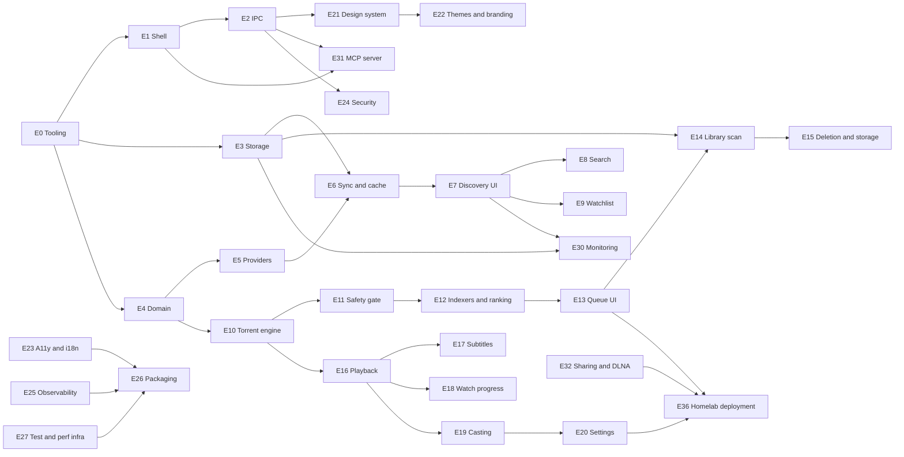
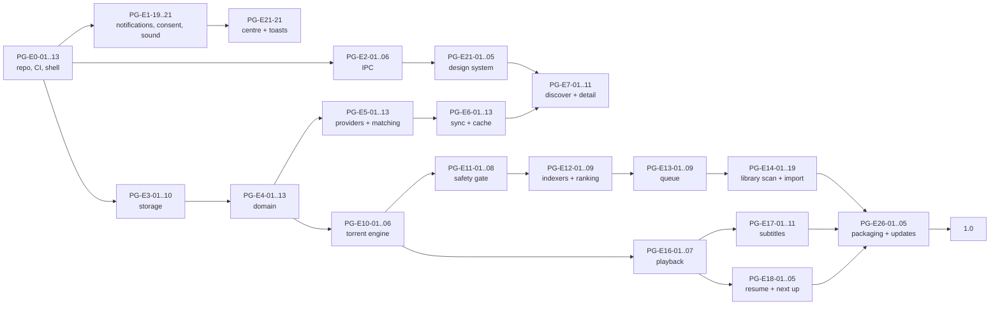

# Peregrine — Task Backlog

Granular, reviewable backlog. Phases and exit criteria come from [PLAN.md](./PLAN.md); the constraints that make these tasks necessary come from [ARCHITECTURE.md](./ARCHITECTURE.md).

## Conventions

The backlog is a checklist. Every task is one line with a machine-readable prefix and its acceptance
underneath:

```
- [ ] **PG-E3-10** *(doing)* `L` · deps PG-E3-04 · Type-safe repositories per aggregate
  - Acceptance: Round-trip property test for every entity
```

| Part | Meaning |
| --- | --- |
| `[x]` / `[ ]` | `[x]` is `done`. A task is `done` only when the global Definition of Done in PLAN §8 holds. |
| `**PG-E<epic>-<NN>**` | Stable forever; never renumber, supersede instead. |
| `*(doing)*` / `*(review)*` | Present on the two states a checkbox cannot express; absent means `todo`. |
| `` `XS` … `XL` `` | `XS` ≤ 0.5 d · `S` 1 d · `M` 2–3 d · `L` 4–5 d · `XL` 6–10 d |
| `deps …` | Task IDs that must be done first. Absent means startable immediately. |
| `plat …` | Present only when the task is not `all` platforms: `mac`, `win`, `lin`, `lin-wayland`. |
| `Acceptance:` | The observable proof beyond "the code is there". |

Every task implicitly includes its tests, error handling, structured logging, and doc updates per PLAN §8. Day totals use the band midpoints (`XS` 0.5 · `S` 1 · `M` 2.5 · `L` 4.5 · `XL` 8) rounded up to a whole day; `cargo xtask backlog-stats` recomputes the roll-up from this file and fails when the declared table at the bottom drifts.

## Implementation status

The desktop now starts a real runtime: it opens the SQLite database, runs the scheduler, publishes events through the coalescing bus to the webview, keeps redacted JSON logs, and drains all of it on exit. A Diagnostics screen starts a hello job, watches its progress, cancels it, and reads the journal row and the log tail the core wrote (PG-E0-19). The UI is no longer a header of buttons: the window chrome, a sidebar with one row per screen, the content area, and the player bar are one persistent layout (PG-E7-01), and `packages/ui` now holds the beginning of the kit — icons, buttons, the sidebar, and the settings primitives — beside the token pipeline and `Button`. Discover is still an empty shell, and provider, torrent, indexer, playback, stream, cast, monitor, MCP, and testkit crates remain documentation-only scaffolds.

Storage is complete for Phase 0: SQLite opening with the documented PRAGMA set, the single writer and reader pool, eleven migrations whose schema the tests assert column by column — applied through a runner that copies an existing database first and rotates the copies, with a boot-time integrity check that quarantines a damaged file and rebuilds the schema before signalling that a rescan is required — keyset-paged reads, and the job journal. The three schema defects PG-E3-06, PG-E3-08 and PG-E3-09 had recorded are settled by migration 0008 and the document they came from is corrected (PG-E3-19). Domain implementations exist for external IDs, release parsing and library-name parsing (each measured by an integration test against a committed corpus, 255 release names at a 95% floor and 209 library names at 100%), quality profiles, path policy, the account scope, notification policy, torrent inspection (PG-E4-07: the extension allowlist, traversal, reserved names, link and spoof rejection, and the count and size caps, each finding carrying a stable reason string), release ranking against a quality profile (PG-E4-06: a typed score with per-rule reasons in a fixed order, or a typed rejection), episode ordering per scheme (PG-E4-10: the canonical plus overlay list for `aired`, `dvd`, `absolute`, and `anime`, with the episodes a scheme has no number for reported in a typed outcome rather than dropped or ranked at their aired number), and — since PG-E4-01 — the whole catalogue and library entity set: titles, aliases, genres, keywords, companies, people, credits, seasons, episodes and their ordering overlay, plus library roots, media items and files, unmatched files, watch progress, subtitle tracks, watchlist entries and smart collections, each with a validating constructor and a test that asserts its enum values against DATA_MODEL §2. The application layer holds the scheduler, the event bus and its rate limiter, the runtime, notification policy and service ports, and redacted logging, with generated IPC bindings and theme validation. `peregrine-storage::catalogue` re-exports the domain's `TitleKind`, `TitleSubtype` and `MetadataState` rather than declaring its own, and a test reads `CREATE TABLE title` out of `sqlite_master` to assert each enum's spellings are exactly the constraint's, so the enum and the schema cannot drift apart silently. Nothing consumes the rescan signal yet because the scanner lives in E14.

The current verification, with rustc 1.99.0 on macOS arm64, passed 915 Rust tests and 103 frontend tests at the commit that wrote this paragraph (the counts move with every test added), plus `cargo clippy --workspace --all-targets -- -D warnings`, `cargo fmt --all --check`, every repository gate (`check-arch`, `check-determinism`, `check-migrations`, `check-todos`, `check-commands`, `check-offset`, `check-theme`, `check-dead-deps`, `check-notices`, `backlog-stats`, and `gen-ipc --check`), and the frontend typecheck, lint, format check, dead-dependency gate, and build. `check-dead-deps` is worth a word of its own: it shells out to `cargo-machete` and **fails rather than skips** when the tool is absent, so an earlier version of this paragraph listed it among the gates that passed while it had never been run on this machine. It has now been run (`cargo-machete` 0.9.2) and passes, including its own violation fixture. What that does not establish: any Windows or Linux run (PG-E0-13 still owes a green three-platform CI), an executed GitHub Actions run of any kind, a run of the packaged app, and the platform and soak suites that do not exist yet. `pnpm tauri dev` was run on macOS arm64 and opened a window (PG-E0-03); the runtime's own data directory could not be created in that environment because the agent sandbox forbids writes outside the checkout, so the window is verified and the in-app runtime is not.

Measured once on that machine in a debug build, for the record rather than as a budget: startup to a ready runtime on an empty data directory was 8.6 ms; 5 000 no-op jobs through the scheduler took 85 ms to submit and 91 ms in total (about 55 000 jobs/s of queue overhead); 200 one-step hello jobs ran end to end at 15.2 ms each, dominated by the job's own 10 ms step and a 1 ms poll interval. `PG-E27-08` owns the benches and the budget gate that would make these numbers enforceable; there is no budget gate for them today.

Every one of Phase 0's 91 tasks states an `Acceptance:` line, checked mechanically rather than by sampling, because a task whose acceptance is missing is a task nobody can verify — and the eight that are marked `*(review)*` are waiting on a human or a platform, not on a missing criterion.

PG-E0-14 is settled: `cargo deny check` is green on the real graph (advisories, bans, licences, sources), the five MPL-2.0 crates that arrive through Tauri's own stack are accepted one crate at a time by [adr/0021](./adr/0021-mpl-2-0-transitive-dependencies.md), and the advisory half is proven able to fail against a fixture. Tooling now includes the dead-dependency gates for both workspaces (PG-E0-15), a release workflow that has never been executed because no tag exists and the GitHub token here is unusable (PG-E0-16), and a checked attribution artefact for both runtime halves, with `cargo xtask check-notices` deriving the frontend closure from `pnpm-lock.yaml` (PG-E0-18). [adr/0022](./adr/0022-component-packs-and-sidecar-verification.md) settles how a component pack is verified before it runs, which is the mechanism PG-E26-01 still has to build. PG-E28-07 owns documentation checking and PG-E22-02 owns icon checking; `cargo xtask check-docs` and `cargo xtask icons --check` are still named in AGENTS.md §3 and still unimplemented. E2E, parser fuzz targets, and performance budgets remain open under E4 and E27.

**Phase 0 has ten tasks that cannot be finished inside Phase 0**, because the backlog declares dependencies on features that later phases build. They are listed here rather than left to be discovered when someone tries to tick them, and none of them should be closed by weakening its acceptance:

| Task | Depends on | Why the acceptance cannot be met yet |
| --- | --- | --- |
| PG-E1-05 | PG-E16-02 (Phase 3) | Its acceptance is "mpv and ffmpeg reaped"; there is no `PlayerBackend` and no mpv to reap |
| PG-E1-06 | PG-E1-05 | Orphan reaping is specified against the process the player will spawn |
| PG-E1-17 | PG-E1-05 | Power-save inhibition is specified "during playback and active downloads" |
| PG-E1-10 | PG-E10-09 (Phase 2) | The quit dialog "states the seed count", which needs the torrent engine |
| PG-E1-15 | aggregate download progress (Phase 2/3) | The badge is "driven by aggregate download progress"; its declared dep is only PG-E1-09, so the dependency line is incomplete |
| PG-E1-16 | PG-E24-03 (Phase 4) | Reveal-in-file-manager is "path-guarded" through the adapter that does not exist |
| PG-E2-12 | PG-E25-01 → PG-E20-01 (both Phase 4) | Command timing is surfaced "in Diagnostics" at a level the settings registry chooses; PG-E25-01's own note says exposing level changes is owed to the settings registry, so the chain is two phases deep |
| PG-E4-20 | PG-E16–E24, E29–E34 (Phases 6–8) | Its acceptance wants every DATA_MODEL §3 invariant to map to a named test, and 18 of the 39 belong to monitoring, agent access, the media server, and local accounts — phases whose tables no migration creates, so no test is possible. The audit is done; the residual is unreachable from Phase 0 |
| PG-E4-18 | a nightly toolchain, then Phase 4 | Its acceptance is a **24-hour** fuzz run, and `cargo-fuzz` needs nightly while this workspace is stable-minus-two with no fuzz command in AGENTS §3. The parsers are fuzz-ready and their no-panic property is already covered by proptest and a 200k hostile-input corpus, so the residual is the harness, which cannot be built without the toolchain decision |
| PG-E3-18 | a tagged release (PG-E0-16) | Its acceptance is "CI tests upgrade from each fixture", and "every previous release" is currently the empty set: `git tag` lists none and the workspace is unreleased at 0.1.0. No earlier schema exists to capture, and a fixture taken from the current schema would test that 0.1.0 upgrades to 0.1.0 — the one upgrade path that cannot fail. It needs a release, not code |

PG-E1-21 additionally requires a sound to be "verified by ear on each OS" and recorded in `SPIKE-11`, so it is a three-platform manual verification rather than something a single machine can close.

## Epic dependency graph



---

# Phase 0 — Foundations

## E0 · Repository and tooling

- [x] **PG-E0-01** `S` · Cargo workspace with one crate per module map entry
  - Acceptance: `cargo build --workspace` succeeds; arch allowlist file committed
- [x] **PG-E0-02** `S` · pnpm workspace: `apps/desktop`, `packages/{ui,theme,ipc-client,player-ui,i18n}`
  - Acceptance: `pnpm -r build` succeeds with placeholder exports
- [ ] **PG-E0-03** *(review)* `S` · deps PG-E0-02 · Tauri v2 scaffold with dev/build scripts and per-OS bundle identifiers
  - Acceptance: `pnpm tauri dev` opens a window on all three OSes
- [x] **PG-E0-04** `M` · deps PG-E0-01 · `xtask check-arch` parses crate edges
  - Acceptance: Fails on a fixture violation, passes on the real tree
- [x] **PG-E0-05** `S` · deps PG-E0-01 · `xtask check-migrations` hashes against the base branch
  - Acceptance: Fails when a merged migration is edited
- [x] **PG-E0-06** `M` · deps PG-E2-01 · `xtask gen-ipc` regenerates TS bindings, CI diff gate
  - Acceptance: Committed bindings match regeneration byte-for-byte
- [x] **PG-E0-07** `XS` · `xtask check-todos` requires an issue reference on every TODO
  - Acceptance: Fails on a bare TODO fixture
- [x] **PG-E0-08** `XS` · deps PG-E0-01 · Rust formatting and lint policy
  - Acceptance: `cargo clippy -- -D warnings` clean; pedantic lints configured
- [x] **PG-E0-09** `S` · deps PG-E0-02 · TypeScript strict config and lint stack
  - Acceptance: `tsc --noEmit` clean with `noUncheckedIndexedAccess`, `exactOptionalPropertyTypes`
- [x] **PG-E0-10** `S` · deps PG-E0-08, PG-E0-09 · Pre-commit hooks: format, lint staged files, arch check
  - Acceptance: A commit with a formatting error is rejected locally
- [ ] **PG-E0-11** *(review)* `XS` · Commit convention, PR template with perf and security checklists, CODEOWNERS **Remaining:** The template now carries every §4 category, the §6 budgets, the SECURITY.md per-PR controls, the DCO/commit convention and the §3 gates, but "rendered on a test PR" has not been executed: `gh` is unauthenticated here, so the GitHub-side rendering and the CODEOWNERS team names are unverified.
  - Acceptance: Template rendered on a test PR
- [ ] **PG-E0-12** *(review)* `XS` · Issue templates and label taxonomy, milestones mapped to phases **Remaining:** Locally verified: every phase in PLAN.md §2 has one label, every epic in this file maps to one of them, and every label a template or `renovate.json` names exists in `labels.yml`. Unexecuted: GitHub applies a form label only if the label already exists in the repository, and nothing creates or verifies the taxonomy outside `.github/workflows/labels.yml`, which runs on push to `main`; so the forms produce labelled issues only after that sync has run, and the run itself is unobserved.
  - Acceptance: Templates produce labelled issues
- [ ] **PG-E0-13** *(review)* `M` · deps PG-E0-01 · CI matrix: lint, test, build on macOS arm64, Windows x64, Ubuntu 24.04 **Remaining:** The Ubuntu MSRV job now installs the same Tauri Linux prerequisites as the `rust` and `gates` jobs, so it can link the shell. The `rust` job's exact flag set was then run locally on macOS arm64, which is the closest this environment can get to the matrix: `cargo clippy --workspace --all-targets --all-features --locked -- -D warnings` clean, `cargo test --workspace --locked` 419 passed and 0 failed, `cargo build --workspace --locked` succeeded, and every text gate passes — so macOS is expected green. What is still missing is a recorded run: the GitHub token here is unusable, so nothing has executed on GitHub, and neither `windows-2022` nor `ubuntu-24.04` has been exercised at all beyond the prerequisite install being present in the file.
  - Acceptance: Green on a trivial PR with cache warm
- [x] **PG-E0-14** `S` · deps PG-E0-13 · Supply-chain gate: `cargo-deny`, `cargo-audit`, `osv-scanner`, `pnpm audit`
  - Acceptance: Build fails on an advisory fixture
  - Settled: `cargo deny check` is green on the real graph under cargo-deny 0.20.2 — advisories, bans, licences, and sources all pass. The five MPL-2.0 crates are accepted one crate at a time through `[[licenses.exceptions]]` pinned by version and recorded in [adr/0021](./adr/0021-mpl-2-0-transitive-dependencies.md); `allow-wildcard-paths` ends the eleven false positives on our own path dependencies; `paste` and `proc-macro-error` are ignored by exact advisory id as compile-time-only, documented in DEPENDENCIES §7. `ci.yml` exercises the advisory half against `xtask/fixtures/supply-chain/advisory`, which pins `paste` 1.0.15 and must fail — verified locally: exit 1, RUSTSEC-2024-0436. `audit.yml` runs `osv-scanner` and `cargo-audit` weekly, because neither is a per-commit question.
- [x] **PG-E0-15** `XS` · deps PG-E0-13 · Dead-dependency gate: `knip`, `cargo-machete`
  - Acceptance: Build fails on an unused fixture dependency
- [ ] **PG-E0-16** `M` · deps PG-E0-13 · Release workflow: bundles, SBOM, signed manifest, changelog **Verified since, without a tagged run:** all four workflows parse and are structurally sound — every job carries `runs-on` or `uses`, no `needs` names a job that does not exist, and every step has `uses` or `run` — and **all thirteen `uses:` references resolve upstream**, each tag confirmed present with `git ls-remote` (`actions/checkout@v7`, `actions/setup-node@v7`, `actions/upload-artifact@v7`, `actions/download-artifact@v6`, `pnpm/action-setup@v6`, `softprops/action-gh-release@v3`, `Swatinem/rust-cache@v2`, `taiki-e/install-action@v2`, `EmbarkStudios/cargo-deny-action@v2`, `EndBug/label-sync@v2`, `dtolnay/rust-toolchain@1.95.0` and `@stable`, `google/osv-scanner-action@v2.7.0`). That proves the references exist, which is the failure a first release would otherwise hit; it does not prove a step does the right thing. **Remaining:** `.github/workflows/release.yml` is written and parses (`actionlint` 1.7.12 clean), but no tagged run has been executed: the acceptance needs a real `v*` tag to publish artefacts and a manifest, and the signing secrets plus the `RELEASE_SIGNING_CONFIGURED` repository variable must exist first. The bundled notice paths were wrong on the first merge (`../NOTICE` resolved to `apps/desktop/`), which `tauri-build` rejected; they are corrected to `../../../` and `cargo build -p peregrine-desktop` now succeeds, but the placement of those files *inside* each bundle still needs a real bundler run.
  - Acceptance: A tagged pre-release publishes artifacts and a manifest
- [ ] **PG-E0-17** *(review)* `XS` · deps PG-E0-13 · Automated dependency updates, grouped weekly **Remaining:** The config is verified statically — `schedule:weekly`, one group each for cargo, npm and github-actions, and version ranges left to the DEPENDENCIES §1 policy — and the managed labels exist. Nothing has run: "a grouped PR opens on schedule" needs the Renovate app installed on the repository, then one scheduled run observed.
  - Acceptance: A grouped PR opens on schedule
- [x] **PG-E0-18** `S` · `LICENSE`, `NOTICE`, third-party attribution scaffold
  - Acceptance: Attribution file lists every runtime dependency and sidecar

- [x] **PG-E0-19** `M` · deps PG-E0-03, PG-E2-02, PG-E2-06, PG-E2-07, PG-E3-02, PG-E6-01, PG-E25-01 · Connect the Phase 0 runtime: initialize and retain redacted logging, open SQLite, start the scheduler, and register a hello-job service through IPC **Correction (PG-E1-04):** this acceptance was overstated when it was ticked. `apps/desktop/src/hooks/useJobs.ts` — since moved to `apps/desktop/src/features/jobs/hooks/` — calls `listen` from `@tauri-apps/api/event`, which invokes `plugin:event|listen`, and the `default` capability granted no `core:event:*` permission at all, so the bridge's subscription was refused by the ACL and no job event could reach the UI. The report was confirmed from the installed sources rather than taken on trust: installed `@tauri-apps/api@2.12.1` has `event.js:139 return invoke('plugin:event|listen', …)`, Tauri 2.12.1's own `permissions/event/autogenerated/reference.md` names the gate `core:event:allow-listen`, and `apps/desktop/src-tauri/gen/schemas/capabilities.json` — the build's resolved ACL, not the file on disk — listed the capability's permissions as `["core:window:default", "core:window:allow-start-dragging"]`. `core:event:allow-listen` and `core:event:allow-unlisten` are now granted, so the subscription and its cleanup are permitted; that the whole path then works is asserted by the resolved ACL and not by a run of the Diagnostics screen, which was outside this package's scope.
  - Acceptance: From the desktop UI, start a hello job, persist its journal state, observe rate-limited progress and cancellation, and view its redacted log output; shutdown drains the scheduler and database; startup failures use structured errors; measure startup and scheduler performance
  - **Correction (PG-E14-02's gates):** two of this task's own tests were flaky, about one run in ten, and the flake was a real defect rather than a slow test. `runtime::cancelling_a_hello_job_stops_it_and_closes_its_row` and `jobs::command_tests::cancel_stops_a_running_job_and_then_reports_it_unknown` both cancel a job twice and expect the second answer to be "no such job"; sometimes it was `ok`. The cause is a window between two sources of truth: **a job writes its own terminal row, and the scheduler resolves its handle afterwards**, so `Runtime::cancel` — which decided liveness from the handle — could find a live handle for a job whose journal row already said `canceled`. Cancelling there answered `ok` about a job that had already stopped, and `ok` is the one answer a caller cannot tell apart from a real cancellation. `Runtime::cancel` now reads the row's phase first and treats a terminal row as "not live", removing the entry and reporting `UnknownJob`, which is the rule the UI already assumed. A failed journal read falls back to the handle rather than refusing the request, because failing to cancel because a read failed would be strictly worse. A deterministic test pins it by writing the terminal row by hand — staging the window every run, where racing a real job staged it one run in ten — and the two original tests are unchanged and now pass 40 and 30 runs in a row.

## E1 · App shell and platform

- [ ] **PG-E1-01** *(review)* `M` · deps PG-E0-03 · Window creation with platform-appropriate chrome behind one `WindowChrome` component **Remaining:** Landed: `WindowChrome` presenting a macOS title bar (78 logical px reserved for the native traffic lights, `deep` drag region), a Windows toolbar beneath the native frame, and a Linux header bar, plus a neutral bar when the platform cannot be read; the platform comes from the core's `BuildInfo.target` over the typed IPC contract, never from the user agent. `tauri.conf.json` carries the overlay settings, `cargo build -p peregrine-desktop` validates them, and `main_window_declares_restorable_overlay_chrome` asserts them against the config the runtime was built with. Run on macOS arm64: the window opened at the configured logical 1280×800, centred, the WebKit content process started, and the chrome's macOS geometry is in the emitted stylesheet. Unverified: no Windows or Linux run, so "caption buttons on Windows" and "headerbar on Linux" rest on Tauri's native frame staying native and on the per-OS assertion in `WindowChrome.test.tsx`; ARCHITECTURE §17's Windows cell was corrected in the same change, because `titleBarStyle` is macOS-only in Tauri v2.
  - Acceptance: Traffic lights on macOS, caption buttons on Windows, headerbar on Linux
- [x] **PG-E1-02** `S` · deps PG-E1-01 · Window state persistence: size, position, maximized, per-monitor **Settled:** `tauri-plugin-window-state` 2.5.0 owns the geometry (ARCHITECTURE §6), and the window is created `visible: false` because the plugin is what shows it, once the restored geometry is in place, so the window never paints at the config default and jumps. It persists size, position, maximized, fullscreen, visibility, and decorations per window label in `app_config_dir/.window-state.json`. Verified on macOS arm64 against a 2× built-in display and a 1× external one: `visible: false` was shown (the saved state carried `visible: true` at exit); a hand-written `1600×1000 @ (300,200)` physical came up at `800×500 @ (150,100)` points, which is that rectangle at 2×; a saved position on no monitor was refused while the size still applied; `maximized: true` came up maximized. Measured limitation: the file holds **physical** pixels keyed by window label alone, with no monitor identity and no scale factor, so it is per-monitor only in the sense that a saved rectangle is applied when it still intersects an available monitor. Restoring the same `800×500 @ (300,200)` on the 2× display after it had been saved on the 1× one produced a `400×250`-point window: a window that alternates between displays of different scale factors changes size, and nothing in the plugin tracks a monitor change while running.
  - Acceptance: Restores across restarts and monitor changes
- [ ] **PG-E1-03** *(review)* `M` · deps PG-E1-01 · Custom drag regions, double-click-to-zoom, snap layouts **Remaining:** Landed: the macOS bar carries `data-tauri-drag-region="deep"` and `core:window:allow-start-dragging` is granted (the double-click zoom needs `internal_toggle_maximize`, which `core:window:default` already carries); every other platform declares `"false"`, because the native frame owns dragging there. Tauri's injected script refuses to drag from any element it classifies as clickable on the event path, which is what keeps the bar's controls clickable, and `WindowChrome.test.tsx` asserts one drag region on the bar, no control of ours, and nothing in the tab order. Unexecuted: no Windows or Linux run, where dragging, double-click zoom, Snap Layouts, and the caption buttons are the native frame's and are untouched by this change.
  - Acceptance: Drag and zoom behave natively; caption buttons hit-test correctly
- [x] **PG-E1-04** `S` · deps PG-E1-01 · Single-instance enforcement with argument forwarding **Done:** `tauri-plugin-single-instance` 2.5.3 is registered first in the builder, so a second launch hands its `std::env::args_os` vector and working directory to the first instance and exits before its own runtime starts. The callback raises `main` (`unminimize` then `set_focus`, both no-ops on a window that is already up; the `is_minimized` question is deliberately not asked because this callback runs on the event loop, so the answer would have to come from another thread and be stale by the time it arrived) and hands the payload to `external::forward`, which is the one seam both this and PG-E1-11's deep links go through. **Run on macOS arm64** under `tauri dev`: the first instance wrote `/tmp/app_peregrine_desktop_si.sock`; a second `/tmp/pg-target-e1-shell/debug/peregrine-desktop "peregrine://title/tmdb/123"` exited 0 in 0.63 s with no window and no runtime of its own, and the first instance's log carried `peregrine_desktop::external external input arrived and has no handler yet (PG-E1-11) {arguments: 1, has_working_directory: true}` — the argument reached the callback intact. **Not wired, and named as such:** `forward` has nothing to route to until PG-E1-11 exists, so it records the argument *count* and never the values (a deep link can carry a magnet URI, and the log tail is copied out of the app — SECURITY.md T13). Windows and Linux were not run; their locking mechanism (named mutex, D-Bus name) is the plugin's and is asserted only by the crate's own platform support table.
  - Acceptance: Second launch focuses the first and forwards the deep link
- [ ] **PG-E1-05** `M` · deps PG-E1-01, PG-E16-02 · Graceful shutdown sequence
  - Acceptance: mpv and ffmpeg reaped, journal checkpointed, no orphan on next boot
- [ ] **PG-E1-06** `M` · deps PG-E1-05 · Orphan child-process reaper keyed by PID and start time
  - Acceptance: A killed app leaves no mpv behind after relaunch
- [ ] **PG-E1-07** `M` · deps PG-E1-01 · plat mac · App menu and shortcuts: macOS app menu, Edit menu, Window, Help **Remaining:** Landed: `apps/desktop/src-tauri/src/menu.rs` describes the menu as data and installs it in `setup`. On macOS the first submenu is the application menu (About with the bundle's name, version, and copyright, Services, Hide, Hide Others, Quit) and About appears nowhere else; on every platform there is an Edit menu of the platform's own undo/redo/cut/copy/paste/select-all, a View menu holding full screen, a Window menu (minimize, zoom, close), and a Help menu (About off macOS). The accelerators are the OS's: `muda` attaches `CmdOrCtrl` to each predefined item, so Cmd on macOS and Ctrl elsewhere is `muda`'s `CMD_OR_CTRL` and not a table of ours, and `Cmd` on an item whose platform default is different would mean overriding it. **A Playback menu is present with Play/Pause, Next, and Previous explicitly disabled**, because this phase has no playback command to serve them and an enabled item that does nothing is worse than an absent one; the ids (`playback.play_pause`, `playback.next`, `playback.previous`) are declared now so the Phase 3 handler does not have to change what the OS already knows the item by, and their accelerators are deliberately unset while the items are inert. `View` holds only full screen: zoom is a webview operation no command serves, so it is absent. **Unexecuted:** the acceptance needs a real macOS run with an input focused, and the harness on this machine has no assistive access (`System Events` answers `osascript is not allowed assistive access` for any menu-bar read), so `Edit ▸ Copy` was not driven. What was executed on macOS arm64: `tauri dev` started, `menu::install` returned `Ok` (its only failure path is logged), and the app ran with the menu installed and no error line. **PG-E1-08 is not implemented here**: there is no shortcut registry and no conflict detection, and nothing in this change claims one.
  - Acceptance: Cut/copy/paste/select-all work in inputs on macOS
- [x] **PG-E1-08** `M` · deps PG-E1-07 · Shortcut registry with conflict detection and platform rendering **Done:** The registry is `peregrine-ipc::shortcuts`, which is the crate the shell and the generated frontend contract both go through, so the menu and the Settings list read one table. An entry holds `muda`'s own `Modifiers` and `Code` built from `CMD_OR_CTRL`, and `Shortcut::render` writes the platform notation from those pieces — one declaration per shortcut, not a macOS string beside a Windows one that can drift, and no accelerator string at all, so the menu can be given the same value later. `list_shortcuts` is the command; `apps/desktop/src/features/settings/components/SettingsScreen.tsx` maps over its answer and holds no list of its own, which `SettingsScreen.test.tsx` asserts by rendering the screen from two synthetic bindings and from none. The accelerators are real, not a reference list: `useShortcutDispatch` matches `event.code` and all four modifier flags against the same answer and opens the screen the action names, so an entry that did nothing could not exist. **Conflict detection is `shortcuts::validate`, called by the command and from `setup`:** two entries claiming one accelerator is `ShortcutConflict::Duplicate`, and an entry claiming one an application menu item owns is `ShortcutConflict::MenuOwned`; both have a named test. **Measured gap:** `muda` resolves a predefined item's accelerator internally and exposes no accessor for it (`PredefinedMenuItemType::accelerator` is `pub(crate)`), so the OS-owned Edit, Window, and application-menu accelerators cannot be read back and the reserved set is what this application itself declares, which is empty until the first application-owned menu item with an accelerator exists. A copy of `muda`'s table would close that gap and is exactly the drift this registry exists to avoid, so it is left open and named here. **Unexecuted:** the list was never looked at in a window — the harness cannot drive the Tauri webview, so the screen is covered by rendering tests and the typecheck rather than by a screenshot. Windows and Linux were not run; their branch of the rendering is asserted by `both_notations_are_rendered_from_one_binding`, which asks for the other notation directly.
  - Acceptance: Shortcuts list in Settings is generated from the registry
- [ ] **PG-E1-09** `M` · deps PG-E1-01 · Tray or menu-bar extra with state-aware menu **Remaining:** Landed: `apps/desktop/src-tauri/src/tray.rs` builds a tray whose menu is data (`spec`) rendered from the core's state, with the two counts the acceptance names, a separator, "Show Peregrine", and "Quit Peregrine". The counts are the core's and not the shell's: `Runtime::shell_status` reads the scheduler's `live` counter and `peregrine_ipc::runtime::shell_status` hands it to the shell, which re-reads it every two seconds and rebuilds the menu only when a value changed — rebuilt on the main thread, because `muda`, which Tauri's menus sit on, refuses to create a platform menu item anywhere else. **Run on macOS arm64** against the built shell: the log carries `the tray is showing the core's counters {active_downloads: 0, seeding: 0}`, with no `WARN` or `ERROR` line anywhere in the run, so the icon was created with the counts the core reported. **`seeding` is 0 by construction:** no torrent engine is composed into the runtime yet (PG-E10), so the core has no other number to report and the tray does not invent one. **The window-state hazard:** nothing here hides the window, and `ensure_main_window_visible` in `lib.rs` is the other half — `tauri-plugin-window-state` 2.5.0 persists `visible` under `StateFlags::all()` and calls `show()` only when the restored value is `true`, so a state file saying `visible: false` would leave the next launch invisible; the shell now shows the window itself in `setup` when the restored state hid it. Removing the VISIBLE flag is not a fix, because the plugin would then never call `show()` at all. The consequence for later work is that a "start minimized to the tray" preference cannot be expressed while that stands, and PG-E1-10 will have to replace the check rather than live beside it. **Unexecuted, and why the task is not ticked:** "hidden when disabled" is implemented as `ShellStatus::tray_enabled` and removing the icon, and the disabled branch is executed by `a_disabled_tray_leaves_no_icon_behind` through the real `install` function against a mock application — but nothing in this phase can set that value, because the settings registry (PG-E20-01) is where a user's answer will live, so no run of the shipping binary has taken the path. Windows and Linux were not run; their tray mechanism is the plugin's, and `set_visible`/`remove_tray_by_id` are Tauri's per-platform implementation.
  - Acceptance: Shows active downloads and seeding count; hidden when disabled
- [ ] **PG-E1-10** `S` · deps PG-E1-09, PG-E10-09 · Close-to-tray and keep-seeding-after-close policy with prompts
  - Acceptance: Quit dialog states the seed count and offers both options
- [x] **PG-E1-11** `S` · deps PG-E1-04 · Deep link handling: `peregrine://title/...`, `peregrine://magnet/...` **Done:** **The choice, stated:** `tauri-plugin-deep-link` is registered and `tauri-plugin-single-instance`'s `deep-link` feature is deliberately **not** enabled. The plugin is the only thing that registers the `peregrine://` scheme with the OS at all, and its `on_open_url` is the one delivery path that never appears in an argument vector — macOS Launch Services delivers a URL to the running application as an Apple Event. The feature is the wrong half of that: reading its source, it calls `deep_link.handle_cli_arguments(args)` *before* the single-instance callback, so the same argument would reach the router twice (once through the plugin's `deep-link://new-url` event and once through the callback that PG-E1-04 already owns), and it makes the deep-link crate an implicit dependency of a feature rather than a deliberate one. The scheme is configured in `tauri.conf.json` under `plugins.deep-link.desktop.schemes`. **The grammar** is `peregrine-domain::deeplink`, because a deep link is a parser of untrusted input and parsers live in the domain (R13/R15): `peregrine://title/<provider>/<id>` is rebuilt through the same `deep_link` builder a notification click uses, so the external link and the internal one cannot spell a title differently, and a magnet is accepted as `peregrine://magnet/<40 hex btih>` or `peregrine://magnet?xt=urn:btih:<40 hex btih>` and nothing else — no base32, no `btmh`, no duplicate `xt`, no fragment. Every refusal is a fixed sentence that holds no part of the input, so a refused magnet cannot reach the diagnostics tail (SECURITY.md T13), and the parser has a proptest for "answers rather than panics" plus one for "anything accepted re-parses to itself". **A magnet is refused, deliberately:** SECURITY.md T12 requires a confirmation showing the inspection report before anything is added, no torrent engine exists to produce one (PG-E10), and the validated infohash is therefore not retained, logged, or emitted — a value only a log line or an event could carry is a liability. `external::forward` (a second launch, and this process's own argument vector on a cold start) and `external::forward_urls` (the URL the OS hands over) are the same router; a title is emitted on `external://deep-link` as the canonical link this application built. **A cold start is why the delivery state exists:** the window's document loads after `setup` runs, so a link that arrived with the launch is held and released on `Builder::on_page_load` instead of being emitted into a webview with no listener. **Run on macOS arm64** against the built shell: a launch *with* `peregrine://title/tmdb/123` as its argument logged `an external deep link routed {route: "title"}`; a second instance while it ran logged the same line for `peregrine://title/tmdb/4242` and exited 0; a second instance carrying `peregrine://magnet?xt=urn:btih:0123…4567` logged `a magnet deep link was refused: adding one needs the inspection gate (SECURITY.md T12) and no torrent engine is composed in yet`; `grep` over the whole log found the infohash 0 times and the raw title links 0 times. **Unexecuted:** the Launch Services path — `on_open_url` is registered and routed, but executing it needs an installed bundle with the scheme registered in its `Info.plist`, which this harness cannot build and register, so on macOS only the argument-vector cold start and the single-instance warm start were observed. Windows and Linux were not run at all; their deep link arrives as an argument to a second process, which is the path that was exercised.
  - Acceptance: Cold start and warm start both route correctly
- [ ] **PG-E1-12** `S` · deps PG-E1-01 · Native file and folder pickers wrapped in a typed API **Remaining:** Landed: `tauri-plugin-dialog` 2.8.2 is registered in the shell and granted exactly `dialog:allow-open` (not the default set, which would also enable `message`, `save`, and `confirm`), and `apps/desktop/src/lib/picker.ts` is the only module that names `@tauri-apps/plugin-dialog`. `pickFile` and `pickFolder` answer with discriminated results (`cancelled`, `files`, `folder`) and `null` outside the Tauri shell rather than throwing, and they return `UntrustedPath`, a branded string that cannot be passed where a `PathGuard` product is wanted. **A picker result is not trusted input**: the dialog proves a human chose a path in an OS-owned window and nothing about the path itself, and `PathGuard` is Rust's, so validation happens in the core when the path is used, not here — the module's doc comment says so, and the brand is what makes the compiler agree. Note that the plugin also appends the picked path to the fs and asset *scopes*; that is inert in this build because `tauri-plugin-fs` is a transitive dependency that is never registered as a plugin, so no `fs:` command exists to consume the scope, and the capability grants none. **Unexecuted:** the acceptance's "returns resolved paths" needs the native dialog to actually open and answer, which needs a human at the window; the wrapper is covered by 14 unit tests against a mocked plugin (single, multiple, cancel, empty selection, a non-string entry, option passthrough for both pickers, and the no-shell case), and no dialog was opened on any OS.
  - Acceptance: Returns resolved paths, never raw strings
- [ ] **PG-E1-13** `S` · deps PG-E1-09 · Autostart registration per OS, off by default **Remaining:** Landed: `tauri-plugin-autostart` 2.7.0 is registered in the shell with `MacosLauncher::LaunchAgent`, and the login item is reachable only through `peregrine-ipc`'s `autostart_enabled` and `set_autostart`, which the Settings screen's toggle calls. Off by default is structural rather than a default: registering the plugin creates no login item, `set_autostart` is the only call to `enable` in the shipping binary, and `REGISTERED_AT_FIRST_RUN` is asserted in a `const` block so the requirement is checked while compiling the crate. A refused change answers `PERMISSION_DENIED` with a fixed message; the OS error's own text is logged locally and not sent over IPC, because on macOS and Linux it names the path of the entry the OS would not touch. **Unexecuted, which is why the task is not ticked: no login-item write was performed on any OS.** Toggling it needs the running application with a loaded webview, and this harness cannot drive the Tauri window — so "the toggle survives a reboot" was not executed and **no reboot was faked**, and neither was "removed cleanly on uninstall", which would need a packaged install and an uninstall step. What the plugin does per OS — `SMAppService` or a LaunchAgent on macOS, a registry `Run` key on Windows, an XDG autostart entry on Linux — is the crate's own implementation and was not observed on any of the three.
  - Acceptance: Toggle survives reboot; removed cleanly on uninstall
- [ ] **PG-E1-14** `M` · deps PG-E1-09, PG-E1-19 · Native notification delivery through `tauri-plugin-notification`: `on_action` handler registered at startup, int32 ids from a persisted counter, resolved per-OS sound value, deep link in `extra` **Remaining:** Landed: `tauri-plugin-notification` 2.6.0 is registered in the shell and allowed with a stated reason in `arch-allowlist.toml`; `apps/desktop/src-tauri/src/notifications.rs` holds the whole adapter. The **click handler is registered in `setup`**, before the runtime can raise an event and before the document loads, because the plugin only asks the OS to report clicks while a handler exists and a toast shown before the first handler reports nothing ever (ADR 0015 §3, §6). A click is routed through `crate::external::forward_urls`, the same router a `peregrine://` launch takes, so it gets the same grammar check, the same refusal for a magnet, and the same hold-until-page-load `Delivery` state — a click is not a second, weaker route. The **deep link travels in `extra` under `deepLink`**, which is what the click reports back, so the toast's visible text never carries a destination. The **int32 id** comes from a rotating counter persisted at `<app data dir>/notification-id` (one decimal line beside `peregrine.sqlite`), so a restart continues the sequence; ids are `1..=i32::MAX` and wrap back to 1, 0 is never issued, and a wrap is harmless because nothing routes by id and macOS and Windows ignore the value entirely. The **sound value is passed through unchanged** from `Outgoing`, which `NotificationPayload::render` already resolved from the event's switch and `Platform::system_sound` per OS, so the adapter holds no second sound table that could drift; PG-E1-21 still owns whether those values are the right ones (SPIKE-11). The **capability grant is two permissions**, `notification:allow-is-permission-granted` and `notification:allow-request-permission`, and deliberately not `notification:default`: that set also grants `allow-notify`, which would let the renderer show a toast directly and bypass the service that writes the centre row before any OS call. **Tests:** 10 in `notifications.rs` — the counter's sequence and persistence across a restart, the wrap and the refusal to issue 0, six unusable counter fixtures, a click routing to the canonical link, three hostile links (`magnet`, `javascript:`, an unknown route) reaching nothing, four click shapes that route nothing (no `extra`, another action id, no notification, a non-string link), the handler registering against a real plugin instance, the toast mapping (body, sound, link), the plugin's I/O error becoming a recordable `NotifyError::Refused`, and the sound value coming from the domain. **Not ticked, and why — the acceptance is not executed:** no toast was delivered on any OS and no click was received from one. Delivery needs the running application with a bundle identity (macOS `UNUserNotificationCenter`, Windows an installed app), and the harness cannot drive the Tauri webview or present a notification to a human, so `install()` registering the handler, showing a toast, and a human clicking it were **written and unit-tested, never run**. The OS-failure clause is partly unreachable by construction and that is reported rather than papered over: the plugin's `show()` is fire-and-forget — it spawns the OS call and discards the result (`let _ = notification.show()`) — so no desktop failure after preparation can be observed through it at all; the adapter maps the one error the plugin can return (an I/O failure preparing the payload) to `NotifyError::Refused`, and the centre-row-before-toast ordering that the acceptance depends on is PG-E1-19's, proven there against a test double. **Found:** ADR 0015's evidence cites 2.5.1, where `on_action` was a plugin-builder method; in 2.6.0 it is `Notification::on_action` behind `NotificationExt`, so "registered at startup" is a `setup` call rather than `.plugin(...on_action(...))`. Registering it is also what makes the plugin take the *tracked* path, so a handler is a cost — one waiting thread per toast on macOS and Windows — as well as the requirement. Also found: `Platform::system_sound` hardcodes `C:\Windows\Media\Windows Notify System Generic.wav`, which ADR 0015 §5 says must be resolved from `%SystemRoot%` at runtime; that belongs to PG-E1-21's sound work, not here.
  - **Narrowed by PG-E1-19:** the centre row is now written *before* the OS call and the port exists, so this task is the adapter alone — `tauri-plugin-notification`, the startup `on_action` listener, the int32 id counter, the per-OS sound value, click routing, and the capability grant. Its acceptance still covers the OS-failure path, which PG-E1-19 could only prove against a test double.
  - Acceptance: A toast routes to the right screen when clicked; the centre entry exists even when delivery fails; no notification is shown without a registered listener
- [x] **PG-E1-19** `L` · deps PG-E3-09 · `NotificationService`: the event catalogue from [ADR 0015](./adr/0015-native-notifications.md), per-event policy, dedupe window, burst summaries, global rate limit, focus suppression, quiet hours with digest, severity handling, and the in-app centre as the authoritative record **Done:** `peregrine-storage`'s `NotificationRepository` is the row: it writes the centre entry before any OS call, coalesces a repeat inside the entry's dedupe window (anchored at the first occurrence, so a repeating event cannot coalesce forever) while keeping the `delivered_at` history the global rate limit counts, refreshes a burst summary over the burst window, pages by `(created_at, id)` cursor, counts only the rows a digest is waiting for, and applies `AccountScope` visibility (a rated, non-adult subject) in SQL. `peregrine-domain`'s `centre` module holds the port and the rows, so the row vocabulary has one definition; `NewCentreEntry` carries `NotificationText` and `DeepLink`, whose only constructors scan, so an unscanned string cannot reach a row. `peregrine-app`'s service is the only path from the planner to a row, and every suppression is written with its reason. **Tests:** I13 has one named test per path — permission denied, disabled, quiet hours, focus, dedupe, rate limit, burst — plus `the_schema_refuses_a_suppressed_row_with_no_reason`; I14 has `a_critical_event_notifies_during_quiet_hours_and_with_its_switch_off`, `..._is_still_deduped`, `..._is_still_rate_limited`, `..._is_still_focus_suppressed`; I15 drives nine canaries (two real filesystem roots, a Windows path, a token, a magnet, a bare infohash, a tracker URL) through all ten event templates and adds the adult-name rule, with `an_adult_flagged_title_is_never_named` — all in `peregrine-app/tests/notify.rs`, `peregrine-storage/src/notify/tests.rs` and `peregrine-domain/src/centre.rs`. **Still others':** the `OsNotifier` adapter (PG-E1-14 — only the port and a test double are here: no Tauri plugin, no native delivery, no click routing), the settings/consent store and first-run choice (PG-E20-01, PG-E1-20), sound values and the in-app chime (PG-E1-21), the centre UI (PG-E21-21) and retention (PG-E3-15). Nothing in the shipping binary constructs the service yet, and the digest's window-end trigger needs the settings registry before it can fire. **Found:** `NotificationPayload::render` never called the existing `burst_deep_link`, so a summary clicked through to one title's page; a summary now routes to `peregrine://queue` as ADR 0015 §4 says, and the digest keeps `peregrine://notifications`. **Also found:** the service counted the row it had just written as a previous match, so every first occurrence planned as a duplicate — the counts now exclude the current row and the burst count includes it.
  - Acceptance: Table-driven tests over the policy matrix: every suppression records a reason; critical events ignore quiet hours but not focus modes; five completions in a burst produce one summary toast and five centre entries
- [ ] **PG-E1-20** `M` · deps PG-E1-19, PG-E1-12 · Consent and permission handling: wizard step with per-event choice, `isPermissionGranted`/`requestPermission` probe, a test-notification button, an OS-settings deep link, denial fallback to the in-app centre, and revocation detection **Remaining:** Landed, in the core: consent is now state rather than a boolean — `peregrine-domain::notify::Consent` holds the decision (`Unanswered`, `Granted`, `Declined`), the "don't ask again" flag, and the OS's last reported permission, with `should_prompt`, `consented`, `permits_delivery`, `revoked`, and `with_os_permission` as the only ways to read it. `peregrine-app`'s `Preferences` carries it, the service exposes `consent`, `should_prompt_consent`, `record_consent`, and `record_os_permission`, and `planner_state` derives what the planner sees through `permits_delivery()` — so the answer is consulted **before** the notifier can be called, in the same place the centre row has already been written. **The acceptance is proven at the service layer:** `a_declined_user_is_never_asked_again_and_still_gets_every_event` drives a declined user (both with and without the "don't ask again" flag) through five events, including both critical ones, and asserts `should_prompt_consent()` is false, the consent reads back as stored, no event reached the notifier, and all five are centre rows with `permission_denied` recorded; `recording_consent_stores_the_answer_and_changes_nothing_else` proves the answer is persisted through the store while the sound switch, hidden titles, quiet hours, and per-event rows are untouched except for the documented critical-event normalisation; `a_revoked_os_permission_centres_the_next_event` proves revocation detection — a granted consent plus an OS that reports `false` centres the next event with the row intact, and granting it back in the OS restores delivery without rewriting the user's own answer. The frontend half is `apps/desktop/src/lib/notifications.ts`, the only module that names `@tauri-apps/plugin-notification`: `probePermission` (never prompts) and `requestPermission` (the ask) answer `granted`/`denied`/`unverified`, never claiming a permission outside the shell, on a thrown call, or on a prompt the user dismissed, and `notificationSettingsUrl` names macOS's and Windows's settings pages and answers `null` on Linux, which publishes no portable one. `sendNotification` is deliberately not imported: a renderer that could send a toast directly would be a route around the centre-first invariant. **Not ticked, and why:** the wizard step and the Settings screen do not exist, so nothing asks the user yet, and no test-notification button exists. The IP surface is unchanged on purpose: a consent command would need the notification service, and the service cannot be constructed in the shipping runtime until PG-E20-01's settings registry implements `NotificationPreferences` — a command answering "unavailable" for a state nothing can write is a dead surface, not a delivered one. **Also unexecuted:** the OS probes and the settings links were driven against a mocked plugin (10 tests), not against a real OS — no system prompt was raised and neither settings URL was opened, because opening one takes over the user's Settings pane; both are for SPIKE-11 to verify. No `requestPermission` was ever called by the app, and the wizard's per-event choice UI is unwritten.
  - Acceptance: A declined user is never asked again unprompted and still receives every event in the centre; the test button reports honestly whether a notification arrived; the resolved state and OS link are visible in Settings
- [ ] **PG-E1-21** `M` · deps PG-E1-14 · Sound policy per OS: verified sound values per event class, master and per-event switches, optional custom file validated per OS, honest "best effort" copy, and the synthesized WebAudio in-app chime (no bundled audio assets) **Recorded by PG-E1-14:** `peregrine-domain`'s `Platform::system_sound()` hardcodes `C:\Windows\Media\Windows Notify System Generic.wav`, while ADR 0015 §5 requires the Windows path to be resolved from `%SystemRoot%` at runtime against a validated fallback list. That is real drift between the ADR and the code, and this task owns the sound values. Left in place rather than fixed, because sound is this task's to settle.
  - Acceptance: Sound on and off both verified by ear on each OS with the result recorded in SPIKE-11; a custom file that fails to load falls back with one non-modal notice; the chime never overlaps itself and respects the master switch
- [ ] **PG-E1-15** `S` · deps PG-E1-09 · plat mac, win · Dock and taskbar progress badges driven by aggregate download progress
  - Acceptance: Badge clears when the queue is idle
- [ ] **PG-E1-16** `XS` · deps PG-E1-12, PG-E24-03 · Reveal-in-file-manager per OS, path-guarded
  - Acceptance: Refuses paths outside configured roots
- [ ] **PG-E1-17** `S` · deps PG-E1-05 · Power-save inhibition during playback and active downloads
  - Acceptance: Screen does not sleep during playback; released on stop
- [ ] **PG-E1-18** *(review)* `M` · deps PG-E1-01 · High-DPI, multi-monitor, and fractional-scaling correctness pass **Remaining:** Landed: every chrome metric is a logical pixel taken from the platform's own logical metric (52 px macOS, 40 px Windows, 47 px GNOME) and applied as a minimum height, so rounding at a fractional scale or 1.4× text expansion grows the bar instead of clipping it; the document no longer sizes itself with `100vh`, which a fractional device-pixel ratio rounds against the window box and turns into a scrollbar; `trafficLightPosition` is asserted to be a logical position. Observed on macOS arm64: the built stylesheet carries the geometry as `min-height: 52px/40px/47px` and `padding-left: 78px`, the window opened at the config's logical 1280×800 (persisted as 2560×1602 physical at 2×), and the two-display machine has one 2× and one 1× screen, which is where the scale-factor defect PG-E1-02 measured lives — in the persisted window rectangle, not in the CSS. Unobserved: 125% and 150% are Windows and GNOME factors that no macOS display produces, and no screen was inspected visually for blur or clipping at a fractional scale.
  - Acceptance: No blurry text or clipped chrome at 125%, 150%, 200%

## E2 · IPC layer

- [x] **PG-E2-01** `M` · deps PG-E0-03 · `specta` + `tauri-specta` export pipeline and generated client, pinned to the exact `2.0.0-rc.25` RC (no stable 2.x exists) with a written fallback to hand-written DTOs
  - Acceptance: One Rust type change propagates to a compiling TS call site; the RC pin is exact
- [x] **PG-E2-02** `S` · deps PG-E2-01 · Structured `AppError` with stable codes and UI mapping
  - Acceptance: Every code has a message key and a retryability flag
- [x] **PG-E2-03** `S` · deps PG-E2-01 · Command registration with a ≤20-line rule and a lint check
  - Acceptance: A fixture command with logic fails the check
- [x] **PG-E2-04** `M` · deps PG-E2-01 · Event bus with namespaced, versioned topics
  - Acceptance: Topic names are declared in one manifest shared with TS
- [x] **PG-E2-05** `M` · deps PG-E2-04 · Coalescing / rate-limiting event batcher with drop counters
  - Acceptance: A 1 kHz producer delivers ≤4 Hz with audit of drops
- [x] **PG-E2-06** `M` · deps PG-E2-04 · Job-scoped command pattern: start returns job ID, progress streams
  - Acceptance: No command blocks >100 ms in a load test
- [x] **PG-E2-07** `M` · deps PG-E2-06 · Cancellation API for every job-scoped command
  - Acceptance: Cancel mid-job leaves no partial DB state
- [ ] **PG-E2-08** `M` · deps PG-E2-01 · Typed asset protocol for cached images and local thumbs **Remaining:** Landed: Tauri's `protocol-asset` feature is on for the shell, `app.security.assetProtocol` is `enable: true` with an **empty static scope**, and `media::install` runs in `setup` to create and allow exactly one directory: `<OS cache directory>/images`, the tier 3 cache of ARCHITECTURE §8 that holds poster, backdrop, still, and generated local-thumbnail variants. The library root, the data directory, the database, and the logs are not exposed, and the config exposes nothing on its own, so a path is readable only because the runtime allowed its directory. **A path outside the cache fails rather than being read** — Tauri's asset handler asks the same scope, and the scope canonicalizes before it matches, so a symlink planted inside the cache that resolves out is refused; four tests in `apps/desktop/src-tauri/src/media.rs` prove that with real files on both sides of the boundary, plus that an unresolved scope serves nothing at all. `apps/desktop/src/lib/media.ts` is the only module that names `convertFileSrc`, returns `null` rather than a URL outside the shell, and refuses anything that is not an absolute path — including a `data:` URI, which is what keeps the acceptance's "no base64" true by construction. **Not ticked, and why:** the acceptance is an end-to-end observation — a poster rendering in the webview over `asset:` — and no image cache exists yet to write one (PG-E6-09 owns the content-addressed store and the command that returns a reference), while the webview cannot be driven in this harness. So the protocol is registered and the scope is proven, but no poster was loaded on any OS and the `` path is unexecuted. **Unobserved also:** Windows' `http://asset.localhost` form and Linux's, since only macOS arm64 was built.
  - Acceptance: Poster loads without base64 or IPC payloads
- [x] **PG-E2-09** `XS` · deps PG-E2-01 · Payload size guard: responses over 64 KB log a warning in dev
  - Acceptance: Fixture oversized response triggers the guard
- [x] **PG-E2-10** `M` · deps PG-E2-02 · IPC contract tests generated from the command registry
  - Acceptance: Every command's failure behaviour is tested, or the command is proven infallible with a recorded reason
  - The acceptance was narrowed rather than the task left open, because the original wording cannot hold for a command that has no failure to exercise. `system::build_info` takes only an `AppHandle` and reads infallible bundle metadata, so its case drives it against an application whose runtime never started and asserts it still answers `Ok`; the exemption carries a non-empty reason in the case table, so a command that *does* touch managed state cannot claim it lazily. The other five each drive a real failure through a mock app and assert the code, the retryability the code's metadata implies, the message key, a path-free `detail`/`cause`, and a payload inside the 64 KB budget.
  - Generated, not hand-written: the registry is enumerated by exporting the crate's own bindings and parsing `__TAURI_INVOKE("name")`, then compared **both ways** against the case table. Proven by mutation in both directions — a seventh command without a case fails naming the command, and a case naming an unregistered command fails naming the case. `collect_commands!` seals its list in a private field, so this reuses the same artifact `gen-ipc --check` pins rather than inventing a second source.
- [x] **PG-E2-11** `S` · deps PG-E2-05 · Backpressure signal to the UI when events are dropped
  - Acceptance: UI shows a degraded live indicator instead of stalling
- [ ] **PG-E2-12** `S` · deps PG-E2-10, PG-E25-01 · Dev-only command timing instrumentation, surfaced in Diagnostics
  - Acceptance: p95 latency per command visible without an account

## E3 · Storage

- [x] **PG-E3-01** `S` · deps PG-E0-01 · SQLite open path with PRAGMAs on every connection
  - Acceptance: WAL on, foreign keys on, busy timeout set; asserted in a test
- [x] **PG-E3-02** `M` · deps PG-E3-01 · Single-writer channel and reader pool
  - Acceptance: 20 concurrent writers serialize without `SQLITE_BUSY`
- [x] **PG-E3-03** `S` · deps PG-E3-01 · Migration 0001: settings, account, secret_ref, job, event_log
  - Acceptance: Applies on an empty database and is reversible in a test fixture
- [x] **PG-E3-04** `M` · deps PG-E3-03 · Migration 0002: catalogue tables per DATA_MODEL §2.2
  - Acceptance: Applies and satisfies the schema snapshot test
- [x] **PG-E3-05** `S` · deps PG-E3-04 · Migration 0003: seasons, episodes, episode_ordering
  - Acceptance: Unique constraints proven by negative tests
- [x] **PG-E3-06** `M` · deps PG-E3-05 · Migration 0004: library tables including partial unique indices **Spec defect settled:** §2.3 declared `media_file.video_account TEXT`, ffprobe's `profile` mistyped; migration 0008 renames the column and the document is corrected.
  - Acceptance: One movie item, one episode item invariants hold under concurrency
- [x] **PG-E3-07** `S` · deps PG-E3-06 · Migration 0005: subtitles, progress, watchlist, smart collections
  - Acceptance: Generated column and partial index verified
- [x] **PG-E3-08** `M` · deps PG-E3-07 · Migration 0006: acquisition tables including `release_decision` **Spec defect settled:** §2.7 declared a non-unique index named `_uq`; migration 0008 makes it unique among live jobs and reconciles any duplicate live rows.
  - Acceptance: Dedupe index proven to exclude terminal jobs
- [x] **PG-E3-09** `S` · deps PG-E3-08 · Migration 0007: cache, image, dataset, notification, device, cast tables **Spec gap settled:** §2.7's `image_ref UNIQUE (…)` treated NULLs as distinct, so duplicate artwork rows with a NULL `language` could coexist; migration 0008 rebuilds the table with `language NOT NULL DEFAULT ''`. The quality-profile contradiction rules map to DATA_MODEL §3 I35.
  - Acceptance: Cache tables droppable with no user-data loss (invariant I9)
- [ ] **PG-E3-10** `L` · deps PG-E3-04 · Type-safe repositories per aggregate with row mappers **Remaining:** the job journal's repository exists (`insert_job`, `update_job`, `job`, `list_jobs`) with round-trip and guard tests, `PageRequest` is the pagination shape every list query takes (PG-E3-11), and the catalogue's identity slice exists — a stub title, its external ids, the guard that refuses an id another title owns, and the two scoped reads (`title_identity`, `list_titles`) that apply an `AccountScope` in SQL rather than after fetching. **The library and watch-state repositories now exist too** (`crates/peregrine-storage/src/library.rs`, `watch.rs`): `library_root`, `media_item`, `media_file`, `unmatched_file` and `subtitle_track` write and read through typed methods with internal row mappers, `watch_progress` and `watchlist_entry` upsert on their natural keys, every content read takes an `AccountScope` and applies it in SQL, every list is keyset-paginated with the cursor named in the module doc, and each entity has a round-trip property test plus scope, keyset, empty-table and cursor-totality tests. **Still owed:** the acquisition repositories (`quality_profile`, `indexer`, `download_job`/`download_file`, `release_decision`) and `smart_collection` — none has a domain type or a caller yet, so R1/R3 put them with E12 and E9; the `account` and `notification` repositories, which other packages own; `season` and `episode`, whose reads belong with the episode-ordering slice (PG-E4-10); `media_file`'s read by root or quality, which is PG-E3-17's shape; the provider field mapping onto `title` (PG-E5-06); genres and artwork; and a `Cursor` that carries a text sort key, which the browse grid's `sort_name` ordering will need (PG-E7). The acceptance is not met for the aggregates above that have no repository, so this task stays unticked. **Marker cleared — nobody is on this task.** The slice it was doing landed (library and watch-state repositories, PG-E3-10's own note below records what exists and what is still owed for the aggregates with no repository), so the marker was claiming work that had already been merged.
  - Acceptance: Round-trip property test for every entity
- [x] **PG-E3-11** `S` · deps PG-E3-10 · Keyset pagination helper used by every list query
  - Acceptance: `OFFSET` is absent from the codebase, enforced by grep gate
- [x] **PG-E3-12** `M` · deps PG-E3-04 · FTS5 contentless table with explicit maintenance and rebuild command **Spec defect settled:** §2.9's `content=''` on its own made per-row maintenance impossible — the bundled SQLite 3.51.3 refuses `DELETE` and `UPDATE` on a contentless table, and the `'delete'` special command silently affects zero rows — so migration 0009 creates `title_fts` with `contentless_delete=1`, and §2.9 and ADR 0003 are corrected in the same change. **Deviation recorded:** the read orders by rowid, not by `bm25`, because a rank is relative to the whole corpus and a cursor taken from one does not survive an insert between pages. **Remaining:** relevance ranking — the `bm25` weights, the `popularity` tiebreak, the exact-external-id shortcut, the trigram fallback, and the `<16 ms` p95 gate — belongs to PG-E8-01 and `SPIKE-5`; no `xtask rebuild-fts` command exists, because this adapter has no path to a database file, so rebuild is `Database::rebuild_search_index`, which PG-E3-16's maintenance job should schedule; `Database::reindex_title` and `Database::remove_title_index` are exercised by tests and have no production caller yet — nothing in the repository layer updates or deletes a `title` row, so PG-E5-06's provider sync is the first updater and the deletion epic the first deleter, and either must reindex after writing `title_alias`, `title_keyword`, `credit`, or `person`, because no trigger watches those tables.
  - Acceptance: Rebuild reproduces identical search results
- [x] **PG-E3-13** `M` · deps PG-E3-03 · Migration runner with pre-migration backup and rotation
  - Acceptance: A failing migration leaves the database untouched and backed up
- [x] **PG-E3-14** `M` · deps PG-E3-13 · Integrity check on boot with corruption recovery path
  - Acceptance: Injected corruption rebuilds and rescan triggers
  - Open cost, carried by PG-E27-08: the specification says the full `PRAGMA integrity_check` runs on every boot, and it measured **45.5 ms on a 45 MB database with a warm cache** (48.2 ms for the whole `Database::open`). The documented typical database is 60–300 MB and a cold cache is worse, against the ≤ 1200 ms cold-start budget in ARCHITECTURE §6, so this is the largest single fixed cost in startup and it grows with the library. It was not deviated from, because changing it changes ARCHITECTURE §15. A budget gate does not exist yet, so nothing would catch a regression here today. The two deliberate options when it becomes tight are `quick_check` and skipping the full check after a clean shutdown, each of which needs its own record.
- [x] **PG-E3-15** `S` · deps PG-E3-10 · Retention jobs per DATA_MODEL §6
  - Acceptance: Old rows pruned; user data untouched
  - **Done:** §6 is data now rather than a scattering of literals: `peregrine-storage`'s `retention` module holds `RETENTION_POLICY`, one entry per table the section names, each with its window expressed in milliseconds and a line saying what a row is, plus `Elsewhere` entries for `image_cache` (the byte cap is PG-E6-09's), `download_job` (user action, PG-E13-10) and `watch_progress` (forever; user data, not a cache), so the whole policy reads in one place. The prunable set is `provider_cache` by its own `expires_at`, terminal `job` rows after 30 days by `finished_at` or by `created_at` when a row never recorded a finish, `event_log` after 90 days or beyond 10 000 rows, `notification` 30 days after it was read or 90 after it was dismissed, and `release_decision` after 30 days — and §6's tables this schema does not have yet are named in the module doc, because a predicate for a table that does not exist cannot run. Planning and deleting are separate steps (`AGENTS` R22): `Database::plan_retention(at_millis)` returns a `RetentionPlan` — the instant it was taken at and a per-table count, zero entries included so the plan enumerates the policy — and `Database::apply_retention(&plan)` removes what the plan enumerated, re-running the same predicates against the plan's own instant, so no clock is read here or below (`AGENTS` R14). Deletion reaches the single writer in statements bounded at `PRUNE_BATCH_ROWS` = 500 rows, so a sweep does not hold the write lock for its length, and it is best-effort per table in `backup::prune`'s way: a table whose statement fails is logged, recorded in the outcome, and the others still run (a stopped writer is the one error, because then nothing can run).
  - **Tests:** `retention_prunes_the_eligible_rows_and_leaves_every_other_table_byte_identical` is the acceptance: it seeds a row past its window and a row inside it in every eligible table, seeds the user-data tables with four-hundred-day-old rows that any sweep by age alone would take, and then compares a `quote()` rendering of every table outside the policy before and after the run — the eligible rows go, the rows inside their window stay, and every other table is byte-identical. `the_policy_prunes_exactly_the_tables_this_suite_calls_eligible` ties the policy to that guard's list so a new deletion is a deliberate edit to both, `the_plan_enumerates_what_would_be_removed_without_removing_it` asserts planning deletes nothing, `a_second_run_removes_nothing` covers idempotence, `the_event_log_cap_prunes_the_oldest_beyond_it` covers §6's second bound, `a_table_the_run_cannot_prune_is_reported_and_the_others_still_run` drops a table between planning and applying and asserts the failure is reported and the rest ran, `every_rule_names_a_column_that_exists_and_selects_something` runs every predicate against the real schema and checks the one filter against `JobPhase::is_terminal`, and `the_eligibility_clause_ands_the_filter_with_the_aged_terms` pins the generated clause and its cap.
  - **Remaining:** nothing in the shipping binary calls either method yet, because §6's trigger is the daily maintenance job (PG-E3-16); the "hard prune when the DB exceeds its budget" half of the `provider_cache` row needs the budget the settings registry would hold (PG-E20-01), and the per-resource-class TTLs that write `expires_at` are the fetcher's (PG-E5-04). Two things found while implementing: §6's `release_decision` window is implemented as written, but PG-E12-10's "why this release" panel reads rows this drops after thirty days, which is a policy question rather than a bug; and §6's `monitor_event`, `mcp_call`, `approval_request`, `share*`, `account_unlock_attempt`, `content_request` and `account_content_rule` rows have no table yet, so their windows are recorded in the module doc and not in the policy.
- [x] **PG-E3-16** `M` · deps PG-E3-15 · Maintenance job: `VACUUM`, `ANALYZE`, FTS optimize, yielding to playback
  - Acceptance: Never runs during playback; asserted by test
  - **Ready for this:** PG-E3-15 landed the two calls a retention pass needs — `Database::plan_retention(now)` and `Database::apply_retention(&plan)` — and PG-E3-12 landed `Database::rebuild_search_index` for the FTS half. Nothing schedules either of them yet, and the yielding-to-playback rule belongs with the job that does.
  - **Done:** `peregrine-storage`'s `maintenance` module is the job, and §6's rule is the first thing in its shape: `Database::apply_maintenance(&plan, is_playing)` takes the answer to "is something playing right now?" as a predicate, because this crate may not name `peregrine-playback` (AGENTS R6). The answer is owned by whoever can see both crates — `peregrine-app`'s maintenance job, the only place the player and the adapter meet — and it is asked before *every* step, so a playback that starts mid-run stops the run where it is rather than only being noticed at the door. Planning and applying are separate, as they are for retention: `Database::plan_maintenance(MaintenanceRequest)` returns a `MaintenancePlan` carrying the step list in run order (`Retention`, `Vacuum`, `Analyze`, `RebuildSearchIndex`, `OptimizeSearchIndex`), the free-page share the `VACUUM` decision turns on, and the `RetentionPlan` that step will apply, so the plan is what executes. Time arrives as a value (AGENTS R14): the instant and §6's weekly and monthly intervals are the request's, and no clock is read here or below. Every step goes through the single writer and a step that fails is recorded in the outcome while the remaining steps still run (a stopped writer is the one error). §6's "exceeding 20%" is read strictly, and the decision compares by cross-multiplication rather than by the rounded percentage, so a share a fraction over the threshold is not rounded down into a decision not to vacuum. `ANALYZE` and the FTS index's `optimize` — a new `fts::optimize`, `INSERT INTO title_fts(title_fts) VALUES ('optimize')`, which merges the segments a title-at-a-time write path leaves behind — are scheduled on every run because both are cheap and idempotent.
  - **Tests:** `maintenance_declines_and_writes_nothing_while_playback_is_active` is the acceptance, and it fails from either side. The first arm runs a five-step plan with the predicate saying a playback is live and asserts every step is declined and that a `quote()` rendering of every table and the file's own page geometry are byte-identical afterwards; the second arm runs the *same plan* on the same untouched database with nothing playing and asserts every step ran and left its own evidence (the cached rows are gone, `sqlite_stat1` exists, the rebuilt index answers, the bytes on disk fell). A build that ignored the predicate fails the first arm, and a fixture with no work in it fails the plan's step-list assertion before either arm runs — both mutations were run by hand: ignoring the predicate fails with `a playback must leave every step unrun: [Retention: Ran, Vacuum: Ran, Analyze: Ran, RebuildSearchIndex: Ran, OptimizeSearchIndex: Ran]`. `playback_that_starts_mid_run_stops_the_remaining_steps` is the yielding half: the predicate reports idle once and playing from then on, the first step runs and every later step is declined. The rest are `an_empty_database_runs_only_the_steps_that_are_due`, `the_plan_lists_every_step_that_is_due_and_nothing_else` (the plan is an enumeration, and planning writes nothing), `a_second_run_leaves_the_database_byte_identical`, `one_step_failing_does_not_stop_the_others` (the `notification` table is dropped between planning and applying, so the retention step fails and a test asserts `ANALYZE`, the rebuild and the vacuum all still ran), `maintenance_changes_only_the_tables_this_suite_names` (the diff of every table before and after a full run must be a subset of a list written out by hand, which caught `sqlite_stat4`; the ten user-data tables are compared byte for byte, reusing the retention suite's `quote()` snapshot, which moved into `test_support` rather than being written twice), and `the_free_page_threshold_is_more_than_twenty_percent_of_the_file`.
  - **`VACUUM`, measured rather than assumed.** It **cannot run inside a transaction** — `SQLite` refuses it with "cannot VACUUM from within a transaction", and `vacuum_refuses_to_run_inside_a_transaction` pins that — so the writer dispatches it on the connection in autocommit, and no step opens one around it. **In WAL mode it reclaims nothing on disk by itself**: on a file of 1120 pages with 995 free, `page_count * page_size` fell from 9.2 MB to 1.0 MB while the main file stayed 9.2 MB and the `-wal` stayed 9.8 MB; `PRAGMA wal_checkpoint(TRUNCATE)` is what then truncated the main file to 1.0 MB. The step therefore checkpoints after vacuuming, a checkpoint that reports itself busy is logged and reported in the writer's `Vacuumed { checkpointed }` answer without failing the run, and the measured consequence of dropping the checkpoint is in the commit body: the same run grew the bytes on disk from 6.0 MB to 7.1 MB instead of shrinking them. **Its temporary copy is held in memory**: `sqlite3RunVacuum` attaches a temporary database, this build has `SQLITE_TEMP_STORE 1` and §5's PRAGMA set requires `temp_store = MEMORY`, so `sqlite3TempInMemory` is true — measured, the process grew 75 MB for a 150 MB database and 96 MB for a 300 MB one, against 1–2 MB with `temp_store = FILE`. That cost is bounded by the database's live size and is why `VACUUM` is scheduled only when there are pages to reclaim or the month has elapsed; the PRAGMA set is `DATA_MODEL` §5's, so it was not changed here. `VACUUM INTO`, the pre-migration copy's mechanism, is not used: it writes a second file of the database's size and replacing the live one would need every connection closed and the file renamed under the open writer.
  - **Remaining:** nothing in the shipping binary calls the job, because **the scheduler does not exist** — the entry point is `plan_maintenance` then `apply_maintenance`, and the caller that owns §6's intervals is a timer that has not been written. No migration was added for a last-run record: the schema records no such instant, the interval bookkeeping is the scheduler's until it exists, and 0012 is still free. §6's second gate is unimplemented: "never while a download is latency-sensitive and the user has enabled 'don't disturb downloads'" needs the setting (PG-E20-01) and a download state that does not reach this adapter. §6's rebuild trigger is an event rather than an interval, so `MaintenanceRequest::reindex_requested` is the caller's and nothing raises it yet: a dataset reimport is PG-E6-08's and a `probe_version` schema change is the probe cache's (PG-E5-04). The five-step order puts `VACUUM` after retention and before `ANALYZE`, which means the pages a run's own retention pass frees are reclaimed by the *next* run's `VACUUM` (measured and asserted by `the_pages_a_prune_frees_are_reclaimed_by_the_next_run`); deciding it mid-run instead would make the plan a forecast rather than the thing that runs, and the gap is one daily run at worst. No budget was touched.

- [x] **PG-E3-17** `S` · deps PG-E3-10 · Disk accounting queries for per-tier usage
  - Acceptance: Diagnostics totals match filesystem measurement within 2%
  - **Done:** `peregrine-storage`'s `usage` module answers §7's tiers and §4's library aggregate, and every number records which side of the database/filesystem line it is measured from (`MeasuredFrom`). `Database` is `page_count * page_size` — the main file once the write-ahead log has been checkpointed, and the logical size the main file and the log together cover until then. `Cache` is `SUM(provider_cache.size_bytes)` and `Artwork` is `SUM(image_cache.bytes)`, both byte columns a writer recorded. `Sidecars` is a row count over `subtitle_track.path` and no bytes, because the schema stores a path and no size. `Logs` has no row. `Database::library_storage_usage(scope)` is the §4 read, grouped by root and quality, excluding files recorded missing (I11) and applying the scope in SQL (I25/R34). `DiskUsage` deliberately has no total: the cache's bytes live inside the database file, so the tiers are not disjoint and a sum would count them twice. Migration 0011 adds the two covering indices the sums are read through, each with the statement it serves.
  - **Tests:** `the_library_totals_match_the_filesystem_within_two_percent` writes three real files into a temporary directory, records their `stat`ed sizes in their rows, and compares the query's total with a fresh walk of the directory — inside 2%, which is the acceptance. `the_library_total_stops_matching_when_a_file_changes_behind_the_database` appends bytes to a file behind the database and asserts the gap is exactly what the database was never told and larger than the tolerance, so the accepting test compares two independent measurements rather than restating one. The cache tiers assert what is true of a cache instead of pretending: `the_artwork_tier_matches_the_files_the_database_owns_and_is_a_lower_bound` adds a file no row owns and shows the query does not move, `the_database_tier_matches_its_file_once_the_log_is_checkpointed` shows the geometry covers the log while frames are outstanding and matches the file after a checkpoint, and `the_sidecar_tier_counts_rows_and_cannot_report_bytes` names the tier the 2% cannot be met for and why. `the_accounting_queries_are_served_by_their_covering_indices` asserts both plans mention the indices migration 0011 adds, and the remaining cases are the empty database, the group keys, a restricted scope, and a file recorded missing.
  - **Remaining:** the 2% tolerance is met for the library tier and for the database tier against a checkpointed file; it is **not** met, and cannot be met from SQL, for `Sidecars` (the schema holds no size) or `Logs` (no row at all), and both report no bytes with a named source rather than an estimate. For the artwork and cache tiers the number is only as good as the writer that recorded it, which is why the source is part of the value. No screen reads any of this yet (PG-E14-18), no clear button exists for a disposable tier, and `dataset_state.size_bytes` is not a tier here because dataset accounting is PG-E6-08.
- [ ] **PG-E3-18** `M` · deps PG-E3-13 · Fixture databases for every previous release, used in migration tests **Vacuous until a release exists, and it is not merely waiting on a phase.** "Every previous release" is currently the empty set: `git tag` lists **no tags at all** and the workspace is unreleased at 0.1.0, so there is no schema any earlier version shipped and therefore no fixture to capture and no upgrade to test. The task becomes real the moment a version is tagged, and the first fixture is that release's database — which means the work it needs first is a release, not code. Capturing a fixture from the *current* schema would test that 0.1.0 upgrades to 0.1.0, which is the one upgrade path that cannot fail. PG-E3-13 already owns the migration-integrity half, so nothing is lost by waiting.
  - Acceptance: CI tests upgrade from each fixture

- [x] **PG-E3-19** `M` · deps PG-E3-09 · Resolve the schema defects recorded by PG-E3-06, PG-E3-08, and PG-E3-09 before repository consumers land
  - Acceptance: Decide the intended video-profile column and info-hash index semantics, document null-language artwork uniqueness, and apply required corrections in a new append-only migration; upgrade fixtures preserve existing rows and reject duplicate artwork under the agreed key

## E4 · Domain core

- [x] **PG-E4-01** `M` · deps PG-E0-01 · Core entities and value objects with validating constructors
  - Acceptance: Illegal states unrepresentable; construction failures are typed
- [x] **PG-E4-02** `S` · deps PG-E4-01 · `ExternalId` with provider prefixes and parsing
  - Acceptance: Round-trip property test over generated ID shapes
  - Verified: `external_id_round_trips_through_its_text_form` generates a provider and a value and asserts `parse(to_string(id)) == id`, and `external_id_parse_never_panics_on_arbitrary_input` covers arbitrary text. The `*(doing)*` marker was stale rather than hiding a gap.
- [x] **PG-E4-03** `L` · deps PG-E4-01 · `ReleaseName` parser: resolution, source, codec, HDR, audio, group, repack, season pack, multi-episode
  - Acceptance: ≥ 95% correct on a 200-name corpus; no panics on fuzz input
  - **A retraction stands here, and the defects found in its place are fixed.** A defect report that `Movie.2024.2160p.BluRay.DTS-HD-GROUP` loses its group was filed on this line and is **wrong** — that shape parses to `Some("GROUP")`, as do `DTS-GROUP`, `DTS:X-GROUP`, `E-AC3-GROUP`, `AC3-GROUP`, `TrueHD-GROUP`, `DDP5.1-GROUP`, `5.1-GROUP`, `HDR-GROUP` and `DTS-HD-GROUP[TRACKER]`. What a probe actually found were three narrower holes, all with one cause: the masker left a letter immediately before the group's hyphen, and `group_attaches` needs a tag boundary (`#`) or a channel-layout digit there. The fix is domain knowledge rather than a looser rule — `DTS-HD.MA` and `DTS-HD MA` are the profile's own name and `DTS-ES` is the matrix variant, so both are now recognized codec spellings mapped to the codec they name; bit depth is a tag the ranking does not read but a name still carries, so `10bit`/`8bit`/`12bit`/`hi10p` are masked without a field (`UNMODELLED_TAGS`). All three shapes now report `GROUP`, and the protection they must not cost is pinned: `Spider-Man.2002.1080p.BluRay.x264` still reports no group, because the rule reads the *last* hyphen and a title hyphen is followed by more tokens. The `PATTERNS` table's longest-first ordering is enforced by `pattern_table_is_sorted_longest_first`, which caught the first placement of the new entries.
  - Owed to **PG-E4-04**, not here: the release parser takes a release title by contract, so a filename's extension reaches the group (`…DTS-HD-GROUP.mkv` → `Some("GROUP.mkv")`). The filename parser knows where the extension starts and must strip it first.
- [x] **PG-E4-04** `L` · deps PG-E4-03 · `NameParser` for library filenames and folders
  - Acceptance: Same corpus requirement as PG-E4-03 plus anime absolute and `1x01` forms
  - Owed, reproduced by probe: the extension is extracted correctly (`…-GROUP.mkv` reports `extension: Some("mkv")`) but the **group absorbs it** — `release().group()` returns `Some("GROUP.mkv")` for `Some.Movie.2024.1080p.BluRay.x264-GROUP.mkv`. The cause is deliberate and worth keeping: the release tail is read on the whole text so that a tag in a folder name still counts, and `ReleaseName`'s group scan permits `.`. The consequence is not cosmetic: a library parse yields `GROUP.mkv` where a torrent release name yields `GROUP`, so group-based voting and dedupe see two different groups for one release. The fix belongs here rather than in the release parser, which is documented as taking a release title and is right to stop the group at nothing — this parser knows where the extension starts.
  - **Flaky property test, found and fixed after this task was ticked:** `a_generated_absolute_name_parses` generated title words from `[A-Za-z]{1,8}` and asserted that `"{words} - {episode:03}"` parses with that title and `BareAbsolute` numbering. But `ep` and `episode` are **episode-prefix markers** in this grammar, so the generated `"EP - 001"` is read as a marker plus an episode number and refused for having no title. The property was therefore false, and it passed only while runs happened to draw a word other than those two — it went green on four separate runs, including two full workspace runs, before failing here. The parser was right and the test was wrong: the generator now excludes the two spellings it can produce, and `a_marker_shaped_title_word_is_a_marker` asserts the refusal on purpose with the `PrefixedAbsolute` evidence and the number, so the ambiguous case is documented instead of left to a seed. Verified with 60 000 generated cases over three runs and no new regression seed.
- [x] **PG-E4-05** `M` · deps PG-E4-01 · `QualityProfile` model with rules, caps, and cut-off rank
  - Acceptance: Serialization round-trip and validation of contradictory rules
  - Settled: a duplicated entry in an accept list is now a contradiction rather than a harmless repeat — the second entry can never be reached, and a user who typed it believes they asked for something. `QualityRules::new` is fallible, the type deserializes through a draft that runs the same check (so a hand-edited profile file cannot carry a preference order the constructor would refuse), and `QualityProfileError::DuplicatedRule` names the list and the repeated value. The property generators deduplicate before building, or every generated profile would be invalid instead of exercising the ranker. Covered for all four lists, plus a round-trip test and a wire-form rejection built from a real serialization rather than a guessed literal.
  - Not this acceptance: `QualityRules` still cannot express an HDR preference list, but that is no longer a disagreement with the documentation — FLOWS F5 says HDR, seeder count and age are deliberately unscored because the profile has no input for them. `cutoff_rank` likewise still has no consumer in the ranker, because neither the profile nor `ReleaseName` gives a candidate a ladder position, so whatever implements upgrade/cut-off owns `release_decision.rank_position`.
- [x] **PG-E4-06** `L` · deps PG-E4-05, PG-E4-03 · `ReleaseRanker` pure scoring with per-rule reason output
  - Acceptance: Monotonicity, determinism, and totality property tests
  - **Correction (found while running PG-E14-01's gates, resolved in round 12):** the monotonicity property this acceptance names failed on a seeded counterexample, and **the scorer was right** — the property's *generator* was measuring the wrong thing. `Movie.2024.2160p.REMUX.x264.EAC3-dd` states Dolby Digital Plus and, in its group, spells `dd`, which is how a release name writes Dolby Digital. The release parser reads a codec tag **wherever it appears**, so that candidate declares `[Eac3, Ac3]`, and `score_audio` takes the best position any of them holds — under the fixture profile, `AC3`'s, because that rotation ranks it above `EAC3`. The property's `improve` helper read the fixture's own `audio` list and asked for "one step better", which was a position the scorer was *already* holding, so the score could not rise and the assertion was testing a premise that was false. **The fix is in the generator:** it now measures the position the scorer sees, from `name_of(parts).audio()`, and the property keeps its full strength — a strictly better scored position still has to raise the score for all four families. **The seed stays committed** (`crates/peregrine-domain/proptest-regressions/rank.txt`); it is the case that now runs first and proves the fix. Two things were written down wrongly before the diagnosis landed, and the record is worth keeping: the first note said `improve` swapped the codec "to `Eac3`" (it swapped to `Ac3`), and the second blamed an implied-codec expansion in the parser (there is none — the expansion here comes from the *group* text). Both were guesses dressed as findings; what settled it was printing the parsed audio set and the two scored positions for the exact input rather than reasoning about them. The module doc's monotonicity sentence is now precise about what the scorer compares: the codecs the whole name mentions, not only the ones a caller passed in.
- [x] **PG-E4-07** `L` · deps PG-E4-01 · `TorrentInspector` rules: extension allowlist, traversal, reserved names, caps, unicode spoofing
  - Acceptance: Each hostile fixture classified correctly, with reason strings
- [x] **PG-E4-08** `M` · deps PG-E4-01 · `PathGuard` policy model, pure containment logic
  - Acceptance: Escape attempts rejected; property test over generated paths
  - Verified: `a_parent_component_that_escapes_the_root_is_never_contained` and `appending_a_relative_component_to_the_root_stays_inside` both run as properties over generated paths, alongside the explicit hostile fixtures (traversal, absolute, device names, confusable separators, over-length components). The `*(doing)*` marker was stale.
- [x] **PG-E4-09** `M` · deps PG-E4-01 · `WatchPolicy`: resume point, watched threshold, next-episode selection
  - Acceptance: Boundary tests at 0%, 2%, 50%, 92%, 95%, 99%, and zero-duration
- [x] **PG-E4-10** `M` · deps PG-E4-07, PG-E3-05 · `EpisodeOrderingStrategy` for aired, absolute, DVD, anime
  - Acceptance: Ordering fixtures reproduce expected lists
  - Verified: `a_golden_table_reproduces_each_schemes_expected_list` runs seven fixture cases — one per scheme, a scheme with no rows for a title, an unnumbered special, and an unnumbered standard episode — and totality, determinism, and the canonical-number-never-rewritten rule run as properties over generated episode sets. Every scheme but `aired` places nothing without a row of its own: an episode the scheme has no number for is reported in `OrderedEpisodes::unplaced` with a typed reason, never ranked at its aired number.
- [x] **PG-E4-11** `M` · deps PG-E4-01 · Download job state machine with guarded transitions
  - Acceptance: Illegal transitions rejected; every state reachable in a test
  - Owed: SM1 was amended so that `removed` is reachable from **every** non-terminal state, because a queued download the user cannot cancel has no way out — a job parked behind the active-set limit can wait hours. `download::transition` currently rejects `Removed` from `queued`, `inspecting`, `metadata`, and `seeding`, so those four cells still need adding, one test per cell.
- [x] **PG-E4-12** `M` · deps PG-E4-11 · Media availability derivation from items and jobs
  - Acceptance: Table-driven test over item and job combinations
- [x] **PG-E4-13** `M` · deps PG-E4-01 · Player session state machine
  - Acceptance: Every transition and failure path covered
- [x] **PG-E4-14** `S` · deps PG-E4-01 · Subtitle timing math: offset, frame-rate conversion, PAL speedup
  - Acceptance: Property test: offset then reverse offset is identity
- [x] **PG-E4-15** `M` · deps PG-E4-14 · Subtitle format model and SRT/VTT/ASS writers
  - Acceptance: Round-trip of styling-bearing ASS preserves italics and positioning
- [x] **PG-E4-16** `S` · deps PG-E4-11, PG-E4-13 · Domain event enum covering every state-changing operation
  - Acceptance: Repository layer emits only declared events
- [x] **PG-E4-17** `S` · deps PG-E4-01 · `Clock` and `IdGenerator` ports for determinism in tests
  - Acceptance: `cargo xtask check-determinism` fails on a wall-clock or random read outside an adapter crate
  - The acceptance was **reworded, and the original wording was the reason this task looked closeable while its rule was broken.** It asked for "no `SystemTime::now` or random call outside an adapter" — and nothing in the tree uses `SystemTime` at all, so a grep for the string it named would have passed. What the tree actually had was `peregrine-sync` declaring its own **private production** `SystemClock` (`jiff::Timestamp::now()`) and `UlidGenerator` (`Ulid::generate()`) and wiring them into `SchedulerConfig::defaults()`, while `peregrine-platform::SystemClock` documented itself as "the one place that reads the machine's clock". One port, two production adapters, a shipping crate reading the wall clock outside the adapter, and a doc comment that was false. Both adapters are gone: the scheduler now takes `Arc<dyn Clock>` and `Arc<dyn IdGenerator>`, the real `UlidGenerator` lives beside `SystemClock` in the adapter crate with a deliberate `ulid` allowlist edge, and the `Default`/`with_defaults` constructors that could only exist by supplying an adapter are deleted.

    The gate is `cargo xtask check-determinism`, configured from `arch-allowlist.toml` so the patterns are data rather than code. It catches `Timestamp::now` and `Ulid::generate` — the two that mattered — and is pinned **not** to flag `Instant::now`, which is the monotonic clock, is what `tokio::time` controls in tests, and is what the scheduler's heap and the event ticker legitimately use. A negative fixture fails with exactly three named violations, and an empty `forbidden` list is a top-level error rather than a pass.
- [ ] **PG-E4-18** `M` · deps PG-E4-03, PG-E4-04, PG-E4-15 · Fuzz targets for release-name, filename, and subtitle parsers. **Its acceptance runs in Phase 4, and the toolchain is a decision the repository has not made.** The acceptance is a 24-hour run, and a libFuzzer harness needs a **nightly** toolchain — this machine has stable only, the workspace's MSRV is stable-minus-two, and AGENTS §3 lists no fuzz command, so adding `cargo-fuzz` plus a nightly requirement is a tooling decision rather than a task-level one. What already exists and what does not: all three parsers are fuzz-ready (each takes `&str` and returns a value, with no IO), and their no-panic property is *already* covered deterministically — `proptest` properties over arbitrary `String` and generated separator soup, plus a 200k hostile-input corpus for the filename parser. The residual is the harness itself: a `fuzz/` crate, one target per parser, and CI wiring. Writing the targets without a nightly toolchain would produce code that cannot be built, let alone run, so it is recorded rather than half-done.
  - Acceptance: 24 h fuzz run without panic in Phase 4
- [x] **PG-E4-19** `M` · deps PG-E4-17 · `Conformance`-friendly fake implementations for all ports
  - Acceptance: Fakes live in `testkit`, usable from any crate's tests
  - **"All ports" means both ports that exist.** `peregrine-domain/src/ports.rs` declares `Clock` and `IdGenerator` and nothing else. The previous doc comment in `peregrine-testkit` promised in-memory repositories and a scripted metadata provider as well; there is no port for either, so they are not here — a double for a trait that does not exist is the speculative work R3 forbids. The fakes are a frozen `FakeClock` (observable through `now_millis`, controllable through `advance`, the only thing that moves it) and a deterministic `CountingIds` (the Nth draw is `Ulid::from_parts(1_700_000_000_000, N)`, with `issued()` as the count the port itself does not expose). **The metadata provider is now the third port**: `FakeMetadataProvider` and `metadata_provider_satisfies_the_port` are here for it (PG-E5-01), so the promise this note recorded as not yet owed is paid, and `peregrine-testkit`'s own doc comment was corrected in the same change rather than left describing the old scope (R20).
  - **The conformance suite is `peregrine-testkit/src/conformance.rs`, and it is not a cycle.** `clock_satisfies_the_port` and `id_generator_satisfies_the_port` take the port method as a closure, so the same assertions run in `peregrine-testkit`'s tests against the fake and in `peregrine-platform`'s tests against `SystemClock` and `UlidGenerator`. The edge added is `peregrine-platform` (and `peregrine-sync`, `peregrine-app`) **dev**-depending on `peregrine-testkit`, which depends on `peregrine-domain`; no shipping crate gains a test dependency and no crate depends back on an adapter. The suite reads no wall clock, takes no lock, and sleeps nowhere — a suite that needed real time could not have been run against the fake. It asserts the floor that catches a unit mistake and that repeated reads never go backwards; it deliberately does **not** assert that two reads differ (a coarse clock is still a clock) and does **not** assert ULID ordering (two identifiers minted in the same millisecond order arbitrarily, which `UlidGenerator` documents).
  - `FrozenClock`/`CountingIds` are deleted from `peregrine-sync/src/tests.rs` and `peregrine-app/src/jobs/hello.rs`; their assertions are unchanged in strength. `peregrine-app`'s copy was **not** unused — it fed both `SchedulerConfig` and `HelloJob` in the two scheduler tests of that module — so what that deletion removes is duplication, not dead weight. `peregrine-domain/src/ports.rs` keeps its private single-use doubles for its own tests: `peregrine-testkit` depends on `peregrine-domain`, so a dev-dependency the other way would be the cycle.
  - **New allowlist edges, each deliberate:** `[crates.peregrine-testkit].runtime` gains `jiff` and `ulid` (the ports' own vocabulary, named in the fake signatures and in the suite; they cannot be dev-dependencies because a dev-dependency of an unpublished crate is not re-exported to the crates that run the suite), and `peregrine-app`, `peregrine-platform` and `peregrine-sync` gain `peregrine-testkit` in `may_depend_on` for the test-only edges above.
  - **Remaining — nothing blocking, but the phrase "conformance suite" is thinner than it sounds.** The suite is two free functions that each implementation's test calls by hand, so adding a third implementation means adding a call site; there is no test-attribute macro and no driver, because two ports and two implementations do not pay for one and a macro would want a proc-macro crate. When port three arrives, revisit this. Nothing in this task was verified against a second architecture or a second machine: the only proof that the production adapter passes is one local `cargo test -p peregrine-platform` run.
- [ ] **PG-E4-20** `S` · deps PG-E4-01 · Domain documentation pass: invariants stated where enforced. **The audit is done and recorded in [DATA_MODEL](./DATA_MODEL.md) §3:** all 39 invariants are classified as enforced with a citing test (I1–I4, I6, I7, I9, I11–I13, I28, I35–I39), enforced by tests that do not cite the identifier (I14, I15, I25–I27), a genuine gap (I10: nothing deletes a title, so the cascade rule has no enforcer until PG-E15), unenforceable because the path does not exist (I5 is guaranteed upstream by `TorrentInspector` refusing traversal before any row; I8 is vacuous because nothing writes `settings` yet), or owed by a phase whose tables no migration creates (I16–I24, I29–I34). **A first pass called I5 and I8 gaps and that was wrong** — the code path that could violate I5 does not exist and the control that refuses the bad input does, and I8's promised test would assert over an empty table. Also fixed: `RUSTDOCFLAGS="-D warnings" cargo doc -p peregrine-domain --no-deps` was red on two public docs linking the private `Event::name` and on `subtitle/mod.rs` linking `format`, which is both a module and a macro; it is clean now. **Remaining:** the acceptance asks for a named test per invariant, and that is unreachable for the 18 whose phases do not exist — so this task carries the same cross-phase block as the six E1 rows. The reachable work is to cite the identifier in the five suites that already enforce I14, I15 and I25–I27, to write I8's test when the settings registry lands (PG-E20-01), and to add I5's insert-time revalidation with the `download_file` writer.
  - Acceptance: Each invariant in DATA_MODEL §3 maps to a named test

---

# Phase 1 — Discovery

## E5 · Metadata providers

- [ ] **PG-E5-01** `M` · deps PG-E4-01 · `MetadataProvider` trait with declared capabilities and rate policy **Landed, and not ticked for one named reason.** `peregrine-providers` now holds the port: `MetadataProvider` (one operation, `search`), `ProviderDescriptor` with the `Capabilities` a provider declares, the `RatePolicy` and `CachePolicy` it answers under, the `Attribution` its terms require, and a closed `ProviderError` vocabulary. `peregrine-testkit` holds `FakeMetadataProvider` and `metadata_provider_satisfies_the_port`. The acceptance's first half is met, and the second is met for the port as it stands: the suite is pinned from both directions — the fake passes it, and four deliberately broken providers fail it (one answering with another provider's ids, one ignoring the limit, one claiming `search` and then failing, one refusing with the wrong provider's name). **What is not here is the other seven operations.** `ARCHITECTURE` §13 lists eight capabilities and all eight are declarable, but only `search` has an operation, so "a fake provider passes it" is true of a port that can do one thing. The rest return *drafts* of catalogue entities, and every domain catalogue type carries the `i64` row id only `peregrine-storage` assigns — so a provider cannot return a `Title`, it returns a draft, and the drafts are the normal form that PG-E5-06 to PG-E5-16 design against real payloads rather than against providers' documentation. **Four findings worth carrying forward:** the port is `dyn`-compatible by construction and that is tested, because the registry (PG-E5-12) holds providers of different types in one list and an `async fn` in a trait rules `dyn` out on this toolchain (`error[E0038]`, measured rather than assumed) — the operation therefore returns a boxed future, one allocation per request and no proc-macro dependency; `ProviderError` carries no free text at all, because TMDB takes its key as `?api_key=` and a `String` in the error is a route from a provider's failure message to a log tail a user copies out (SECURITY.md T13), so the detail is logged locally and the URL redacted; there is **no `Anilist` variant in `peregrine-domain::id::Provider`** although ADR 0007 and PG-E5-14 both treat AniList as an optional anime source; and ADR 0007 rule 6 requires conditional requests on every JSON endpoint "with `ETag` or `Last-Modified`" while `docs/research/data-sources.md` records that TMDB's JSON API has *no* documented `ETag` — `CachePolicy::revalidates` expresses either answer, and PG-E5-04 owns which is true.
  - Acceptance: Conformance suite defined; a fake provider passes it
- [ ] **PG-E5-02** `M` · deps PG-E5-01 · HTTP client stack: rustls, HTTP/2, compression, timeouts, retry, circuit breaker **Blocked on dependency additions, not on design.** `reqwest` is already in `Cargo.lock` (0.13.5, pulled in transitively) but with *no TLS backend*: `rustls`, `native-tls`, `h2`, and `webpki-roots` are absent from the lockfile and from the local registry cache, and `governor`, `moka`, `backon`, and `reqwest-middleware` — the crates the `[crates.peregrine-providers]` allowlist already anticipates — are absent too. Enabling `rustls-tls` and adding the retry and rate-limit crates therefore needs a fetch that the agent environment refuses (the cargo registry lives outside the checkout), so this task has to be started by someone who can run `cargo add`/`cargo fetch`. `wiremock`, which §13 names as the provider test harness, is absent for the same reason. **What can be done meanwhile, and was:** PG-E5-05's hygiene landed without a client, because a response is untrusted input whatever carried it.
  - Acceptance: 429/5xx/timeout fixtures behave per policy
- [ ] **PG-E5-03** `M` · deps PG-E5-02 · Per-host token buckets and global concurrency cap **The per-host half landed; the concurrency cap did not, and for a stated reason.** `peregrine-providers::rate` holds `RateLimiter`: one token bucket per host, built from the `RatePolicy` a provider declares, with `reserve(host, policy, now)` answering how long the caller must wait and `park(host, policy, until)` remembering a `Retry-After`. It answers with a `Duration` instead of sleeping, which keeps the crate synchronous and object safe and keeps the scheduler the only async layer — and it takes the instant as a parameter, so `check-determinism` needs no exemption and a test drives ten seconds of traffic in microseconds. The acceptance is asserted directly: one call a millisecond for ten seconds against five a second with a burst of three allows between 50 and 53 requests. **Three arithmetic bugs were found by the tests written for those hazards, all three in the refusing path and all three the kind that silently exceed a provider's rate:** `unsigned_abs` on a negative elapsed time minted a million milliseconds of tokens for a clock that stepped backwards; truncating a non-integral spacing (90 a minute is 667 ms, not 666) let the refusing path answer `Duration::ZERO` at 666 ms, which every caller reads as "go now"; and a park that created the bucket empty spent the client's burst on the delay it was already serving. The spacing is now a ceiling division with a 1 ms floor on every refusal, elapsed time saturates at zero in both directions, and a park seeds a fresh bucket credited from the instant it ends. **Owed:** the global concurrency cap. The job-level cap already exists — `SchedulerClasses` bounds each job kind's in-flight attempts (PG-E6-03) — and what is missing is a *request*-level cap for one job that issues several calls, which needs an async "wait for a permit" and therefore belongs with the client that will call it (PG-E5-02). Building a synchronous `try_acquire` now would put the polling loop in every caller.
  - Acceptance: Synthetic burst never exceeds the configured rate
- [ ] **PG-E5-04** `M` · deps PG-E5-02, PG-E3-09 · Conditional-request middleware with ETag and Last-Modified to `provider_cache`
  - Acceptance: Repeat call transfers zero bytes (304 path asserted)
- [ ] **PG-E5-05** `M` · deps PG-E5-02 · Response hygiene: size caps, content-type check, validating decode, unknown-field tolerance **Landed ahead of its declared dep, and the dep points the wrong way.** `peregrine-providers::hygiene` holds `Body` and `BodyCap`: a provider's answer is size-capped, its media type checked when one was sent, and decoded into a validating model, with the three failure modes kept apart — over the cap is `TooLarge` and reports how large the body was, bytes that are not JSON at all (an HTML error page, a truncated read, an empty answer, non-UTF-8, or a structure nested 10 000 deep) are `Transport { Decode }`, and JSON that is not the expected shape is `SchemaDrift`, because "the provider changed how it answers" is a different fact from "we could not read what arrived" and ADR 0007 rule 7 keeps serving cache for the first. It takes `&[u8]` rather than a `reqwest::Response` on purpose: a provider's answer is untrusted input whatever carried it, and the rules about reading it do not depend on the client — which is why this task's declared dependency on PG-E5-02 is the wrong way round, and why it could land first. **The cap has no default here:** what is too large is a property of an endpoint, not of the port, so the adapter passes it exactly as it passes a rate and a cache policy. **The acceptance's "or marked stale" half is PG-E6-15's** — this module returns the typed failure and the sync layer is what maps a drift onto `MetadataState::Stale`. **Unexecuted:** the fixtures are byte literals in the module's tests rather than recorded responses, because the recording harness is PG-E5-17's and `wiremock` is not installed in this environment; the behaviours asserted are the ones §13 lists, but they are asserted against bodies this repository wrote rather than against what TMDB actually sends.
  - Acceptance: Oversized, HTML, and drifted JSON fixtures rejected or marked stale
- [ ] **PG-E5-06** `L` · deps PG-E5-01 · TMDB adapter: configuration, genres, trending, discover with the full filter set
  - Acceptance: Fixture replay produces identical normalized output
- [ ] **PG-E5-07** `M` · deps PG-E5-06 · TMDB adapter: movie details, credits, videos, external ids, release dates
  - Acceptance: Normalization snapshot tests
- [ ] **PG-E5-08** `L` · deps PG-E5-06 · TMDB adapter: TV details, seasons, episodes, episode groups, content ratings
  - Acceptance: Season and episode normalization including specials
- [ ] **PG-E5-09** `M` · deps PG-E5-08 · TMDB `/changes` adapter for movie and TV windows with cursor handling
  - Acceptance: Overlapping-window test yields no duplicates
- [ ] **PG-E5-10** `M` · deps PG-E5-01 · TVDB v4 adapter behind a user-supplied key
  - Acceptance: Optional; skipped cleanly when unconfigured
- [ ] **PG-E5-11** `S` · deps PG-E5-01 · OMDb fallback adapter for ratings when IMDb dataset is unavailable
  - Acceptance: Used only on cache miss; never a primary path
- [ ] **PG-E5-12** `S` · deps PG-E5-01 · Provider registry manifest: enablement, priority, auth requirement, endpoints
  - Acceptance: Diagnostics lists exactly the endpoints contacted
- [ ] **PG-E5-13** `L` · deps PG-E5-08, PG-E4-04 · Title matching engine: external ID resolution, alias and year reconciliation
  - Acceptance: 100-case matching corpus with expected outcomes
- [ ] **PG-E5-14** `M` · deps PG-E5-13 · Anime detection and subtype classification, AniList/MAL id capture
  - Acceptance: Anime fixtures classified correctly and ordered absolutely
- [ ] **PG-E5-15** `M` · deps PG-E5-13 · Artwork normalization into `image_ref` with language and vote metadata
  - Acceptance: Primary selection deterministic across fixtures
- [ ] **PG-E5-16** `S` · deps PG-E5-07, PG-E5-08 · Trailer selection policy: official, language preference, recency, fallback
  - Acceptance: Fixture table of expected picks
- [ ] **PG-E5-17** `M` · deps PG-E5-02 · Provider fixture harness: record, redact, replay
  - Acceptance: No fixture contains an API key; a leak check runs in CI
- [ ] **PG-E5-18** `M` · deps PG-E5-01 · Provider contract tests run per adapter against the shared suite
  - Acceptance: Adding an adapter requires no new test scaffolding
- [ ] **PG-E5-19** `XS` · deps PG-E5-06 · Attribution compliance: TMDB logo and notice in About and on detail pages
  - Acceptance: Visual check plus a test that the notice string exists
- [ ] **PG-E5-20** `S` · deps PG-E5-06 · Key validation flow with a live "test connection" action
  - Acceptance: Invalid key produces an actionable error, not a generic failure
- [ ] **PG-E5-21** `S` · deps PG-E5-14 · Anime-specific providers research spike outcome applied or rejected with a written decision
  - Acceptance: ADR updated
- [ ] **PG-E5-22** `S` · deps PG-E5-03, PG-E25-02 · Rate-limit observability: remaining budget surfaced per provider
  - Acceptance: Diagnostics shows budget and last 429

## E6 · Sync and cache

- [ ] **PG-E6-01** `L` · deps PG-E3-08, PG-E4-19 · Job scheduler: priority queues, worker pool, dedupe, backoff with jitter **Remaining:** The scheduler runs behind the desktop runtime with a persisted job and IPC progress (PG-E0-19), and its queue overhead was measured once (about 55 000 no-op jobs/s in a debug build) — that number is recorded in the status section, not enforced. What remains: the shared testkit fakes (PG-E4-19), and the conformance suite a fake engine passes. **Marker cleared — nobody is on this task.** Its own note already names what remains, and the largest piece is the shared testkit fakes, which is PG-E4-19 and is in flight.
  - Acceptance: Deferred jobs retry on schedule; dedupe proven
- [ ] **PG-E6-02** `M` · deps PG-E6-01 · Resource token acquisition with panic-safe release **Remaining:** PG-E6-01 already tests panic-safe worker-slot release. This task covers resource tokens beyond worker slots; verify release on panic, cancellation, and retry without duplicating that test.
  - Acceptance: Injected panic releases the token (guard test)
- [ ] **PG-E6-03** `M` · deps PG-E6-01 · Concurrency classes: metadata, image, dataset, subtitle, probe **Remaining:** SchedulerClasses exists; wire each production job kind and prove independent limits under load.
  - Acceptance: Each class has an independent limit asserted under load
- [ ] **PG-E6-04** `M` · deps PG-E6-01, PG-E5-09 · Incremental change sync with persisted cursors and overlapping windows
  - Acceptance: Crash between cursor advance and upsert loses nothing
- [ ] **PG-E6-05** `L` · deps PG-E6-01 · IMDb ratings dataset download, checksum, parse, transactional swap
  - Acceptance: Header change or truncated file leaves the old dataset in place
- [ ] **PG-E6-06** `M` · deps PG-E6-05 · Ratings join into `title` via `external_id`
  - Acceptance: 100 k-title join completes within the DB budget
- [ ] **PG-E6-07** `M` · deps PG-E6-05 · Optional IMDb alt-title import (`title.akas`, 493 MB compressed, re-keyed through the TMDB `imdb_id`) behind an explicit opt-in. `title.basics` is deliberately excluded because TMDB `external_ids` already supplies the IMDb id
  - Acceptance: Disabled by default; the measured disk cost is shown before enabling; alt-title search improves measurably with it on
- [ ] **PG-E6-08** `S` · deps PG-E6-05, PG-E3-16 · Dataset disk accounting and quiet-hours scheduling
  - Acceptance: Never runs during playback when configured
- [ ] **PG-E6-09** `L` · deps PG-E2-08, PG-E3-09 · Image cache: content-addressed store, variant matrix, atomic writes **The blob store landed; the rows and the cap did not.** `peregrine-sync::images` holds `ImageCache`, `ImageKey`, and `ImageVariant`: the key is `sha256(provider|path|variant)` as lowercase hex, exactly the value `DATA_MODEL`'s `image_cache.key` column documents, verified against `printf 'tmdb|abc|w342' | shasum -a 256` rather than against a remembered constant. Byte-level JSON is the `ImageVariant` pair the research recommends keeping — a `w342` poster and a `w780` backdrop — with everything else proxied, and the provider's full size list deliberately **not** enumerated, because TMDB's comes from `/3/configuration` at runtime and a table here would be a second copy of something the provider owns. **The acceptance is met and the test states it the way a test can:** a blob only ever appears under its final name by `rename` after `write_all` and `sync_all`, so a crash leaves either no file or the whole file, and the file a killed download leaves behind has the `partial` suffix and is therefore never a hit — the suite stages that leftover and asserts the cache reports the image as absent. The directory is deliberately **not** fsynced: without it a crash can lose the rename and the image is fetched again, which is a cost this cache can afford and a partial poster is not. **The name "content-addressed" is loose and worth stating:** two providers serving byte-identical artwork get two blobs, because the key hashes the identity and not the bytes; what it buys is a filesystem-safe name two writers agree on, and a hostile provider path cannot escape the directory because no part of the path reaches the filesystem at all. **The rows landed too**, in `peregrine-storage`'s `image_cache` module: record, read, touch, remove, and one totals query. The two halves are written by different layers and neither can be reached from the other, so the relationship is stated where it belongs rather than assumed: **a row without a file is a row an eviction tolerates**, and **a file without a row is a leak** that only the cache wipe (`PG-E6-18`) reaps, because eviction walks rows and only a directory walk finds what the rows do not know about. That is why the row is written *after* the bytes are published — a crash between the two loses a file rather than recording bytes that are not there — and why `record` is an upsert that keeps `created_at` and `hits`: a row that already exists is the same image rediscovered after a row loss or a restored backup, not a new file and not a read. A read is `touch`, which the *caller* reports, because only the caller knows whether the file it found was the one it was looking for. **One query, two callers:** the artwork tier of `DATA_MODEL` §7 already summed this column, so the totals live in the module and the usage report now calls them instead of holding its own `SELECT` — two copies would have drifted, and the copy that drifted would have been the one nobody tested. **Still owed, and owned by PG-E6-10:** the least-recently-used *ordering* and the byte cap's policy. The ordering is deliberately absent here: `PG-E6-10` owns that query and therefore the index that serves it (AGENTS §5), and adding one now would be an index for a read nobody has written. Also owed by PG-E6-10's own list, and stated in the module: eviction removes the file first and the row second, the same order the record is written in and for the same reason. **Also owed:** the command that turns a key into something the webview can load, which is what would let PG-E2-08's acceptance be observed end to end.
  - Acceptance: No partial file survives a crash (temp + rename)
- [ ] **PG-E6-10** `M` · deps PG-E6-09 · Image LRU eviction to the configured cap with pinned-item protection
  - Acceptance: Cache never exceeds the cap; in-use images never evicted
- [ ] **PG-E6-11** `M` · deps PG-E6-09, PG-E4-19 · Blurhash generation on ingest of a new primary artwork
  - Acceptance: Placeholder present before any bytes are fetched
- [ ] **PG-E6-12** `M` · deps PG-E6-09 · Idle-driven prefetch for the next rail, bounded and cancellable
  - Acceptance: Prefetch never runs during scroll or playback when configured off
- [ ] **PG-E6-13** `M` · deps PG-E6-04 · Cache invalidation contract: `library://changed` carries affected keys
  - Acceptance: UI refetches only affected queries (assertion in E2E)
- [ ] **PG-E6-14** `S` · deps PG-E6-01 · Sync health model: per-provider state, next run, error class
  - Acceptance: Diagnostics renders it without querying the network
- [ ] **PG-E6-15** `S` · deps PG-E6-04 · Stale-metadata policy, refresh-on-view, and the TMDB six-month cache compliance sweep
  - Acceptance: Title viewed after TTL enqueues a refresh; UI never blocks; a scheduled sweep refreshes or purges cached metadata at or before 180 days, with a purge path for the termination clause
- [ ] **PG-E6-16** `M` · deps PG-E6-01 · Offline detection and network-state model
  - Acceptance: Airplane-mode test: no job storm, no error modals
- [ ] **PG-E6-17** `L` · deps PG-E6-09 · Sync load test: 5 000 titles, 20 k images, throttled network
  - Acceptance: Completes within the DB and disk budgets without UI stall
- [ ] **PG-E6-18** `S` · deps PG-E6-13 · Full cache wipe and rebuild path exposed in Settings
  - Acceptance: App remains usable and repopulates

## E7 · Discovery UI

- [x] **PG-E7-01** `M` · deps PG-E2-01, PG-E21-05 · App shell layout: sidebar, top bar, content area, persistent player surface
  - Acceptance: Shell never unmounts across navigation
  - Landed: `AppShell` is one column — the platform window chrome, a row holding `packages/ui`'s `Sidebar` beside the content area, and the player bar — so only `main`'s children change when the screen does. `apps/desktop/src/app/screens.ts` is the screen table (id, catalogue key, icon) and the shell draws one sidebar row per entry in that order, marking the current one with `aria-current="page"`; the core's `navigation.*` shortcuts route through the same table, so a shortcut cannot open a screen the sidebar does not list. `App.test.tsx` asserts the property the acceptance names — chrome, nav landmark, and player bar all render outside `<main>` — and that the row count and order follow the table rather than a second list. **The declared dep is only half delivered:** PG-E21-05's sidebar and its breakpoints are here; split panes, density modes, and user-driven collapse are not, so that task stays open. **Not this task's:** the screen switch is still `useState` (PG-E7-02 replaces it with typed routes, at which point a row becomes a link), and the player surface is the idle bar because the surface a playing session drives is PG-E16-03. Diagnostics stays a sidebar entry rather than moving under Settings, because `menu.rs` and the deep-link router both reach it directly today.
- [ ] **PG-E7-02** `M` · deps PG-E7-01, PG-E3-11 · Router with typed routes and cache-first loaders
  - Acceptance: No route renders a full-page spinner
- [x] **PG-E7-03** `M` · deps PG-E21-03 · Design-system primitives consumed from `packages/ui`
  - Acceptance: No ad-hoc styled element in a feature folder (review gate)
  - Landed across three slices, and the gate was audited rather than assumed — every `className` left in a feature folder is now one of two kinds: placement on a kit component (`m-auto max-w-md` on Discover's empty state, `flex flex-wrap gap-2` around the Diagnostics button row) or type and colour on the feature's own text. **The line, so the gate is checkable rather than a matter of taste:** a feature may place what it renders and may set type and colour on its own words; it may not build a control, a surface, a table, or a titled region, because those are the kit's. `AppShell` draws itself from `Sidebar`/`SidebarItem`/`IconButton`; `DiscoverScreen` is `Screen` + `EmptyState`; `SettingsScreen` is `Screen` + two `SettingsSection`s; `JobsScreen` is `Screen` + `Section`s + `Table` + `Progress` + `Panel` + the two state blocks. **This is a standing gate, not a one-off:** it holds for the three screens that exist, and each screen still to come (Browse, Detail, Library, Queue, Player, Cast — ARCHITECTURE §6's routing map) re-runs it as it lands and brings whatever primitive it needs with it. PG-E21-03 stays open because the primitive list is not finished; the gate does not require it to be, only that no feature re-implements one.
  - Acceptance: No ad-hoc styled element in a feature folder (review gate)
- [ ] **PG-E7-04** `M` · deps PG-E7-03 · Title card component: poster, blurhash, rating badge, availability overlay
  - Acceptance: Renders correctly at 5 sizes without layout shift
- [ ] **PG-E7-05** `M` · deps PG-E7-04, PG-E21-08 · Hover preview: dwell, scale, metadata panel, trailer peek toggle
  - Acceptance: Cancels cleanly on leave; no layout thrash measured
- [ ] **PG-E7-06** `L` · deps PG-E7-04 · Virtualized grid with fixed tile geometry
  - Acceptance: 5 000 items at ≥60 fps; blurhash fills first paint
- [ ] **PG-E7-07** `M` · deps PG-E7-04 · Horizontal rails with keyboard traversal and edge affordances
  - Acceptance: Arrow keys traverse; no scroll jank on 500-item rails
- [ ] **PG-E7-08** `L` · deps PG-E7-07 · Discover screen: hero, continue watching, top 10, on the air, upcoming, top rated, recommendations **Remaining:** The Continue Watching rail has an empty state until PG-E18-04 supplies progress; that task integrates the rail after Discover exists.
  - Acceptance: Each rail has a defined empty state
- [ ] **PG-E7-09** `L` · deps PG-E7-06 · Filter surface: type, genre, year, rating, runtime, language, country, provider, status, availability, sort
  - Acceptance: Filter state is URL-encoded and shareable
- [ ] **PG-E7-10** `M` · deps PG-E7-09, PG-E3-07 · Smart collections: saved filter plus sort, pinned to the sidebar
  - Acceptance: Persisted, reorderable, applied in one click
- [ ] **PG-E7-11** `L` · deps PG-E7-03, PG-E21-09 · Title detail: hero expansion, backdrop cross-fade, actions, availability
  - Acceptance: Shared-element transition from card; reduced-motion path exists
- [ ] **PG-E7-12** `M` · deps PG-E7-11 · Cast and crew presentation with person pages
  - Acceptance: Person page lists credits and is reachable by keyboard
- [ ] **PG-E7-13** `L` · deps PG-E7-11, PG-E4-10 · Season selector and episode list with stills, air dates, progress
  - Acceptance: Specials marked; missing episodes indicated
- [ ] **PG-E7-14** `M` · deps PG-E7-11, PG-E24-06 · Trailer playback in a sandboxed child webview with privacy-enhanced embed
  - Acceptance: No third-party script loads in the main window (asserted)
- [ ] **PG-E7-15** `M` · deps PG-E7-08, PG-E18-04 · Recommendations and "because you watched" based on local history
  - Acceptance: Requires no server; degrades to trending when history is empty
- [ ] **PG-E7-16** `M` · deps PG-E7-08 · Empty, loading, and error states for every rail and grid **Remaining:** The three screens that exist have designed states rather than spinners — Discover's whole body is `EmptyState` at page size, Diagnostics draws `EmptyState` per region, Settings distinguishes an empty registry from an unreadable one — but every one of those is a *single* state, and this task is about the state matrix each rail and grid will have once they carry data: cached-then-revalidating, offline, partial, failed, and genuinely empty. **Blocked on the data path, not on design:** the rails are PG-E7-08's and arrive with the provider cache (PG-E5, PG-E6). Skeletons come from PG-E21-12.
  - Acceptance: Every state has a designed treatment, not a spinner
- [ ] **PG-E7-17** `M` · deps PG-E7-06 · Grid selection model: click, cmd/ctrl-click, shift-range, context menu
  - Acceptance: Bulk actions operate on the selection
- [ ] **PG-E7-18** `S` · deps PG-E7-06 · Poster size and density control, persisted per screen
  - Acceptance: Applies without a full remount
- [ ] **PG-E7-19** `L` · deps PG-E7-06 · Keyboard navigation model: roving tabindex, Home/End, Page Up/Down, Escape layering
  - Acceptance: Keyboard-only walkthrough of Discover and Browse passes
- [ ] **PG-E7-20** `M` · deps PG-E7-06, PG-E27-08 · Frame-time budget gate for the grid in CI
  - Acceptance: Fails on a regression beyond 15%
- [ ] **PG-E7-21** `M` · deps PG-E7-11, PG-E22-05 · Visual regression snapshots per theme for the grid and detail screens
  - Acceptance: Divergence beyond threshold fails CI
- [ ] **PG-E7-22** `S` · deps PG-E7-08, PG-E25-01 · Discover screen instrumentation: time to first paint and rail hydration
  - Acceptance: Metrics visible in Diagnostics and asserted in E2E

## E8 · Search

- [ ] **PG-E8-01** `M` · deps PG-E3-12 · FTS5 query builder: prefix terms, ranking weights, filters
  - Acceptance: Injection-safe; parameterized only
- [ ] **PG-E8-02** `M` · deps PG-E8-01 · Ranking tuning with `bm25` weights and popularity tiebreak
  - Acceptance: Golden-result fixtures for 40 queries
- [ ] **PG-E8-03** `XS` · deps PG-E8-01 · External-ID fast path (`tt…`, `tmdb:…`) bypassing FTS
  - Acceptance: Exact match returns the right title first
- [ ] **PG-E8-04** `M` · deps PG-E8-01 · Trigram fallback for short or non-Latin queries
  - Acceptance: Fixture queries resolve; decision recorded from SPIKE-5
- [ ] **PG-E8-05** `M` · deps PG-E8-01, PG-E6-01 · Debounced remote enrichment with job dedupe
  - Acceptance: Typing a 13-character query enqueues at most one remote search
- [ ] **PG-E8-06** `M` · deps PG-E8-01, PG-E7-06 · Search results screen with grouped results and filters
  - Acceptance: Keyboard-navigable, virtualized, no layout shift
- [ ] **PG-E8-07** `L` · deps PG-E8-06, PG-E1-08 · Command palette: navigation, actions, recent, fuzzy titles
  - Acceptance: Every app action is reachable from the palette
- [ ] **PG-E8-08** `M` · deps PG-E8-02, PG-E27-08 · Search perf bench and p95 gate
  - Acceptance: 100 k titles, p95 ≤ 50 ms in CI

## E9 · Watchlist and collections

- [ ] **PG-E9-01** `M` · deps PG-E2-06, PG-E3-07 · Watchlist commands with optimistic add and remove, plus rollback on failure
  - Acceptance: Toggle feels instant; a failed write reverts and reports
- [ ] **PG-E9-02** `M` · deps PG-E7-09 · Watchlist screen with sort, filter, and availability overlay
  - Acceptance: Availability derived per item, not per render
- [ ] **PG-E9-03** `S` · deps PG-E9-01, PG-E7-17 · Add-to-watchlist affordances: card hover action, context menu, detail page, keyboard shortcut
  - Acceptance: Every affordance reflects the same state
- [ ] **PG-E9-04** `S` · deps PG-E9-01, PG-E7-01 · Sidebar watchlist entry with count and a quick-add drop target
  - Acceptance: Count updates live without a full refetch
- [ ] **PG-E9-05** `M` · deps PG-E4-12, PG-E9-02 · Availability derivation for watchlist items: available, downloading, wanted, unavailable
  - Acceptance: Table-driven test over item and job combinations
- [ ] **PG-E9-06** `M` · deps PG-E9-01, PG-E7-17 · Bulk add and remove from a grid selection
  - Acceptance: 500-item bulk operation completes as a job with progress
- [ ] **PG-E9-07** `M` · deps PG-E9-02, PG-E21-17 · Manual reordering with a keyboard-accessible alternative
  - Acceptance: Reorder persists and works without a pointer
- [ ] **PG-E9-08** `S` · deps PG-E9-02, PG-E7-16 · Watchlist onboarding: empty state that suggests popular titles to seed it
  - Acceptance: New users reach a non-empty watchlist in one click
- [ ] **PG-E9-09** `S` · deps PG-E9-05 · Auto-acquire flag on watchlist entries, gated behind the post-1.0 automation epic
  - Acceptance: Flag persists; no acquisition occurs until the automation epic lands
- [ ] **PG-E9-10** `S` · deps PG-E9-02, PG-E27-08 · Watchlist scale test: 2 000 entries render and query within budget
  - Acceptance: Virtualized render at 60 fps; query ≤ 5 ms

---

# Phase 2 — Acquisition and library

## E10 · Torrent engine

- [ ] **PG-E10-01** `M` · deps PG-E4-19 · `TorrentEngine` trait: session, add, select, stream, stats, limits, remove
  - Acceptance: Fake engine passes the conformance suite
- [ ] **PG-E10-02** `L` · deps PG-E10-01 · librqbit adapter: session lifecycle, config, persistence path
  - Acceptance: Start/stop clean on all three OSes; SPIKE-3 outcome applied
- [ ] **PG-E10-03** `M` · deps PG-E10-02 · Metadata-only fetch for magnets with timeout and peer reporting
  - Acceptance: Returns the file list without writing payload bytes
- [ ] **PG-E10-04** `M` · deps PG-E10-02 · Per-file selection and deselection at add time and afterwards
  - Acceptance: Unselected files never appear on disk
- [ ] **PG-E10-05** `L` · deps PG-E10-02 · Per-job "download in order" toggle plus head-and-tail-first ordering and streaming read-ahead with a configurable, bitrate-derived window
  - Acceptance: First playable byte within the target time on a local swarm; the container index is present from the start so seeking works immediately; toggling off restores rarest-first outside the window
- [ ] **PG-E10-06** `M` · deps PG-E10-05, PG-E16-06 · Piece priority driver reacting to player read position and stalls
  - Acceptance: Starvation raises priority within one poll interval
- [ ] **PG-E10-07** `M` · deps PG-E10-02 · Progress and statistics stream: rates, peers, ETA, ratio, health
  - Acceptance: Stats accurate within 5% of engine counters
- [ ] **PG-E10-08** `L` · deps PG-E10-02, PG-E3-08 · Restart reattachment from `engine_state_json`
  - Acceptance: Kill and relaunch resumes without re-downloading verified pieces
- [ ] **PG-E10-09** `M` · deps PG-E10-02 · Seeding policy: ratio target, time target, stop-on-quit, keep-seeding
  - Acceptance: Terminates at the configured policy; survives restart
- [ ] **PG-E10-10** `M` · deps PG-E10-02 · Global and per-job limits: down, up, connections, active downloads
  - Acceptance: Applied at runtime without restarting the session
- [ ] **PG-E10-11** `M` · deps PG-E10-02 · Proxy and interface binding: `socks5h://` (so DNS resolves at the proxy), interface bind, explicit handling of DHT and UDP-tracker traffic while a proxy is set, **runtime re-resolution** of the bound interface, and **fail-closed** behaviour when it disappears
  - Acceptance: Engine peer and tracker IO stops entirely if the bound interface goes away, no silent fallback to the default route, and a VPN reconnect is picked up without an app restart (qBittorrent passes the unresolved interface through but never re-resolves it, so a dropped tunnel just grinds); asserted by killing and restoring the interface in a test
- [ ] **PG-E10-12** `M` · deps PG-E10-11 · Leak check tool: compare the tunnel-exit IP with the machine's non-tunnelled public IP via several echo endpoints
  - Acceptance: Reports the observed addresses and states plainly which protocols were verified; SOCKS5 UDP-associate coverage is explicitly reported as unverified until SPIKE-3 confirms it
- [ ] **PG-E10-13** `M` · deps PG-E10-02 · Port reachability check and UPnP/NAT-PMP decision, off by default
  - Acceptance: Diagnostics shows reachability; no silent router mutation
- [ ] **PG-E10-14** `M` · deps PG-E10-02 · Loopback seeder harness for integration tests
  - Acceptance: A test downloads from a local seeder deterministically
- [ ] **PG-E10-15** `S` · deps PG-E10-02 · Engine error taxonomy mapped to UI codes
  - Acceptance: No raw engine string reaches the UI
- [ ] **PG-E10-16** `M` · deps PG-E10-10, PG-E16-01 · Bandwidth reservation while playing and "pause on playback" policy
  - Acceptance: Streaming keeps headroom; verified under a saturating download
- [ ] **PG-E10-17** `M` · deps PG-E10-14 · RSS ingest adapter (Phase 5 prerequisite, engine side)
  - Acceptance: Parses a fixture feed and enqueues candidates
- [ ] **PG-E10-18** `M` · deps PG-E10-11 · IP-filter and blocklist support with **fail-closed** parse semantics: an unparseable filter blocks new peer traffic with a prominent error and requires an explicit "continue without blocklist" confirmation, never silently installing an empty blocklist. Plain-text and gzip formats, applied on file change without a restart
  - Acceptance: A corrupt filter file blocks new peer traffic and surfaces an actionable error (qBittorrent's parser installs an empty filter, which is fail-open); a valid edit applies live; both formats covered by fixtures

## E11 · Safety gate

- [ ] **PG-E11-01** `M` · deps PG-E4-07 · Extension allowlist and blocklist with content sniffing
  - Acceptance: A media file with a double extension is classified by content
- [ ] **PG-E11-02** `M` · deps PG-E4-07 · Path validation: relative-only, no traversal, no absolute, no reserved names
  - Acceptance: Every hostile path fixture rejected with a reason
- [ ] **PG-E11-03** `S` · deps PG-E11-02 · Unicode spoofing detection for right-to-left override and homoglyph extensions
  - Acceptance: Spoofed `.exe` fixtures rejected
- [ ] **PG-E11-04** `S` · deps PG-E11-01 · Caps: file count, total size, single-file size, free-space floor, plus **parser bounds applied before decoding untrusted bytes** — bencode nesting depth and token ceilings and a hard torrent-file size cap, following qBittorrent's proven limits (depth 100, 10 M tokens, 100 MiB file)
  - Acceptance: Each cap boundary tested at and one below the limit; a deeply nested or token-flooding bencode fixture is rejected before allocation, not after
- [ ] **PG-E11-05** `M` · deps PG-E11-01 · Archive and disk-image policy: blocked by default, advanced opt-in with warnings
  - Acceptance: Default build blocks; opt-in path logs an audit event
- [ ] **PG-E11-06** `M` · deps PG-E11-04, PG-E3-08 · `SafetyReport` construction, persistence, and rendering in the UI
  - Acceptance: Report survives restart and explains each finding
- [ ] **PG-E11-07** `M` · deps PG-E11-06, PG-E13-06 · Blocked and warned UI flows with per-file reasoning and no override for hard blocks
  - Acceptance: Attempting an override on a hard block is impossible via UI and IPC
- [ ] **PG-E11-08** `M` · deps PG-E11-06, PG-E10-03 · Pre-write guarantee test: engine never receives a torrent before a report exists
  - Acceptance: Assertion in the service layer plus an integration test
- [ ] **PG-E11-09** `M` · deps PG-E11-06, PG-E16-04 · Post-download verification: probe the media file and compare with the release claim
  - Acceptance: Mismatch raises a warning and updates the quality label
- [ ] **PG-E11-10** `S` · deps PG-E11-07, PG-E3-15 · Audit trail: every blocked and overridden decision in `event_log`
  - Acceptance: Diagnostics can filter to security events
- [ ] **PG-E11-11** `M` · deps PG-E4-18, PG-E11-02 · Fuzz and property suite for the inspector over generated file lists
  - Acceptance: 24 h run without panic or false allow
- [ ] **PG-E11-12** `M` · deps PG-E11-08 · Threat-model review pass against SECURITY.md with written findings
  - Acceptance: Findings triaged into tasks or explicitly accepted
- [ ] **PG-E11-13** `S` · deps PG-E11-06, PG-E24-04 · Never-open-with-system-handler enforcement and test
  - Acceptance: The `opener` plugin is not reachable for media paths
- [ ] **PG-E11-14** `M` · deps PG-E11-02 · Symlink and hardlink handling on all three platforms
  - Acceptance: Symlinked payload entries rejected on each OS in CI

## E12 · Indexers and ranking

- [ ] **PG-E12-01** `M` · deps PG-E4-19 · `Indexer` trait with capability, category, and rate declarations
  - Acceptance: Conformance suite defined with a fake indexer
- [ ] **PG-E12-02** `M` · deps PG-E12-01 · Prowlarr adapter using its documented API
  - Acceptance: Fixture replay yields normalized releases
- [ ] **PG-E12-03** `M` · deps PG-E12-01 · Jackett adapter using its documented API
  - Acceptance: Same normalization contract
- [ ] **PG-E12-04** `M` · deps PG-E12-01, PG-E11-06 · Local `.torrent` and magnet ingest with drag-and-drop
  - Acceptance: Dropped file is inspected then queued, never auto-started
- [ ] **PG-E12-05** `L` · deps PG-E12-01 · Built-in public provider adapters: present but disabled, with **no bundled default domain list** — the user supplies the URL — plus health reporting and a legal notice
  - Acceptance: Enabling requires an explicit confirmation naming the risk and a user-supplied base URL; no domain is hardcoded; endpoints rate-limit, so nothing polls them on a schedule
- [ ] **PG-E12-06** `M` · deps PG-E12-01 · Result normalization and de-duplication **keyed on the info hash**, with a normalized-title heuristic used only to catch cross-indexer duplicates that carry different hashes. A parse is never the dedupe key
  - Acceptance: Duplicate fixtures collapse to one canonical release; two indexers reporting the same hash collapse deterministically
- [ ] **PG-E12-07** `M` · deps PG-E4-05, PG-E20-03 · Quality profile editor UI with rule validation
  - Acceptance: Contradictory profiles rejected with an explanation
- [ ] **PG-E12-08** `M` · deps PG-E4-06 · Auto-selection rules: minimum score, seeder floor, size caps, indexer health
  - Acceptance: Table-driven test over decision inputs
- [ ] **PG-E12-09** `L` · deps PG-E12-08, PG-E11-09 · Upgrade policy: detect a better release, download alongside, swap on verification
  - Acceptance: Old file retained until the new one probes successfully
- [ ] **PG-E12-10** `M` · deps PG-E12-08, PG-E3-08 · `release_decision` audit persistence and a UI "why this release" panel
  - Acceptance: Explains score contributions per rule
- [ ] **PG-E12-11** `M` · deps PG-E12-10, PG-E13-04 · Manual release override in the queue with re-download semantics
  - Acceptance: Override replaces the job cleanly, no orphan files
- [ ] **PG-E12-12** `M` · deps PG-E12-02, PG-E12-03 · Search-across-indexers aggregation with per-indexer timeout and partial results
  - Acceptance: One slow indexer never blocks the others
- [ ] **PG-E12-13** `S` · deps PG-E12-12 · Indexer health checks and degraded-state surfacing
  - Acceptance: Failing indexer is marked and excluded from auto-selection
- [ ] **PG-E12-14** `S` · deps PG-E12-05 · Legal and documentation review of every shipped indexer adapter
  - Acceptance: Notice present; adapters off by default; ADR recorded
- [ ] **PG-E12-15** `M` · deps PG-E12-08 · Ranking golden fixtures for 20 title and account scenarios
  - Acceptance: Ranking changes require a fixture update in review
- [ ] **PG-E12-16** `L` · deps PG-E12-04, PG-E10-04 · Season pack handling: fan out to episode items, partial selection
  - Acceptance: Selecting three episodes downloads only those files

## E13 · Queue and download UI

- [ ] **PG-E13-01** `M` · deps PG-E2-05 · `download://stats` consumption with animated between-sample interpolation
  - Acceptance: Smooth ring animation at 4 Hz updates
- [ ] **PG-E13-02** `M` · deps PG-E13-01, PG-E7-04 · Progress ring and bar components on the title card
  - Acceptance: Percentage, rate, and ETA legible at card size
- [ ] **PG-E13-03** `M` · deps PG-E13-01 · Downloads screen: active, queued, seeding, completed, failed tabs
  - Acceptance: Each tab has a designed empty state
- [ ] **PG-E13-04** `M` · deps PG-E13-03, PG-E2-07 · Job actions: pause, resume, remove, force start, reorder priority, open folder
  - Acceptance: Every action is optimistic with rollback on failure
- [ ] **PG-E13-05** `M` · deps PG-E13-03, PG-E10-04 · Per-job detail: files, selection toggles, peers, trackers, speed graph
  - Acceptance: File selection changes apply without restarting the torrent
- [ ] **PG-E13-06** `M` · deps PG-E13-04, PG-E3-08 · Queue conflict resolution UI: existing download for the same episode
  - Acceptance: Offers replace, keep both, or cancel
- [ ] **PG-E13-07** `M` · deps PG-E13-03, PG-E10-10 · Global and per-job limit controls in the queue header
  - Acceptance: Changes apply live and persist
- [ ] **PG-E13-08** `S` · deps PG-E13-04, PG-E1-14 · Notification and tray integration for completion and failure
  - Acceptance: Click routes to the completed item
- [ ] **PG-E13-09** `M` · deps PG-E13-02, PG-E16-01 · Play-while-downloading entry point on the card, the queue row, and the detail page, available from the moment metadata is known rather than on completion (uTorrent-style Stream)
  - Acceptance: Playback starts from partial data; buffer health and stall state are shown honestly; the action is present but disabled with a reason when no file is selected or metadata is missing
- [ ] **PG-E13-10** `S` · deps PG-E13-03, PG-E3-15 · Download history with filters and clear actions
  - Acceptance: History retention respects settings
- [ ] **PG-E13-11** `M` · deps PG-E13-04 · Queue keyboard interactions and bulk operations
  - Acceptance: Keyboard-only queue management passes
- [ ] **PG-E13-12** `S` · deps PG-E13-04, PG-E1-15 · Aggregated queue stats feeding the dock badge and tray
  - Acceptance: Values match the queue screen
- [ ] **PG-E13-13** `M` · deps PG-E13-05, PG-E10-13 · Stall diagnostics panel: DHT nodes, trackers, port reachability, peers by client
  - Acceptance: Actionable guidance per failure mode
- [ ] **PG-E13-14** `L` · deps PG-E13-03, PG-E3-02 · 20-job concurrency soak with frame-time assertion
  - Acceptance: No visible jank and no `SQLITE_BUSY`

## E14 · Library scan and match

- [x] **PG-E14-01** `S` · deps PG-E3-06 · Root management: add, remove, classify, rescan policy **Landed at the storage and service layers; the IPC and UI face is the remainder.** `peregrine-app::LibraryService` adds a root (`PathGuard` first, because that is what `LibraryRoot`'s own doc requires — absolute, no `.` or `..`, components checked for reserved and empty names), removes one, changes one's scan mode, and lists them; `peregrine-storage` gained `remove_library_root`, `set_root_scan_mode`, and `library_root_by_path`. **The acceptance is proven twice, at the two layers that could break it:** at storage, a real file on a real disk plus a `media_file` row and a `watch_progress` row all survive a root removal, and the only statement it runs is `DELETE FROM library_root WHERE id = ?`; at the service, the file the user cared about is still on disk afterwards. **Three decisions taken deliberately rather than by default:** a folder that does not exist can still be added, because a library on an unmounted drive is a state this build models (PG-E14-16) and refusing would make a removable library impossible to configure before plugging it in; two roots over one directory are both allowed, because PG-E14-12 reports duplicates rather than the schema refusing them and a user may keep `/media` and `/media/Movies` for reasons of their own; and the `kind` is the user's rather than a guess, because guessing it means walking the directory, which is the scanner's job (PG-E14-02) and would make adding a root as slow as scanning one. The duplicate check is a *lookup* for the error message — the schema's `UNIQUE (path)` is what actually stops a duplicate, so a lost race arrives as a storage error rather than as a silent second root. **Ticked, and the IPC and UI face is what finished it.** `library::list_roots`, `library::add_root` and `library::remove_root` are registered commands with contract cases declaring the failure each must report (PG-E2-10), and the bindings are regenerated (`cargo xtask gen-ipc --check` compares bytes, not a hand-written list). Two things about that surface are decisions rather than plumbing: a row id travels in a **DTO** (`RootRef`) because specta refuses to export a large integer as a command argument, which is the same reason `jobs::list` shows one page and takes a limit; and `RuntimeError::Library` maps to `Conflict` for a folder that is already a library, `InvalidInput` for a path `PathGuard` refuses, and through to the storage codes otherwise — the service's own message names the absolute path the user picked, so the payload carries a sentence and the path stays in the log (ARCHITECTURE §7 rule 3). **Settings now has a Media folders section**: every root by path, what it is expected to hold, whether it has ever been scanned, a Remove per row, and Add folder through the shell's own picker (PG-E1-12), which returns an `UntrustedPath` the core re-validates. The section keeps three states apart rather than collapsing them — reading, failed, and genuinely empty — because a list reading "you have no libraries" when the core did not answer is telling the user something the app does not know. Reviewed by rendering it in both themes against a stub core at 1100×900. **Owed, and smaller than what landed:** choosing the *kind* and the *scan mode* from this screen, which the settings registry owns (PG-E20-01) — a folder added here is filed as `mixed`, the honest answer for a folder nobody has classified — and rendering *when* a root was last scanned, which needs the locale-aware date formatting the i18n work owns (nothing in this build formats a date yet, and a hand-rolled one would be the first of several); the row says whether it has been scanned instead. `last_scan_at` is already writable (`record_root_scan`) and the scanner that writes it is PG-E14-02's; the scheduled-scan *interval* is PG-E20's setting, which is why `scan_mode` is recorded as policy data with no period invented beside it.
  - Acceptance: Removing a root never deletes files or progress
  - **Correction (found by PG-E14-04's tests):** removing a root that had **indexed files** did not work at all. `media_file.root_id` is a foreign key with SQLite's default action, so `DELETE FROM library_root` was refused the moment any file row pointed at the root — and the acceptance test written for this task did not catch it, because its file fixture came from a shared helper whose `root_id` is `None`. A test of "removing a root keeps the files" that never gives the files a root is a test of nothing; the fixture now points at the root it is under, which is what makes the case real. The fix is a migration-free one: `remove_root` is now two statements in one transaction — the files keep their rows and lose their root (`root_id` is nullable for exactly this), then the root is deleted. That is the product's rule expressed in the schema's terms: removing a root removes a configuration entry and nothing else. **Owed to PG-E14-10:** the indexing step has to **adopt** a file whose path it finds with `root_id IS NULL`, because `media_file.path` is unique and re-adding a removed root cannot insert a second row for a file that is already there.
- [x] **PG-E14-02** `M` · deps PG-E14-01 · Scanner with ignore rules: samples, extras, trailers, hidden, temp files **Landed in two halves, because it is two decisions.** The *policy* is `peregrine_domain::ScanPolicy`: a pure classifier over paths, which is what lets the interesting cases be a table of names rather than a corpus of files — and it is where the judgement calls live. Two of them are worth recording, because each is a rule *shape* chosen against a false positive: the **sample** rule matches only the last token of a stem (release samples are `…-sample.mkv`, while a rule that matched anywhere would drop `Sample This (2012)`), and the **trailers** rule matches either end (`Trailer - Alien.mkv` and `Alien-trailer.mkv` are both how trailers are named). The extension list is deliberately small and `.vob` is the interesting omission: it is a piece of a disc structure rather than a title, so a library that indexes half a DVD as a media file is worse than one that ignores it until disc support exists. `Extras`' list is Plex's and Jellyfin's **minus** `specials` (that is a television season, `season 0`), `scenes` and `shorts` (ordinary words for a film to be called) — losing a show's specials is a worse failure than indexing one interview. The *walk* is `peregrine_app::library::Scanner`, and it does three things a `read_dir` recursion does not: it does not follow symbolic links (a link inside a root that points outside it is how an index holds files the user never pointed at, and `PathGuard`'s containment check is syntactic and cannot see where a link resolves — the reason is recorded so a scan says what it ignored); it sorts each directory by name, because `read_dir`'s order is arbitrary and a scan log nobody can diff is a scan log nobody reads; and it reports an unreadable *directory* instead of failing, because one folder whose permissions changed is not a reason to abandon a library — only an unreadable *root* stops the scan, since then there is nothing to report. An ignored folder is reported once, with its reason, rather than once per file inside it. Every skip is logged at `debug` with its reason and every decision is one function, so the log and the outcome cannot disagree. **The acceptance is a corpus of real files in a temporary tree:** two titles kept (including one three levels down) and the rest skipped with the reason a user would give — `.srt` and `.nfo` as unsupported, `._Alien.mkv` as hidden, `Alien.mkv.part` as temporary, `Alien-sample.mkv`, `Trailer - Alien.mkv`, and the `Sample/`, `Extras/` and `.Trash/` folders reported as folders. **Owed, and owned elsewhere:** the parallel, cancellable version (PG-E14-04), the mtime-and-size incremental pass (PG-E14-03), and the per-file parse and match the walk feeds (PG-E14-05). Note that it is ticked while its dependency PG-E14-01 is not: the scanner needs roots as data, and what PG-E14-01 still owes is the IPC and UI face that reaches them.
  - Acceptance: Corpus scan skips the right files with reasons logged
  - **Correction (PG-E14-13):** the scanner applied the ignore policy to the root's **own** path components, so a library at `/Users/me/.media/Movies` — or anywhere under a dotted directory — was skipped in its entirety and every file in it reported as hidden. Found by the reconciler's tests, which build their corpus with `TempDir` and whose own name starts with a dot: the earlier corpus used `std::env::temp_dir().join("peregrine-scan-…")`, which has no dotted component, so nothing caught it. The walk now strips the root before classifying, and the policy's contract says so: the rules describe what is *below* the root, because the root is a path the user chose and can defend — `/media/Extras/Alien.mkv` is not the same claim as a root the user named `Extras`. A regression test scans a root under each of `.media-library`, `.hidden`, `Extras` and `Sample` and asserts its one film is a candidate with nothing skipped, beside the existing test that a `.Trash` folder *below* a root is still hidden.
- [ ] **PG-E14-03** `M` · deps PG-E14-02 · Incremental scan using mtime and size, with a hash fallback **The rule landed, and the acceptance is proven against a real filesystem rather than against the rule alone.** `Freshness::of` takes what the library recorded and what the file says now, and answers `New`, `Unchanged`, or `Changed`: two numbers, because each catches what the other misses — a **size** change is what a rewrite inside a filesystem's mtime granularity looks like (FAT and NTFS round to two seconds), and an **mtime** change is what an edit that preserves the length looks like, so both have to match before a file is left alone. `CandidateFile::freshness` is the scanner half: it compares a candidate against the stamps the library holds for a root, and it delegates to `Freshness::of` rather than restating the rule. **The acceptance test does what a coarse filesystem does:** it records a real file's mtime, rewrites it with more bytes, puts the mtime back with `File::set_modified`, and asserts the scan calls it `Changed` — then asserts the mtime really was restored, because a test that failed to move it back would pass for the wrong reason. A library that has not changed needs no work at all is asserted in the same corpus. **Not ticked, for two reasons that are different in kind.** The title's **hash fallback cannot exist yet**: the one case two numbers cannot see is content that changed while both stayed the same, catching it means digesting the file and comparing against last time's digest, and `media_file` has no digest column — digesting every unchanged file on every scan is the work incremental scanning exists to avoid, so the fallback needs a stored digest *and* a rule for when to spend a read. That is a schema decision, not a missing line. And the incremental **pass** is what a scan job runs, which is PG-E14-04's; what landed here is the decision it will call. **Corrected while landing PG-E14-13:** this note first claimed that nothing indexes `media_file.root_id`. That was wrong, and the mistake is worth leaving visible: the claim came from `DATA_MODEL`'s `CREATE INDEX` lines, which list only `media_item_idx` and `missing_idx`, while **migration 0011 already added** `media_file_usage_idx ON media_file (root_id, quality_label, media_item_id, size_bytes) WHERE missing_since IS NULL`. So the per-root read of *present* files is an index read, and the predicate `missing_since IS NULL` is what makes it one — dropping it turns a scan of one library into a scan of every library's rows, `probe_json` and all. The missing set is the other way round: `media_file_missing_idx` is partial on `missing_since IS NOT NULL` and does not carry `root_id`, so the root is applied after the index read, which is the right order because the missing set is the small one. The schema block in `DATA_MODEL` now lists both of 0011's indices, which is the documentation gap that produced the wrong claim.
  - Acceptance: Size-changed file with identical mtime is detected
- [x] **PG-E14-04** `M` · deps PG-E14-02 · Parallel walk with bounded concurrency and cancellation **Landed as the walk and the job that drives it, and the acceptance is one rule rather than a timing.** `Scanner::scan_bounded` reads directories on the blocking pool with at most `limit` in flight (`WALK_CONCURRENCY` is 8, and `PG-E14-14` is where that number meets a budget), checks the cancellation token at every await point, and returns `ScanError::Cancelled` rather than a partial outcome. Both walks are built from one synchronous per-directory routine, and **the two walks are asserted to produce identical outcomes** — that is why an outcome is sorted by path, since the order things were *found* in is the one thing about them that differs by construction. `LibraryScanJob` walks every root on a page and reconciles each one whose walk finished: **a root is reconciled only if its walk finished**, which is `PG-E14-04`'s acceptance held in one place. That is not a nicety — the reconciliation marks absent files missing, so running it against a walk that stopped halfway would mark every file the walk had not reached as missing, which is the same "your library is gone" state an unplugged drive produces and what `PG-E14-16` exists to prevent. A root that finished is reconciled even when a later root is cancelled, because work already finished is not undone. A root that cannot be walked is reported and changes nothing, which is the same rule reached deterministically — and it is the unplugged-drive case, held at the layer that could break it. Progress counts **roots**, not files: how many files a tree holds is only known once it has been walked, so a file-counted bar would have no denominator until the work was over. **The cancellation test's assertion is conditional on the terminal state, deliberately:** a cancel's timing is not something a test can pin, but the rule it must obey is, so the test asserts that a missing mark appears only behind a finished walk. **Found while writing it:** the foreign-key defect recorded as a correction on PG-E14-01. **The entry point landed with it:** `Runtime::start_library_scan`, the `library::scan_now` command with its contract case, regenerated bindings, and a **Scan now** row in Settings → Media folders that is disabled when there is nothing to scan or a write is in flight. A second request while a scan is live is refused **by name** (`RuntimeError::ScanAlreadyRunning`, mapped to `Conflict`) rather than queued or silently dropped. **It is deliberately not deduped by the scheduler**, and the reason is a defect worth recording rather than a design preference: `PG-E6-01` can coalesce a submission onto a live job holding the same `dedupe_key`, and the coalesce path resolves the caller's completion **without sending a state change** — so the losing handle's state never reaches terminal, which would leave a journal row `queued` forever and a `Runtime` live entry that only the shutdown sweep prunes. That is a bug in the coalesce path rather than a fact about scans, and it is worth fixing on its own terms: a handle the engine has given up on should say so. Two scans that did start together would not corrupt anything — each reconciles only on a complete walk — so the pre-check avoids paying for duplicated IO without being what keeps the library consistent. **Owed:** the watcher and the schedule that start a scan unasked (`PG-E14-15`).
  - Acceptance: Cancelling mid-scan leaves consistent state
- [ ] **PG-E14-05** `L` · deps PG-E4-04, PG-E5-13 · Name-parsing match pipeline into catalogue with confidence scoring **The half that needs no provider landed:** `peregrine-app::library::index_candidates` parses each candidate's name with `peregrine-domain`'s `LibraryName` and writes the title, item, and file rows the library needs, called by the scan job **before** the reconciliation — index first, reconcile second, or the same pass would mark a file missing and then index it. A parsed film becomes a **stub** title (the identity a later sync fills in, `PG-E5-06`), found by its sort name so a second copy of one film is one title and a show's episodes will share one too; a name that states a season or an episode is **parked** in `unmatched_file` with everything the parse read, because placing an episode needs the numbering rules `PG-E14-07` owns; a name that cannot be parsed is parked with its reason, which is what makes the queue workable. **Idempotence is a property, not an intention:** the indexer is run over the same candidates after any interruption, so a title is found by sort name, an item by title and episode, and a file by path — a second pass creates nothing and reports the refresh it made. **The scope decision this needed is now written down** in `DATA_MODEL`'s I25 discussion: the scanner's reads take no `AccountScope`, because a fresh installation may hold no account row, because the files exist whether or not an account may see them, and because I37 presumes the row exists to be hidden — gating belongs on the way out. The surface is separate and named so an account-scoped caller cannot reach it by accident, and `the_indexer_records_a_stub_for_every_file_including_one_an_account_cannot_see` pins both halves: both titles are written, and a restricted scope sees neither. **Two things were found while writing it.** The first version stored the *scan's* instant as the file's mtime, which would have made every file look changed on the next pass — the incremental rule compares what the library recorded against what the filesystem says, and a test now asserts the stored stamp is the filesystem's. And the sort name is deliberately only lower-cased and whitespace-collapsed: the full normalization this task owns (articles, punctuation, accents) is not guessed at, because a key that changes when that lands is a key that would have to be re-applied to rows written under the old one. **Owed, and the bulk of the acceptance:** provider attribution, so that a parsed name is matched to a provider's title rather than to its own stub — the ≥98% corpus figure is that half's; episode placement (`PG-E14-07`); sidecars (`PG-E14-06`, `PG-E14-09`); and the confidence scores the `unmatched_file` rows leave NULL.
  - Acceptance: ≥ 98% correct attribution on the naming corpus
- [ ] **PG-E14-06** `M` · deps PG-E14-05 · Sidecar metadata support: NFO, existing artwork, `.srt` siblings
  - Acceptance: NFO title and year win over filename parsing
- [ ] **PG-E14-07** `L` · deps PG-E14-05, PG-E4-10 · Episode matching: absolute, multi-episode, ranges, specials placement
  - Acceptance: Fixture table of 60 ambiguous cases with expected results
- [ ] **PG-E14-08** `M` · deps PG-E14-07 · Unmatched file queue with suggestions and manual matching UI
  - Acceptance: Manual match creates the item and remembers the rule
- [ ] **PG-E14-09** `M` · deps PG-E14-08 · Match-rule memory: user corrections become reusable patterns
  - Acceptance: Second occurrence auto-matches
- [ ] **PG-E14-10** `M` · deps PG-E14-03 · ffprobe pipeline with JSON cache keyed by path, mtime, and probe version
  - Acceptance: Repeat scan does not re-probe unchanged files
- [ ] **PG-E14-11** `M` · deps PG-E14-10 · Media file quality labelling from probe output
  - Acceptance: Labels match a fixture expectation table
- [ ] **PG-E14-12** `M` · deps PG-E14-10 · Duplicate detection across roots with a resolution preference
  - Acceptance: Duplicates reported, never auto-deleted
- [ ] **PG-E14-13** `M` · deps PG-E14-10, PG-E3-06 · Missing-file reconciliation with `missing_since` and progress retention **The reconciliation landed; the ffprobe half of its dependency is still owed, and it does not need it.** `LibraryService::reconcile` takes a root, what a scan saw, and the instant the scan ran, and answers with the paths it stamped missing and the paths it restored — nothing else. **It never deletes anything**: not the row, not the file, not the progress. `FLOWS` F8's sentence ("never deletes watch progress or catalogue rows when a file disappears") lives in that one method, and deleting a `media_file` row would take its `subtitle_track` rows by cascade and orphan the progress hanging off the item, which is the one thing a user cannot recreate. **The acceptance is proven at both layers it is about.** At storage — where an account and a title can be created with the crate's own helpers — a file row, its item, and a progress row all survive the missing mark, and clearing it leaves the same row rather than a second one. At the service, real files in a real directory: the film is removed, the row is stamped and the item is kept, the film comes back and it is still `file_id` pointing at the same item. **The precondition is the module's most important sentence:** it is only ever called with a scan that *ran*, which is why the scanner returns an error for an unreadable root instead of an empty outcome — reconciling against an empty scan would stamp a whole library missing the moment a drive was unplugged. `PG-E14-16` owns that state; what this owes it is never being reachable from a failed walk, which the types already make true, because an error is not an outcome. Also asserted: a file already stamped keeps the **first** instant (`DATA_MODEL` I11), reconciling one root says nothing about another's files, and a root with nothing indexed reconciles to nothing. **Owed:** the scan job that calls it (`PG-E14-04`), the ffprobe pipeline in its dependency list (`PG-E14-10` — the reconciliation is about rows and paths and never needed a probe), and `PG-E14-16`'s unreachable-root state. **Found by writing it:** a real bug in `PG-E14-02`'s scanner, corrected there.
  - Acceptance: Removing and restoring a file preserves watch progress
- [ ] **PG-E14-14** `M` · deps PG-E14-04, PG-E27-08 · 20 k-file scan performance pass within the SPIKE-7 budget
  - Acceptance: Budget asserted in a bench
- [ ] **PG-E14-15** `M` · deps PG-E14-03 · Filesystem watcher for incremental updates with debounce
  - Acceptance: New file appears in the library within seconds
- [ ] **PG-E14-16** `M` · deps PG-E14-13 · Network and removable volume handling with unreachable-root state
  - Acceptance: Unplugging a drive never marks files deleted
- [ ] **PG-E14-17** `M` · deps PG-E7-09, PG-E14-11 · Library screen: local media grid with library-specific filters **The screen and the read behind it landed; the grid and the filters are what its dependencies still owe.** `Library` is a sidebar screen of its own beside Discover, because the two answer different questions: Discover is what could be acquired, this is what is here — and it is the one screen that works with no provider at all, which is why it sits second. `Database::list_library_titles` is the read: a page of the titles the library actually holds, newest first, with the item count, the file count, the bytes those files add up to, and how many of them the last scan could not find. It joins from `title` through `media_item` to `media_file` with a `LEFT JOIN`, so an item whose file the scan has not reached yet is visible as an item rather than dropped, and its cost is stated in the module: a grouped scan of the library's items rather than of the catalogue. **A row says when a title is a stub** — a title the library inferred from a filename that no provider has described yet (`PG-E5-06`) — because that is the honest answer to "why is there no poster", and a row drawn like any other would promise artwork that is not coming yet. **It needed an account, and there is not one yet:** `installation_scope` is now the single place this build says which account a user-facing read runs under, documented in `DATA_MODEL`'s I25 discussion with the resolution `PG-E35` will replace it with. **A new icon mark came with it** (`library`: spines on a shelf) because the kit's five marks had nothing that read as the user's own media. **Reviewed by rendering both themes** at 1100×760 against a stub core. **Owed:** the grid and its artwork (`PG-E7-09`'s card), the quality labels (`PG-E14-11`), and the filters this task's acceptance names — resolution, codec, HDR, size, added date — none of which can be offered before those two land. **A scan can now be started from this screen, and the list follows it.** The toolbar carries a **Scan now** action, the job's own progress while it runs, and a sentence for each way the last one ended — because "Scanning…" left behind after a failed scan is a screen lying about the state of the world. The action is offered on the *empty* state too, which is exactly where it is wanted: the copy tells the user to add a folder and scan, and making them walk to Settings to do it would be a worse answer than the button it already has a command for. **The list re-reads when a scan this screen started reaches a terminal phase** — a counter rather than a flag, since a boolean refreshes once and then never again for the second scan — and the subscription is the library's own rather than the jobs bridge's: that store follows one hello job for the Diagnostics screen, so reusing it would have meant turning a diagnostics store into a job registry. **Two rules were extracted to `lib/` while doing it**, each because a second feature needed what the first had written: the versioned-envelope rule (`lib/job-events.ts`), so the jobs bridge and this screen cannot disagree about which events are readable, and the sentence a failed call shows a user (`lib/ipc-message.ts`), which the settings hooks had a private copy of — the same extraction that a wrong `message` field made obviously worth having, since a screen showing a code's short word instead of the core's sentence is showing the user a diagnostic label. **Reviewed by rendering it** at 1100×700 in the dark theme; the running state is covered by rendering tests rather than by the capture, because the stub core emits no job events.
  - Acceptance: Filters cover resolution, codec, HDR, size, added date
- [ ] **PG-E14-18** `M` · deps PG-E3-17, PG-E14-11 · Storage usage screen per root, quality, and media type
  - Acceptance: Totals within 2% of the filesystem
- [ ] **PG-E14-19** `M` · deps PG-E14-10, PG-E13-04 · Import from completed download into the library with probe and naming rules
  - Acceptance: Imported item plays and is labelled correctly
- [ ] **PG-E14-20** `S` · deps PG-E14-04, PG-E25-03 · Scan job UI with progress, cancellation, and a per-file log
  - Acceptance: Details are exportable for bug reports

## E15 · Deletion and storage management

- [ ] **PG-E15-01** `M` · deps PG-E3-06 · `DeletionPlan` builder: files, bytes, blockers, shared-file detection
  - Acceptance: Blockers correctly detected in fixture scenarios
- [ ] **PG-E15-02** `M` · deps PG-E15-01, PG-E21-06 · Confirmation dialog enumerating paths and bytes with trash-first default
  - Acceptance: No string is truncated; full path visible on hover
- [ ] **PG-E15-03** `M` · deps PG-E15-02, PG-E1-05 · Trash-based deletion per OS with permanent fallback and distinct confirmation
  - Acceptance: Restorable from the OS trash on each platform
- [ ] **PG-E15-04** `M` · deps PG-E15-01, PG-E4-08 · Path revalidation between plan and confirm
  - Acceptance: A symlink swapped in between is refused
- [ ] **PG-E15-05** `M` · deps PG-E15-01, PG-E16-02 · Player and seeding blockers with resolve actions
  - Acceptance: Cannot delete a file being played or actively seeded
- [ ] **PG-E15-06** `M` · deps PG-E15-02, PG-E2-07 · Bulk deletion progress job, cancellable, no partial DB state
  - Acceptance: Cancelling leaves a consistent DB and a clear report
- [ ] **PG-E15-07** `S` · deps PG-E15-06, PG-E3-17 · Reclaim accounting and an event-log record per deletion
  - Acceptance: Storage screen updates immediately and accurately
- [ ] **PG-E15-08** `S` · deps PG-E15-02 · "Remove from library" versus "delete files" as separate actions
  - Acceptance: Removing the entry alone never touches disk
- [ ] **PG-E15-09** `M` · deps PG-E15-07 · Empty-trash and orphan-file cleanup tool with dry run
  - Acceptance: Dry run lists exactly what would be removed
- [ ] **PG-E15-10** `M` · deps PG-E15-04 · Deletion safety review: no wildcard, no recursive delete outside a resolved plan
  - Acceptance: Code-level assertion plus adversarial tests

---

# Phase 3 — Playback and subtitles

## E16 · Playback

- [ ] **PG-E16-01** `M` · deps PG-E4-19, PG-E10-05 · `MediaSource` abstraction covering local file and torrent stream
  - Acceptance: Same session code path for both, asserted by a shared test suite
- [ ] **PG-E16-02** `M` · deps PG-E4-19 · `PlayerBackend` trait with state and position streams
  - Acceptance: Fake backend passes conformance
- [ ] **PG-E16-03** `L` · deps PG-E16-02 · mpv adapter: spawn with hardened flags, JSON IPC, event parsing
  - Acceptance: Session reaches playing on fixture media on each OS
- [ ] **PG-E16-04** `M` · deps PG-E14-10, PG-E16-03 · Probe integration: codec, tracks, duration, hw-decode capability
  - Acceptance: Track lists match ffprobe output
- [ ] **PG-E16-05** `L` · deps PG-E16-03 · Per-platform video surface: `--wid` embedding on Windows and X11 with explicit sibling-window resize, move, and z-order sync against the webview; app-positioned borderless child window on macOS (`--wid` is unimplemented on Cocoa) ([ADR 0013](./adr/0013-mpv-distribution-and-video-surface.md))
  - Acceptance: Video fills the player region on each OS; resize, fullscreen, DPI change, display change, and Spaces switching keep the overlay aligned
- [ ] **PG-E16-06** `L` · deps PG-E16-05 · Wayland degraded hand-off: mpv toplevel in theatre mode with the webview video region hidden, never a black rectangle
  - Acceptance: Playback usable on Wayland; limitations published in the README and platform matrix
- [ ] **PG-E16-07** `L` · deps PG-E16-03, PG-E21-09 · Player overlay UI: controls, timeline, chapters, hover previews
  - Acceptance: Auto-hide, keyboard-first, no layout shift on show
- [ ] **PG-E16-08** `L` · deps PG-E16-07 · Timeline interactions: scrub with thumbnails, precise seek, chapter markers
  - Acceptance: Thumbnails generated lazily and cached
- [ ] **PG-E16-09** `M` · deps PG-E16-04 · Track selection: video quality variants, audio device, audio track, subtitles
  - Acceptance: Selections persist per show and per file
- [ ] **PG-E16-10** `S` · deps PG-E16-07 · Playback speed, aspect, zoom, and audio delay controls
  - Acceptance: All persist per session and optionally per show
- [ ] **PG-E16-11** `M` · deps PG-E16-05 · Fullscreen, always-on-top, picture-in-picture native window
  - Acceptance: PiP works without a webview video element
- [ ] **PG-E16-12** `M` · deps PG-E16-01, PG-E10-06 · Buffer health and stall UI for streaming sources
  - Acceptance: Honest buffering state with actionable options
- [ ] **PG-E16-13** `M` · deps PG-E16-03 · mpv crash handling with exit code, stderr tail, and retry at position
  - Acceptance: App survives; retry resumes correctly
- [ ] **PG-E16-14** `M` · deps PG-E16-11, PG-E19-08 · Session handoff between embedded surface, separate window, and casting
  - Acceptance: Position preserved across handoffs
- [ ] **PG-E16-15** `M` · deps PG-E16-03, PG-E25-02 · Player telemetry: time to first frame, dropped frames, decoder, hw path
  - Acceptance: Visible in Diagnostics; ≤ 3% dropped frames on fixture media
- [ ] **PG-E16-16** `M` · deps PG-E18-05 · Next-up overlay with countdown, cancel, and play-now
  - Acceptance: Countdown pauses when the window is unfocused (configurable)
- [ ] **PG-E16-17** `M` · deps PG-E16-08 · Chapter and intro/outro skip affordances when markers exist
  - Acceptance: Skips only when markers are present; no guessing
- [ ] **PG-E16-18** `M` · deps PG-E16-04, PG-E20-03 · Per-OS hardware decode detection with manual override
  - Acceptance: Override persists and is explained in Settings
- [ ] **PG-E16-19** `M` · deps PG-E16-09 · Audio output device selection and exclusive-mode option
  - Acceptance: Device switch applies mid-playback
- [ ] **PG-E16-20** `M` · deps PG-E16-15 · Frame-timing and A/V sync sanity suite across fixture files
  - Acceptance: No regression across codecs and containers
- [ ] **PG-E16-21** `S` · deps PG-E16-07, PG-E1-17 · Sleep prevention, screensaver suppression, and media-key handling
  - Acceptance: Media keys control playback when focused
- [ ] **PG-E16-22** `M` · deps PG-E16-05 · Session recovery after display change, GPU reset, or wake from sleep
  - Acceptance: Playback resumes; no black surface
- [ ] **PG-E16-23** `M` · deps PG-E16-07, PG-E23-01 · Player accessibility: focus order, shortcuts announced, captions styling
  - Acceptance: Screen reader announces state changes
- [ ] **PG-E16-24** `M` · deps PG-E16-15, PG-E27-08 · Playback perf bench: startup, seek latency, memory during 2 h playback
  - Acceptance: Stable memory, seek under the defined budget

## E17 · Subtitles and language

- [ ] **PG-E17-01** `M` · deps PG-E4-19 · `SubtitleProvider` trait and conformance suite
  - Acceptance: Fake provider passes
- [ ] **PG-E17-02** `L` · deps PG-E17-01 · OpenSubtitles adapter: search by hash, id, and metadata; download with quota tracking. A descriptive `User-Agent` is mandatory (the edge blocks undescriptive ones) and the search endpoint issues a redirect that must be followed
  - Acceptance: Quota state surfaced before it is exhausted; a missing or generic user agent is rejected before the request is sent; the redirect path is covered by a fixture
- [ ] **PG-E17-03** `M` · deps PG-E17-01 · Secondary providers: Subdl and one fallback with declared capabilities
  - Acceptance: Chain falls through on quota or failure
- [ ] **PG-E17-04** `S` · deps PG-E17-02, PG-E4-01 · Movie-hash computation and matching, reimplemented from the published algorithm description — `filesize` plus little-endian `u64` sums over the first and last 64 KiB, zero-padded to 16 hex characters — never ported from the GPL Media Player Classic source
  - Acceptance: Both published test vectors match (`breakdance.avi` 12 909 756 bytes → `8e245d9679d31e12`; unpacked `dummy.rar` 4 295 033 890 bytes → `61f7751fc2a72bfb`); files outside the valid size range are rejected
- [ ] **PG-E17-05** `M` · deps PG-E17-04 · Candidate ranking: hash, release name, downloads, rating, frame-rate hints
  - Acceptance: Golden fixtures for scoring
- [ ] **PG-E17-06** `M` · deps PG-E4-15 · Encoding detection and conversion to UTF-8 SRT or ASS
  - Acceptance: Encoding matrix passes without mojibake
- [ ] **PG-E17-07** `M` · deps PG-E16-04 · Embedded subtitle extraction via ffmpeg without touching video
  - Acceptance: Extracted track matches the source within tolerance
- [ ] **PG-E17-08** `M` · deps PG-E17-07, PG-E16-03 · Bitmap subtitle handling: burn-in path for PGS and VobSub
  - Acceptance: Correct burn-in on a fixture; clear limitation notice
- [ ] **PG-E17-09** `M` · deps PG-E17-05, PG-E16-09 · On-player subtitle search, download, and attach flow
  - Acceptance: Attach without restarting playback
- [ ] **PG-E17-10** `M` · deps PG-E4-14 · Live offset adjustment with keyboard shortcuts and persistence
  - Acceptance: Offset survives restart and applies to the track
- [ ] **PG-E17-11** `M` · deps PG-E17-02, PG-E6-03 · Automatic fetch policy: per-title, per-language, background scan guard
  - Acceptance: Never exceeds the configured daily provider budget
- [ ] **PG-E17-12** `M` · deps PG-E17-05 · Language preference chain with forced and SDH variants
  - Acceptance: Chain order respected in selection
- [ ] **PG-E17-13** `M` · deps PG-E17-12, PG-E16-09 · Per-show language and subtitle memory, including "always this language"
  - Acceptance: Reopening an episode applies the memory
- [ ] **PG-E17-14** `M` · deps PG-E17-09, PG-E20-03 · Subtitle style controls: size, font, colour, background, position, ASS overrides
  - Acceptance: Settings map to mpv properties and persist
- [ ] **PG-E17-15** `L` · deps PG-E17-10 · Sync tooling: automatic offset estimation from audio or reference subtitles
  - Acceptance: Produces a suggested offset with a confidence indicator
- [ ] **PG-E17-16** `M` · deps PG-E17-06 · Local subtitle discovery and management: import, rename, delete
  - Acceptance: Local files are indexed as tracks for their file
- [ ] **PG-E17-17** `S` · deps PG-E3-07 · Subtitle download history and re-download dedupe
  - Acceptance: Repeat fetch is a no-op
- [ ] **PG-E17-18** `S` · deps PG-E17-16, PG-E15-07 · Subtitle cache management and cleanup
  - Acceptance: Removing files removes their tracks
- [ ] **PG-E17-19** `M` · deps PG-E17-14 · Multi-language dual subtitle display
  - Acceptance: Two tracks rendered simultaneously per style config
- [ ] **PG-E17-20** `S` · deps PG-E17-02 · Subtitle provider attribution and terms compliance
  - Acceptance: Attribution string present where required

## E18 · Watch progress and resume

- [ ] **PG-E18-01** `M` · deps PG-E3-07, PG-E16-02 · Progress persistence with coalesced writes and crash safety
  - Acceptance: Kill -9 at any point loses ≤ 5 s of position
- [ ] **PG-E18-02** `M` · deps PG-E4-09 · Resume policy implementation from the domain function
  - Acceptance: Boundary fixtures pass at every threshold
- [ ] **PG-E18-03** `M` · deps PG-E18-01 · Resume affordances in the UI: card progress, detail-page button, per-episode progress
  - Acceptance: No screen shows a stale position after a session
- [ ] **PG-E18-04** `M` · deps PG-E18-02, PG-E7-08 · Continue Watching rail with correct ordering and dedupe by show
  - Acceptance: Shows the next unwatched episode, not the last watched
- [ ] **PG-E18-05** `M` · deps PG-E4-10, PG-E18-02 · Next-episode autoplay with countdown and ordering-scheme awareness
  - Acceptance: Plays the next episode in the active scheme
- [ ] **PG-E18-06** `S` · deps PG-E18-01, PG-E7-13 · Mark watched, unwatched, and bulk season marking **Two behaviours found while settling the watched threshold (PG-E4-09) land here:** a manual **watched** mark below the storage floor is still cleared as soon as playback reports a position, because `set_position` re-derives from the floor — so "manual overrides survive subsequent playbacks" is not yet true in that direction, and a test currently documents the opposite. The other direction is deliberate and needs a surface here: a manual **unwatch** outranks a later finished playback, so replaying such a title to the end does not re-mark it watched, which is F10's rule and needs an explicit re-mark affordance rather than a silent reversal.
  - Acceptance: Manual overrides survive subsequent playbacks
- [ ] **PG-E18-07** `S` · deps PG-E18-01 · Watch history timeline with filtering
  - Acceptance: Accurate and paginated by keyset
- [ ] **PG-E18-08** `M` · deps PG-E18-01 · Multi-device position merge rules (local wins by recency)
  - Acceptance: Conflict fixtures resolve deterministically
- [ ] **PG-E18-09** `M` · deps PG-E18-08 · Trakt device OAuth and scrobble after Phase 5 scope confirmation **Remaining:** Deliver OAuth and scrobbling first; PG-E29-05 adds conflict resolution and the offline queue.
  - Acceptance: Opt-in; failures never affect local state
- [ ] **PG-E18-10** `S` · deps PG-E18-08, PG-E14-13 · Resume across a re-downloaded file with a different duration
  - Acceptance: Position scaled by percentage with a warning if wildly different

---

# Phase 4 — Platform, casting, distribution

## E19 · Casting

- [ ] **PG-E19-01** `M` · deps PG-E4-19 · Discovery: `mdns-sd` for `_googlecast._tcp` and `rupnp` for SSDP `M-SEARCH` (`ssdp` is dead, there is no `dlna` crate), deduplicated device list
  - Acceptance: Devices appear within 3 s on the test network
- [ ] **PG-E19-02** `S` · deps PG-E19-01 · Device model with protocol, model, capabilities, trust, and pinning
  - Acceptance: Pinned devices sort first; untrusted require confirmation
- [ ] **PG-E19-03** `M` · deps PG-E19-02 · Capability model: container, codec, HDR, audio, subtitle support per device class
  - Acceptance: Fixture matrix for Chromecast, DLNA TV, and DLNA audio renderer
- [ ] **PG-E19-04** `M` · deps PG-E10-05, PG-E24-07 · LAN stream server: interface-bound listener, session token, optional PIN, Range support
  - Acceptance: No listener exists when casting is disabled
- [ ] **PG-E19-05** `M` · deps PG-E19-03 · Direct-play path with correct mime, Range, and metadata
  - Acceptance: Direct play verified for H.264/AAC MP4
- [ ] **PG-E19-06** `L` · deps PG-E19-04 · HLS remux pipeline: fragmented MP4, audio transcode when required
  - Acceptance: MKV/H.265/AC3 fixtures play on the reference renderer
- [ ] **PG-E19-07** `M` · deps PG-E19-06 · Encoder ladder: hardware H.264 first (VideoToolbox/NVENC/QSV/AMF/VAAPI), then `libopenh264`, then a clear refusal — never libx264, which our LGPL ffmpeg does not have ([ADR 0014](./adr/0014-ffmpeg-build-and-transcode.md))
  - Acceptance: Each rung exercised on reference hardware; refusal path shows an actionable message; CPU cap respected
- [ ] **PG-E19-08** `L` · deps PG-E19-05 · Chromecast adapter over `rust_cast`: connect, load, control, status, plus our own mDNS discovery and hand-rolled `EDIT_TRACKS` for receiver-side subtitle selection (absent from the crate)
  - Acceptance: Position reconciliation accurate within 2 s; subtitle track selection works or is documented as unsupported
- [ ] **PG-E19-09** `L` · deps PG-E19-05 · DLNA adapter: `rupnp` discovery plus hand-rolled `AVTransport`, `RenderingControl`, and `ConnectionManager` SOAP with DIDL-Lite metadata
  - Acceptance: Plays and stops on a reference DLNA renderer; advertised-but-unsupported protocols are detected on first attempt
- [ ] **PG-E19-10** `M` · deps PG-E19-06, PG-E17-08 · Subtitle delivery to cast: sidecar WebVTT or burn-in decision
  - Acceptance: Unsupported formats burn in; supported ones attach
- [ ] **PG-E19-11** `M` · deps PG-E19-08, PG-E21-04 · Cast UI: device picker, session control, delivery-mode indicator
  - Acceptance: Shows why a transcode is happening
- [ ] **PG-E19-12** `M` · deps PG-E19-11, PG-E16-14 · Session handoff back to desktop with position transfer
  - Acceptance: Resume is seamless in both directions
- [ ] **PG-E19-13** `M` · deps PG-E19-08 · Failure handling: device disappears, port conflict, token expiry
  - Acceptance: Session ends cleanly with position written back
- [ ] **PG-E19-14** `S` · deps PG-E19-04 · Privacy posture: off by default, explicit warning, no long-lived server, docs
  - Acceptance: Settings text reviewed; assertion that no LAN bind happens by default

## E20 · Settings

- [ ] **PG-E20-01** `L` · deps PG-E2-01 · Settings registry in Rust: type, default, validation, label keys, section
  - Acceptance: UI renders from the registry with no duplicated schema
- [ ] **PG-E20-02** `M` · deps PG-E20-01 · Generated Settings UI: sections, search, dirty state, per-section reset
  - Acceptance: Adding a setting requires only a registry entry
- [ ] **PG-E20-03** `L` · deps PG-E20-02 · Sections: General, Appearance, Playback, Subtitles and Language, Torrent, Network, Indexers, Storage, Advanced, Diagnostics
  - Acceptance: Every setting has help text explaining the consequence
- [ ] **PG-E20-04** `M` · deps PG-E20-02, PG-E24-05 · Secret fields with keyring storage, never echoed back to the UI
  - Acceptance: The UI can only learn whether a value exists
- [ ] **PG-E20-05** `M` · deps PG-E20-02 · Config export and import with secrets excluded and a dry-run diff
  - Acceptance: Import shows what will change before applying
- [ ] **PG-E20-06** `S` · deps PG-E20-02 · Settings search with keyboard navigation
  - Acceptance: Typing filters instantly
- [ ] **PG-E20-07** `M` · deps PG-E20-01 · Validation with actionable errors and safe ranges per field
  - Acceptance: Invalid values cannot be persisted
- [ ] **PG-E20-08** `M` · deps PG-E20-02 · macOS Settings window pattern with toolbar tabs; in-window page elsewhere
  - Acceptance: Matches platform convention on each OS
- [ ] **PG-E20-09** `S` · deps PG-E20-08 · Reset-to-defaults per section and globally, with confirmation
  - Acceptance: Reset never touches user data
- [ ] **PG-E20-10** `M` · deps PG-E20-03 · Advanced section: concurrency, cache sizes, probe version, log level, channel
  - Acceptance: Each risky setting is labelled and reversible
- [ ] **PG-E20-11** `S` · deps PG-E20-01 · Default-account setup on first run and a account switcher stub
  - Acceptance: account-scoped settings resolve correctly
- [ ] **PG-E20-12** `S` · deps PG-E20-01 · Settings documentation generated from the registry
  - Acceptance: Docs page stays in sync in CI
- [ ] **PG-E20-13** `M` · deps PG-E20-02, PG-E1-20, PG-E1-21 · Settings → Notifications section: master switch with permission state and test button, per-event enable and sound rows, quiet hours, hide-titles privacy toggle, sound controls, and per-OS delivery notes with a link to the system settings
  - Acceptance: Rendered entirely from the settings registry; the security-event row's disabled toggle shows its reason inline; changing a sound previews it once

## E21 · Design system and motion

- [x] **PG-E21-01** `L` · deps PG-E0-02 · Token pipeline: OKLCH palettes, semantic roles, contrast validator
  - Acceptance: Every shipped theme passes WCAG AA for text and controls
  - Hazard found while building the Settings primitives: a Tailwind class for a *token* is not distinguishable from a Tailwind class for a *colour* to anything that groups classes by name. `tailwind-merge` read `text-caption` as a colour and dropped `text-text-on-accent` beside it, so `Button variant="primary" size="sm"` shipped without the token that carries §2.1's contrast requirement — silently, and with a test that asserted the class list and therefore passed. `packages/ui/src/merge.ts` now registers the type scale, and `merge.test.ts` asserts both the class it was losing and that its copy of the scale still matches `TYPOGRAPHY_SIZE_UTILITIES`. **The general rule this leaves behind:** a new theme namespace whose utility names can collide with an existing group has to be registered with the merge configuration in the same change, or the class disappears from whichever component composes both.
- [ ] **PG-E21-02** `M` · deps PG-E21-01, PG-E22-02 · Theme runtime: light, dark, system, custom, per-OS accent integration
  - Acceptance: Switching is instant with no re-render or flash
- [ ] **PG-E21-03** `L` · deps PG-E21-01 · Primitive components: button, input, select, checkbox, radio, slider, tabs, tooltip, popover, dialog, sheet, toast, menu, table, skeleton **Remaining:** Five of the list exist — `Button` (part of PG-E0-02's scaffold, kept because the shell's error boundary and the Diagnostics screen use it), `IconButton` and `Switch` (added with the shell and the Settings rebuild: a `role="switch"` with `aria-checked`, a 28 px target even though the visible track is 20 px, a `busy` state that refuses a second press while the OS has not answered, and a label tied to it with `for` so the words operate it), and `Progress`, added with the Diagnostics rebuild — a determinate bar whose fill moves with `scaleX` rather than `width`, because §5 rule 2 allows `transform` and `opacity` and a width animation lays the element out on every frame. `Table` is presentational here and its data-grid half is PG-E21-18's. The rest land with their first caller rather than as a library with no user: `Input`/`Select`/`Checkbox` with the Settings forms, the overlay layer with PG-E21-06, the notification surfaces with PG-E21-21, `Skeleton` with PG-E21-12. **A gap this task has to close, named here so it is not discovered late:** the test environment is `node` with `react-dom/server` (`vitest.config.ts`), so no test in the tree can press a key, move focus, or click — the reason the `Switch` tests assert markup and attributes rather than driving the control. It has a second edge that only showed up when a *store-backed* screen was first tested: `zustand` 5 hands React `api.getInitialState` as the server snapshot, so a static render can only ever see the state a store was constructed with, however it has been seeded. `JobsScreen.test.tsx` swaps that snapshot for the duration of one draw and says so; the real answer is the same DOM environment, and until it exists every store-backed screen is testable only in its initial state.
  - **Correction (found by looking at the settings screen, PG-E14-04):** `Button` had no `whitespace-nowrap`, so a two-word label in a row whose description was wide drew as "Scan" over "now" — which reads as a rendering fault rather than as a wrapped label, and no test could have caught it, because every class the button needed was there. The class is now part of the variant's base and the kit's own test states the contract, so it cannot be dropped silently. Worth noting how it was found: by rendering the screen and *looking* at it, which is the same discipline that has caught the visual defects in this phase and the one no gate performs.
  - Acceptance: Each has states, keyboard behaviour, and a visual snapshot
- [ ] **PG-E21-04** `L` · deps PG-E21-03 · Domain components: title card, rail, hero, episode row, device row, progress ring, job row, filter bar
  - Acceptance: Reused across at least two screens each
- [ ] **PG-E21-05** `M` · deps PG-E21-03 · Layout system: sidebar, split panes, responsive breakpoints, density modes **Remaining:** The sidebar landed with PG-E7-01. `packages/ui`'s `Sidebar` is the labelled navigation landmark — 232 logical px, `bg-surface-1`, one bordered column that scrolls rather than pushing the player bar — and `SidebarItem` is its row: a 32 px target, `aria-current="page"` for the current one, the token focus ring, and a label that stays in the accessibility tree when the layout falls back to the 60 px icon rail below the `lg` breakpoint. The acceptance was measured rather than reasoned, through the DevTools protocol against the built frontend: the shell fills the viewport exactly and the document never scrolls at 960×900 and 1023×900 (60 px rail), 1024×600, 1024×900, 1440×900, 2560×900, and 5120×1440 (232 px), with `scrollHeight == innerHeight` in every one. **Owed:** split panes (no caller yet), density modes (PG-E21-20 owns the settings and the space tokens they need), and user-driven collapse — `docs/research/desktop-ux.md` §78 gives it `Cmd+Ctrl+S`, so it wants a registry entry in `peregrine-ipc::shortcuts` and a persisted width (PG-E1-02) rather than a media query.
  - Acceptance: Resizing from 1024 to 5120 px never breaks layout
- [ ] **PG-E21-06** `M` · deps PG-E21-03, PG-E7-19 · Overlay layer: dialogs, sheets, confirmations, focus trap, escape layering
  - Acceptance: Escape closes only the top layer, focus restores
- [ ] **PG-E21-07** `S` · deps PG-E21-01 · Motion tokens: durations and easings per the desktop-UX research
  - Acceptance: No animation outside the token set (lint rule)
- [ ] **PG-E21-08** `M` · deps PG-E21-07 · Micro-interaction library: hover, press, toggle, checkbox, drag, drop, feedback states
  - Acceptance: Each documented with its trigger and duration
- [ ] **PG-E21-09** `L` · deps PG-E21-07 · Shared-element transitions: card to detail hero, rail to grid, player chrome
  - Acceptance: 60 fps during transition with transform-only animation
- [ ] **PG-E21-10** `M` · deps PG-E21-09 · Scroll choreography: rail snapping, sticky headers, backdrop parallax with a budget
  - Acceptance: No long tasks > 50 ms during scroll
- [ ] **PG-E21-11** `M` · deps PG-E21-09 · Reduced-motion and reduced-transparency paths for every animation
  - Acceptance: `prefers-reduced-motion` disables non-essential motion
- [ ] **PG-E21-12** `M` · deps PG-E21-04 · Loading and empty state library: skeletons, blurhash, empty illustrations, error states **Remaining:** The two block primitives landed with the Settings rebuild, because that screen has three states and would otherwise have styled them itself: `EmptyState` (one line saying what is not there, an optional second saying why, no illustration and no placement of its own — with an `inline` size for a row in a group and a `page` size for a screen that has nothing else on it, which is what Discover needed and what the first version, inline-only, got wrong) and `ErrorState` (a danger *border* rather than danger copy, because §2.2 holds `--state-danger` to 3:1 and body text to 4.5:1, with `role="alert"` so it is announced when it appears, and an optional `action` so a dismissible failure can offer its way out). All three screens that exist now draw their empty and failed states with them. **Owed:** skeletons with real geometry, blurhash placeholders, empty *illustrations* (blocked on PG-E22-01's branding), and the per-screen sweep for the rails and grids that do not exist yet.
  - Acceptance: No screen uses a bare spinner
- [ ] **PG-E21-13** `M` · deps PG-E21-03 · Icon set: a consistent outlined system with a product-specific subset **Remaining:** Five marks exist in `packages/ui/src/Icon.tsx` — compass, pulse, tune, sun, moon — which is what the shell draws and nothing more, since an icon with no caller cannot be reviewed. They are one family by construction: a single 24-unit `viewBox`, a 1.5 px stroke, `currentColor`, round caps and joins, four allowed sizes, and `aria-hidden` on every one, so an icon-only control is named by its `label` and never a second time by a `<title>` beside a visible label. `Icon.test.tsx` walks the whole set rather than a sample, asserting the grid, the stroke, the decorative role, the size mapping, and the emoji half of the acceptance — no `<text>` and no non-ASCII character in any mark's output. **Owed:** the rest of the family, the product-specific marks (the falcon, the availability and quality badges), filled variants for active states, and the "no emoji as icons anywhere" grep gate over the tree rather than over the primitive.
  - Acceptance: No emoji as icons anywhere (grep gate)
- [ ] **PG-E21-14** `M` · deps PG-E21-12 · Native-feel audit checklist applied to every screen
  - Acceptance: Documented pass per screen with fixes recorded
- [x] **PG-E21-15** `M` · deps PG-E21-03 · Component documentation with usage, do/don't, and accessibility notes **Done, as a gallery rather than as Storybook.** `apps/desktop/gallery.html` is a second entry point of the app's build, so `pnpm -r build` — the CI frontend job's own command — emits `dist/gallery.html` beside `dist/index.html`, and `pnpm gallery` opens it on the dev server. It shows all sixteen primitives in both themes, each with one line saying what it is for and in the states §6 requires: three button variants at two sizes plus disabled, an icon set at four sizes, a switch in its on, off, busy and disabled states, a sidebar with its rows, a settings group, a panel, a progress bar at 0%, 42% and a clamped 140%, a table with a numeric column, and both state blocks. **No new build chain and no new dependency:** `packages/ui` has no bundler, no Tailwind configuration and no browser target, and giving it one would be a second setup to keep in step for a page that only reads those packages (R2). **The part that keeps it honest is a test:** `Gallery.test.tsx` compares `GALLERY_COMPONENTS` against `@peregrine/ui`'s real exports in both directions and against the sections the page actually draws, so a primitive added to the kit and not shown here fails the suite. It found one immediately — `SidebarItem` was sharing `Sidebar`'s section — and reviewing the rendered page found two more misrepresentations of my own making: the default `Button` variant is `secondary`, so the section labelled "three variants" was showing it twice, and a full-width settings row dropped into a wrapping flex row put the switch half a screen from its label. **Not included:** the visual-regression baseline (PG-E7-21, PG-E21-16), per-component do/don't prose beyond the one-line descriptions, and publishing the gallery as a standalone site. The screenshot harness that made the review possible lives in `target/` and is still uncommitted: it needs a task of its own, since no existing task owns a scripted browser capture.
  - Acceptance: Storybook-style static gallery buildable in CI
- [ ] **PG-E21-16** `M` · deps PG-E21-09, PG-E27-08 · Motion performance gate: frame-time assertion during transitions in CI
  - Acceptance: Regression beyond threshold fails the build
- [ ] **PG-E21-17** `M` · deps PG-E21-08 · Drag-and-drop system for cards into collections and queue reordering
  - Acceptance: Works with keyboard alternatives for every drag action
- [ ] **PG-E21-18** `M` · deps PG-E21-03 · Table and list primitives with virtualization and column resize **Remaining:** The presentational half landed with the Diagnostics rebuild: `Table` takes columns, rows, and a row key, and owns what was being got wrong at each call site — `scope="col"` on every heading, figures that do not jitter on a numeric column, and a row key that comes from the data rather than a position. It is deliberately not a data grid: sorting, selection with shift and cmd/ctrl, column resizing, keyset paging, and virtualization are this task's, and guessing at them before a screen needs them is what R2 asks us not to do. It draws its headings and no body when it has no rows; whether that deserves a state is the caller's, and `EmptyState` is the block for it. **Owed:** everything in the task title beyond "presentational", plus the list half.
  - Acceptance: 10 k rows at 60 fps
- [ ] **PG-E21-19** `M` · deps PG-E21-03, PG-E23-01 · Form primitives for Settings with validation display **Remaining:** The non-form half landed with the Settings rebuild: `SettingsSection`, `SettingsRow`, `Switch`, `ShortcutKeys`, and the two state blocks, plus `ErrorState`'s `role="alert"` — which is the acceptance, for the one failure this screen can have today. `SettingsScreen.test.tsx` asserts a failed read is announced and is never rendered as "no shortcuts are registered", because an unreachable core and an empty registry are different facts. **Owed:** the form primitives themselves (`Input`, `Select`, `Checkbox`, `Textarea`) and validation display — there is no form with a field to validate yet, and the settings registry that will bring one is PG-E20-01. The acceptance is not met for a validated field, so the task stays open.
  - Acceptance: Errors announced to screen readers
- [ ] **PG-E21-20** `M` · deps PG-E21-05 · Density and scale settings: compact, comfortable, and UI scale factor
  - Acceptance: Layout holds at 80% and 150% with no clipping
- [ ] **PG-E21-21** `M` · deps PG-E21-04, PG-E1-19 · Notification centre and toast fallback components per [DESIGN_SYSTEM §13](./DESIGN_SYSTEM.md)
  - Acceptance: Toast placement matches the OS convention; lifetime, stacking, keyboard reach, and reduced-motion paths tested; the centre virtualizes and groups by day

## E22 · Themes, branding, and iconography

- [ ] **PG-E22-01** `M` · Logo and wordmark: primary, mono, and small-size variants
  - Acceptance: Legible at 16 px; ships as SVG with a single currentColor path set
- [ ] **PG-E22-02** `M` · deps PG-E22-01 · App icon per OS: macOS squircle with safe margins, Windows multi-size `.ico`, Linux PNG set **Remaining:** Implement cargo xtask icons --check for platform sizes and formats; current icon files alone do not satisfy the gate.
  - Acceptance: Passes each platform's iconography guidelines
- [ ] **PG-E22-03** `M` · deps PG-E21-01 · Shipped themes: Default Dark, Default Light, Midnight, plus one high-contrast **Marker cleared — nobody is on this task, and it has no note of its own.** What exists: `assets/themes/` holds `default-dark.json`, `default-light.json` and `high-contrast.json`, and `packages/theme` holds the tokens and their test. What the title asks for and the tree does not have: the **Midnight** theme. The acceptance — contrast validation and visual snapshots per theme — is unverified here.
  - Acceptance: Each passes contrast validation and visual snapshots
- [ ] **PG-E22-04** `M` · deps PG-E21-02 · Theme file format and a documented authoring guide
  - Acceptance: A community theme can be added without a rebuild
- [ ] **PG-E22-05** `S` · deps PG-E22-04 · Theme import and export with validation
  - Acceptance: Invalid theme rejected with a clear reason
- [ ] **PG-E22-06** `S` · deps PG-E22-03 · Wallpaper and backdrop treatment per theme, including a blur and dim policy
  - Acceptance: Text remains legible over any backdrop
- [ ] **PG-E22-07** `S` · deps PG-E22-02 · Tray, notification, and file-association icons
  - Acceptance: Crisp on each OS at each DPI
- [ ] **PG-E22-08** `S` · deps PG-E22-01, PG-E0-18 · About screen with attribution, licences, and version information
  - Acceptance: Lists every bundled component and its licence
- [ ] **PG-E22-09** `XS` · deps PG-E22-01 · Brand usage notes in the README for forks and distributions
  - Acceptance: Clear trademark position for an open-source project
- [ ] **PG-E22-10** `S` · deps PG-E22-03, PG-E1-01 · Splash or launch treatment that avoids any white flash
  - Acceptance: Launch shows the themed shell immediately

## E23 · Accessibility and internationalization

- [ ] **PG-E23-01** `L` · deps PG-E21-04 · Screen-reader semantics for grid, rails, player, and dialogs
  - Acceptance: VoiceOver, Narrator, and Orca walkthroughs pass
- [ ] **PG-E23-02** `M` · deps PG-E21-11 · Reduced motion, transparency, and contrast preferences honoured end to end
  - Acceptance: OS setting change applies live
- [ ] **PG-E23-03** `L` · deps PG-E7-19 · Full keyboard operability with a visible focus ring per platform convention
  - Acceptance: Keyboard-only completion of every critical flow
- [ ] **PG-E23-04** `S` · deps PG-E21-05 · Hit-target and spacing audit against platform guidance
  - Acceptance: Minimum target sizes met at every density
- [ ] **PG-E23-05** `M` · deps PG-E0-02 · Message extraction pipeline and locale loading at runtime
  - Acceptance: A pseudo-locale renders the whole UI
- [ ] **PG-E23-06** `M` · deps PG-E23-05 · ICU message handling for plurals, dates, durations, and numbers
  - Acceptance: Locale-aware formatting verified for three locales
- [ ] **PG-E23-07** `M` · deps PG-E23-05 · RTL correctness pass: layout mirroring, icons, progress direction
  - Acceptance: RTL pseudo-locale screenshot review passes
- [ ] **PG-E23-08** `M` · deps PG-E23-05 · Text expansion tolerance at 1.4× for every screen
  - Acceptance: No truncation or overflow
- [ ] **PG-E23-09** `S` · deps PG-E17-14, PG-E23-02 · Caption and subtitle rendering accessibility: size, contrast, background
  - Acceptance: Meets caption readability guidance
- [ ] **PG-E23-10** `XS` · deps PG-E23-03 · Accessibility statement and known limitations documented
  - Acceptance: Published in the README docs set
- [ ] **PG-E23-11** `M` · deps PG-E23-06, PG-E8-01 · Locale-aware sorting and search stemming policy
  - Acceptance: Sorting correct for accented and CJK titles
- [ ] **PG-E23-12** `M` · deps PG-E23-01, PG-E27-06 · Automated a11y checks in CI for key screens
  - Acceptance: Violations fail the build

## E24 · Security and hardening

- [ ] **PG-E24-01** `M` · deps PG-E2-01 · Tauri capabilities per window, minimal and reviewed
  - Acceptance: The player window cannot call filesystem or shell commands
- [ ] **PG-E24-02** `M` · deps PG-E24-01 · Strict CSP with no remote origins in the main window
  - Acceptance: A CSP violation test page fails to load scripts
- [ ] **PG-E24-03** `M` · deps PG-E4-08 · `PathGuard` implementation with canonicalization and root allowlist
  - Acceptance: Symlink escape and prefix-match escape attempts rejected
- [ ] **PG-E24-04** `S` · deps PG-E24-01 · Remove or lock down every shell and opener capability
  - Acceptance: Media paths cannot be opened by the system handler
- [ ] **PG-E24-05** `M` · deps PG-E0-01 · Secrets: keyring storage, `Secret` wrapper, redaction layer **Marker cleared — nobody is on this task, and it has no note of its own.** What exists: `crates/peregrine-secrets` with `secret.rs`, `redact.rs` and the redaction tests. What the acceptance asks for and has not been run is the log-scanning test that finds no key material across every log path; whether the keyring adapter itself exists is a question this note does not answer, because checking it is that task's work rather than a reader's.
  - Acceptance: A log-scanning test finds no key material across all log paths
- [ ] **PG-E24-06** `M` · deps PG-E24-01 · Sandboxed trailer webview with origin restrictions and no IPC access
  - Acceptance: Trailer cannot invoke any app command
- [ ] **PG-E24-07** `M` · deps PG-E10-05 · Local HTTP hardening: token scope, no listing, no-store, session lifetime
  - Acceptance: Requests without a valid token are rejected; listing returns 404
- [ ] **PG-E24-08** `M` · deps PG-E4-18 · Fuzzing programme for parsers and protocol handlers with CI cadence
  - Acceptance: 24 h runs clean; corpus checked in
- [ ] **PG-E24-09** `S` · deps PG-E0-16 · SBOM generation and release attachment
  - Acceptance: SBOM lists every runtime and bundled component
- [ ] **PG-E24-10** `S` · deps PG-E0-14 · Dependency review policy: bans, licence allowlist, advisory gate
  - Acceptance: A banned crate fails CI
- [ ] **PG-E24-11** `M` · deps PG-E26-05 · Update signing verification and downgrade protection
  - Acceptance: A tampered manifest is rejected
- [ ] **PG-E24-12** `M` · deps PG-E11-12 · Threat-model review with the STRIDE table from SECURITY.md, findings triaged
  - Acceptance: Written report with accepted risks named
- [ ] **PG-E24-13** `M` · deps PG-E25-01 · Crash-report scrubbing: paths, keys, and titles removed
  - Acceptance: Scrubber fixture test proves no user data leaves
- [ ] **PG-E24-14** `M` · deps PG-E27-09 · Permission model: least privilege, revocation detection, plain-language prompts
  - Acceptance: Revoking a folder mid-session degrades gracefully
- [ ] **PG-E24-15** `M` · deps PG-E15-10 · Adversarial review of the deletion and path code by a second pair of eyes
  - Acceptance: Review recorded with findings resolved
- [ ] **PG-E24-16** `S` · deps PG-E24-12 · Security documentation: reporting policy, supported versions, disclosure timeline
  - Acceptance: Published in SECURITY.md

## E25 · Observability and diagnostics

- [ ] **PG-E25-01** `M` · deps PG-E0-08 · `tracing` setup: structured JSON, rotation, redaction, per-module levels **Remaining:** The subscriber is installed and retained at desktop startup (PG-E0-19) and the log tail reaches the Diagnostics screen. Still owed: exposing level changes through settings, which needs the settings registry (PG-E20-01). Retention and key-shape scrubbing remain PG-E25-03. **Marker cleared — nobody is on this task.** Its note is accurate about the remainder: level changes need the settings registry (PG-E20-01), so this waits on that rather than on effort.
  - Acceptance: Log level change applies at runtime
- [ ] **PG-E25-02** `M` · deps PG-E25-01 · Metrics registry: counters, histograms, per-provider and per-session
  - Acceptance: Exposed internally and rendered in Diagnostics
- [ ] **PG-E25-03** `M` · deps PG-E25-01 · Log tail and export with a size cap and secret scrubbing, plus the two gaps PG-E25-01 flagged as unbuilt: **log retention** (ARCHITECTURE §16's 7 days / 20 MB — `tracing-appender` has no byte-cap primitive, so it belongs with log management) and **key-shape scrubbing** (SECURITY.md T13; only values registered through `Secret` are currently removed, and heuristics need their own false-positive policy)
  - Acceptance: Exported bundle is inspectable before sending
- [ ] **PG-E25-04** `M` · deps PG-E24-13 · Opt-in crash reporting with a self-hostable DSN, empty by default
  - Acceptance: No network call occurs when unconfigured (asserted)
- [ ] **PG-E25-05** `M` · deps PG-E25-02, PG-E3-17 · Diagnostics screen: provider health, disk budget, DB stats, slow queries, endpoint list
  - Acceptance: All values are real, none hardcoded
  - Rebuilt on the kit while landing PG-E7-03, and two defects in the existing screen were fixed with it. **It never read the journal.** `useJobsBridge` subscribed to the two event topics and called nothing else, so the screen opened on "No job has been recorded yet" and an empty log until the user pressed Refresh — a screen asserting emptiness it had not asked about, the same class of lie `SettingsScreen` was fixed for. The bridge now calls `refresh()` once on mount, before subscribing, which also means an unreachable core shows the structured error instead of a false empty state. **Its failure copy had no advice.** The screen built its own title key and fell back to the core's raw `message`; it now goes through `describeIpcError`, so the alert carries the mapped title *and* the advice ("Try again. If it keeps happening, export diagnostics from Settings and quote the code."), which is PLAN §8 item 4's pair, and the raw message — which can name a path — stays in the log (SECURITY.md T13). Neither fix is this task's scope; both are recorded here because this is the screen they were in.
- [ ] **PG-E25-06** `M` · deps PG-E25-02, PG-E7-22 · Startup and navigation timing instrumentation surfaced per screen
  - Acceptance: Budgets visible without an account
- [ ] **PG-E25-07** `M` · deps PG-E6-01, PG-E13-10 · Job history view with failure reasons and retry actions
  - Acceptance: Explains every terminal state
- [ ] **PG-E25-08** `S` · deps PG-E25-05 · Self-test command: DB integrity, disk space, provider reachability, keyring availability
  - Acceptance: Produces a pass/fail report suitable for a bug report
- [ ] **PG-E25-10** `S` · deps PG-E25-02, PG-E1-19 · Notification delivery metrics: delivered, suppressed by reason, failed, clicked, and test-notification outcomes per OS, surfaced in Diagnostics
  - Acceptance: Suppression reasons are countable and explain a user's report of "I never got told"; nothing is inferred from logs alone
- [ ] **PG-E25-09** `M` · deps PG-E25-03 · Debug bundle builder: config, logs, diagnostics, anonymized DB snapshot, no media paths by default
  - Acceptance: Reviewers can reproduce issues without user media

## E26 · Packaging, release, and CI/CD

- [ ] **PG-E26-01** `L` · deps PG-E0-16 · Sidecar strategy per OS: upstream GPL mpv (an LGPL-only build has no X11 video output) and a minimal LGPL-only ffprobe in the base install, plus a full LGPL-only ffmpeg as a signed, checksum-verified on-demand component pack with its size shown before download. Licence text, recorded `configure` line, and written source offers for all of them; `xtask check-notices` gates it. **The mechanism is decided:** [adr/0022](./adr/0022-component-packs-and-sidecar-verification.md) fixes a committed `sidecars.toml` compiled into the binary, minisign with an embedded public key, staged size/hash/signature verification behind a `VerifiedSidecar` token, an explicit resolution order that excludes `PATH`, and a named capability loss instead of a crash. **Remaining:** `crates/peregrine-platform/src/sidecar.rs` now implements three of the record's decisions against pins supplied by its caller: the §4 resolution order (override, then the managed directory, then the directory beside the application binary, with `PATH` never consulted and a blank override refused as a typed mistake), staged §3 verification (regular file, exact byte length, SHA-256, with the length re-checked in the same pass that hashes so a file that changes under it is refused), an atomic `install` that refuses a cross-device move rather than copying and reports a Windows-busy or read-only target as retryable, and the §6 capability report that names which capabilities a missing `mpv`, `ffprobe`, or `ffmpeg` costs. What does not exist: **the real per-OS artefact pins** — no URL, exact byte size, SHA-256, or signature for any platform is recorded anywhere, and AGENTS §7.7 forbids inventing one — so `Artifact` values have no production source and the §1 manifest generator, the download path, and the §2 minisign check (which needs a dependency decision the repository has not made) are all still owed; §5's re-verification-on-change record is also owed, so every resolution hashes the file today. The pins are a prerequisite for the download and signature work rather than a detail of it: without them there is nothing for either to verify against. Also owed: the Settings and Diagnostics surface that shows the size before download and lists the named losses. **The install control is done, not owed.** `install` used to take a raw `&Path`, so nothing proved a verified artefact landed inside a managed directory — digest verification proves the bytes are the pinned ones, not that they belong where they are being put. It now takes a *name* and a `&Sources`, and builds `sources.managed.join(name)` itself, so containment is **structural**: a name carrying `/`, `\` or NUL, or `""`, `"."`, `".."`, is refused, and there is no path to escape with and no canonicalization to get wrong. The refusal is a distinct `InstallRefusal::NotAName` rather than a synthetic `io::Error` on `InstallError`, because `is_target_unreplaceable` classifies a `PermissionDenied` as *retryable* — right for a momentarily read-only directory, and the worst advice for a name that tried to leave it. Disabling the separator check makes `a_name_that_is_not_a_plain_name_is_refused` fail, which is how the control is shown to work. What genuinely remains: the per-OS pins, the manifest generator, the download path, the minisign check and its dependency decision, the re-verification-on-change record, and the Settings/Diagnostics surface.
  - Acceptance: Base bundles contain the correct binaries, licence files, and source offers; the component pack verifies checksum and signature before use and refuses to run otherwise; shipped ffmpeg reports no `--enable-gpl`
- [ ] **PG-E26-02** `L` · deps PG-E26-01 · macOS signing, hardened runtime, notarization, entitlements review
  - Acceptance: Notarized build installs on a clean Mac without warnings
- [ ] **PG-E26-03** `M` · deps PG-E26-01 · Windows signing path documented and automated where possible
  - Acceptance: Installer passes SmartScreen on a clean VM
- [ ] **PG-E26-04** `L` · deps PG-E26-01 · Linux packages: AppImage, deb, rpm, and a Flatpak manifest with portals
  - Acceptance: Each installs and launches with working file access
- [ ] **PG-E26-05** `L` · deps PG-E26-02 · Auto-update: signed manifest, channels, staged rollout, rollback retention
  - Acceptance: Update verified from the previous release on each OS
- [ ] **PG-E26-06** `M` · deps PG-E26-05 · Release checklist automation with a gated workflow
  - Acceptance: A release cannot publish with a failing gate
- [ ] **PG-E26-07** `M` · deps PG-E26-01, PG-E27-08 · Nightly builds with the performance and soak suites attached
  - Acceptance: Artifacts published with measurements
- [ ] **PG-E26-08** `S` · deps PG-E0-16 · Changelog automation from conventional commits
  - Acceptance: Release notes group by category
- [ ] **PG-E26-09** `M` · deps PG-E26-02, PG-E26-04 · Install and uninstall cleanliness checks per OS
  - Acceptance: No leftover processes, no orphan tray icons, no stray files
- [ ] **PG-E26-10** `M` · deps PG-E26-01, PG-E3-01 · Portable mode: config and data beside the executable
  - Acceptance: Works on a USB stick without touching user account paths
- [ ] **PG-E26-11** `M` · deps PG-E26-02 · First-run wizard integrated into the packaged build, including the first account (name and avatar) and the notifications consent step
  - Acceptance: A clean machine reaches a working state in under 3 minutes, with one adult account created and its avatar rendered
- [ ] **PG-E26-12** `S` · deps PG-E26-05 · Beta channel with telemetry-free feedback flow
  - Acceptance: Beta builds identifiable in About and Diagnostics
- [ ] **PG-E26-13** `M` · deps PG-E26-04 · Distribution docs: Homebrew cask, winget, Flathub submission steps
  - Acceptance: Each package manager install path tested at least once
- [ ] **PG-E26-14** `M` · deps PG-E26-05, PG-E3-18 · Crash-safe upgrade path from each prior release
  - Acceptance: Upgrade preserves library, progress, and settings
- [ ] **PG-E26-15** `M` · deps PG-E0-13 · CI build-time budget and cache strategy
  - Acceptance: CI wall time stays within the metric target
- [ ] **PG-E26-16** `M` · deps PG-E26-01 · Reproducibility report: locked builds, hashed artifacts
  - Acceptance: Two builds of the same tag produce the same hashes where feasible
- [ ] **PG-E26-17** `S` · deps PG-E26-05 · Auto-update UX: prompt, defer, restart-now, never during playback or download
  - Acceptance: Deferral state persists
- [ ] **PG-E26-18** `M` · deps PG-E26-06 · Per-OS release smoke suite executed before publishing
  - Acceptance: Scripted checks pass on all three OSes
- [ ] **PG-E26-19** `M` · deps PG-E26-04 · Sandbox and store-readiness review: Flatpak permissions, macOS sandbox feasibility
  - Acceptance: Written decision with scope implications
- [ ] **PG-E26-20** `XS` · deps PG-E26-06 · Support matrix and minimum OS versions documented with telemetry-free rationale
  - Acceptance: Published in the README

## E27 · Test, performance, and quality infrastructure

- [ ] **PG-E27-01** `M` · deps PG-E4-19 · Test conventions, `testkit` crate, and fixture policy
  - Acceptance: New tests need no new scaffolding
- [ ] **PG-E27-02** `S` · deps PG-E0-13 · `nextest` configuration with retries only for known-flaky tags
  - Acceptance: Flake rate measurable
- [ ] **PG-E27-03** `M` · deps PG-E27-02 · Coverage tooling with per-crate thresholds and a report artifact
  - Acceptance: CI fails below the thresholds in PLAN §6
- [ ] **PG-E27-04** `M` · deps PG-E4-19 · Contract test suite shared by all adapters per port
  - Acceptance: Adding an adapter automatically runs it
- [ ] **PG-E27-05** `S` · deps PG-E27-01 · Public-domain and synthesized media fixture set
  - Acceptance: Repo stays small; fixture provenance documented
- [ ] **PG-E27-06** `L` · deps PG-E21-04 · Playwright suite for critical UI flows against a mocked IPC bridge
  - Acceptance: 15 flows green in CI
- [ ] **PG-E27-07** `L` · deps PG-E26-01 · Packaged-app E2E via `tauri-driver` where supported, scripted smoke otherwise
  - Acceptance: Release gating suite runs per OS
- [ ] **PG-E27-08** `L` · deps PG-E3-10 · Criterion benches and a budget gate for startup, search, grid, IPC, DB
  - Acceptance: Regression beyond 15% fails the build
- [ ] **PG-E27-09** `M` · deps PG-E26-11 · First-run, permission, and upgrade integration tests
  - Acceptance: Clean-machine scenarios automated where possible
- [ ] **PG-E27-10** `M` · deps PG-E13-14 · Soak suite: 72 h downloads plus playback on a nightly schedule
  - Acceptance: Memory and descriptor growth within limits
- [ ] **PG-E27-11** `L` · deps PG-E27-10 · Chaos suite: disk full, network flap, corrupt torrent, provider outage, clock skew
  - Acceptance: Documented recovery for each, no data loss
- [ ] **PG-E27-12** `M` · deps PG-E27-11 · Fault-injection hooks behind a feature flag, absent from release builds
  - Acceptance: Release binary contains no injection surface
- [ ] **PG-E27-13** `M` · deps PG-E7-21 · Visual regression baseline management per theme and OS
  - Acceptance: Baselines reviewable in PRs
- [ ] **PG-E27-14** `M` · deps PG-E27-07 · Manual per-OS test plan for what cannot be automated
  - Acceptance: Checklist lives in the release workflow
- [ ] **PG-E27-15** `M` · deps PG-E27-01 · Test data generator for catalogue scale (100 k titles)
  - Acceptance: Benches and load tests use it
- [ ] **PG-E27-17** `M` · deps PG-E1-19, PG-E1-20, PG-E26-18 · Per-OS notification test matrix: consent denied, permission granted but delivery failing, quiet hours, focus suppression, burst coalescing, both sound settings, click routing, and a system with no notification daemon
  - Acceptance: The matrix runs on packaged builds for each OS in the release checklist; the no-daemon Linux case proves the in-app centre is a complete substitute
- [ ] **PG-E27-16** `M` · deps PG-E27-03, PG-E27-08 · Quality dashboard: coverage, flake rate, budgets, open TODOs
  - Acceptance: Updated weekly without manual work

---

# Phase 5 — 1.0 hardening and community

## E28 · Documentation and community

- [ ] **PG-E28-01** `M` · deps PG-E26-06 · README: what it is, screenshots, install per OS, first-run walkthrough, legal position
  - Acceptance: A newcomer reaches playback without asking a question
- [ ] **PG-E28-02** `S` · deps PG-E0-11 · Contribution guide for humans covering the same rules as AGENTS.md
  - Acceptance: Rules stated once and cross-linked
- [ ] **PG-E28-03** `M` · deps PG-E5-18 · Provider authoring guide with a worked example
  - Acceptance: A new provider lands by following the guide only
- [ ] **PG-E28-04** `M` · deps PG-E12-14 · Indexer authoring guide including the legal checklist
  - Acceptance: Contributions cannot add an enabled-by-default indexer
- [ ] **PG-E28-05** `M` · deps PG-E25-07 · Troubleshooting guide covering the top failure modes from beta
  - Acceptance: Each entry has a symptom, cause, and fix
- [ ] **PG-E28-06** `M` · deps PG-E28-01 · FAQ: subtitles, seeding, VPN, casting limitations, indexers, legal questions
  - Acceptance: Answers are honest about limitations
- [ ] **PG-E28-07** `S` · deps PG-E0-13 · Architecture docs kept in sync, with a docs check in CI for broken links and diagrams **Remaining:** Implementation status and dependency ordering are reconciled; cargo xtask check-docs and its negative fixtures are still absent, so this task remains open. **Marker cleared — nobody is on this task.** Its note is accurate: `check-docs` and its negative fixtures are still absent. AGENTS §3 now says so at the command line as well.
  - Acceptance: CI fails on a broken relative link or invalid mermaid block
- [ ] **PG-E28-08** `M` · deps PG-E27-06 · Screenshot and demo-asset pipeline kept current per release
  - Acceptance: Screenshots refresh automatically from a scripted run
- [ ] **PG-E28-09** `XS` · deps PG-E26-08 · Release notes template focused on user-visible change and known issues
  - Acceptance: Every release lists known issues
- [ ] **PG-E28-10** `S` · deps PG-E28-01 · Community files: code of conduct, support policy, roadmap visibility
  - Acceptance: Published and referenced from the README

## E29 · Post-1.0 features

- [ ] **PG-E29-01** `L` · deps PG-E20-11 · Multiple accounts with **independent state**: create, switch, per-account watch progress and watchlist. No gating layer — that is E35
  - Acceptance: Switching does not restart the app or lose a session; a second account sees the same library and can watch anything, by design at this stage
- [ ] **PG-E29-02** `M` · deps PG-E29-01 · Per-account library visibility rules: which roots an account may see. No rating gating, curation, PIN, or OS-authenticated switching — all of that is Phase 8 (E35)
  - Acceptance: Visibility verified by tests; a second account can still watch anything in the roots it can see, by design at this stage
- [ ] **PG-E29-03** `M` · deps PG-E12-08 · Watchlist automation: on-add acquire, quality profile per item
  - Acceptance: Auto-acquire respects limits and never blocks the UI
- [ ] **PG-E29-04** `M` · deps PG-E10-17 · Scheduled searches and new-episode detection with notifications
  - Acceptance: No duplicate notifications across restarts
- [ ] **PG-E29-05** `L` · deps PG-E18-09 · Trakt progress sync with conflict resolution and offline queue
  - Acceptance: Two-device scenario resolves deterministically
- [ ] **PG-E29-06** `M` · deps PG-E21-17 · Collection management UI: manual collections, drag-and-drop, posters
  - Acceptance: Keyboard alternative exists for every drag action
- [ ] **PG-E29-07** `M` · deps PG-E29-02, PG-E14-12 · Library sharing view: what other accounts can see, what is duplicated on disk
  - Acceptance: Extra copies surfaced with a cleanup suggestion
- [ ] **PG-E29-08** `M` · deps PG-E16-17 · Skip-intro support sourced from a maintained public dataset or chapters
  - Acceptance: Never guesses; off by default
- [ ] **PG-E29-09** `M` · deps PG-E17-08 · Subtitle OCR exploration spike with a written verdict
  - Acceptance: ADR records the decision either way
- [ ] **PG-E29-10** `M` · deps PG-E28-03 · Plugin-free extension SDK documentation: how to add a provider or engine as a PR
  - Acceptance: Guide plus conformance suite is sufficient
- [ ] **PG-E29-11** `M` · deps PG-E0-04 · Headless core extraction spike for a future companion service
  - Acceptance: Written architecture note, no product commitment
- [ ] **PG-E29-12** `M` · deps PG-E24-01 · WASM-sandboxed extension evaluation spike with a capability model
  - Acceptance: Verdict recorded; no shipping commitment
- [ ] **PG-E29-13** `M` · deps PG-E27-08 · Performance pass on low-end hardware and integrated GPUs
  - Acceptance: Budgets met on the minimum spec
- [ ] **PG-E29-14** `M` · deps PG-E23-10 · Accessibility certification-grade audit by an external reviewer
  - Acceptance: Findings resolved or documented

---

## Critical path

Phase 0 first closes PG-E0-19 using the already implemented foundations, then completes notification delivery and per-platform verification. The first product slice after that is provider → storage/cache → IPC → Discover. Dependency edges name prerequisites; conformance and integration checks follow their implementation, rather than creating cycles.

The shortest sequence that produces a genuinely usable app. Everything off this path can slip without delaying the milestone.



---

# Phase 6 — Roadmap (post-1.0)

Both epics are committed roadmap, not speculation, and both are excluded from the core 1.0 and full-quality-bar totals above. They are specified in [adr/0016](./adr/0016-monitoring-and-availability.md) and [adr/0017](./adr/0017-mcp-server.md).

## E30 · Monitoring

- [ ] **PG-E30-01** `M` · deps PG-E4-11 · Monitor domain model and the availability state machine (`scheduled → airing → released → release_found → in_library`, plus `paused`, `ended`, `blackholed`)
  - Acceptance: Every transition has a named test; an event-less transition is impossible by construction
- [ ] **PG-E30-02** `M` · deps PG-E3-08 · Monitor persistence, migrations, and the per-target uniqueness rule
  - Acceptance: One monitor per scope and target; a monitor survives an upgrade through the fixture set
- [ ] **PG-E30-03** `L` · deps PG-E5-08, PG-E6-01 · Air-date sync for monitored shows from TMDB, plus TVDB `/updates` when a key is present, with reconciliation and disagreement recording
  - Acceptance: A moved date produces one `air_date_moved` event and one notification, never a duplicate on re-poll; provider disagreement is recorded, not silently resolved
- [ ] **PG-E30-04** `M` · deps PG-E5-07 · Release-window tracking for movies by release type (digital, physical, theatrical)
  - Acceptance: `monitor.movie_released` fires on the chosen release type, not on the theatrical date
- [ ] **PG-E30-05** `M` · deps PG-E10-17, PG-E4-06 · Availability detection from indexer feeds against the account floor and seeder minimum
  - Acceptance: `release_found` only when a release clears the floor; the evidence (release title and score) is stored
- [ ] **PG-E30-06** `M` · deps PG-E30-01 · Evidence-based state derivation with dedupe keys and a durable `monitor_event` log
  - Acceptance: Re-deriving the same state never creates a second event (unique key); every state chip has an explainable reason
- [ ] **PG-E30-07** `M` · deps PG-E1-19, PG-E30-06 · Monitor notification events wired into the [ADR 0015](./adr/0015-native-notifications.md) catalogue, with the evening digest for `*_aired`
  - Acceptance: Five events behave per their defaults; a 20-show watchlist produces at most one evening digest
- [ ] **PG-E30-08** `L` · deps PG-E7-06, PG-E30-06 · Calendar screen: month and week views, upcoming, aired-but-not-in-library, below-cutoff upgrade candidates, and waiting-too-long
  - Acceptance: Keyboard-navigable with the grid's focus model; fixed-height week rows so scrolling never re-measures
- [ ] **PG-E30-09** `M` · deps PG-E12-07, PG-E30-02 · Monitor management: add from a title or a watchlist item, per-monitor notify and acquire policy, pause, resume, remove, bulk add
  - Acceptance: Auto-acquire is opt-in per monitor and still passes the safety gate; bulk add of 100 items is a cancelable job
- [ ] **PG-E30-10** `M` · deps PG-E30-03, PG-E27-15 · Monitoring test suite: date moves, source disagreement, provider failure, a month offline, release-before-air-date, and the request budget for 20 monitors
  - Acceptance: The request count for the documented cadence is asserted, not estimated

## E31 · MCP server

- [ ] **PG-E31-01** `L` · deps PG-E2-01 · `peregrine-mcp` stdio server on `rmcp` 3.x: JSON-RPC framing, protocol-version negotiation, `server/discover`, and the local-socket bridge to the running app
  - Acceptance: A stdio client completes `server/discover` and `tools/list`; with the app closed it launches it or fails with a clear error, and never opens the database
- [ ] **PG-E31-02** `L` · deps PG-E2-04 · App-side `McpService`: tool registry, JSON Schemas, dispatch wrapper that audits every outcome, and version negotiation for both transports
  - Acceptance: One wrapper means no tool can skip the audit; an unknown protocol version is rejected with the supported list
- [ ] **PG-E31-03** `M` · deps PG-E31-02 · Read-only tool set with result shaping and library-relative identifiers only
  - Acceptance: No response contains a filesystem path, verified by a scanning test over every tool's fixture output
- [ ] **PG-E31-04** `M` · deps PG-E31-02, PG-E13-04 · State-changing tools with two-phase approval, session and per-title remembers with expiry
  - Acceptance: A download cannot start without an approved request; approving once does not pre-approve the next
- [ ] **PG-E31-05** `L` · deps PG-E1-19, PG-E24-05 · Client pairing, scopes, token issue, rotation, and revocation
  - Acceptance: `read` is the only default scope; a revoked client fails its next call with a clear error; tokens exist only as hashes
- [ ] **PG-E31-06** `L` · deps PG-E24-07, PG-E31-02 · Streamable HTTP transport: loopback bind, bearer tokens, `Host` validation against DNS rebinding, protocol-version consistency, off by default
  - Acceptance: No listener exists when agent access is disabled; a mismatched `MCP-Protocol-Version` and a non-loopback `Host` are both rejected
- [ ] **PG-E31-07** `M` · deps PG-E31-02, PG-E20-02 · Audit trail (`mcp_call`) and the Settings → Agents activity viewer
  - Acceptance: All eight outcomes are recorded and filterable; denials and approvals surface first
- [ ] **PG-E31-08** `M` · deps PG-E31-03 · Output redaction, size caps, and untrusted-content labelling for every externally sourced string
  - Acceptance: A scanning test proves labelled wrapping; an oversized provider field is truncated with a visible marker
- [ ] **PG-E31-09** `S` · deps PG-E31-02 · Per-client rate limiting and result truncation markers
  - Acceptance: A burst is throttled with `rate_limited` audited; the client sees a clear retry hint
- [ ] **PG-E31-10** `M` · deps PG-E31-01, PG-E31-04 · Conformance against the MCP Inspector and two real clients, plus the permanent prompt-injection fixture
  - Acceptance: A poisonous overview cannot cause a download without a human approval click; this test never leaves the suite
- [ ] **PG-E31-11** `M` · deps PG-E31-01, PG-E28-07 · Per-client setup documentation: copy-paste stdio config snippets, transport choices, and the scope reference
  - Acceptance: A user can connect a client without reading source or guessing paths
- [ ] **PG-E31-12** `M` · deps PG-E24-12, PG-E31-06 · Agent-access threat review against SECURITY.md T23–T27 with findings triaged
  - Acceptance: Written report; accepted risks named explicitly

---

# Phase 7 — Roadmap (post-1.0): media server

Specified in [adr/0018](./adr/0018-media-server.md). Three independent pieces, in the recommended order:

| Sub-phase | Content | Epics | Est |
| --- | --- | --- | --- |
| `v1.3.0` | Scan-friendly export for Jellyfin and Plex, hardlink-or-copy with a manifest, optional `.disc` placeholders, DLNA server, Wi-Fi-first interface and discovery handling | E32 | ~32 d |
| `v1.4.0` | Headless `peregrine-server` service, the Jellyfin API subset, delivery decisions from the measured link budget, server security and scoping | E33 | ~30 d |
| `v1.5.0` | Client mode: consume an existing Jellyfin or Plex library, unified source model, progress write-back | E34 | ~21 d |

**v1.3 is the active sub-phase (decided 2026-10-09): E32 below. E33 and E34 stay scoped-but-unbroken-down** until v1.3 lands, because `SPIKE-15` will change the API subset's shape. `SPIKE-14` and `SPIKE-16` run inside E32 as its verification tasks.

## E32 · Sharing and DLNA server

- [ ] **PG-E32-01** `M` · deps PG-E3-09, PG-E20-02 · Share model, configuration, and settings: which libraries are shared, the destination root, the naming template, and per-device library scoping
  - Acceptance: A share is created, edited, and removed from settings; scope changes take effect without a server restart; nothing outside the shared libraries is reachable
- [ ] **PG-E32-02** `L` · deps PG-E32-01, PG-E14-19 · Manifest and reconciliation engine: a durable map from library item to exported paths, detecting moved, upgraded, and deleted files
  - Acceptance: Re-running the export is idempotent; a file replaced by an upgrade updates the link and the NFO rather than leaving a duplicate; a cancelable job with progress, never a blind script
- [ ] **PG-E32-03** `M` · deps PG-E32-02, PG-E14-18 · Hardlink-or-copy strategy with same-filesystem detection, a disk-cost preview before committing, and honest storage accounting
  - Acceptance: Hardlink used when possible and verified by inode comparison; the preview states the real cost; storage stats never double-count a hardlinked file
- [ ] **PG-E32-04** `L` · deps PG-E32-02, PG-E4-04 · Naming templates for both ecosystems from one writer: `Movie Name (2005) [imdbid-tt…]`, `Series (2005)/Season 01/S01E01`, multi-version suffixes, extras folders
  - Acceptance: A fixture library exports to paths that match the documented conventions character-for-character; reserved characters are replaced
- [ ] **PG-E32-05** `L` · deps PG-E32-04, PG-E6-09 · NFO sidecars and local artwork: Kodi/Jellyfin NFO from our normalized metadata, plus `poster`/`backdrop`/`logo`/`thumb` written from the image cache at the filenames both scanners look for
  - Acceptance: A title exported with NFO and artwork appears fully populated in both scanners with no manual match; images are converted once, not re-fetched
- [ ] **PG-E32-06** `M` · deps PG-E32-05, PG-E17-06 · Subtitle sidecar export with language, default, forced, and SDH suffixes, extracting embedded tracks when no external file exists
  - Acceptance: `.default.en.srt`, `.forced.en.ass`, and `.en.sdh.srt` are produced and picked up by the scanners; bitmap tracks are skipped with a logged reason rather than written as broken text
- [ ] **PG-E32-07** `S` · deps PG-E32-04, PG-E30-02 · Optional `.disc` placeholder generation for monitored titles that are not yet on disk
  - Acceptance: Placeholders appear for opted-in monitors and disappear when the real file arrives; never created without the opt-in
- [ ] **PG-E32-08** `L` · deps PG-E19-04, PG-E10-06 · DLNA/UPnP server: SSDP announce, alive, and byebye, `ContentDirectory` Browse with DIDL-Lite, `ConnectionManager`, over the existing range-capable HTTP server
  - Acceptance: A reference TV and VLC browse and play; no second streaming stack is introduced; the server is discoverable without mDNS on at least one real DLNA client
- [ ] **PG-E32-09** `L` · deps PG-E32-01, PG-E19-04 · Wi-Fi-first networking: interface enumeration and selection, LAN address detection, mDNS advertisement, QR and short-URL pairing, and a client-reachability probe that names access-point isolation
  - Acceptance: Only selected private-range interfaces are bound and advertised; the QR path works when discovery is blocked; the isolation probe produces an actionable message rather than "not found"
- [ ] **PG-E32-10** `M` · deps PG-E32-09, PG-E24-05 · Server authentication and device pairing: per-device tokens issued at pairing, named, revocable, with last-seen and an optional PIN, and a read-and-stream-only surface
  - Acceptance: Tokens exist only as hashes; a revoked device fails its next request; no endpoint in the server surface can delete, write, or reveal a filesystem path
- [ ] **PG-E32-11** `M` · deps PG-E32-10, PG-E25-05 · Now-playing and audit surface: connected devices, what each is streaming, byte counts, and a disconnect action
  - Acceptance: Diagnostics and the sharing screen agree with the server's own session state; disconnecting ends the stream within a second
- [ ] **PG-E32-12** `M` · deps PG-E32-03, PG-E32-08, PG-E32-10 · Sharing and DLNA test suite: SPIKE-14 scanners, hardlink and copy paths, stale-manifest reconciliation, revocation mid-stream, simulated AP isolation, and the SPIKE-16 Wi-Fi thresholds
  - Acceptance: A real Jellyfin and a real Plex install both scan the export unassisted; every listed fault injects cleanly

---

# Phase 8 — Roadmap (post-1.0): local accounts and parental gating

Specified in [adr/0019](./adr/0019-local-accounts-and-parental-gating.md). All local: no account server, no email, no remote identity. The query-layer seam that makes this cheap lands in 1.0 as part of PG-E3-10, because retrofitting a scope through a finished read path is the expensive version.

## E35 · Accounts, avatars, and parental gating

- [ ] **PG-E35-01** `M` · deps PG-E3-10 · Account model: kinds (`adult`, `child`, `guest`), capabilities, lock policy, rating ceiling, curated-only flag, avatars, and persistence. **Exactly one guest account**, unrenameable and with no custom avatar
  - Acceptance: The CHECK constraints reject an unrestricted child account and a child account with `can_acquire`; creating a second guest account fails on the partial unique index; guest rename and avatar change are refused by the service
- [ ] **PG-E35-02** `M` · deps PG-E35-01, PG-E3-11 · `AccountScope` enforcement across every read, with the **permanent leak suite** as its test
  - Acceptance: No read path can return content outside the scope, proven by fixture tests naming each path; adding an unscoped read fails the suite
- [ ] **PG-E35-03** `L` · deps PG-E35-02 · Visibility function: rating ceiling with a mapping table, allow/deny for titles, collections, genres, keywords, and roots, and **fail-closed** handling of unrated content
  - Acceptance: An unrated title is hidden from a restricted account; a parent can allow it explicitly; the mapping table has a fixture per rating system we store
- [ ] **PG-E35-04** `M` · deps PG-E35-03 · Indirect-leak closure: search suggestions, "similar titles", result counts, continue-watching, notification bodies, and error shapes
  - Acceptance: A blocked title is indistinguishable from a nonexistent one on every path, including the total counts the UI renders
- [ ] **PG-E35-05** `M` · deps PG-E35-01, PG-E10-01 · Capability enforcement in the services: acquisition, deletion, settings writes, queue visibility, and agent access
  - Acceptance: A child account cannot create a job through the UI, a deep link, an agent call, or the media server; the queue route returns not-found rather than an empty list
- [ ] **PG-E35-06** `L` · deps PG-E35-01 · `OsAuthenticator` port plus the macOS adapter: `LAContext` with Touch ID, Apple Watch, and device-password fallback, reporting which mechanism answered
  - Acceptance: Each mechanism satisfies the gate on real hardware (SPIKE-17); cancellation is distinguishable from failure; a missing biometry enrolment falls back rather than erroring opaquely
- [ ] **PG-E35-07** `M` · deps PG-E35-06 · Windows Hello adapter: `CheckAvailabilityAsync` then `RequestVerificationAsync` with PIN, fingerprint, and face
  - Acceptance: Availability is reported honestly; cancellation and failure are distinct outcomes; no dialog appears when nothing is enrolled
- [ ] **PG-E35-08** `M` · deps PG-E35-06 · Linux adapters: polkit authentication agent, then fprintd over D-Bus, then an app PIN, with explicit unavailability reporting
  - Acceptance: On a desktop with neither, the app says the gate is a PIN and that it is weaker; no adapter claims success it did not receive
- [ ] **PG-E35-09** `M` · deps PG-E35-06, PG-E35-07, PG-E35-08 · Gate experience: bidirectional switching gate, idle auto-lock, exponential backoff with a countdown, and the parent-visible unlock audit
  - Acceptance: Switching out of a child account and into an adult account both require the gate; a burst of failures backs off; the audit lists method and outcome per attempt
- [ ] **PG-E35-10** `L` · deps PG-E21-04, PG-E35-01 · "Who's watching" picker, top-bar switcher, and the three-field account creation screen (name, avatar, kind) per [DESIGN_SYSTEM §16](./DESIGN_SYSTEM.md)
  - Acceptance: The picker leaks nothing about other accounts; keyboard operability per the grid's focus model; a child account without a ceiling or curation is refused with an explanation
- [ ] **PG-E35-14** `M` · deps PG-E35-10, PG-E6-09 · Avatar sources and import pipeline: the built-in original mark set, the initials generator, custom-image import (square crop, raster-only, size and dimension caps, EXIF and GPS stripped, six sizes, blurhash), and the generic default — with the asset set and its `NOTICE` entry
  - Acceptance: A custom image imports and renders at every size with no metadata retained; an SVG or animated file is refused with a reason; the built-in set is original work and attributed
- [ ] **PG-E35-11** `L` · deps PG-E35-03, PG-E35-10 · Parental settings: rating ceiling with resolved examples, curated collection builder with a "visible to this child" badge on the grid, capability summary, and lock policy
  - Acceptance: A parent curates a collection and the child account sees exactly it; the capability summary matches the enforced behaviour in tests
- [ ] **PG-E35-12** `M` · deps PG-E35-05, PG-E1-19 · Request and approve flow: child request, notification to adults, decision with a reason shown to the child, acquisition authorised by the approval, all audited
  - Acceptance: A request becomes a job only after an adult approves, with requester and approver recorded; an approved request cannot be replayed
- [ ] **PG-E35-13** `M` · deps PG-E35-05, PG-E32-10, PG-E31-05 · Account binding for casting devices and MCP clients, so a device or agent only ever sees its account's scope
  - Acceptance: A child's paired tablet shows the child's scope; a child's agent cannot acquire; rebinding requires an adult account

---

# Phase 9 — Roadmap (post-1.0): homelab deployment

Specified in [adr/0020](./adr/0020-homelab-deployment.md). Homelab support is the headless `peregrine-server` from Phase 7 v1.4 made installable on a machine with no display: one container image, one state directory, and packaging generated for umbrelOS, Unraid, and NixOS from a single metadata source. **The browser console is not here** — it is E37 below, scoped but not broken down, and the umbrelOS App Store submission waits for it because the store's published standard requires a browser-first page after install.

| Sub-phase | Content | Epics | Est |
| --- | --- | --- | --- |
| `v2.0.0` | Deployment configuration and secret backends, the container image, generated umbrelOS/Unraid/CasaOS/NixOS packaging, GPU transcode pass-through, desktop-as-a-client, and the deployment guide | E36 | ~56 d |
| `v2.1.0` | Browser console served by the daemon: HTTP and WebSocket API, paired-device authentication, `AccountScope` enforcement, and browser playback. Requires its own record before implementation | E37 | not yet broken down |

## E36 · Homelab deployment

- [ ] **PG-E36-01** `M` · deps PG-E20-02 · Deployment configuration model: one config file plus the documented environment overlay for state root, media and download roots, port, bind interfaces, `PUID`/`PGID`, and log level, with file → environment → flag precedence
  - Acceptance: A malformed or unknown value fails startup naming the key and the source it came from; the same effective configuration produces identical behaviour through the file route and the environment route
- [ ] **PG-E36-02** `M` · deps PG-E36-01, PG-E3-09 · Headless state-root layout and single-directory invariant: config, database and WAL, image cache, torrent session state, and logs all resolve under one declared path, created with owner-only permissions on first start
  - Acceptance: Moving the state root to a fresh volume and restarting reproduces the library with nothing written outside it; the pre-flight check refuses a state root inside a media root
- [ ] **PG-E36-03** `M` · deps PG-E36-01, PG-E24-05 · Secret backend selection — keyring, owner-only file under the state root, or injected environment — with no silent fallback and a startup error naming the missing backend
  - Acceptance: With no keyring present the daemon does not start in keyring mode and says what to configure instead; the file backend writes mode `0600` and no secret reaches a log or a diagnostics bundle
- [ ] **PG-E36-04** `M` · deps PG-E36-01, PG-E14-06 · Sidecar and runtime resolution on a server host: locate or vendor `ffmpeg`, `ffprobe`, and `mpv` with no desktop session, verify their checksums, and report a missing sidecar as a named capability loss rather than a crash
  - Acceptance: The daemon starts on a host with no `mpv` and states which features are unavailable; a tampered sidecar is refused and never executed
- [ ] **PG-E36-05** `XL` · deps PG-E36-02, PG-E36-03, PG-E36-04 · Container image: glibc-based, `linux/amd64` and `linux/arm64`, non-root with `PUID`/`PGID` applied at startup, one state directory, one injected `PORT`, all capabilities dropped, no writable root filesystem required, and an unauthenticated health endpoint returning liveness and version only. Docker **and Podman**, including rootless Podman, with no assumption of a Docker socket or the Docker CLI
  - Acceptance: The image starts as a non-root user with the requested `PUID`/`PGID` under Docker, rootful Podman, and rootless Podman, and writes only under the state root in all three; the health endpoint returns no library data, no path, and no token; a scan confirms no secret is baked into any layer
- [ ] **PG-E36-06** `M` · deps PG-E36-05, PG-E3-06 · Graceful shutdown under a platform stop timeout: drain or park active jobs, checkpoint the torrent session, flush and close SQLite, and exit cleanly on `SIGTERM`, with a forced-exit path that still leaves the database consistent
  - Acceptance: A download in flight and a job mid-write both survive a `SIGTERM` inside the timeout with no `SQLITE_BUSY`, no truncated WAL, and no orphaned lock; a second `SIGTERM` forces exit without corrupting state
- [ ] **PG-E36-07** `M` · deps PG-E36-05, PG-E32-09 · Server-side networking: bind the configured interfaces rather than a blind `0.0.0.0`, honour the injected port, identify container bridge and VPN interfaces by name and range, and expose the listen port and discovery status in Diagnostics
  - Acceptance: Only configured interfaces are bound and advertised; a bridge address is never advertised by default; the UI states when mDNS is unavailable and offers QR and short-URL pairing instead
- [ ] **PG-E36-08** `M` · deps PG-E36-07, PG-E10-06 · BitTorrent reachability on a homelab host: a documented host-networking path, a configurable listen port, and a reachability report that distinguishes outbound-works from inbound-blocked
  - Acceptance: Seeding works under host networking; under a bridge the diagnostics say plainly that inbound peers are blocked and name the port to forward, with no UPnP or NAT-PMP port mapping attempted anywhere
- [ ] **PG-E36-09** `M` · deps PG-E36-02, PG-E14-19 · Read-only media-root support: detect write capability per configured root at configuration time, disable and label deletion, import, and export against a read-only root, and state each root's capability in Settings before any job depends on it
  - Acceptance: A read-only media root serves, scans, and plays with no failed job; every unavailable action is named before it is attempted; a refused write leaves no partial operation behind
- [ ] **PG-E36-10** `M` · deps PG-E36-05, PG-E19-03 · GPU transcode pass-through for a container host: `/dev/dri` and render-group access when present, hardware encoder detection reported per host, and an honest software or direct-play fallback when neither exists
  - Acceptance: With no device passed the daemon reports software-only capability rather than failing; with a device passed the encoder is used and named in the session; the fallback never silently ships a different ffmpeg build ([adr/0014](./adr/0014-ffmpeg-build-and-transcode.md))
- [ ] **PG-E36-11** `L` · deps PG-E36-05, PG-E0-05 · Generated deployment metadata from one source: the image labels, the Compose file, the Quadlet/systemd unit, the umbrelOS app package (`umbrel-app.yml` plus `docker-compose.yml`, with its folder mounts and `GPU` permission declared), the Unraid Community Applications template, the CasaOS descriptor, and the NixOS module defaults
  - Acceptance: Regenerating from the metadata source is a no-op when nothing changed; a port or mount changed in one place appears in every generated surface or the gate fails; a host with no store still gets the Compose file and the unit
- [ ] **PG-E36-12** `L` · deps PG-E36-05, PG-E36-11 · NixOS support: a derivation building the daemon from source plus a NixOS module creating the user and group, the state directory, a hardened systemd unit, and a firewall rule for the configured port only, with `nix-ld` and `appimage-run` documented for the desktop build
  - Acceptance: The module starts the daemon on a clean NixOS host with the state directory created and exactly one port opened; disabling it leaves no unit, no user, and no firewall rule behind; the desktop AppImage path is documented as unsupported and is not tested
- [ ] **PG-E36-13** `L` · deps PG-E36-05, PG-E32-10, PG-E2-04 · Desktop app as a client of a remote daemon: a "connect to a server" mode bridging the existing IPC surface over the LAN, with paired tokens, reconnect and offline states, and a clear indication of which machine is being browsed
  - Acceptance: The full interface works against a remote daemon with no local library; losing the connection shows an offline state rather than an empty library; local-only features are named as unavailable on a remote source
- [ ] **PG-E36-14** `M` · deps PG-E36-17, PG-E36-12, PG-E28-07 · Homelab deployment guide: Compose on Debian and Ubuntu Server, the umbrelOS community-store route, the Unraid template, the CasaOS descriptor, the Podman and Quadlet path on Fedora Server, and the NixOS module, with the state-root contract, the secret-backend choice, read-only roots, GPU pass-through, the port-forwarding caveat, and what is deliberately absent (no tray, no per-OS notifications, no trash-based delete)
  - Acceptance: A homelab user reaches a running daemon and a first library scan by following the guide on a host with no display and no desktop session, without reading source
- [ ] **PG-E36-15** `L` · deps PG-E36-05, PG-E36-06, PG-E36-09, PG-E36-11 · Homelab test suite: `PUID`/`PGID` ownership, read-only root, missing keyring, bridge networking, injected port, rootless-Podman start, `SIGTERM` inside the platform timeout, state-root relocation across an update, sidecar absence, and four-way configuration equivalence, plus the licence and notice check against the image contents
  - Acceptance: Every listed condition injects cleanly in CI with no network; `xtask check-notices` passes against the image contents including the ffmpeg and mpv source offer; the equivalence test is permanent
- [ ] **PG-E36-17** `M` · deps PG-E36-05, PG-E36-07 · Per-host deployment notes: Proxmox VE as an unprivileged LXC container or a VM with the media root bind-mounted and `PUID`/`PGID` matched into the host UID/GID map, XCP-ng as a Debian or Ubuntu guest, TrueNAS SCALE datasets and ACLs for the app user, and OpenMediaVault's Compose plugin path — each with an explicit statement that the container runtime does not go on a hypervisor host
  - Acceptance: Following a note on a real host of each kind reaches a running daemon with a working library; the Proxmox note shows the unprivileged mapping rather than a privileged container; the warning against installing the runtime on the Proxmox host itself is present and tested by review
- [ ] **PG-E36-18** `M` · deps PG-E36-05, PG-E36-14, PG-E36-17 · `SPIKE-19`: install the image on a real umbrelOS host and a real Unraid host through the platform's own UI, and on a Proxmox unprivileged LXC and a TrueNAS SCALE host, recording volume ownership, ZFS ACL behaviour, GPU transcode reality, state across an update, the no-keyring case, and stop-timeout behaviour
  - Acceptance: Written findings appended to [adr/0020](./adr/0020-homelab-deployment.md); the E37 scope and the generated metadata defaults are decided by the findings rather than assumed

## E37 · Browser console (scoped, not broken down)

A homelab user's expectation, and the umbrelOS App Store's published standard, is a page they open in a browser. That is a second client of the same core: an HTTP and WebSocket API, paired-device authentication, `AccountScope` enforcement on every read, and a decision about what playback means without mpv. It is deliberately not smuggled into E36. The App Store submission waits for it.

E37 stays unwritten until E36 lands and `SPIKE-19` has reported, for the same reason E33–E34 stay unwritten in Phase 7: the first real homelab install changes the shape. It needs its own record for the API and session model before implementation starts.

---

## Task count and effort roll-up

Counted from this file by `cargo xtask backlog-stats`, which parses the checklist above and fails when this table disagrees with it. An estimate is always exactly one band; implementation notes belong in the task line.

| Phase | Epics | Tasks | Ideal days |
| --- | --- | --- | --- |
| 0 Foundations | E0–E4 | 91 | 174 |
| 1 Discovery | E5–E9 | 80 | 199 |
| 2 Acquisition and library | E10–E15 | 92 | 227 |
| 3 Playback and subtitles | E16–E18 | 54 | 136 |
| 4 Platform and distribution | E19–E27 | 133 | 327 |
| 5 1.0 hardening and community | E28–E29 | 24 | 58 |
| 6 Roadmap: monitoring and agent access | E30–E31 | 22 | 66 |
| 7 Roadmap: media server | E32 written; E33–E34 pending | 12 written | ≈ 90 total (39 written) |
| 8 Roadmap: accounts and parental gating | E35 | 14 | 43 |
| 9 Roadmap: homelab deployment | E36 written; E37 pending | 17 written | 56 |
| **Full backlog (phases 0–5)** | | **474** | **1 120** |

Two numbers matter, and they are different by design.

| Scope | Content | Tasks | Ideal days | Why |
| --- | --- | --- | --- | --- |
| **Core 1.0** | Working discovery, acquisition with the safety gate, library, playback with subtitles and resume, notifications with consent, plus signed installers and updates | 225 | 577 (+30% contingency ≈ **750**) | This is a genuinely usable, shippable app |
| **Full quality bar** | Phases 0–5: casting codec matrix, full i18n, accessibility audit, soak and chaos programmes, fuzzing programmes, per-OS package breadth, portable mode, multi-account, Trakt, collections | 474 | **1 120** | This is what "no known defects, every platform, every edge case" costs |

Phase 6 is committed roadmap and is **excluded** from the 1.0 figures: 22 tasks and 66 ideal days on top, tracked separately so the 1.0 numbers stay meaningful. Phase 7 (media server) is excluded as well: v1.3 is broken down as E32 (12 tasks, 39 ideal days), and v1.4–v1.5 add roughly 51 more that are scoped but not yet broken down. Phase 8 (accounts and parental gating) adds 14 tasks and 43 ideal days. Phase 9 (homelab deployment) adds E36 as 17 tasks and 56 ideal days, with E37 (a browser console served by the daemon) scoped but unwritten because the first real homelab install decides its shape.

The core 1.0 figure is the previous scope baseline; it has not yet been re-estimated to include PG-E0-19 and PG-E3-19, both of which have since landed. The full backlog total includes both.

The gap is the 1.x roadmap, not waste. Cutting the full bar to ship 1.0 sooner is a deliberate trade, not a shortcut, and [PLAN.md](./PLAN.md) §7 records what is deferred and why.

Reference points for calibration, since bottom-up estimates on novel work are always optimistic:

- Comparable open-source media clients are 80 000–150 000 lines of production code across client and server. This backlog lands in that range.
- The estimates assume an experienced Rust **and** React developer, and they include tests, error handling, and logging per the Definition of Done in PLAN §8.
- Re-baseline after Phase 0 using measured velocity. If Phase 0's 91 tasks take materially longer than 174 ideal days, scale every later phase by the observed factor rather than trimming the quality bar silently.

Tasks marked `L` or `XL` are not estimable to better than ±50% until they are picked up; break each into sub-tasks smaller than five ideal days at that point.
