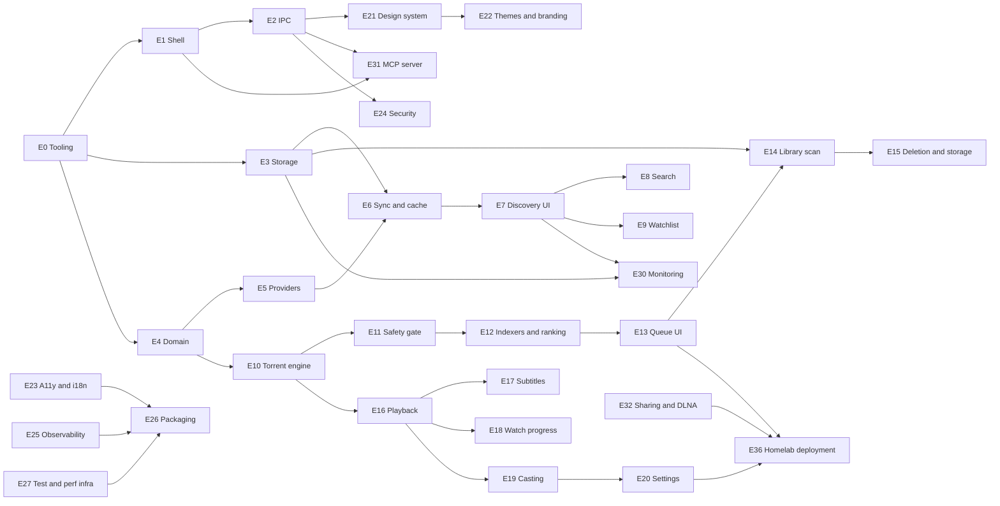
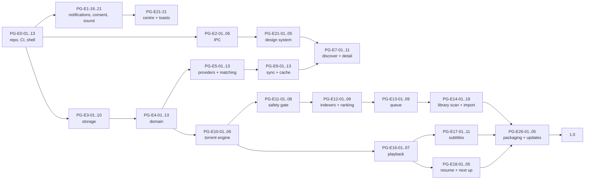

# Peregrine — Task Backlog

Granular, reviewable backlog. Phases and exit criteria come from [PLAN.md](./PLAN.md); the constraints that make these tasks necessary come from [ARCHITECTURE.md](./ARCHITECTURE.md).

## Conventions

The backlog is a checklist. Every task is one line with a machine-readable prefix and its acceptance
underneath:

```
- [ ] **PG-E3-10** *(doing)* `L` · deps PG-E3-04 · Type-safe repositories per aggregate
  - Acceptance: Round-trip property test for every entity
```

| Part | Meaning |
| --- | --- |
| `[x]` / `[ ]` | `[x]` is `done`. A task is `done` only when the global Definition of Done in PLAN §8 holds. |
| `**PG-E<epic>-<NN>**` | Stable forever; never renumber, supersede instead. |
| `*(doing)*` / `*(review)*` | Present on the two states a checkbox cannot express; absent means `todo`. |
| `` `XS` … `XL` `` | `XS` ≤ 0.5 d · `S` 1 d · `M` 2–3 d · `L` 4–5 d · `XL` 6–10 d |
| `deps …` | Task IDs that must be done first. Absent means startable immediately. |
| `plat …` | Present only when the task is not `all` platforms: `mac`, `win`, `lin`, `lin-wayland`. |
| `Acceptance:` | The observable proof beyond "the code is there". |

Every task implicitly includes its tests, error handling, structured logging, and doc updates per PLAN §8. Day totals use the band midpoints (`XS` 0.5 · `S` 1 · `M` 2.5 · `L` 4.5 · `XL` 8) rounded up to a whole day; `cargo xtask backlog-stats` recomputes the roll-up from this file and fails when the declared table at the bottom drifts.

## Implementation status

The desktop now starts a real runtime: it opens the SQLite database, runs the scheduler, publishes events through the coalescing bus to the webview, keeps redacted JSON logs, and drains all of it on exit. A Diagnostics screen starts a hello job, watches its progress, cancels it, and reads the journal row and the log tail the core wrote (PG-E0-19). Discover is still an empty shell, and provider, torrent, indexer, playback, stream, cast, monitor, MCP, and testkit crates remain documentation-only scaffolds.

Storage is complete for Phase 0: SQLite opening with the documented PRAGMA set, the single writer and reader pool, eight migrations whose schema the tests assert column by column — applied through a runner that copies an existing database first and rotates the copies, with a boot-time integrity check that quarantines a damaged file and rebuilds the schema before signalling that a rescan is required — keyset-paged reads, and the job journal. The three schema defects PG-E3-06, PG-E3-08 and PG-E3-09 had recorded are settled by migration 0008 and the document they came from is corrected (PG-E3-19). Domain implementations exist for external IDs, release parsing, quality profiles, path policy, the account scope, notification policy, and — since PG-E4-01 — the whole catalogue and library entity set: titles, aliases, genres, keywords, companies, people, credits, seasons, episodes and their ordering overlay, plus library roots, media items and files, unmatched files, watch progress, subtitle tracks, watchlist entries and smart collections, each with a validating constructor and a test that asserts its enum values against DATA_MODEL §2. The application layer holds the scheduler, the event bus and its rate limiter, the runtime, notification policy and service ports, and redacted logging, with generated IPC bindings and theme validation. `peregrine-storage::catalogue` re-exports the domain's `TitleKind`, `TitleSubtype` and `MetadataState` rather than declaring its own, and a test reads `CREATE TABLE title` out of `sqlite_master` to assert each enum's spellings are exactly the constraint's, so the enum and the schema cannot drift apart silently. Nothing consumes the rescan signal yet because the scanner lives in E14.

The current verification, with rustc 1.99.0 on macOS arm64, passed 438 Rust tests and 75 frontend tests at the commit that wrote this paragraph (the counts move with every test added), plus `cargo clippy --workspace --all-targets -- -D warnings`, `cargo fmt --all --check`, every repository gate (`check-arch`, `check-migrations`, `check-todos`, `check-commands`, `check-offset`, `check-theme`, `check-dead-deps`, `check-notices`, `backlog-stats`, and `gen-ipc --check`), and the frontend typecheck, lint, format check, dead-dependency gate, and build. What that does not establish: any Windows or Linux run (PG-E0-13 still owes a green three-platform CI), an executed GitHub Actions run of any kind, a run of the packaged app, and the platform and soak suites that do not exist yet. `pnpm tauri dev` was run on macOS arm64 and opened a window (PG-E0-03); the runtime's own data directory could not be created in that environment because the agent sandbox forbids writes outside the checkout, so the window is verified and the in-app runtime is not.

Measured once on that machine in a debug build, for the record rather than as a budget: startup to a ready runtime on an empty data directory was 8.6 ms; 5 000 no-op jobs through the scheduler took 85 ms to submit and 91 ms in total (about 55 000 jobs/s of queue overhead); 200 one-step hello jobs ran end to end at 15.2 ms each, dominated by the job's own 10 ms step and a 1 ms poll interval. `PG-E27-08` owns the benches and the budget gate that would make these numbers enforceable; there is no budget gate for them today.

PG-E0-14 is settled: `cargo deny check` is green on the real graph (advisories, bans, licences, sources), the five MPL-2.0 crates that arrive through Tauri's own stack are accepted one crate at a time by [adr/0021](./adr/0021-mpl-2-0-transitive-dependencies.md), and the advisory half is proven able to fail against a fixture. Tooling now includes the dead-dependency gates for both workspaces (PG-E0-15), a release workflow that has never been executed because no tag exists and the GitHub token here is unusable (PG-E0-16), and a checked attribution artefact whose Rust half is gate-enforced while its frontend half is owed (PG-E0-18). [adr/0022](./adr/0022-component-packs-and-sidecar-verification.md) settles how a component pack is verified before it runs, which is the mechanism PG-E26-01 still has to build. PG-E28-07 owns documentation checking and PG-E22-02 owns icon checking; `cargo xtask check-docs` and `cargo xtask icons --check` are still named in AGENTS.md §3 and still unimplemented. E2E, parser fuzz targets, and performance budgets remain open under E4 and E27.

## Epic dependency graph



---

# Phase 0 — Foundations

## E0 · Repository and tooling

- [x] **PG-E0-01** `S` · Cargo workspace with one crate per module map entry
  - Acceptance: `cargo build --workspace` succeeds; arch allowlist file committed
- [x] **PG-E0-02** `S` · pnpm workspace: `apps/desktop`, `packages/{ui,theme,ipc-client,player-ui,i18n}`
  - Acceptance: `pnpm -r build` succeeds with placeholder exports
- [ ] **PG-E0-03** *(review)* `S` · deps PG-E0-02 · Tauri v2 scaffold with dev/build scripts and per-OS bundle identifiers
  - Acceptance: `pnpm tauri dev` opens a window on all three OSes
- [x] **PG-E0-04** `M` · deps PG-E0-01 · `xtask check-arch` parses crate edges
  - Acceptance: Fails on a fixture violation, passes on the real tree
- [x] **PG-E0-05** `S` · deps PG-E0-01 · `xtask check-migrations` hashes against the base branch
  - Acceptance: Fails when a merged migration is edited
- [x] **PG-E0-06** `M` · deps PG-E2-01 · `xtask gen-ipc` regenerates TS bindings, CI diff gate
  - Acceptance: Committed bindings match regeneration byte-for-byte
- [x] **PG-E0-07** `XS` · `xtask check-todos` requires an issue reference on every TODO
  - Acceptance: Fails on a bare TODO fixture
- [x] **PG-E0-08** `XS` · deps PG-E0-01 · Rust formatting and lint policy
  - Acceptance: `cargo clippy -- -D warnings` clean; pedantic lints configured
- [x] **PG-E0-09** `S` · deps PG-E0-02 · TypeScript strict config and lint stack
  - Acceptance: `tsc --noEmit` clean with `noUncheckedIndexedAccess`, `exactOptionalPropertyTypes`
- [x] **PG-E0-10** `S` · deps PG-E0-08, PG-E0-09 · Pre-commit hooks: format, lint staged files, arch check
  - Acceptance: A commit with a formatting error is rejected locally
- [ ] **PG-E0-11** *(review)* `XS` · Commit convention, PR template with perf and security checklists, CODEOWNERS **Remaining:** The template now carries every §4 category, the §6 budgets, the SECURITY.md per-PR controls, the DCO/commit convention and the §3 gates, but "rendered on a test PR" has not been executed: `gh` is unauthenticated here, so the GitHub-side rendering and the CODEOWNERS team names are unverified.
  - Acceptance: Template rendered on a test PR
- [ ] **PG-E0-12** *(review)* `XS` · Issue templates and label taxonomy, milestones mapped to phases **Remaining:** Locally verified: every phase in PLAN.md §2 has one label, every epic in this file maps to one of them, and every label a template or `renovate.json` names exists in `labels.yml`. Unexecuted: GitHub applies a form label only if the label already exists in the repository, and nothing creates or verifies the taxonomy outside `.github/workflows/labels.yml`, which runs on push to `main`; so the forms produce labelled issues only after that sync has run, and the run itself is unobserved.
  - Acceptance: Templates produce labelled issues
- [ ] **PG-E0-13** *(review)* `M` · deps PG-E0-01 · CI matrix: lint, test, build on macOS arm64, Windows x64, Ubuntu 24.04 **Remaining:** The Ubuntu MSRV job now installs the same Tauri Linux prerequisites as the `rust` and `gates` jobs, so it can link the shell. The `rust` job's exact flag set was then run locally on macOS arm64, which is the closest this environment can get to the matrix: `cargo clippy --workspace --all-targets --all-features --locked -- -D warnings` clean, `cargo test --workspace --locked` 419 passed and 0 failed, `cargo build --workspace --locked` succeeded, and every text gate passes — so macOS is expected green. What is still missing is a recorded run: the GitHub token here is unusable, so nothing has executed on GitHub, and neither `windows-2022` nor `ubuntu-24.04` has been exercised at all beyond the prerequisite install being present in the file.
  - Acceptance: Green on a trivial PR with cache warm
- [x] **PG-E0-14** `S` · deps PG-E0-13 · Supply-chain gate: `cargo-deny`, `cargo-audit`, `osv-scanner`, `pnpm audit`
  - Acceptance: Build fails on an advisory fixture
  - Settled: `cargo deny check` is green on the real graph under cargo-deny 0.20.2 — advisories, bans, licences, and sources all pass. The five MPL-2.0 crates are accepted one crate at a time through `[[licenses.exceptions]]` pinned by version and recorded in [adr/0021](./adr/0021-mpl-2-0-transitive-dependencies.md); `allow-wildcard-paths` ends the eleven false positives on our own path dependencies; `paste` and `proc-macro-error` are ignored by exact advisory id as compile-time-only, documented in DEPENDENCIES §7. `ci.yml` exercises the advisory half against `xtask/fixtures/supply-chain/advisory`, which pins `paste` 1.0.15 and must fail — verified locally: exit 1, RUSTSEC-2024-0436. `audit.yml` runs `osv-scanner` and `cargo-audit` weekly, because neither is a per-commit question.
- [x] **PG-E0-15** `XS` · deps PG-E0-13 · Dead-dependency gate: `knip`, `cargo-machete`
  - Acceptance: Build fails on an unused fixture dependency
- [ ] **PG-E0-16** `M` · deps PG-E0-13 · Release workflow: bundles, SBOM, signed manifest, changelog **Remaining:** `.github/workflows/release.yml` is written and parses (`actionlint` 1.7.12 clean), but no tagged run has been executed: the acceptance needs a real `v*` tag to publish artefacts and a manifest, and the signing secrets plus the `RELEASE_SIGNING_CONFIGURED` repository variable must exist first. The bundled notice paths were wrong on the first merge (`../NOTICE` resolved to `apps/desktop/`), which `tauri-build` rejected; they are corrected to `../../../` and `cargo build -p peregrine-desktop` now succeeds, but the placement of those files *inside* each bundle still needs a real bundler run.
  - Acceptance: A tagged pre-release publishes artifacts and a manifest
- [ ] **PG-E0-17** *(review)* `XS` · deps PG-E0-13 · Automated dependency updates, grouped weekly **Remaining:** The config is verified statically — `schedule:weekly`, one group each for cargo, npm and github-actions, and version ranges left to the DEPENDENCIES §1 policy — and the managed labels exist. Nothing has run: "a grouped PR opens on schedule" needs the Renovate app installed on the repository, then one scheduled run observed.
  - Acceptance: A grouped PR opens on schedule
- [ ] **PG-E0-18** `S` · `LICENSE`, `NOTICE`, third-party attribution scaffold **Remaining:** The Rust half is complete and gate-enforced — `sidecars.toml` declares the three redistributed executables with their licences, pins, source offers and build configurations, `THIRD_PARTY.md` is generated from it plus the non-development closure of `peregrine-desktop` read out of `Cargo.lock`, `cargo xtask check-notices` byte-compares the artefact and refuses invalid declarations (`ok (484 checked)`, negative fixture proven), and `NOTICE` points at it. What the acceptance still owes is the **frontend runtime inventory**: `react`, `react-dom`, `zustand`, `i18next` and their transitive runtime packages are bundled into `apps/desktop/dist` and therefore redistributed, and the artefact only has a section saying so. A pure-text derivation from `pnpm-lock.yaml` needs a YAML parser that `xtask` does not have, so the choice is a justified parser dependency or a `pnpm licenses list --json` generator diff-gated like `gen-ipc`. Also owed: the exact per-OS sidecar versions and SHA-256 in place of the `pinned-per-os` pin rule, which belongs with PG-E26-01.
  - Acceptance: Attribution file lists every runtime dependency and sidecar

- [x] **PG-E0-19** `M` · deps PG-E0-03, PG-E2-02, PG-E2-06, PG-E2-07, PG-E3-02, PG-E6-01, PG-E25-01 · Connect the Phase 0 runtime: initialize and retain redacted logging, open SQLite, start the scheduler, and register a hello-job service through IPC
  - Acceptance: From the desktop UI, start a hello job, persist its journal state, observe rate-limited progress and cancellation, and view its redacted log output; shutdown drains the scheduler and database; startup failures use structured errors; measure startup and scheduler performance

## E1 · App shell and platform

- [ ] **PG-E1-01** `M` · deps PG-E0-03 · Window creation with platform-appropriate chrome behind one `WindowChrome` component
  - Acceptance: Traffic lights on macOS, caption buttons on Windows, headerbar on Linux
- [ ] **PG-E1-02** `S` · deps PG-E1-01 · Window state persistence: size, position, maximized, per-monitor
  - Acceptance: Restores across restarts and monitor changes
- [ ] **PG-E1-03** `M` · deps PG-E1-01 · Custom drag regions, double-click-to-zoom, snap layouts
  - Acceptance: Drag and zoom behave natively; caption buttons hit-test correctly
- [ ] **PG-E1-04** `S` · deps PG-E1-01 · Single-instance enforcement with argument forwarding
  - Acceptance: Second launch focuses the first and forwards the deep link
- [ ] **PG-E1-05** `M` · deps PG-E1-01, PG-E16-02 · Graceful shutdown sequence
  - Acceptance: mpv and ffmpeg reaped, journal checkpointed, no orphan on next boot
- [ ] **PG-E1-06** `M` · deps PG-E1-05 · Orphan child-process reaper keyed by PID and start time
  - Acceptance: A killed app leaves no mpv behind after relaunch
- [ ] **PG-E1-07** `M` · deps PG-E1-01 · plat mac · App menu and shortcuts: macOS app menu, Edit menu, Window, Help
  - Acceptance: Cut/copy/paste/select-all work in inputs on macOS
- [ ] **PG-E1-08** `M` · deps PG-E1-07 · Shortcut registry with conflict detection and platform rendering
  - Acceptance: Shortcuts list in Settings is generated from the registry
- [ ] **PG-E1-09** `M` · deps PG-E1-01 · Tray or menu-bar extra with state-aware menu
  - Acceptance: Shows active downloads and seeding count; hidden when disabled
- [ ] **PG-E1-10** `S` · deps PG-E1-09, PG-E10-09 · Close-to-tray and keep-seeding-after-close policy with prompts
  - Acceptance: Quit dialog states the seed count and offers both options
- [ ] **PG-E1-11** `S` · deps PG-E1-04 · Deep link handling: `peregrine://title/...`, `peregrine://magnet/...`
  - Acceptance: Cold start and warm start both route correctly
- [ ] **PG-E1-12** `S` · deps PG-E1-01 · Native file and folder pickers wrapped in a typed API
  - Acceptance: Returns resolved paths, never raw strings
- [ ] **PG-E1-13** `S` · deps PG-E1-09 · Autostart registration per OS, off by default
  - Acceptance: Toggle survives reboot; removed cleanly on uninstall
- [ ] **PG-E1-14** `M` · deps PG-E1-09, PG-E1-19 · Native notification delivery through `tauri-plugin-notification`: `on_action` handler registered at startup, int32 ids from a persisted counter, resolved per-OS sound value, deep link in `extra`, delivery state written to the centre before the OS call
  - Acceptance: A toast routes to the right screen when clicked; the centre entry exists even when delivery fails; no notification is shown without a registered listener
- [ ] **PG-E1-19** *(doing)* `L` · deps PG-E3-09 · `NotificationService`: the event catalogue from [ADR 0015](./adr/0015-native-notifications.md), per-event policy, dedupe window, burst summaries, global rate limit, focus suppression, quiet hours with digest, severity handling, and the in-app centre as the authoritative record **In progress:** the domain policy and redaction scanner are complete and tested (proptest caught `is_safe("")` returning false), the app ports and service compile in an earlier workspace run; the current audit could not rerun Rust checks with the installed Cargo 1.80.1. **Remaining:** the storage repository over the `notification` table, the `peregrine-platform` `OsNotifier` adapter, service tests against fakes, and the mutation evidence for R31's "centre survives OS delivery failing" claim. **Remaining:** Require AccountScope on centre reads and apply visibility in the service before exposing the centre through IPC; add tests for restricted accounts and hidden subjects.
  - Acceptance: Table-driven tests over the policy matrix: every suppression records a reason; critical events ignore quiet hours but not focus modes; five completions in a burst produce one summary toast and five centre entries
- [ ] **PG-E1-20** `M` · deps PG-E1-19, PG-E1-12 · Consent and permission handling: wizard step with per-event choice, `isPermissionGranted`/`requestPermission` probe, a test-notification button, an OS-settings deep link, denial fallback to the in-app centre, and revocation detection
  - Acceptance: A declined user is never asked again unprompted and still receives every event in the centre; the test button reports honestly whether a notification arrived; the resolved state and OS link are visible in Settings
- [ ] **PG-E1-21** `M` · deps PG-E1-14 · Sound policy per OS: verified sound values per event class, master and per-event switches, optional custom file validated per OS, honest "best effort" copy, and the synthesized WebAudio in-app chime (no bundled audio assets)
  - Acceptance: Sound on and off both verified by ear on each OS with the result recorded in SPIKE-11; a custom file that fails to load falls back with one non-modal notice; the chime never overlaps itself and respects the master switch
- [ ] **PG-E1-15** `S` · deps PG-E1-09 · plat mac, win · Dock and taskbar progress badges driven by aggregate download progress
  - Acceptance: Badge clears when the queue is idle
- [ ] **PG-E1-16** `XS` · deps PG-E1-12, PG-E24-03 · Reveal-in-file-manager per OS, path-guarded
  - Acceptance: Refuses paths outside configured roots
- [ ] **PG-E1-17** `S` · deps PG-E1-05 · Power-save inhibition during playback and active downloads
  - Acceptance: Screen does not sleep during playback; released on stop
- [ ] **PG-E1-18** `M` · deps PG-E1-01 · High-DPI, multi-monitor, and fractional-scaling correctness pass
  - Acceptance: No blurry text or clipped chrome at 125%, 150%, 200%

## E2 · IPC layer

- [x] **PG-E2-01** `M` · deps PG-E0-03 · `specta` + `tauri-specta` export pipeline and generated client, pinned to the exact `2.0.0-rc.25` RC (no stable 2.x exists) with a written fallback to hand-written DTOs
  - Acceptance: One Rust type change propagates to a compiling TS call site; the RC pin is exact
- [x] **PG-E2-02** `S` · deps PG-E2-01 · Structured `AppError` with stable codes and UI mapping
  - Acceptance: Every code has a message key and a retryability flag
- [x] **PG-E2-03** `S` · deps PG-E2-01 · Command registration with a ≤20-line rule and a lint check
  - Acceptance: A fixture command with logic fails the check
- [x] **PG-E2-04** `M` · deps PG-E2-01 · Event bus with namespaced, versioned topics
  - Acceptance: Topic names are declared in one manifest shared with TS
- [x] **PG-E2-05** `M` · deps PG-E2-04 · Coalescing / rate-limiting event batcher with drop counters
  - Acceptance: A 1 kHz producer delivers ≤4 Hz with audit of drops
- [x] **PG-E2-06** `M` · deps PG-E2-04 · Job-scoped command pattern: start returns job ID, progress streams
  - Acceptance: No command blocks >100 ms in a load test
- [x] **PG-E2-07** `M` · deps PG-E2-06 · Cancellation API for every job-scoped command
  - Acceptance: Cancel mid-job leaves no partial DB state
- [ ] **PG-E2-08** `M` · deps PG-E2-01 · Typed asset protocol for cached images and local thumbs
  - Acceptance: Poster loads without base64 or IPC payloads
- [x] **PG-E2-09** `XS` · deps PG-E2-01 · Payload size guard: responses over 64 KB log a warning in dev
  - Acceptance: Fixture oversized response triggers the guard
- [ ] **PG-E2-10** `M` · deps PG-E2-02 · IPC contract tests generated from the command registry
  - Acceptance: Every command has a test that exercises its error path
- [x] **PG-E2-11** `S` · deps PG-E2-05 · Backpressure signal to the UI when events are dropped
  - Acceptance: UI shows a degraded live indicator instead of stalling
- [ ] **PG-E2-12** `S` · deps PG-E2-10, PG-E25-01 · Dev-only command timing instrumentation, surfaced in Diagnostics
  - Acceptance: p95 latency per command visible without a accountr

## E3 · Storage

- [x] **PG-E3-01** `S` · deps PG-E0-01 · SQLite open path with PRAGMAs on every connection
  - Acceptance: WAL on, foreign keys on, busy timeout set; asserted in a test
- [x] **PG-E3-02** `M` · deps PG-E3-01 · Single-writer channel and reader pool
  - Acceptance: 20 concurrent writers serialize without `SQLITE_BUSY`
- [x] **PG-E3-03** `S` · deps PG-E3-01 · Migration 0001: settings, account, secret_ref, job, event_log
  - Acceptance: Applies on an empty database and is reversible in a test fixture
- [x] **PG-E3-04** `M` · deps PG-E3-03 · Migration 0002: catalogue tables per DATA_MODEL §2.2
  - Acceptance: Applies and satisfies the schema snapshot test
- [x] **PG-E3-05** `S` · deps PG-E3-04 · Migration 0003: seasons, episodes, episode_ordering
  - Acceptance: Unique constraints proven by negative tests
- [x] **PG-E3-06** `M` · deps PG-E3-05 · Migration 0004: library tables including partial unique indices **Spec defect settled:** §2.3 declared `media_file.video_account TEXT`, ffprobe's `profile` mistyped; migration 0008 renames the column and the document is corrected.
  - Acceptance: One movie item, one episode item invariants hold under concurrency
- [x] **PG-E3-07** `S` · deps PG-E3-06 · Migration 0005: subtitles, progress, watchlist, smart collections
  - Acceptance: Generated column and partial index verified
- [x] **PG-E3-08** `M` · deps PG-E3-07 · Migration 0006: acquisition tables including `release_decision` **Spec defect settled:** §2.7 declared a non-unique index named `_uq`; migration 0008 makes it unique among live jobs and reconciles any duplicate live rows.
  - Acceptance: Dedupe index proven to exclude terminal jobs
- [x] **PG-E3-09** `S` · deps PG-E3-08 · Migration 0007: cache, image, dataset, notification, device, cast tables **Spec gap settled:** §2.7's `image_ref UNIQUE (…)` treated NULLs as distinct, so duplicate artwork rows with a NULL `language` could coexist; migration 0008 rebuilds the table with `language NOT NULL DEFAULT ''`. The quality-profile contradiction rules map to DATA_MODEL §3 I35.
  - Acceptance: Cache tables droppable with no user-data loss (invariant I9)
- [ ] **PG-E3-10** *(doing)* `L` · deps PG-E3-04 · Type-safe repositories per aggregate with row mappers **Remaining:** the job journal's repository exists (`insert_job`, `update_job`, `job`, `list_jobs`) with round-trip and guard tests, `PageRequest` is the pagination shape every list query takes (PG-E3-11), and the catalogue's identity slice exists — a stub title, its external ids, the guard that refuses an id another title owns, and the two scoped reads (`title_identity`, `list_titles`) that apply an `AccountScope` in SQL rather than after fetching. Still owed: the provider field mapping onto `title` (which belongs with the adapters, PG-E5-06), genres and artwork, the scoped read paths with `AccountScope` (R34), the library, account, and acquisition repositories, and the per-entity property tests.
  - Acceptance: Round-trip property test for every entity
- [x] **PG-E3-11** `S` · deps PG-E3-10 · Keyset pagination helper used by every list query
  - Acceptance: `OFFSET` is absent from the codebase, enforced by grep gate
- [ ] **PG-E3-12** `M` · deps PG-E3-04 · FTS5 contentless table with explicit maintenance and rebuild command
  - Acceptance: Rebuild reproduces identical search results
- [x] **PG-E3-13** `M` · deps PG-E3-03 · Migration runner with pre-migration backup and rotation
  - Acceptance: A failing migration leaves the database untouched and backed up
- [x] **PG-E3-14** `M` · deps PG-E3-13 · Integrity check on boot with corruption recovery path
  - Acceptance: Injected corruption rebuilds and rescan triggers
  - Open cost, carried by PG-E27-08: the specification says the full `PRAGMA integrity_check` runs on every boot, and it measured **45.5 ms on a 45 MB database with a warm cache** (48.2 ms for the whole `Database::open`). The documented typical database is 60–300 MB and a cold cache is worse, against the ≤ 1200 ms cold-start budget in ARCHITECTURE §6, so this is the largest single fixed cost in startup and it grows with the library. It was not deviated from, because changing it changes ARCHITECTURE §15. A budget gate does not exist yet, so nothing would catch a regression here today. The two deliberate options when it becomes tight are `quick_check` and skipping the full check after a clean shutdown, each of which needs its own record.
- [ ] **PG-E3-15** `S` · deps PG-E3-10 · Retention jobs per DATA_MODEL §6
  - Acceptance: Old rows pruned; user data untouched
- [ ] **PG-E3-16** `M` · deps PG-E3-15 · Maintenance job: `VACUUM`, `ANALYZE`, FTS optimize, yielding to playback
  - Acceptance: Never runs during playback; asserted by test
- [ ] **PG-E3-17** `S` · deps PG-E3-10 · Disk accounting queries for per-tier usage
  - Acceptance: Diagnostics totals match filesystem measurement within 2%
- [ ] **PG-E3-18** `M` · deps PG-E3-13 · Fixture databases for every previous release, used in migration tests
  - Acceptance: CI tests upgrade from each fixture

- [x] **PG-E3-19** `M` · deps PG-E3-09 · Resolve the schema defects recorded by PG-E3-06, PG-E3-08, and PG-E3-09 before repository consumers land
  - Acceptance: Decide the intended video-profile column and info-hash index semantics, document null-language artwork uniqueness, and apply required corrections in a new append-only migration; upgrade fixtures preserve existing rows and reject duplicate artwork under the agreed key

## E4 · Domain core

- [x] **PG-E4-01** `M` · deps PG-E0-01 · Core entities and value objects with validating constructors
  - Acceptance: Illegal states unrepresentable; construction failures are typed
- [ ] **PG-E4-02** *(doing)* `S` · deps PG-E4-01 · `ExternalId` with provider prefixes and parsing
  - Acceptance: Round-trip property test over generated ID shapes
- [ ] **PG-E4-03** *(doing)* `L` · deps PG-E4-01 · `ReleaseName` parser: resolution, source, codec, HDR, audio, group, repack, season pack, multi-episode
  - Acceptance: ≥ 95% correct on a 200-name corpus; no panics on fuzz input
- [ ] **PG-E4-04** `L` · deps PG-E4-03 · `NameParser` for library filenames and folders
  - Acceptance: Same corpus requirement as PG-E4-03 plus anime absolute and `1x01` forms
- [ ] **PG-E4-05** *(doing)* `M` · deps PG-E4-01 · `QualityProfile` model with rules, caps, and cut-off rank
  - Acceptance: Serialization round-trip and validation of contradictory rules
- [ ] **PG-E4-06** `L` · deps PG-E4-05, PG-E4-03 · `ReleaseRanker` pure scoring with per-rule reason output
  - Acceptance: Monotonicity, determinism, and totality property tests
- [ ] **PG-E4-07** `L` · deps PG-E4-01 · `TorrentInspector` rules: extension allowlist, traversal, reserved names, caps, unicode spoofing
  - Acceptance: Each hostile fixture classified correctly, with reason strings
- [ ] **PG-E4-08** *(doing)* `M` · deps PG-E4-01 · `PathGuard` policy model, pure containment logic
  - Acceptance: Escape attempts rejected; property test over generated paths
- [ ] **PG-E4-09** `M` · deps PG-E4-01 · `WatchPolicy`: resume point, watched threshold, next-episode selection. **Inherited defect to settle here:** `WatchProgress::record` (PG-E4-01, `library.rs`) derives `watched` from `WATCHED_PERCENT = 0.92`, which is the *storage floor* in DATA_MODEL I6, not the playback threshold that FLOWS F10 sets at ≥ 0.95 or the credits. So a position reported at 0.93 is stored as `watched = 1` — a row the policy says should still be resumable — and every consumer that reads the flag rather than recomputing a percentage (the continue-watching rail, next-up, the resume button) inherits that disagreement. The policy owns the threshold, so `record` must stop deciding it: either it derives `percent` only and the policy marks watched when its own threshold is met, or it takes the decision from the caller. `mark_watched` then enforces I6's floor for a policy-driven mark and exempts a manual one. Both boundaries are this task's acceptance (92% is the floor, 95% is the policy), which is why it is written down here rather than changed silently in the entity.
  - Acceptance: Boundary tests at 0%, 2%, 50%, 92%, 95%, 99%, and zero-duration
- [ ] **PG-E4-10** `M` · deps PG-E4-07, PG-E3-05 · `EpisodeOrderingStrategy` for aired, absolute, DVD, anime
  - Acceptance: Ordering fixtures reproduce expected lists
- [ ] **PG-E4-11** `M` · deps PG-E4-01 · Download job state machine with guarded transitions
  - Acceptance: Illegal transitions rejected; every state reachable in a test
- [ ] **PG-E4-12** `M` · deps PG-E4-11 · Media availability derivation from items and jobs
  - Acceptance: Table-driven test over item and job combinations
- [ ] **PG-E4-13** `M` · deps PG-E4-01 · Player session state machine
  - Acceptance: Every transition and failure path covered
- [ ] **PG-E4-14** `S` · deps PG-E4-01 · Subtitle timing math: offset, frame-rate conversion, PAL speedup
  - Acceptance: Property test: offset then reverse offset is identity
- [ ] **PG-E4-15** `M` · deps PG-E4-14 · Subtitle format model and SRT/VTT/ASS writers
  - Acceptance: Round-trip of styling-bearing ASS preserves italics and positioning
- [ ] **PG-E4-16** `S` · deps PG-E4-11, PG-E4-13 · Domain event enum covering every state-changing operation
  - Acceptance: Repository layer emits only declared events
- [ ] **PG-E4-17** *(doing)* `S` · deps PG-E4-01 · `Clock` and `IdGenerator` ports for determinism in tests **Remaining:** Ports and local test fakes exist; production adapters and the rule forbidding clock/randomness outside adapters must be verified before completion.
  - Acceptance: No `SystemTime::now` or random call outside an adapter (grep gate)
- [ ] **PG-E4-18** `M` · deps PG-E4-03, PG-E4-04, PG-E4-15 · Fuzz targets for release-name, filename, and subtitle parsers
  - Acceptance: 24 h fuzz run without panic in Phase 4
- [ ] **PG-E4-19** `M` · deps PG-E4-17 · `Conformance`-friendly fake implementations for all ports
  - Acceptance: Fakes live in `testkit`, usable from any crate's tests
- [ ] **PG-E4-20** `S` · deps PG-E4-01 · Domain documentation pass: invariants stated where enforced
  - Acceptance: Each invariant in DATA_MODEL §3 maps to a named test

---

# Phase 1 — Discovery

## E5 · Metadata providers

- [ ] **PG-E5-01** `M` · deps PG-E4-01 · `MetadataProvider` trait with declared capabilities and rate policy
  - Acceptance: Conformance suite defined; a fake provider passes it
- [ ] **PG-E5-02** `M` · deps PG-E5-01 · HTTP client stack: rustls, HTTP/2, compression, timeouts, retry, circuit breaker
  - Acceptance: 429/5xx/timeout fixtures behave per policy
- [ ] **PG-E5-03** `M` · deps PG-E5-02 · Per-host token buckets and global concurrency cap
  - Acceptance: Synthetic burst never exceeds the configured rate
- [ ] **PG-E5-04** `M` · deps PG-E5-02, PG-E3-09 · Conditional-request middleware with ETag and Last-Modified to `provider_cache`
  - Acceptance: Repeat call transfers zero bytes (304 path asserted)
- [ ] **PG-E5-05** `M` · deps PG-E5-02 · Response hygiene: size caps, content-type check, validating decode, unknown-field tolerance
  - Acceptance: Oversized, HTML, and drifted JSON fixtures rejected or marked stale
- [ ] **PG-E5-06** `L` · deps PG-E5-01 · TMDB adapter: configuration, genres, trending, discover with the full filter set
  - Acceptance: Fixture replay produces identical normalized output
- [ ] **PG-E5-07** `M` · deps PG-E5-06 · TMDB adapter: movie details, credits, videos, external ids, release dates
  - Acceptance: Normalization snapshot tests
- [ ] **PG-E5-08** `L` · deps PG-E5-06 · TMDB adapter: TV details, seasons, episodes, episode groups, content ratings
  - Acceptance: Season and episode normalization including specials
- [ ] **PG-E5-09** `M` · deps PG-E5-08 · TMDB `/changes` adapter for movie and TV windows with cursor handling
  - Acceptance: Overlapping-window test yields no duplicates
- [ ] **PG-E5-10** `M` · deps PG-E5-01 · TVDB v4 adapter behind a user-supplied key
  - Acceptance: Optional; skipped cleanly when unconfigured
- [ ] **PG-E5-11** `S` · deps PG-E5-01 · OMDb fallback adapter for ratings when IMDb dataset is unavailable
  - Acceptance: Used only on cache miss; never a primary path
- [ ] **PG-E5-12** `S` · deps PG-E5-01 · Provider registry manifest: enablement, priority, auth requirement, endpoints
  - Acceptance: Diagnostics lists exactly the endpoints contacted
- [ ] **PG-E5-13** `L` · deps PG-E5-08, PG-E4-04 · Title matching engine: external ID resolution, alias and year reconciliation
  - Acceptance: 100-case matching corpus with expected outcomes
- [ ] **PG-E5-14** `M` · deps PG-E5-13 · Anime detection and subtype classification, AniList/MAL id capture
  - Acceptance: Anime fixtures classified correctly and ordered absolutely
- [ ] **PG-E5-15** `M` · deps PG-E5-13 · Artwork normalization into `image_ref` with language and vote metadata
  - Acceptance: Primary selection deterministic across fixtures
- [ ] **PG-E5-16** `S` · deps PG-E5-07, PG-E5-08 · Trailer selection policy: official, language preference, recency, fallback
  - Acceptance: Fixture table of expected picks
- [ ] **PG-E5-17** `M` · deps PG-E5-02 · Provider fixture harness: record, redact, replay
  - Acceptance: No fixture contains an API key; a leak check runs in CI
- [ ] **PG-E5-18** `M` · deps PG-E5-01 · Provider contract tests run per adapter against the shared suite
  - Acceptance: Adding an adapter requires no new test scaffolding
- [ ] **PG-E5-19** `XS` · deps PG-E5-06 · Attribution compliance: TMDB logo and notice in About and on detail pages
  - Acceptance: Visual check plus a test that the notice string exists
- [ ] **PG-E5-20** `S` · deps PG-E5-06 · Key validation flow with a live "test connection" action
  - Acceptance: Invalid key produces an actionable error, not a generic failure
- [ ] **PG-E5-21** `S` · deps PG-E5-14 · Anime-specific providers research spike outcome applied or rejected with a written decision
  - Acceptance: ADR updated
- [ ] **PG-E5-22** `S` · deps PG-E5-03, PG-E25-02 · Rate-limit observability: remaining budget surfaced per provider
  - Acceptance: Diagnostics shows budget and last 429

## E6 · Sync and cache

- [ ] **PG-E6-01** *(doing)* `L` · deps PG-E3-08, PG-E4-19 · Job scheduler: priority queues, worker pool, dedupe, backoff with jitter **Remaining:** The scheduler runs behind the desktop runtime with a persisted job and IPC progress (PG-E0-19), and its queue overhead was measured once (about 55 000 no-op jobs/s in a debug build) — that number is recorded in the status section, not enforced. What remains: the shared testkit fakes (PG-E4-19), and the conformance suite a fake engine passes.
  - Acceptance: Deferred jobs retry on schedule; dedupe proven
- [ ] **PG-E6-02** `M` · deps PG-E6-01 · Resource token acquisition with panic-safe release **Remaining:** PG-E6-01 already tests panic-safe worker-slot release. This task covers resource tokens beyond worker slots; verify release on panic, cancellation, and retry without duplicating that test.
  - Acceptance: Injected panic releases the token (guard test)
- [ ] **PG-E6-03** `M` · deps PG-E6-01 · Concurrency classes: metadata, image, dataset, subtitle, probe **Remaining:** SchedulerClasses exists; wire each production job kind and prove independent limits under load.
  - Acceptance: Each class has an independent limit asserted under load
- [ ] **PG-E6-04** `M` · deps PG-E6-01, PG-E5-09 · Incremental change sync with persisted cursors and overlapping windows
  - Acceptance: Crash between cursor advance and upsert loses nothing
- [ ] **PG-E6-05** `L` · deps PG-E6-01 · IMDb ratings dataset download, checksum, parse, transactional swap
  - Acceptance: Header change or truncated file leaves the old dataset in place
- [ ] **PG-E6-06** `M` · deps PG-E6-05 · Ratings join into `title` via `external_id`
  - Acceptance: 100 k-title join completes within the DB budget
- [ ] **PG-E6-07** `M` · deps PG-E6-05 · Optional IMDb alt-title import (`title.akas`, 493 MB compressed, re-keyed through the TMDB `imdb_id`) behind an explicit opt-in. `title.basics` is deliberately excluded because TMDB `external_ids` already supplies the IMDb id
  - Acceptance: Disabled by default; the measured disk cost is shown before enabling; alt-title search improves measurably with it on
- [ ] **PG-E6-08** `S` · deps PG-E6-05, PG-E3-16 · Dataset disk accounting and quiet-hours scheduling
  - Acceptance: Never runs during playback when configured
- [ ] **PG-E6-09** `L` · deps PG-E2-08, PG-E3-09 · Image cache: content-addressed store, variant matrix, atomic writes
  - Acceptance: No partial file survives a crash (temp + rename)
- [ ] **PG-E6-10** `M` · deps PG-E6-09 · Image LRU eviction to the configured cap with pinned-item protection
  - Acceptance: Cache never exceeds the cap; in-use images never evicted
- [ ] **PG-E6-11** `M` · deps PG-E6-09, PG-E4-19 · Blurhash generation on ingest of a new primary artwork
  - Acceptance: Placeholder present before any bytes are fetched
- [ ] **PG-E6-12** `M` · deps PG-E6-09 · Idle-driven prefetch for the next rail, bounded and cancellable
  - Acceptance: Prefetch never runs during scroll or playback when configured off
- [ ] **PG-E6-13** `M` · deps PG-E6-04 · Cache invalidation contract: `library://changed` carries affected keys
  - Acceptance: UI refetches only affected queries (assertion in E2E)
- [ ] **PG-E6-14** `S` · deps PG-E6-01 · Sync health model: per-provider state, next run, error class
  - Acceptance: Diagnostics renders it without querying the network
- [ ] **PG-E6-15** `S` · deps PG-E6-04 · Stale-metadata policy, refresh-on-view, and the TMDB six-month cache compliance sweep
  - Acceptance: Title viewed after TTL enqueues a refresh; UI never blocks; a scheduled sweep refreshes or purges cached metadata at or before 180 days, with a purge path for the termination clause
- [ ] **PG-E6-16** `M` · deps PG-E6-01 · Offline detection and network-state model
  - Acceptance: Airplane-mode test: no job storm, no error modals
- [ ] **PG-E6-17** `L` · deps PG-E6-09 · Sync load test: 5 000 titles, 20 k images, throttled network
  - Acceptance: Completes within the DB and disk budgets without UI stall
- [ ] **PG-E6-18** `S` · deps PG-E6-13 · Full cache wipe and rebuild path exposed in Settings
  - Acceptance: App remains usable and repopulates

## E7 · Discovery UI

- [ ] **PG-E7-01** `M` · deps PG-E2-01, PG-E21-05 · App shell layout: sidebar, top bar, content area, persistent player surface
  - Acceptance: Shell never unmounts across navigation
- [ ] **PG-E7-02** `M` · deps PG-E7-01, PG-E3-11 · Router with typed routes and cache-first loaders
  - Acceptance: No route renders a full-page spinner
- [ ] **PG-E7-03** `M` · deps PG-E21-03 · Design-system primitives consumed from `packages/ui`
  - Acceptance: No ad-hoc styled element in a feature folder (review gate)
- [ ] **PG-E7-04** `M` · deps PG-E7-03 · Title card component: poster, blurhash, rating badge, availability overlay
  - Acceptance: Renders correctly at 5 sizes without layout shift
- [ ] **PG-E7-05** `M` · deps PG-E7-04, PG-E21-08 · Hover preview: dwell, scale, metadata panel, trailer peek toggle
  - Acceptance: Cancels cleanly on leave; no layout thrash measured
- [ ] **PG-E7-06** `L` · deps PG-E7-04 · Virtualized grid with fixed tile geometry
  - Acceptance: 5 000 items at ≥60 fps; blurhash fills first paint
- [ ] **PG-E7-07** `M` · deps PG-E7-04 · Horizontal rails with keyboard traversal and edge affordances
  - Acceptance: Arrow keys traverse; no scroll jank on 500-item rails
- [ ] **PG-E7-08** `L` · deps PG-E7-07 · Discover screen: hero, continue watching, top 10, on the air, upcoming, top rated, recommendations **Remaining:** The Continue Watching rail has an empty state until PG-E18-04 supplies progress; that task integrates the rail after Discover exists.
  - Acceptance: Each rail has a defined empty state
- [ ] **PG-E7-09** `L` · deps PG-E7-06 · Filter surface: type, genre, year, rating, runtime, language, country, provider, status, availability, sort
  - Acceptance: Filter state is URL-encoded and shareable
- [ ] **PG-E7-10** `M` · deps PG-E7-09, PG-E3-07 · Smart collections: saved filter plus sort, pinned to the sidebar
  - Acceptance: Persisted, reorderable, applied in one click
- [ ] **PG-E7-11** `L` · deps PG-E7-03, PG-E21-09 · Title detail: hero expansion, backdrop cross-fade, actions, availability
  - Acceptance: Shared-element transition from card; reduced-motion path exists
- [ ] **PG-E7-12** `M` · deps PG-E7-11 · Cast and crew presentation with person pages
  - Acceptance: Person page lists credits and is reachable by keyboard
- [ ] **PG-E7-13** `L` · deps PG-E7-11, PG-E4-10 · Season selector and episode list with stills, air dates, progress
  - Acceptance: Specials marked; missing episodes indicated
- [ ] **PG-E7-14** `M` · deps PG-E7-11, PG-E24-06 · Trailer playback in a sandboxed child webview with privacy-enhanced embed
  - Acceptance: No third-party script loads in the main window (asserted)
- [ ] **PG-E7-15** `M` · deps PG-E7-08, PG-E18-04 · Recommendations and "because you watched" based on local history
  - Acceptance: Requires no server; degrades to trending when history is empty
- [ ] **PG-E7-16** `M` · deps PG-E7-08 · Empty, loading, and error states for every rail and grid
  - Acceptance: Every state has a designed treatment, not a spinner
- [ ] **PG-E7-17** `M` · deps PG-E7-06 · Grid selection model: click, cmd/ctrl-click, shift-range, context menu
  - Acceptance: Bulk actions operate on the selection
- [ ] **PG-E7-18** `S` · deps PG-E7-06 · Poster size and density control, persisted per screen
  - Acceptance: Applies without a full remount
- [ ] **PG-E7-19** `L` · deps PG-E7-06 · Keyboard navigation model: roving tabindex, Home/End, Page Up/Down, Escape layering
  - Acceptance: Keyboard-only walkthrough of Discover and Browse passes
- [ ] **PG-E7-20** `M` · deps PG-E7-06, PG-E27-08 · Frame-time budget gate for the grid in CI
  - Acceptance: Fails on a regression beyond 15%
- [ ] **PG-E7-21** `M` · deps PG-E7-11, PG-E22-05 · Visual regression snapshots per theme for the grid and detail screens
  - Acceptance: Divergence beyond threshold fails CI
- [ ] **PG-E7-22** `S` · deps PG-E7-08, PG-E25-01 · Discover screen instrumentation: time to first paint and rail hydration
  - Acceptance: Metrics visible in Diagnostics and asserted in E2E

## E8 · Search

- [ ] **PG-E8-01** `M` · deps PG-E3-12 · FTS5 query builder: prefix terms, ranking weights, filters
  - Acceptance: Injection-safe; parameterized only
- [ ] **PG-E8-02** `M` · deps PG-E8-01 · Ranking tuning with `bm25` weights and popularity tiebreak
  - Acceptance: Golden-result fixtures for 40 queries
- [ ] **PG-E8-03** `XS` · deps PG-E8-01 · External-ID fast path (`tt…`, `tmdb:…`) bypassing FTS
  - Acceptance: Exact match returns the right title first
- [ ] **PG-E8-04** `M` · deps PG-E8-01 · Trigram fallback for short or non-Latin queries
  - Acceptance: Fixture queries resolve; decision recorded from SPIKE-5
- [ ] **PG-E8-05** `M` · deps PG-E8-01, PG-E6-01 · Debounced remote enrichment with job dedupe
  - Acceptance: Typing a 13-character query enqueues at most one remote search
- [ ] **PG-E8-06** `M` · deps PG-E8-01, PG-E7-06 · Search results screen with grouped results and filters
  - Acceptance: Keyboard-navigable, virtualized, no layout shift
- [ ] **PG-E8-07** `L` · deps PG-E8-06, PG-E1-08 · Command palette: navigation, actions, recent, fuzzy titles
  - Acceptance: Every app action is reachable from the palette
- [ ] **PG-E8-08** `M` · deps PG-E8-02, PG-E27-08 · Search perf bench and p95 gate
  - Acceptance: 100 k titles, p95 ≤ 50 ms in CI

## E9 · Watchlist and collections

- [ ] **PG-E9-01** `M` · deps PG-E2-06, PG-E3-07 · Watchlist commands with optimistic add and remove, plus rollback on failure
  - Acceptance: Toggle feels instant; a failed write reverts and reports
- [ ] **PG-E9-02** `M` · deps PG-E7-09 · Watchlist screen with sort, filter, and availability overlay
  - Acceptance: Availability derived per item, not per render
- [ ] **PG-E9-03** `S` · deps PG-E9-01, PG-E7-17 · Add-to-watchlist affordances: card hover action, context menu, detail page, keyboard shortcut
  - Acceptance: Every affordance reflects the same state
- [ ] **PG-E9-04** `S` · deps PG-E9-01, PG-E7-01 · Sidebar watchlist entry with count and a quick-add drop target
  - Acceptance: Count updates live without a full refetch
- [ ] **PG-E9-05** `M` · deps PG-E4-12, PG-E9-02 · Availability derivation for watchlist items: available, downloading, wanted, unavailable
  - Acceptance: Table-driven test over item and job combinations
- [ ] **PG-E9-06** `M` · deps PG-E9-01, PG-E7-17 · Bulk add and remove from a grid selection
  - Acceptance: 500-item bulk operation completes as a job with progress
- [ ] **PG-E9-07** `M` · deps PG-E9-02, PG-E21-17 · Manual reordering with a keyboard-accessible alternative
  - Acceptance: Reorder persists and works without a pointer
- [ ] **PG-E9-08** `S` · deps PG-E9-02, PG-E7-16 · Watchlist onboarding: empty state that suggests popular titles to seed it
  - Acceptance: New users reach a non-empty watchlist in one click
- [ ] **PG-E9-09** `S` · deps PG-E9-05 · Auto-acquire flag on watchlist entries, gated behind the post-1.0 automation epic
  - Acceptance: Flag persists; no acquisition occurs until the automation epic lands
- [ ] **PG-E9-10** `S` · deps PG-E9-02, PG-E27-08 · Watchlist scale test: 2 000 entries render and query within budget
  - Acceptance: Virtualized render at 60 fps; query ≤ 5 ms

---

# Phase 2 — Acquisition and library

## E10 · Torrent engine

- [ ] **PG-E10-01** `M` · deps PG-E4-19 · `TorrentEngine` trait: session, add, select, stream, stats, limits, remove
  - Acceptance: Fake engine passes the conformance suite
- [ ] **PG-E10-02** `L` · deps PG-E10-01 · librqbit adapter: session lifecycle, config, persistence path
  - Acceptance: Start/stop clean on all three OSes; SPIKE-3 outcome applied
- [ ] **PG-E10-03** `M` · deps PG-E10-02 · Metadata-only fetch for magnets with timeout and peer reporting
  - Acceptance: Returns the file list without writing payload bytes
- [ ] **PG-E10-04** `M` · deps PG-E10-02 · Per-file selection and deselection at add time and afterwards
  - Acceptance: Unselected files never appear on disk
- [ ] **PG-E10-05** `L` · deps PG-E10-02 · Per-job "download in order" toggle plus head-and-tail-first ordering and streaming read-ahead with a configurable, bitrate-derived window
  - Acceptance: First playable byte within the target time on a local swarm; the container index is present from the start so seeking works immediately; toggling off restores rarest-first outside the window
- [ ] **PG-E10-06** `M` · deps PG-E10-05, PG-E16-06 · Piece priority driver reacting to player read position and stalls
  - Acceptance: Starvation raises priority within one poll interval
- [ ] **PG-E10-07** `M` · deps PG-E10-02 · Progress and statistics stream: rates, peers, ETA, ratio, health
  - Acceptance: Stats accurate within 5% of engine counters
- [ ] **PG-E10-08** `L` · deps PG-E10-02, PG-E3-08 · Restart reattachment from `engine_state_json`
  - Acceptance: Kill and relaunch resumes without re-downloading verified pieces
- [ ] **PG-E10-09** `M` · deps PG-E10-02 · Seeding policy: ratio target, time target, stop-on-quit, keep-seeding
  - Acceptance: Terminates at the configured policy; survives restart
- [ ] **PG-E10-10** `M` · deps PG-E10-02 · Global and per-job limits: down, up, connections, active downloads
  - Acceptance: Applied at runtime without restarting the session
- [ ] **PG-E10-11** `M` · deps PG-E10-02 · Proxy and interface binding: `socks5h://` (so DNS resolves at the proxy), interface bind, explicit handling of DHT and UDP-tracker traffic while a proxy is set, **runtime re-resolution** of the bound interface, and **fail-closed** behaviour when it disappears
  - Acceptance: Engine peer and tracker IO stops entirely if the bound interface goes away, no silent fallback to the default route, and a VPN reconnect is picked up without an app restart (qBittorrent passes the unresolved interface through but never re-resolves it, so a dropped tunnel just grinds); asserted by killing and restoring the interface in a test
- [ ] **PG-E10-12** `M` · deps PG-E10-11 · Leak check tool: compare the tunnel-exit IP with the machine's non-tunnelled public IP via several echo endpoints
  - Acceptance: Reports the observed addresses and states plainly which protocols were verified; SOCKS5 UDP-associate coverage is explicitly reported as unverified until SPIKE-3 confirms it
- [ ] **PG-E10-13** `M` · deps PG-E10-02 · Port reachability check and UPnP/NAT-PMP decision, off by default
  - Acceptance: Diagnostics shows reachability; no silent router mutation
- [ ] **PG-E10-14** `M` · deps PG-E10-02 · Loopback seeder harness for integration tests
  - Acceptance: A test downloads from a local seeder deterministically
- [ ] **PG-E10-15** `S` · deps PG-E10-02 · Engine error taxonomy mapped to UI codes
  - Acceptance: No raw engine string reaches the UI
- [ ] **PG-E10-16** `M` · deps PG-E10-10, PG-E16-01 · Bandwidth reservation while playing and "pause on playback" policy
  - Acceptance: Streaming keeps headroom; verified under a saturating download
- [ ] **PG-E10-17** `M` · deps PG-E10-14 · RSS ingest adapter (Phase 5 prerequisite, engine side)
  - Acceptance: Parses a fixture feed and enqueues candidates
- [ ] **PG-E10-18** `M` · deps PG-E10-11 · IP-filter and blocklist support with **fail-closed** parse semantics: an unparseable filter blocks new peer traffic with a prominent error and requires an explicit "continue without blocklist" confirmation, never silently installing an empty blocklist. Plain-text and gzip formats, applied on file change without a restart
  - Acceptance: A corrupt filter file blocks new peer traffic and surfaces an actionable error (qBittorrent's parser installs an empty filter, which is fail-open); a valid edit applies live; both formats covered by fixtures

## E11 · Safety gate

- [ ] **PG-E11-01** `M` · deps PG-E4-07 · Extension allowlist and blocklist with content sniffing
  - Acceptance: A media file with a double extension is classified by content
- [ ] **PG-E11-02** `M` · deps PG-E4-07 · Path validation: relative-only, no traversal, no absolute, no reserved names
  - Acceptance: Every hostile path fixture rejected with a reason
- [ ] **PG-E11-03** `S` · deps PG-E11-02 · Unicode spoofing detection for right-to-left override and homoglyph extensions
  - Acceptance: Spoofed `.exe` fixtures rejected
- [ ] **PG-E11-04** `S` · deps PG-E11-01 · Caps: file count, total size, single-file size, free-space floor, plus **parser bounds applied before decoding untrusted bytes** — bencode nesting depth and token ceilings and a hard torrent-file size cap, following qBittorrent's proven limits (depth 100, 10 M tokens, 100 MiB file)
  - Acceptance: Each cap boundary tested at and one below the limit; a deeply nested or token-flooding bencode fixture is rejected before allocation, not after
- [ ] **PG-E11-05** `M` · deps PG-E11-01 · Archive and disk-image policy: blocked by default, advanced opt-in with warnings
  - Acceptance: Default build blocks; opt-in path logs an audit event
- [ ] **PG-E11-06** `M` · deps PG-E11-04, PG-E3-08 · `SafetyReport` construction, persistence, and rendering in the UI
  - Acceptance: Report survives restart and explains each finding
- [ ] **PG-E11-07** `M` · deps PG-E11-06, PG-E13-06 · Blocked and warned UI flows with per-file reasoning and no override for hard blocks
  - Acceptance: Attempting an override on a hard block is impossible via UI and IPC
- [ ] **PG-E11-08** `M` · deps PG-E11-06, PG-E10-03 · Pre-write guarantee test: engine never receives a torrent before a report exists
  - Acceptance: Assertion in the service layer plus an integration test
- [ ] **PG-E11-09** `M` · deps PG-E11-06, PG-E16-04 · Post-download verification: probe the media file and compare with the release claim
  - Acceptance: Mismatch raises a warning and updates the quality label
- [ ] **PG-E11-10** `S` · deps PG-E11-07, PG-E3-15 · Audit trail: every blocked and overridden decision in `event_log`
  - Acceptance: Diagnostics can filter to security events
- [ ] **PG-E11-11** `M` · deps PG-E4-18, PG-E11-02 · Fuzz and property suite for the inspector over generated file lists
  - Acceptance: 24 h run without panic or false allow
- [ ] **PG-E11-12** `M` · deps PG-E11-08 · Threat-model review pass against SECURITY.md with written findings
  - Acceptance: Findings triaged into tasks or explicitly accepted
- [ ] **PG-E11-13** `S` · deps PG-E11-06, PG-E24-04 · Never-open-with-system-handler enforcement and test
  - Acceptance: The `opener` plugin is not reachable for media paths
- [ ] **PG-E11-14** `M` · deps PG-E11-02 · Symlink and hardlink handling on all three platforms
  - Acceptance: Symlinked payload entries rejected on each OS in CI

## E12 · Indexers and ranking

- [ ] **PG-E12-01** `M` · deps PG-E4-19 · `Indexer` trait with capability, category, and rate declarations
  - Acceptance: Conformance suite defined with a fake indexer
- [ ] **PG-E12-02** `M` · deps PG-E12-01 · Prowlarr adapter using its documented API
  - Acceptance: Fixture replay yields normalized releases
- [ ] **PG-E12-03** `M` · deps PG-E12-01 · Jackett adapter using its documented API
  - Acceptance: Same normalization contract
- [ ] **PG-E12-04** `M` · deps PG-E12-01, PG-E11-06 · Local `.torrent` and magnet ingest with drag-and-drop
  - Acceptance: Dropped file is inspected then queued, never auto-started
- [ ] **PG-E12-05** `L` · deps PG-E12-01 · Built-in public provider adapters: present but disabled, with **no bundled default domain list** — the user supplies the URL — plus health reporting and a legal notice
  - Acceptance: Enabling requires an explicit confirmation naming the risk and a user-supplied base URL; no domain is hardcoded; endpoints rate-limit, so nothing polls them on a schedule
- [ ] **PG-E12-06** `M` · deps PG-E12-01 · Result normalization and de-duplication **keyed on the info hash**, with a normalized-title heuristic used only to catch cross-indexer duplicates that carry different hashes. A parse is never the dedupe key
  - Acceptance: Duplicate fixtures collapse to one canonical release; two indexers reporting the same hash collapse deterministically
- [ ] **PG-E12-07** `M` · deps PG-E4-05, PG-E20-03 · Quality profile editor UI with rule validation
  - Acceptance: Contradictory profiles rejected with an explanation
- [ ] **PG-E12-08** `M` · deps PG-E4-06 · Auto-selection rules: minimum score, seeder floor, size caps, indexer health
  - Acceptance: Table-driven test over decision inputs
- [ ] **PG-E12-09** `L` · deps PG-E12-08, PG-E11-09 · Upgrade policy: detect a better release, download alongside, swap on verification
  - Acceptance: Old file retained until the new one probes successfully
- [ ] **PG-E12-10** `M` · deps PG-E12-08, PG-E3-08 · `release_decision` audit persistence and a UI "why this release" panel
  - Acceptance: Explains score contributions per rule
- [ ] **PG-E12-11** `M` · deps PG-E12-10, PG-E13-04 · Manual release override in the queue with re-download semantics
  - Acceptance: Override replaces the job cleanly, no orphan files
- [ ] **PG-E12-12** `M` · deps PG-E12-02, PG-E12-03 · Search-across-indexers aggregation with per-indexer timeout and partial results
  - Acceptance: One slow indexer never blocks the others
- [ ] **PG-E12-13** `S` · deps PG-E12-12 · Indexer health checks and degraded-state surfacing
  - Acceptance: Failing indexer is marked and excluded from auto-selection
- [ ] **PG-E12-14** `S` · deps PG-E12-05 · Legal and documentation review of every shipped indexer adapter
  - Acceptance: Notice present; adapters off by default; ADR recorded
- [ ] **PG-E12-15** `M` · deps PG-E12-08 · Ranking golden fixtures for 20 title and account scenarios
  - Acceptance: Ranking changes require a fixture update in review
- [ ] **PG-E12-16** `L` · deps PG-E12-04, PG-E10-04 · Season pack handling: fan out to episode items, partial selection
  - Acceptance: Selecting three episodes downloads only those files

## E13 · Queue and download UI

- [ ] **PG-E13-01** `M` · deps PG-E2-05 · `download://stats` consumption with animated between-sample interpolation
  - Acceptance: Smooth ring animation at 4 Hz updates
- [ ] **PG-E13-02** `M` · deps PG-E13-01, PG-E7-04 · Progress ring and bar components on the title card
  - Acceptance: Percentage, rate, and ETA legible at card size
- [ ] **PG-E13-03** `M` · deps PG-E13-01 · Downloads screen: active, queued, seeding, completed, failed tabs
  - Acceptance: Each tab has a designed empty state
- [ ] **PG-E13-04** `M` · deps PG-E13-03, PG-E2-07 · Job actions: pause, resume, remove, force start, reorder priority, open folder
  - Acceptance: Every action is optimistic with rollback on failure
- [ ] **PG-E13-05** `M` · deps PG-E13-03, PG-E10-04 · Per-job detail: files, selection toggles, peers, trackers, speed graph
  - Acceptance: File selection changes apply without restarting the torrent
- [ ] **PG-E13-06** `M` · deps PG-E13-04, PG-E3-08 · Queue conflict resolution UI: existing download for the same episode
  - Acceptance: Offers replace, keep both, or cancel
- [ ] **PG-E13-07** `M` · deps PG-E13-03, PG-E10-10 · Global and per-job limit controls in the queue header
  - Acceptance: Changes apply live and persist
- [ ] **PG-E13-08** `S` · deps PG-E13-04, PG-E1-14 · Notification and tray integration for completion and failure
  - Acceptance: Click routes to the completed item
- [ ] **PG-E13-09** `M` · deps PG-E13-02, PG-E16-01 · Play-while-downloading entry point on the card, the queue row, and the detail page, available from the moment metadata is known rather than on completion (uTorrent-style Stream)
  - Acceptance: Playback starts from partial data; buffer health and stall state are shown honestly; the action is present but disabled with a reason when no file is selected or metadata is missing
- [ ] **PG-E13-10** `S` · deps PG-E13-03, PG-E3-15 · Download history with filters and clear actions
  - Acceptance: History retention respects settings
- [ ] **PG-E13-11** `M` · deps PG-E13-04 · Queue keyboard interactions and bulk operations
  - Acceptance: Keyboard-only queue management passes
- [ ] **PG-E13-12** `S` · deps PG-E13-04, PG-E1-15 · Aggregated queue stats feeding the dock badge and tray
  - Acceptance: Values match the queue screen
- [ ] **PG-E13-13** `M` · deps PG-E13-05, PG-E10-13 · Stall diagnostics panel: DHT nodes, trackers, port reachability, peers by client
  - Acceptance: Actionable guidance per failure mode
- [ ] **PG-E13-14** `L` · deps PG-E13-03, PG-E3-02 · 20-job concurrency soak with frame-time assertion
  - Acceptance: No visible jank and no `SQLITE_BUSY`

## E14 · Library scan and match

- [ ] **PG-E14-01** `S` · deps PG-E3-06 · Root management: add, remove, classify, rescan policy
  - Acceptance: Removing a root never deletes files or progress
- [ ] **PG-E14-02** `M` · deps PG-E14-01 · Scanner with ignore rules: samples, extras, trailers, hidden, temp files
  - Acceptance: Corpus scan skips the right files with reasons logged
- [ ] **PG-E14-03** `M` · deps PG-E14-02 · Incremental scan using mtime and size, with a hash fallback
  - Acceptance: Size-changed file with identical mtime is detected
- [ ] **PG-E14-04** `M` · deps PG-E14-02 · Parallel walk with bounded concurrency and cancellation
  - Acceptance: Cancelling mid-scan leaves consistent state
- [ ] **PG-E14-05** `L` · deps PG-E4-04, PG-E5-13 · Name-parsing match pipeline into catalogue with confidence scoring
  - Acceptance: ≥ 98% correct attribution on the naming corpus
- [ ] **PG-E14-06** `M` · deps PG-E14-05 · Sidecar metadata support: NFO, existing artwork, `.srt` siblings
  - Acceptance: NFO title and year win over filename parsing
- [ ] **PG-E14-07** `L` · deps PG-E14-05, PG-E4-10 · Episode matching: absolute, multi-episode, ranges, specials placement
  - Acceptance: Fixture table of 60 ambiguous cases with expected results
- [ ] **PG-E14-08** `M` · deps PG-E14-07 · Unmatched file queue with suggestions and manual matching UI
  - Acceptance: Manual match creates the item and remembers the rule
- [ ] **PG-E14-09** `M` · deps PG-E14-08 · Match-rule memory: user corrections become reusable patterns
  - Acceptance: Second occurrence auto-matches
- [ ] **PG-E14-10** `M` · deps PG-E14-03 · ffprobe pipeline with JSON cache keyed by path, mtime, and probe version
  - Acceptance: Repeat scan does not re-probe unchanged files
- [ ] **PG-E14-11** `M` · deps PG-E14-10 · Media file quality labelling from probe output
  - Acceptance: Labels match a fixture expectation table
- [ ] **PG-E14-12** `M` · deps PG-E14-10 · Duplicate detection across roots with a resolution preference
  - Acceptance: Duplicates reported, never auto-deleted
- [ ] **PG-E14-13** `M` · deps PG-E14-10, PG-E3-06 · Missing-file reconciliation with `missing_since` and progress retention
  - Acceptance: Removing and restoring a file preserves watch progress
- [ ] **PG-E14-14** `M` · deps PG-E14-04, PG-E27-08 · 20 k-file scan performance pass within the SPIKE-7 budget
  - Acceptance: Budget asserted in a bench
- [ ] **PG-E14-15** `M` · deps PG-E14-03 · Filesystem watcher for incremental updates with debounce
  - Acceptance: New file appears in the library within seconds
- [ ] **PG-E14-16** `M` · deps PG-E14-13 · Network and removable volume handling with unreachable-root state
  - Acceptance: Unplugging a drive never marks files deleted
- [ ] **PG-E14-17** `M` · deps PG-E7-09, PG-E14-11 · Library screen: local media grid with library-specific filters
  - Acceptance: Filters cover resolution, codec, HDR, size, added date
- [ ] **PG-E14-18** `M` · deps PG-E3-17, PG-E14-11 · Storage usage screen per root, quality, and media type
  - Acceptance: Totals within 2% of the filesystem
- [ ] **PG-E14-19** `M` · deps PG-E14-10, PG-E13-04 · Import from completed download into the library with probe and naming rules
  - Acceptance: Imported item plays and is labelled correctly
- [ ] **PG-E14-20** `S` · deps PG-E14-04, PG-E25-03 · Scan job UI with progress, cancellation, and a per-file log
  - Acceptance: Details are exportable for bug reports

## E15 · Deletion and storage management

- [ ] **PG-E15-01** `M` · deps PG-E3-06 · `DeletionPlan` builder: files, bytes, blockers, shared-file detection
  - Acceptance: Blockers correctly detected in fixture scenarios
- [ ] **PG-E15-02** `M` · deps PG-E15-01, PG-E21-06 · Confirmation dialog enumerating paths and bytes with trash-first default
  - Acceptance: No string is truncated; full path visible on hover
- [ ] **PG-E15-03** `M` · deps PG-E15-02, PG-E1-05 · Trash-based deletion per OS with permanent fallback and distinct confirmation
  - Acceptance: Restorable from the OS trash on each platform
- [ ] **PG-E15-04** `M` · deps PG-E15-01, PG-E4-08 · Path revalidation between plan and confirm
  - Acceptance: A symlink swapped in between is refused
- [ ] **PG-E15-05** `M` · deps PG-E15-01, PG-E16-02 · Player and seeding blockers with resolve actions
  - Acceptance: Cannot delete a file being played or actively seeded
- [ ] **PG-E15-06** `M` · deps PG-E15-02, PG-E2-07 · Bulk deletion progress job, cancellable, no partial DB state
  - Acceptance: Cancelling leaves a consistent DB and a clear report
- [ ] **PG-E15-07** `S` · deps PG-E15-06, PG-E3-17 · Reclaim accounting and an event-log record per deletion
  - Acceptance: Storage screen updates immediately and accurately
- [ ] **PG-E15-08** `S` · deps PG-E15-02 · "Remove from library" versus "delete files" as separate actions
  - Acceptance: Removing the entry alone never touches disk
- [ ] **PG-E15-09** `M` · deps PG-E15-07 · Empty-trash and orphan-file cleanup tool with dry run
  - Acceptance: Dry run lists exactly what would be removed
- [ ] **PG-E15-10** `M` · deps PG-E15-04 · Deletion safety review: no wildcard, no recursive delete outside a resolved plan
  - Acceptance: Code-level assertion plus adversarial tests

---

# Phase 3 — Playback and subtitles

## E16 · Playback

- [ ] **PG-E16-01** `M` · deps PG-E4-19, PG-E10-05 · `MediaSource` abstraction covering local file and torrent stream
  - Acceptance: Same session code path for both, asserted by a shared test suite
- [ ] **PG-E16-02** `M` · deps PG-E4-19 · `PlayerBackend` trait with state and position streams
  - Acceptance: Fake backend passes conformance
- [ ] **PG-E16-03** `L` · deps PG-E16-02 · mpv adapter: spawn with hardened flags, JSON IPC, event parsing
  - Acceptance: Session reaches playing on fixture media on each OS
- [ ] **PG-E16-04** `M` · deps PG-E14-10, PG-E16-03 · Probe integration: codec, tracks, duration, hw-decode capability
  - Acceptance: Track lists match ffprobe output
- [ ] **PG-E16-05** `L` · deps PG-E16-03 · Per-platform video surface: `--wid` embedding on Windows and X11 with explicit sibling-window resize, move, and z-order sync against the webview; app-positioned borderless child window on macOS (`--wid` is unimplemented on Cocoa) ([ADR 0013](./adr/0013-mpv-distribution-and-video-surface.md))
  - Acceptance: Video fills the player region on each OS; resize, fullscreen, DPI change, display change, and Spaces switching keep the overlay aligned
- [ ] **PG-E16-06** `L` · deps PG-E16-05 · Wayland degraded hand-off: mpv toplevel in theatre mode with the webview video region hidden, never a black rectangle
  - Acceptance: Playback usable on Wayland; limitations published in the README and platform matrix
- [ ] **PG-E16-07** `L` · deps PG-E16-03, PG-E21-09 · Player overlay UI: controls, timeline, chapters, hover previews
  - Acceptance: Auto-hide, keyboard-first, no layout shift on show
- [ ] **PG-E16-08** `L` · deps PG-E16-07 · Timeline interactions: scrub with thumbnails, precise seek, chapter markers
  - Acceptance: Thumbnails generated lazily and cached
- [ ] **PG-E16-09** `M` · deps PG-E16-04 · Track selection: video quality variants, audio device, audio track, subtitles
  - Acceptance: Selections persist per show and per file
- [ ] **PG-E16-10** `S` · deps PG-E16-07 · Playback speed, aspect, zoom, and audio delay controls
  - Acceptance: All persist per session and optionally per show
- [ ] **PG-E16-11** `M` · deps PG-E16-05 · Fullscreen, always-on-top, picture-in-picture native window
  - Acceptance: PiP works without a webview video element
- [ ] **PG-E16-12** `M` · deps PG-E16-01, PG-E10-06 · Buffer health and stall UI for streaming sources
  - Acceptance: Honest buffering state with actionable options
- [ ] **PG-E16-13** `M` · deps PG-E16-03 · mpv crash handling with exit code, stderr tail, and retry at position
  - Acceptance: App survives; retry resumes correctly
- [ ] **PG-E16-14** `M` · deps PG-E16-11, PG-E19-08 · Session handoff between embedded surface, separate window, and casting
  - Acceptance: Position preserved across handoffs
- [ ] **PG-E16-15** `M` · deps PG-E16-03, PG-E25-02 · Player telemetry: time to first frame, dropped frames, decoder, hw path
  - Acceptance: Visible in Diagnostics; ≤ 3% dropped frames on fixture media
- [ ] **PG-E16-16** `M` · deps PG-E18-05 · Next-up overlay with countdown, cancel, and play-now
  - Acceptance: Countdown pauses when the window is unfocused (configurable)
- [ ] **PG-E16-17** `M` · deps PG-E16-08 · Chapter and intro/outro skip affordances when markers exist
  - Acceptance: Skips only when markers are present; no guessing
- [ ] **PG-E16-18** `M` · deps PG-E16-04, PG-E20-03 · Per-OS hardware decode detection with manual override
  - Acceptance: Override persists and is explained in Settings
- [ ] **PG-E16-19** `M` · deps PG-E16-09 · Audio output device selection and exclusive-mode option
  - Acceptance: Device switch applies mid-playback
- [ ] **PG-E16-20** `M` · deps PG-E16-15 · Frame-timing and A/V sync sanity suite across fixture files
  - Acceptance: No regression across codecs and containers
- [ ] **PG-E16-21** `S` · deps PG-E16-07, PG-E1-17 · Sleep prevention, screensaver suppression, and media-key handling
  - Acceptance: Media keys control playback when focused
- [ ] **PG-E16-22** `M` · deps PG-E16-05 · Session recovery after display change, GPU reset, or wake from sleep
  - Acceptance: Playback resumes; no black surface
- [ ] **PG-E16-23** `M` · deps PG-E16-07, PG-E23-01 · Player accessibility: focus order, shortcuts announced, captions styling
  - Acceptance: Screen reader announces state changes
- [ ] **PG-E16-24** `M` · deps PG-E16-15, PG-E27-08 · Playback perf bench: startup, seek latency, memory during 2 h playback
  - Acceptance: Stable memory, seek under the defined budget

## E17 · Subtitles and language

- [ ] **PG-E17-01** `M` · deps PG-E4-19 · `SubtitleProvider` trait and conformance suite
  - Acceptance: Fake provider passes
- [ ] **PG-E17-02** `L` · deps PG-E17-01 · OpenSubtitles adapter: search by hash, id, and metadata; download with quota tracking. A descriptive `User-Agent` is mandatory (the edge blocks undescriptive ones) and the search endpoint issues a redirect that must be followed
  - Acceptance: Quota state surfaced before it is exhausted; a missing or generic user agent is rejected before the request is sent; the redirect path is covered by a fixture
- [ ] **PG-E17-03** `M` · deps PG-E17-01 · Secondary providers: Subdl and one fallback with declared capabilities
  - Acceptance: Chain falls through on quota or failure
- [ ] **PG-E17-04** `S` · deps PG-E17-02, PG-E4-01 · Movie-hash computation and matching, reimplemented from the published algorithm description — `filesize` plus little-endian `u64` sums over the first and last 64 KiB, zero-padded to 16 hex characters — never ported from the GPL Media Player Classic source
  - Acceptance: Both published test vectors match (`breakdance.avi` 12 909 756 bytes → `8e245d9679d31e12`; unpacked `dummy.rar` 4 295 033 890 bytes → `61f7751fc2a72bfb`); files outside the valid size range are rejected
- [ ] **PG-E17-05** `M` · deps PG-E17-04 · Candidate ranking: hash, release name, downloads, rating, frame-rate hints
  - Acceptance: Golden fixtures for scoring
- [ ] **PG-E17-06** `M` · deps PG-E4-15 · Encoding detection and conversion to UTF-8 SRT or ASS
  - Acceptance: Encoding matrix passes without mojibake
- [ ] **PG-E17-07** `M` · deps PG-E16-04 · Embedded subtitle extraction via ffmpeg without touching video
  - Acceptance: Extracted track matches the source within tolerance
- [ ] **PG-E17-08** `M` · deps PG-E17-07, PG-E16-03 · Bitmap subtitle handling: burn-in path for PGS and VobSub
  - Acceptance: Correct burn-in on a fixture; clear limitation notice
- [ ] **PG-E17-09** `M` · deps PG-E17-05, PG-E16-09 · On-player subtitle search, download, and attach flow
  - Acceptance: Attach without restarting playback
- [ ] **PG-E17-10** `M` · deps PG-E4-14 · Live offset adjustment with keyboard shortcuts and persistence
  - Acceptance: Offset survives restart and applies to the track
- [ ] **PG-E17-11** `M` · deps PG-E17-02, PG-E6-03 · Automatic fetch policy: per-title, per-language, background scan guard
  - Acceptance: Never exceeds the configured daily provider budget
- [ ] **PG-E17-12** `M` · deps PG-E17-05 · Language preference chain with forced and SDH variants
  - Acceptance: Chain order respected in selection
- [ ] **PG-E17-13** `M` · deps PG-E17-12, PG-E16-09 · Per-show language and subtitle memory, including "always this language"
  - Acceptance: Reopening an episode applies the memory
- [ ] **PG-E17-14** `M` · deps PG-E17-09, PG-E20-03 · Subtitle style controls: size, font, colour, background, position, ASS overrides
  - Acceptance: Settings map to mpv properties and persist
- [ ] **PG-E17-15** `L` · deps PG-E17-10 · Sync tooling: automatic offset estimation from audio or reference subtitles
  - Acceptance: Produces a suggested offset with a confidence indicator
- [ ] **PG-E17-16** `M` · deps PG-E17-06 · Local subtitle discovery and management: import, rename, delete
  - Acceptance: Local files are indexed as tracks for their file
- [ ] **PG-E17-17** `S` · deps PG-E3-07 · Subtitle download history and re-download dedupe
  - Acceptance: Repeat fetch is a no-op
- [ ] **PG-E17-18** `S` · deps PG-E17-16, PG-E15-07 · Subtitle cache management and cleanup
  - Acceptance: Removing files removes their tracks
- [ ] **PG-E17-19** `M` · deps PG-E17-14 · Multi-language dual subtitle display
  - Acceptance: Two tracks rendered simultaneously per style config
- [ ] **PG-E17-20** `S` · deps PG-E17-02 · Subtitle provider attribution and terms compliance
  - Acceptance: Attribution string present where required

## E18 · Watch progress and resume

- [ ] **PG-E18-01** `M` · deps PG-E3-07, PG-E16-02 · Progress persistence with coalesced writes and crash safety
  - Acceptance: Kill -9 at any point loses ≤ 5 s of position
- [ ] **PG-E18-02** `M` · deps PG-E4-09 · Resume policy implementation from the domain function
  - Acceptance: Boundary fixtures pass at every threshold
- [ ] **PG-E18-03** `M` · deps PG-E18-01 · Resume affordances in the UI: card progress, detail-page button, per-episode progress
  - Acceptance: No screen shows a stale position after a session
- [ ] **PG-E18-04** `M` · deps PG-E18-02, PG-E7-08 · Continue Watching rail with correct ordering and dedupe by show
  - Acceptance: Shows the next unwatched episode, not the last watched
- [ ] **PG-E18-05** `M` · deps PG-E4-10, PG-E18-02 · Next-episode autoplay with countdown and ordering-scheme awareness
  - Acceptance: Plays the next episode in the active scheme
- [ ] **PG-E18-06** `S` · deps PG-E18-01, PG-E7-13 · Mark watched, unwatched, and bulk season marking
  - Acceptance: Manual overrides survive subsequent playbacks
- [ ] **PG-E18-07** `S` · deps PG-E18-01 · Watch history timeline with filtering
  - Acceptance: Accurate and paginated by keyset
- [ ] **PG-E18-08** `M` · deps PG-E18-01 · Multi-device position merge rules (local wins by recency)
  - Acceptance: Conflict fixtures resolve deterministically
- [ ] **PG-E18-09** `M` · deps PG-E18-08 · Trakt device OAuth and scrobble after Phase 5 scope confirmation **Remaining:** Deliver OAuth and scrobbling first; PG-E29-05 adds conflict resolution and the offline queue.
  - Acceptance: Opt-in; failures never affect local state
- [ ] **PG-E18-10** `S` · deps PG-E18-08, PG-E14-13 · Resume across a re-downloaded file with a different duration
  - Acceptance: Position scaled by percentage with a warning if wildly different

---

# Phase 4 — Platform, casting, distribution

## E19 · Casting

- [ ] **PG-E19-01** `M` · deps PG-E4-19 · Discovery: `mdns-sd` for `_googlecast._tcp` and `rupnp` for SSDP `M-SEARCH` (`ssdp` is dead, there is no `dlna` crate), deduplicated device list
  - Acceptance: Devices appear within 3 s on the test network
- [ ] **PG-E19-02** `S` · deps PG-E19-01 · Device model with protocol, model, capabilities, trust, and pinning
  - Acceptance: Pinned devices sort first; untrusted require confirmation
- [ ] **PG-E19-03** `M` · deps PG-E19-02 · Capability model: container, codec, HDR, audio, subtitle support per device class
  - Acceptance: Fixture matrix for Chromecast, DLNA TV, and DLNA audio renderer
- [ ] **PG-E19-04** `M` · deps PG-E10-05, PG-E24-07 · LAN stream server: interface-bound listener, session token, optional PIN, Range support
  - Acceptance: No listener exists when casting is disabled
- [ ] **PG-E19-05** `M` · deps PG-E19-03 · Direct-play path with correct mime, Range, and metadata
  - Acceptance: Direct play verified for H.264/AAC MP4
- [ ] **PG-E19-06** `L` · deps PG-E19-04 · HLS remux pipeline: fragmented MP4, audio transcode when required
  - Acceptance: MKV/H.265/AC3 fixtures play on the reference renderer
- [ ] **PG-E19-07** `M` · deps PG-E19-06 · Encoder ladder: hardware H.264 first (VideoToolbox/NVENC/QSV/AMF/VAAPI), then `libopenh264`, then a clear refusal — never libx264, which our LGPL ffmpeg does not have ([ADR 0014](./adr/0014-ffmpeg-build-and-transcode.md))
  - Acceptance: Each rung exercised on reference hardware; refusal path shows an actionable message; CPU cap respected
- [ ] **PG-E19-08** `L` · deps PG-E19-05 · Chromecast adapter over `rust_cast`: connect, load, control, status, plus our own mDNS discovery and hand-rolled `EDIT_TRACKS` for receiver-side subtitle selection (absent from the crate)
  - Acceptance: Position reconciliation accurate within 2 s; subtitle track selection works or is documented as unsupported
- [ ] **PG-E19-09** `L` · deps PG-E19-05 · DLNA adapter: `rupnp` discovery plus hand-rolled `AVTransport`, `RenderingControl`, and `ConnectionManager` SOAP with DIDL-Lite metadata
  - Acceptance: Plays and stops on a reference DLNA renderer; advertised-but-unsupported protocols are detected on first attempt
- [ ] **PG-E19-10** `M` · deps PG-E19-06, PG-E17-08 · Subtitle delivery to cast: sidecar WebVTT or burn-in decision
  - Acceptance: Unsupported formats burn in; supported ones attach
- [ ] **PG-E19-11** `M` · deps PG-E19-08, PG-E21-04 · Cast UI: device picker, session control, delivery-mode indicator
  - Acceptance: Shows why a transcode is happening
- [ ] **PG-E19-12** `M` · deps PG-E19-11, PG-E16-14 · Session handoff back to desktop with position transfer
  - Acceptance: Resume is seamless in both directions
- [ ] **PG-E19-13** `M` · deps PG-E19-08 · Failure handling: device disappears, port conflict, token expiry
  - Acceptance: Session ends cleanly with position written back
- [ ] **PG-E19-14** `S` · deps PG-E19-04 · Privacy posture: off by default, explicit warning, no long-lived server, docs
  - Acceptance: Settings text reviewed; assertion that no LAN bind happens by default

## E20 · Settings

- [ ] **PG-E20-01** `L` · deps PG-E2-01 · Settings registry in Rust: type, default, validation, label keys, section
  - Acceptance: UI renders from the registry with no duplicated schema
- [ ] **PG-E20-02** `M` · deps PG-E20-01 · Generated Settings UI: sections, search, dirty state, per-section reset
  - Acceptance: Adding a setting requires only a registry entry
- [ ] **PG-E20-03** `L` · deps PG-E20-02 · Sections: General, Appearance, Playback, Subtitles and Language, Torrent, Network, Indexers, Storage, Advanced, Diagnostics
  - Acceptance: Every setting has help text explaining the consequence
- [ ] **PG-E20-04** `M` · deps PG-E20-02, PG-E24-05 · Secret fields with keyring storage, never echoed back to the UI
  - Acceptance: The UI can only learn whether a value exists
- [ ] **PG-E20-05** `M` · deps PG-E20-02 · Config export and import with secrets excluded and a dry-run diff
  - Acceptance: Import shows what will change before applying
- [ ] **PG-E20-06** `S` · deps PG-E20-02 · Settings search with keyboard navigation
  - Acceptance: Typing filters instantly
- [ ] **PG-E20-07** `M` · deps PG-E20-01 · Validation with actionable errors and safe ranges per field
  - Acceptance: Invalid values cannot be persisted
- [ ] **PG-E20-08** `M` · deps PG-E20-02 · macOS Settings window pattern with toolbar tabs; in-window page elsewhere
  - Acceptance: Matches platform convention on each OS
- [ ] **PG-E20-09** `S` · deps PG-E20-08 · Reset-to-defaults per section and globally, with confirmation
  - Acceptance: Reset never touches user data
- [ ] **PG-E20-10** `M` · deps PG-E20-03 · Advanced section: concurrency, cache sizes, probe version, log level, channel
  - Acceptance: Each risky setting is labelled and reversible
- [ ] **PG-E20-11** `S` · deps PG-E20-01 · Default-account setup on first run and a account switcher stub
  - Acceptance: account-scoped settings resolve correctly
- [ ] **PG-E20-12** `S` · deps PG-E20-01 · Settings documentation generated from the registry
  - Acceptance: Docs page stays in sync in CI
- [ ] **PG-E20-13** `M` · deps PG-E20-02, PG-E1-20, PG-E1-21 · Settings → Notifications section: master switch with permission state and test button, per-event enable and sound rows, quiet hours, hide-titles privacy toggle, sound controls, and per-OS delivery notes with a link to the system settings
  - Acceptance: Rendered entirely from the settings registry; the security-event row's disabled toggle shows its reason inline; changing a sound previews it once

## E21 · Design system and motion

- [x] **PG-E21-01** `L` · deps PG-E0-02 · Token pipeline: OKLCH palettes, semantic roles, contrast validator
  - Acceptance: Every shipped theme passes WCAG AA for text and controls
- [ ] **PG-E21-02** `M` · deps PG-E21-01, PG-E22-02 · Theme runtime: light, dark, system, custom, per-OS accent integration
  - Acceptance: Switching is instant with no re-render or flash
- [ ] **PG-E21-03** `L` · deps PG-E21-01 · Primitive components: button, input, select, checkbox, radio, slider, tabs, tooltip, popover, dialog, sheet, toast, menu, table, skeleton
  - Acceptance: Each has states, keyboard behaviour, and a visual snapshot
- [ ] **PG-E21-04** `L` · deps PG-E21-03 · Domain components: title card, rail, hero, episode row, device row, progress ring, job row, filter bar
  - Acceptance: Reused across at least two screens each
- [ ] **PG-E21-05** `M` · deps PG-E21-03 · Layout system: sidebar, split panes, responsive breakpoints, density modes
  - Acceptance: Resizing from 1024 to 5120 px never breaks layout
- [ ] **PG-E21-06** `M` · deps PG-E21-03, PG-E7-19 · Overlay layer: dialogs, sheets, confirmations, focus trap, escape layering
  - Acceptance: Escape closes only the top layer, focus restores
- [ ] **PG-E21-07** `S` · deps PG-E21-01 · Motion tokens: durations and easings per the desktop-UX research
  - Acceptance: No animation outside the token set (lint rule)
- [ ] **PG-E21-08** `M` · deps PG-E21-07 · Micro-interaction library: hover, press, toggle, checkbox, drag, drop, feedback states
  - Acceptance: Each documented with its trigger and duration
- [ ] **PG-E21-09** `L` · deps PG-E21-07 · Shared-element transitions: card to detail hero, rail to grid, player chrome
  - Acceptance: 60 fps during transition with transform-only animation
- [ ] **PG-E21-10** `M` · deps PG-E21-09 · Scroll choreography: rail snapping, sticky headers, backdrop parallax with a budget
  - Acceptance: No long tasks > 50 ms during scroll
- [ ] **PG-E21-11** `M` · deps PG-E21-09 · Reduced-motion and reduced-transparency paths for every animation
  - Acceptance: `prefers-reduced-motion` disables non-essential motion
- [ ] **PG-E21-12** `M` · deps PG-E21-04 · Loading and empty state library: skeletons, blurhash, empty illustrations, error states
  - Acceptance: No screen uses a bare spinner
- [ ] **PG-E21-13** `M` · deps PG-E21-03 · Icon set: a consistent outlined system with a product-specific subset
  - Acceptance: No emoji as icons anywhere (grep gate)
- [ ] **PG-E21-14** `M` · deps PG-E21-12 · Native-feel audit checklist applied to every screen
  - Acceptance: Documented pass per screen with fixes recorded
- [ ] **PG-E21-15** `M` · deps PG-E21-03 · Component documentation with usage, do/don't, and accessibility notes
  - Acceptance: Storybook-style static gallery buildable in CI
- [ ] **PG-E21-16** `M` · deps PG-E21-09, PG-E27-08 · Motion performance gate: frame-time assertion during transitions in CI
  - Acceptance: Regression beyond threshold fails the build
- [ ] **PG-E21-17** `M` · deps PG-E21-08 · Drag-and-drop system for cards into collections and queue reordering
  - Acceptance: Works with keyboard alternatives for every drag action
- [ ] **PG-E21-18** `M` · deps PG-E21-03 · Table and list primitives with virtualization and column resize
  - Acceptance: 10 k rows at 60 fps
- [ ] **PG-E21-19** `M` · deps PG-E21-03, PG-E23-01 · Form primitives for Settings with validation display
  - Acceptance: Errors announced to screen readers
- [ ] **PG-E21-20** `M` · deps PG-E21-05 · Density and scale settings: compact, comfortable, and UI scale factor
  - Acceptance: Layout holds at 80% and 150% with no clipping
- [ ] **PG-E21-21** `M` · deps PG-E21-04, PG-E1-19 · Notification centre and toast fallback components per [DESIGN_SYSTEM §13](./DESIGN_SYSTEM.md)
  - Acceptance: Toast placement matches the OS convention; lifetime, stacking, keyboard reach, and reduced-motion paths tested; the centre virtualizes and groups by day

## E22 · Themes, branding, and iconography

- [ ] **PG-E22-01** `M` · Logo and wordmark: primary, mono, and small-size variants
  - Acceptance: Legible at 16 px; ships as SVG with a single currentColor path set
- [ ] **PG-E22-02** `M` · deps PG-E22-01 · App icon per OS: macOS squircle with safe margins, Windows multi-size `.ico`, Linux PNG set **Remaining:** Implement cargo xtask icons --check for platform sizes and formats; current icon files alone do not satisfy the gate.
  - Acceptance: Passes each platform's iconography guidelines
- [ ] **PG-E22-03** *(doing)* `M` · deps PG-E21-01 · Shipped themes: Default Dark, Default Light, Midnight, plus one high-contrast
  - Acceptance: Each passes contrast validation and visual snapshots
- [ ] **PG-E22-04** `M` · deps PG-E21-02 · Theme file format and a documented authoring guide
  - Acceptance: A community theme can be added without a rebuild
- [ ] **PG-E22-05** `S` · deps PG-E22-04 · Theme import and export with validation
  - Acceptance: Invalid theme rejected with a clear reason
- [ ] **PG-E22-06** `S` · deps PG-E22-03 · Wallpaper and backdrop treatment per theme, including a blur and dim policy
  - Acceptance: Text remains legible over any backdrop
- [ ] **PG-E22-07** `S` · deps PG-E22-02 · Tray, notification, and file-association icons
  - Acceptance: Crisp on each OS at each DPI
- [ ] **PG-E22-08** `S` · deps PG-E22-01, PG-E0-18 · About screen with attribution, licences, and version information
  - Acceptance: Lists every bundled component and its licence
- [ ] **PG-E22-09** `XS` · deps PG-E22-01 · Brand usage notes in the README for forks and distributions
  - Acceptance: Clear trademark position for an open-source project
- [ ] **PG-E22-10** `S` · deps PG-E22-03, PG-E1-01 · Splash or launch treatment that avoids any white flash
  - Acceptance: Launch shows the themed shell immediately

## E23 · Accessibility and internationalization

- [ ] **PG-E23-01** `L` · deps PG-E21-04 · Screen-reader semantics for grid, rails, player, and dialogs
  - Acceptance: VoiceOver, Narrator, and Orca walkthroughs pass
- [ ] **PG-E23-02** `M` · deps PG-E21-11 · Reduced motion, transparency, and contrast preferences honoured end to end
  - Acceptance: OS setting change applies live
- [ ] **PG-E23-03** `L` · deps PG-E7-19 · Full keyboard operability with a visible focus ring per platform convention
  - Acceptance: Keyboard-only completion of every critical flow
- [ ] **PG-E23-04** `S` · deps PG-E21-05 · Hit-target and spacing audit against platform guidance
  - Acceptance: Minimum target sizes met at every density
- [ ] **PG-E23-05** `M` · deps PG-E0-02 · Message extraction pipeline and locale loading at runtime
  - Acceptance: A pseudo-locale renders the whole UI
- [ ] **PG-E23-06** `M` · deps PG-E23-05 · ICU message handling for plurals, dates, durations, and numbers
  - Acceptance: Locale-aware formatting verified for three locales
- [ ] **PG-E23-07** `M` · deps PG-E23-05 · RTL correctness pass: layout mirroring, icons, progress direction
  - Acceptance: RTL pseudo-locale screenshot review passes
- [ ] **PG-E23-08** `M` · deps PG-E23-05 · Text expansion tolerance at 1.4× for every screen
  - Acceptance: No truncation or overflow
- [ ] **PG-E23-09** `S` · deps PG-E17-14, PG-E23-02 · Caption and subtitle rendering accessibility: size, contrast, background
  - Acceptance: Meets caption readability guidance
- [ ] **PG-E23-10** `XS` · deps PG-E23-03 · Accessibility statement and known limitations documented
  - Acceptance: Published in the README docs set
- [ ] **PG-E23-11** `M` · deps PG-E23-06, PG-E8-01 · Locale-aware sorting and search stemming policy
  - Acceptance: Sorting correct for accented and CJK titles
- [ ] **PG-E23-12** `M` · deps PG-E23-01, PG-E27-06 · Automated a11y checks in CI for key screens
  - Acceptance: Violations fail the build

## E24 · Security and hardening

- [ ] **PG-E24-01** `M` · deps PG-E2-01 · Tauri capabilities per window, minimal and reviewed
  - Acceptance: The player window cannot call filesystem or shell commands
- [ ] **PG-E24-02** `M` · deps PG-E24-01 · Strict CSP with no remote origins in the main window
  - Acceptance: A CSP violation test page fails to load scripts
- [ ] **PG-E24-03** `M` · deps PG-E4-08 · `PathGuard` implementation with canonicalization and root allowlist
  - Acceptance: Symlink escape and prefix-match escape attempts rejected
- [ ] **PG-E24-04** `S` · deps PG-E24-01 · Remove or lock down every shell and opener capability
  - Acceptance: Media paths cannot be opened by the system handler
- [ ] **PG-E24-05** *(doing)* `M` · deps PG-E0-01 · Secrets: keyring storage, `Secret` wrapper, redaction layer
  - Acceptance: A log-scanning test finds no key material across all log paths
- [ ] **PG-E24-06** `M` · deps PG-E24-01 · Sandboxed trailer webview with origin restrictions and no IPC access
  - Acceptance: Trailer cannot invoke any app command
- [ ] **PG-E24-07** `M` · deps PG-E10-05 · Local HTTP hardening: token scope, no listing, no-store, session lifetime
  - Acceptance: Requests without a valid token are rejected; listing returns 404
- [ ] **PG-E24-08** `M` · deps PG-E4-18 · Fuzzing programme for parsers and protocol handlers with CI cadence
  - Acceptance: 24 h runs clean; corpus checked in
- [ ] **PG-E24-09** `S` · deps PG-E0-16 · SBOM generation and release attachment
  - Acceptance: SBOM lists every runtime and bundled component
- [ ] **PG-E24-10** `S` · deps PG-E0-14 · Dependency review policy: bans, licence allowlist, advisory gate
  - Acceptance: A banned crate fails CI
- [ ] **PG-E24-11** `M` · deps PG-E26-05 · Update signing verification and downgrade protection
  - Acceptance: A tampered manifest is rejected
- [ ] **PG-E24-12** `M` · deps PG-E11-12 · Threat-model review with the STRIDE table from SECURITY.md, findings triaged
  - Acceptance: Written report with accepted risks named
- [ ] **PG-E24-13** `M` · deps PG-E25-01 · Crash-report scrubbing: paths, keys, and titles removed
  - Acceptance: Scrubber fixture test proves no user data leaves
- [ ] **PG-E24-14** `M` · deps PG-E27-09 · Permission model: least privilege, revocation detection, plain-language prompts
  - Acceptance: Revoking a folder mid-session degrades gracefully
- [ ] **PG-E24-15** `M` · deps PG-E15-10 · Adversarial review of the deletion and path code by a second pair of eyes
  - Acceptance: Review recorded with findings resolved
- [ ] **PG-E24-16** `S` · deps PG-E24-12 · Security documentation: reporting policy, supported versions, disclosure timeline
  - Acceptance: Published in SECURITY.md

## E25 · Observability and diagnostics

- [ ] **PG-E25-01** *(doing)* `M` · deps PG-E0-08 · `tracing` setup: structured JSON, rotation, redaction, per-module levels **Remaining:** The subscriber is installed and retained at desktop startup (PG-E0-19) and the log tail reaches the Diagnostics screen. Still owed: exposing level changes through settings, which needs the settings registry (PG-E20-01). Retention and key-shape scrubbing remain PG-E25-03.
  - Acceptance: Log level change applies at runtime
- [ ] **PG-E25-02** `M` · deps PG-E25-01 · Metrics registry: counters, histograms, per-provider and per-session
  - Acceptance: Exposed internally and rendered in Diagnostics
- [ ] **PG-E25-03** `M` · deps PG-E25-01 · Log tail and export with a size cap and secret scrubbing, plus the two gaps PG-E25-01 flagged as unbuilt: **log retention** (ARCHITECTURE §16's 7 days / 20 MB — `tracing-appender` has no byte-cap primitive, so it belongs with log management) and **key-shape scrubbing** (SECURITY.md T13; only values registered through `Secret` are currently removed, and heuristics need their own false-positive policy)
  - Acceptance: Exported bundle is inspectable before sending
- [ ] **PG-E25-04** `M` · deps PG-E24-13 · Opt-in crash reporting with a self-hostable DSN, empty by default
  - Acceptance: No network call occurs when unconfigured (asserted)
- [ ] **PG-E25-05** `M` · deps PG-E25-02, PG-E3-17 · Diagnostics screen: provider health, disk budget, DB stats, slow queries, endpoint list
  - Acceptance: All values are real, none hardcoded
- [ ] **PG-E25-06** `M` · deps PG-E25-02, PG-E7-22 · Startup and navigation timing instrumentation surfaced per screen
  - Acceptance: Budgets visible without a accountr
- [ ] **PG-E25-07** `M` · deps PG-E6-01, PG-E13-10 · Job history view with failure reasons and retry actions
  - Acceptance: Explains every terminal state
- [ ] **PG-E25-08** `S` · deps PG-E25-05 · Self-test command: DB integrity, disk space, provider reachability, keyring availability
  - Acceptance: Produces a pass/fail report suitable for a bug report
- [ ] **PG-E25-10** `S` · deps PG-E25-02, PG-E1-19 · Notification delivery metrics: delivered, suppressed by reason, failed, clicked, and test-notification outcomes per OS, surfaced in Diagnostics
  - Acceptance: Suppression reasons are countable and explain a user's report of "I never got told"; nothing is inferred from logs alone
- [ ] **PG-E25-09** `M` · deps PG-E25-03 · Debug bundle builder: config, logs, diagnostics, anonymized DB snapshot, no media paths by default
  - Acceptance: Reviewers can reproduce issues without user media

## E26 · Packaging, release, and CI/CD

- [ ] **PG-E26-01** `L` · deps PG-E0-16 · Sidecar strategy per OS: upstream GPL mpv (an LGPL-only build has no X11 video output) and a minimal LGPL-only ffprobe in the base install, plus a full LGPL-only ffmpeg as a signed, checksum-verified on-demand component pack with its size shown before download. Licence text, recorded `configure` line, and written source offers for all of them; `xtask check-notices` gates it. **The mechanism is decided:** [adr/0022](./adr/0022-component-packs-and-sidecar-verification.md) fixes a committed `sidecars.toml` compiled into the binary, minisign with an embedded public key, staged size/hash/signature verification behind a `VerifiedSidecar` token, an explicit resolution order that excludes `PATH`, and a named capability loss instead of a crash. **Remaining:** the manifest and its generator, the resolver and verifier, the download path, and the Settings surface that shows the size before download.
  - Acceptance: Base bundles contain the correct binaries, licence files, and source offers; the component pack verifies checksum and signature before use and refuses to run otherwise; shipped ffmpeg reports no `--enable-gpl`
- [ ] **PG-E26-02** `L` · deps PG-E26-01 · macOS signing, hardened runtime, notarization, entitlements review
  - Acceptance: Notarized build installs on a clean Mac without warnings
- [ ] **PG-E26-03** `M` · deps PG-E26-01 · Windows signing path documented and automated where possible
  - Acceptance: Installer passes SmartScreen on a clean VM
- [ ] **PG-E26-04** `L` · deps PG-E26-01 · Linux packages: AppImage, deb, rpm, and a Flatpak manifest with portals
  - Acceptance: Each installs and launches with working file access
- [ ] **PG-E26-05** `L` · deps PG-E26-02 · Auto-update: signed manifest, channels, staged rollout, rollback retention
  - Acceptance: Update verified from the previous release on each OS
- [ ] **PG-E26-06** `M` · deps PG-E26-05 · Release checklist automation with a gated workflow
  - Acceptance: A release cannot publish with a failing gate
- [ ] **PG-E26-07** `M` · deps PG-E26-01, PG-E27-08 · Nightly builds with the performance and soak suites attached
  - Acceptance: Artifacts published with measurements
- [ ] **PG-E26-08** `S` · deps PG-E0-16 · Changelog automation from conventional commits
  - Acceptance: Release notes group by category
- [ ] **PG-E26-09** `M` · deps PG-E26-02, PG-E26-04 · Install and uninstall cleanliness checks per OS
  - Acceptance: No leftover processes, no orphan tray icons, no stray files
- [ ] **PG-E26-10** `M` · deps PG-E26-01, PG-E3-01 · Portable mode: config and data beside the executable
  - Acceptance: Works on a USB stick without touching user account paths
- [ ] **PG-E26-11** `M` · deps PG-E26-02 · First-run wizard integrated into the packaged build, including the first account (name and avatar) and the notifications consent step
  - Acceptance: A clean machine reaches a working state in under 3 minutes, with one adult account created and its avatar rendered
- [ ] **PG-E26-12** `S` · deps PG-E26-05 · Beta channel with telemetry-free feedback flow
  - Acceptance: Beta builds identifiable in About and Diagnostics
- [ ] **PG-E26-13** `M` · deps PG-E26-04 · Distribution docs: Homebrew cask, winget, Flathub submission steps
  - Acceptance: Each package manager install path tested at least once
- [ ] **PG-E26-14** `M` · deps PG-E26-05, PG-E3-18 · Crash-safe upgrade path from each prior release
  - Acceptance: Upgrade preserves library, progress, and settings
- [ ] **PG-E26-15** `M` · deps PG-E0-13 · CI build-time budget and cache strategy
  - Acceptance: CI wall time stays within the metric target
- [ ] **PG-E26-16** `M` · deps PG-E26-01 · Reproducibility report: locked builds, hashed artifacts
  - Acceptance: Two builds of the same tag produce the same hashes where feasible
- [ ] **PG-E26-17** `S` · deps PG-E26-05 · Auto-update UX: prompt, defer, restart-now, never during playback or download
  - Acceptance: Deferral state persists
- [ ] **PG-E26-18** `M` · deps PG-E26-06 · Per-OS release smoke suite executed before publishing
  - Acceptance: Scripted checks pass on all three OSes
- [ ] **PG-E26-19** `M` · deps PG-E26-04 · Sandbox and store-readiness review: Flatpak permissions, macOS sandbox feasibility
  - Acceptance: Written decision with scope implications
- [ ] **PG-E26-20** `XS` · deps PG-E26-06 · Support matrix and minimum OS versions documented with telemetry-free rationale
  - Acceptance: Published in the README

## E27 · Test, performance, and quality infrastructure

- [ ] **PG-E27-01** `M` · deps PG-E4-19 · Test conventions, `testkit` crate, and fixture policy
  - Acceptance: New tests need no new scaffolding
- [ ] **PG-E27-02** `S` · deps PG-E0-13 · `nextest` configuration with retries only for known-flaky tags
  - Acceptance: Flake rate measurable
- [ ] **PG-E27-03** `M` · deps PG-E27-02 · Coverage tooling with per-crate thresholds and a report artifact
  - Acceptance: CI fails below the thresholds in PLAN §6
- [ ] **PG-E27-04** `M` · deps PG-E4-19 · Contract test suite shared by all adapters per port
  - Acceptance: Adding an adapter automatically runs it
- [ ] **PG-E27-05** `S` · deps PG-E27-01 · Public-domain and synthesized media fixture set
  - Acceptance: Repo stays small; fixture provenance documented
- [ ] **PG-E27-06** `L` · deps PG-E21-04 · Playwright suite for critical UI flows against a mocked IPC bridge
  - Acceptance: 15 flows green in CI
- [ ] **PG-E27-07** `L` · deps PG-E26-01 · Packaged-app E2E via `tauri-driver` where supported, scripted smoke otherwise
  - Acceptance: Release gating suite runs per OS
- [ ] **PG-E27-08** `L` · deps PG-E3-10 · Criterion benches and a budget gate for startup, search, grid, IPC, DB
  - Acceptance: Regression beyond 15% fails the build
- [ ] **PG-E27-09** `M` · deps PG-E26-11 · First-run, permission, and upgrade integration tests
  - Acceptance: Clean-machine scenarios automated where possible
- [ ] **PG-E27-10** `M` · deps PG-E13-14 · Soak suite: 72 h downloads plus playback on a nightly schedule
  - Acceptance: Memory and descriptor growth within limits
- [ ] **PG-E27-11** `L` · deps PG-E27-10 · Chaos suite: disk full, network flap, corrupt torrent, provider outage, clock skew
  - Acceptance: Documented recovery for each, no data loss
- [ ] **PG-E27-12** `M` · deps PG-E27-11 · Fault-injection hooks behind a feature flag, absent from release builds
  - Acceptance: Release binary contains no injection surface
- [ ] **PG-E27-13** `M` · deps PG-E7-21 · Visual regression baseline management per theme and OS
  - Acceptance: Baselines reviewable in PRs
- [ ] **PG-E27-14** `M` · deps PG-E27-07 · Manual per-OS test plan for what cannot be automated
  - Acceptance: Checklist lives in the release workflow
- [ ] **PG-E27-15** `M` · deps PG-E27-01 · Test data generator for catalogue scale (100 k titles)
  - Acceptance: Benches and load tests use it
- [ ] **PG-E27-17** `M` · deps PG-E1-19, PG-E1-20, PG-E26-18 · Per-OS notification test matrix: consent denied, permission granted but delivery failing, quiet hours, focus suppression, burst coalescing, both sound settings, click routing, and a system with no notification daemon
  - Acceptance: The matrix runs on packaged builds for each OS in the release checklist; the no-daemon Linux case proves the in-app centre is a complete substitute
- [ ] **PG-E27-16** `M` · deps PG-E27-03, PG-E27-08 · Quality dashboard: coverage, flake rate, budgets, open TODOs
  - Acceptance: Updated weekly without manual work

---

# Phase 5 — 1.0 hardening and community

## E28 · Documentation and community

- [ ] **PG-E28-01** `M` · deps PG-E26-06 · README: what it is, screenshots, install per OS, first-run walkthrough, legal position
  - Acceptance: A newcomer reaches playback without asking a question
- [ ] **PG-E28-02** `S` · deps PG-E0-11 · Contribution guide for humans covering the same rules as AGENTS.md
  - Acceptance: Rules stated once and cross-linked
- [ ] **PG-E28-03** `M` · deps PG-E5-18 · Provider authoring guide with a worked example
  - Acceptance: A new provider lands by following the guide only
- [ ] **PG-E28-04** `M` · deps PG-E12-14 · Indexer authoring guide including the legal checklist
  - Acceptance: Contributions cannot add an enabled-by-default indexer
- [ ] **PG-E28-05** `M` · deps PG-E25-07 · Troubleshooting guide covering the top failure modes from beta
  - Acceptance: Each entry has a symptom, cause, and fix
- [ ] **PG-E28-06** `M` · deps PG-E28-01 · FAQ: subtitles, seeding, VPN, casting limitations, indexers, legal questions
  - Acceptance: Answers are honest about limitations
- [ ] **PG-E28-07** *(doing)* `S` · deps PG-E0-13 · Architecture docs kept in sync, with a docs check in CI for broken links and diagrams **Remaining:** Implementation status and dependency ordering are reconciled; cargo xtask check-docs and its negative fixtures are still absent, so this task remains open.
  - Acceptance: CI fails on a broken relative link or invalid mermaid block
- [ ] **PG-E28-08** `M` · deps PG-E27-06 · Screenshot and demo-asset pipeline kept current per release
  - Acceptance: Screenshots refresh automatically from a scripted run
- [ ] **PG-E28-09** `XS` · deps PG-E26-08 · Release notes template focused on user-visible change and known issues
  - Acceptance: Every release lists known issues
- [ ] **PG-E28-10** `S` · deps PG-E28-01 · Community files: code of conduct, support policy, roadmap visibility
  - Acceptance: Published and referenced from the README

## E29 · Post-1.0 features

- [ ] **PG-E29-01** `L` · deps PG-E20-11 · Multiple accounts with **independent state**: create, switch, per-account watch progress and watchlist. No gating layer — that is E35
  - Acceptance: Switching does not restart the app or lose a session; a second account sees the same library and can watch anything, by design at this stage
- [ ] **PG-E29-02** `M` · deps PG-E29-01 · Per-account library visibility rules: which roots an account may see. No rating gating, curation, PIN, or OS-authenticated switching — all of that is Phase 8 (E35)
  - Acceptance: Visibility verified by tests; a second account can still watch anything in the roots it can see, by design at this stage
- [ ] **PG-E29-03** `M` · deps PG-E12-08 · Watchlist automation: on-add acquire, quality profile per item
  - Acceptance: Auto-acquire respects limits and never blocks the UI
- [ ] **PG-E29-04** `M` · deps PG-E10-17 · Scheduled searches and new-episode detection with notifications
  - Acceptance: No duplicate notifications across restarts
- [ ] **PG-E29-05** `L` · deps PG-E18-09 · Trakt progress sync with conflict resolution and offline queue
  - Acceptance: Two-device scenario resolves deterministically
- [ ] **PG-E29-06** `M` · deps PG-E21-17 · Collection management UI: manual collections, drag-and-drop, posters
  - Acceptance: Keyboard alternative exists for every drag action
- [ ] **PG-E29-07** `M` · deps PG-E29-02, PG-E14-12 · Library sharing view: what other accounts can see, what is duplicated on disk
  - Acceptance: Extra copies surfaced with a cleanup suggestion
- [ ] **PG-E29-08** `M` · deps PG-E16-17 · Skip-intro support sourced from a maintained public dataset or chapters
  - Acceptance: Never guesses; off by default
- [ ] **PG-E29-09** `M` · deps PG-E17-08 · Subtitle OCR exploration spike with a written verdict
  - Acceptance: ADR records the decision either way
- [ ] **PG-E29-10** `M` · deps PG-E28-03 · Plugin-free extension SDK documentation: how to add a provider or engine as a PR
  - Acceptance: Guide plus conformance suite is sufficient
- [ ] **PG-E29-11** `M` · deps PG-E0-04 · Headless core extraction spike for a future companion service
  - Acceptance: Written architecture note, no product commitment
- [ ] **PG-E29-12** `M` · deps PG-E24-01 · WASM-sandboxed extension evaluation spike with a capability model
  - Acceptance: Verdict recorded; no shipping commitment
- [ ] **PG-E29-13** `M` · deps PG-E27-08 · Performance pass on low-end hardware and integrated GPUs
  - Acceptance: Budgets met on the minimum spec
- [ ] **PG-E29-14** `M` · deps PG-E23-10 · Accessibility certification-grade audit by an external reviewer
  - Acceptance: Findings resolved or documented

---

## Critical path

Phase 0 first closes PG-E0-19 using the already implemented foundations, then completes notification delivery and per-platform verification. The first product slice after that is provider → storage/cache → IPC → Discover. Dependency edges name prerequisites; conformance and integration checks follow their implementation, rather than creating cycles.

The shortest sequence that produces a genuinely usable app. Everything off this path can slip without delaying the milestone.



---

# Phase 6 — Roadmap (post-1.0)

Both epics are committed roadmap, not speculation, and both are excluded from the core 1.0 and full-quality-bar totals above. They are specified in [adr/0016](./adr/0016-monitoring-and-availability.md) and [adr/0017](./adr/0017-mcp-server.md).

## E30 · Monitoring

- [ ] **PG-E30-01** `M` · deps PG-E4-11 · Monitor domain model and the availability state machine (`scheduled → airing → released → release_found → in_library`, plus `paused`, `ended`, `blackholed`)
  - Acceptance: Every transition has a named test; an event-less transition is impossible by construction
- [ ] **PG-E30-02** `M` · deps PG-E3-08 · Monitor persistence, migrations, and the per-target uniqueness rule
  - Acceptance: One monitor per scope and target; a monitor survives an upgrade through the fixture set
- [ ] **PG-E30-03** `L` · deps PG-E5-08, PG-E6-01 · Air-date sync for monitored shows from TMDB, plus TVDB `/updates` when a key is present, with reconciliation and disagreement recording
  - Acceptance: A moved date produces one `air_date_moved` event and one notification, never a duplicate on re-poll; provider disagreement is recorded, not silently resolved
- [ ] **PG-E30-04** `M` · deps PG-E5-07 · Release-window tracking for movies by release type (digital, physical, theatrical)
  - Acceptance: `monitor.movie_released` fires on the chosen release type, not on the theatrical date
- [ ] **PG-E30-05** `M` · deps PG-E10-17, PG-E4-06 · Availability detection from indexer feeds against the account floor and seeder minimum
  - Acceptance: `release_found` only when a release clears the floor; the evidence (release title and score) is stored
- [ ] **PG-E30-06** `M` · deps PG-E30-01 · Evidence-based state derivation with dedupe keys and a durable `monitor_event` log
  - Acceptance: Re-deriving the same state never creates a second event (unique key); every state chip has an explainable reason
- [ ] **PG-E30-07** `M` · deps PG-E1-19, PG-E30-06 · Monitor notification events wired into the [ADR 0015](./adr/0015-native-notifications.md) catalogue, with the evening digest for `*_aired`
  - Acceptance: Five events behave per their defaults; a 20-show watchlist produces at most one evening digest
- [ ] **PG-E30-08** `L` · deps PG-E7-06, PG-E30-06 · Calendar screen: month and week views, upcoming, aired-but-not-in-library, below-cutoff upgrade candidates, and waiting-too-long
  - Acceptance: Keyboard-navigable with the grid's focus model; fixed-height week rows so scrolling never re-measures
- [ ] **PG-E30-09** `M` · deps PG-E12-07, PG-E30-02 · Monitor management: add from a title or a watchlist item, per-monitor notify and acquire policy, pause, resume, remove, bulk add
  - Acceptance: Auto-acquire is opt-in per monitor and still passes the safety gate; bulk add of 100 items is a cancelable job
- [ ] **PG-E30-10** `M` · deps PG-E30-03, PG-E27-15 · Monitoring test suite: date moves, source disagreement, provider failure, a month offline, release-before-air-date, and the request budget for 20 monitors
  - Acceptance: The request count for the documented cadence is asserted, not estimated

## E31 · MCP server

- [ ] **PG-E31-01** `L` · deps PG-E2-01 · `peregrine-mcp` stdio server on `rmcp` 3.x: JSON-RPC framing, protocol-version negotiation, `server/discover`, and the local-socket bridge to the running app
  - Acceptance: A stdio client completes `server/discover` and `tools/list`; with the app closed it launches it or fails with a clear error, and never opens the database
- [ ] **PG-E31-02** `L` · deps PG-E2-04 · App-side `McpService`: tool registry, JSON Schemas, dispatch wrapper that audits every outcome, and version negotiation for both transports
  - Acceptance: One wrapper means no tool can skip the audit; an unknown protocol version is rejected with the supported list
- [ ] **PG-E31-03** `M` · deps PG-E31-02 · Read-only tool set with result shaping and library-relative identifiers only
  - Acceptance: No response contains a filesystem path, verified by a scanning test over every tool's fixture output
- [ ] **PG-E31-04** `M` · deps PG-E31-02, PG-E13-04 · State-changing tools with two-phase approval, session and per-title remembers with expiry
  - Acceptance: A download cannot start without an approved request; approving once does not pre-approve the next
- [ ] **PG-E31-05** `L` · deps PG-E1-19, PG-E24-05 · Client pairing, scopes, token issue, rotation, and revocation
  - Acceptance: `read` is the only default scope; a revoked client fails its next call with a clear error; tokens exist only as hashes
- [ ] **PG-E31-06** `L` · deps PG-E24-07, PG-E31-02 · Streamable HTTP transport: loopback bind, bearer tokens, `Host` validation against DNS rebinding, protocol-version consistency, off by default
  - Acceptance: No listener exists when agent access is disabled; a mismatched `MCP-Protocol-Version` and a non-loopback `Host` are both rejected
- [ ] **PG-E31-07** `M` · deps PG-E31-02, PG-E20-02 · Audit trail (`mcp_call`) and the Settings → Agents activity viewer
  - Acceptance: All eight outcomes are recorded and filterable; denials and approvals surface first
- [ ] **PG-E31-08** `M` · deps PG-E31-03 · Output redaction, size caps, and untrusted-content labelling for every externally sourced string
  - Acceptance: A scanning test proves labelled wrapping; an oversized provider field is truncated with a visible marker
- [ ] **PG-E31-09** `S` · deps PG-E31-02 · Per-client rate limiting and result truncation markers
  - Acceptance: A burst is throttled with `rate_limited` audited; the client sees a clear retry hint
- [ ] **PG-E31-10** `M` · deps PG-E31-01, PG-E31-04 · Conformance against the MCP Inspector and two real clients, plus the permanent prompt-injection fixture
  - Acceptance: A poisonous overview cannot cause a download without a human approval click; this test never leaves the suite
- [ ] **PG-E31-11** `M` · deps PG-E31-01, PG-E28-07 · Per-client setup documentation: copy-paste stdio config snippets, transport choices, and the scope reference
  - Acceptance: A user can connect a client without reading source or guessing paths
- [ ] **PG-E31-12** `M` · deps PG-E24-12, PG-E31-06 · Agent-access threat review against SECURITY.md T23–T27 with findings triaged
  - Acceptance: Written report; accepted risks named explicitly

---

# Phase 7 — Roadmap (post-1.0): media server

Specified in [adr/0018](./adr/0018-media-server.md). Three independent pieces, in the recommended order:

| Sub-phase | Content | Epics | Est |
| --- | --- | --- | --- |
| `v1.3.0` | Scan-friendly export for Jellyfin and Plex, hardlink-or-copy with a manifest, optional `.disc` placeholders, DLNA server, Wi-Fi-first interface and discovery handling | E32 | ~32 d |
| `v1.4.0` | Headless `peregrine-server` service, the Jellyfin API subset, delivery decisions from the measured link budget, server security and scoping | E33 | ~30 d |
| `v1.5.0` | Client mode: consume an existing Jellyfin or Plex library, unified source model, progress write-back | E34 | ~21 d |

**v1.3 is the active sub-phase (decided 2026-10-09): E32 below. E33 and E34 stay scoped-but-unbroken-down** until v1.3 lands, because `SPIKE-15` will change the API subset's shape. `SPIKE-14` and `SPIKE-16` run inside E32 as its verification tasks.

## E32 · Sharing and DLNA server

- [ ] **PG-E32-01** `M` · deps PG-E3-09, PG-E20-02 · Share model, configuration, and settings: which libraries are shared, the destination root, the naming template, and per-device library scoping
  - Acceptance: A share is created, edited, and removed from settings; scope changes take effect without a server restart; nothing outside the shared libraries is reachable
- [ ] **PG-E32-02** `L` · deps PG-E32-01, PG-E14-19 · Manifest and reconciliation engine: a durable map from library item to exported paths, detecting moved, upgraded, and deleted files
  - Acceptance: Re-running the export is idempotent; a file replaced by an upgrade updates the link and the NFO rather than leaving a duplicate; a cancelable job with progress, never a blind script
- [ ] **PG-E32-03** `M` · deps PG-E32-02, PG-E14-18 · Hardlink-or-copy strategy with same-filesystem detection, a disk-cost preview before committing, and honest storage accounting
  - Acceptance: Hardlink used when possible and verified by inode comparison; the preview states the real cost; storage stats never double-count a hardlinked file
- [ ] **PG-E32-04** `L` · deps PG-E32-02, PG-E4-04 · Naming templates for both ecosystems from one writer: `Movie Name (2005) [imdbid-tt…]`, `Series (2005)/Season 01/S01E01`, multi-version suffixes, extras folders
  - Acceptance: A fixture library exports to paths that match the documented conventions character-for-character; reserved characters are replaced
- [ ] **PG-E32-05** `L` · deps PG-E32-04, PG-E6-09 · NFO sidecars and local artwork: Kodi/Jellyfin NFO from our normalized metadata, plus `poster`/`backdrop`/`logo`/`thumb` written from the image cache at the filenames both scanners look for
  - Acceptance: A title exported with NFO and artwork appears fully populated in both scanners with no manual match; images are converted once, not re-fetched
- [ ] **PG-E32-06** `M` · deps PG-E32-05, PG-E17-06 · Subtitle sidecar export with language, default, forced, and SDH suffixes, extracting embedded tracks when no external file exists
  - Acceptance: `.default.en.srt`, `.forced.en.ass`, and `.en.sdh.srt` are produced and picked up by the scanners; bitmap tracks are skipped with a logged reason rather than written as broken text
- [ ] **PG-E32-07** `S` · deps PG-E32-04, PG-E30-02 · Optional `.disc` placeholder generation for monitored titles that are not yet on disk
  - Acceptance: Placeholders appear for opted-in monitors and disappear when the real file arrives; never created without the opt-in
- [ ] **PG-E32-08** `L` · deps PG-E19-04, PG-E10-06 · DLNA/UPnP server: SSDP announce, alive, and byebye, `ContentDirectory` Browse with DIDL-Lite, `ConnectionManager`, over the existing range-capable HTTP server
  - Acceptance: A reference TV and VLC browse and play; no second streaming stack is introduced; the server is discoverable without mDNS on at least one real DLNA client
- [ ] **PG-E32-09** `L` · deps PG-E32-01, PG-E19-04 · Wi-Fi-first networking: interface enumeration and selection, LAN address detection, mDNS advertisement, QR and short-URL pairing, and a client-reachability probe that names access-point isolation
  - Acceptance: Only selected private-range interfaces are bound and advertised; the QR path works when discovery is blocked; the isolation probe produces an actionable message rather than "not found"
- [ ] **PG-E32-10** `M` · deps PG-E32-09, PG-E24-05 · Server authentication and device pairing: per-device tokens issued at pairing, named, revocable, with last-seen and an optional PIN, and a read-and-stream-only surface
  - Acceptance: Tokens exist only as hashes; a revoked device fails its next request; no endpoint in the server surface can delete, write, or reveal a filesystem path
- [ ] **PG-E32-11** `M` · deps PG-E32-10, PG-E25-05 · Now-playing and audit surface: connected devices, what each is streaming, byte counts, and a disconnect action
  - Acceptance: Diagnostics and the sharing screen agree with the server's own session state; disconnecting ends the stream within a second
- [ ] **PG-E32-12** `M` · deps PG-E32-03, PG-E32-08, PG-E32-10 · Sharing and DLNA test suite: SPIKE-14 scanners, hardlink and copy paths, stale-manifest reconciliation, revocation mid-stream, simulated AP isolation, and the SPIKE-16 Wi-Fi thresholds
  - Acceptance: A real Jellyfin and a real Plex install both scan the export unassisted; every listed fault injects cleanly

---

# Phase 8 — Roadmap (post-1.0): local accounts and parental gating

Specified in [adr/0019](./adr/0019-local-accounts-and-parental-gating.md). All local: no account server, no email, no remote identity. The query-layer seam that makes this cheap lands in 1.0 as part of PG-E3-10, because retrofitting a scope through a finished read path is the expensive version.

## E35 · Accounts, avatars, and parental gating

- [ ] **PG-E35-01** `M` · deps PG-E3-10 · Account model: kinds (`adult`, `child`, `guest`), capabilities, lock policy, rating ceiling, curated-only flag, avatars, and persistence. **Exactly one guest account**, unrenameable and with no custom avatar
  - Acceptance: The CHECK constraints reject an unrestricted child account and a child account with `can_acquire`; creating a second guest account fails on the partial unique index; guest rename and avatar change are refused by the service
- [ ] **PG-E35-02** `M` · deps PG-E35-01, PG-E3-11 · `AccountScope` enforcement across every read, with the **permanent leak suite** as its test
  - Acceptance: No read path can return content outside the scope, proven by fixture tests naming each path; adding an unscoped read fails the suite
- [ ] **PG-E35-03** `L` · deps PG-E35-02 · Visibility function: rating ceiling with a mapping table, allow/deny for titles, collections, genres, keywords, and roots, and **fail-closed** handling of unrated content
  - Acceptance: An unrated title is hidden from a restricted account; a parent can allow it explicitly; the mapping table has a fixture per rating system we store
- [ ] **PG-E35-04** `M` · deps PG-E35-03 · Indirect-leak closure: search suggestions, "similar titles", result counts, continue-watching, notification bodies, and error shapes
  - Acceptance: A blocked title is indistinguishable from a nonexistent one on every path, including the total counts the UI renders
- [ ] **PG-E35-05** `M` · deps PG-E35-01, PG-E10-01 · Capability enforcement in the services: acquisition, deletion, settings writes, queue visibility, and agent access
  - Acceptance: A child account cannot create a job through the UI, a deep link, an agent call, or the media server; the queue route returns not-found rather than an empty list
- [ ] **PG-E35-06** `L` · deps PG-E35-01 · `OsAuthenticator` port plus the macOS adapter: `LAContext` with Touch ID, Apple Watch, and device-password fallback, reporting which mechanism answered
  - Acceptance: Each mechanism satisfies the gate on real hardware (SPIKE-17); cancellation is distinguishable from failure; a missing biometry enrolment falls back rather than erroring opaquely
- [ ] **PG-E35-07** `M` · deps PG-E35-06 · Windows Hello adapter: `CheckAvailabilityAsync` then `RequestVerificationAsync` with PIN, fingerprint, and face
  - Acceptance: Availability is reported honestly; cancellation and failure are distinct outcomes; no dialog appears when nothing is enrolled
- [ ] **PG-E35-08** `M` · deps PG-E35-06 · Linux adapters: polkit authentication agent, then fprintd over D-Bus, then an app PIN, with explicit unavailability reporting
  - Acceptance: On a desktop with neither, the app says the gate is a PIN and that it is weaker; no adapter claims success it did not receive
- [ ] **PG-E35-09** `M` · deps PG-E35-06, PG-E35-07, PG-E35-08 · Gate experience: bidirectional switching gate, idle auto-lock, exponential backoff with a countdown, and the parent-visible unlock audit
  - Acceptance: Switching out of a child account and into an adult account both require the gate; a burst of failures backs off; the audit lists method and outcome per attempt
- [ ] **PG-E35-10** `L` · deps PG-E21-04, PG-E35-01 · "Who's watching" picker, top-bar switcher, and the three-field account creation screen (name, avatar, kind) per [DESIGN_SYSTEM §16](./DESIGN_SYSTEM.md)
  - Acceptance: The picker leaks nothing about other accounts; keyboard operability per the grid's focus model; a child account without a ceiling or curation is refused with an explanation
- [ ] **PG-E35-14** `M` · deps PG-E35-10, PG-E6-09 · Avatar sources and import pipeline: the built-in original mark set, the initials generator, custom-image import (square crop, raster-only, size and dimension caps, EXIF and GPS stripped, six sizes, blurhash), and the generic default — with the asset set and its `NOTICE` entry
  - Acceptance: A custom image imports and renders at every size with no metadata retained; an SVG or animated file is refused with a reason; the built-in set is original work and attributed
- [ ] **PG-E35-11** `L` · deps PG-E35-03, PG-E35-10 · Parental settings: rating ceiling with resolved examples, curated collection builder with a "visible to this child" badge on the grid, capability summary, and lock policy
  - Acceptance: A parent curates a collection and the child account sees exactly it; the capability summary matches the enforced behaviour in tests
- [ ] **PG-E35-12** `M` · deps PG-E35-05, PG-E1-19 · Request and approve flow: child request, notification to adults, decision with a reason shown to the child, acquisition authorised by the approval, all audited
  - Acceptance: A request becomes a job only after an adult approves, with requester and approver recorded; an approved request cannot be replayed
- [ ] **PG-E35-13** `M` · deps PG-E35-05, PG-E32-10, PG-E31-05 · Account binding for casting devices and MCP clients, so a device or agent only ever sees its account's scope
  - Acceptance: A child's paired tablet shows the child's scope; a child's agent cannot acquire; rebinding requires an adult account

---

# Phase 9 — Roadmap (post-1.0): homelab deployment

Specified in [adr/0020](./adr/0020-homelab-deployment.md). Homelab support is the headless `peregrine-server` from Phase 7 v1.4 made installable on a machine with no display: one container image, one state directory, and packaging generated for umbrelOS, Unraid, and NixOS from a single metadata source. **The browser console is not here** — it is E37 below, scoped but not broken down, and the umbrelOS App Store submission waits for it because the store's published standard requires a browser-first page after install.

| Sub-phase | Content | Epics | Est |
| --- | --- | --- | --- |
| `v2.0.0` | Deployment configuration and secret backends, the container image, generated umbrelOS/Unraid/CasaOS/NixOS packaging, GPU transcode pass-through, desktop-as-a-client, and the deployment guide | E36 | ~56 d |
| `v2.1.0` | Browser console served by the daemon: HTTP and WebSocket API, paired-device authentication, `AccountScope` enforcement, and browser playback. Requires its own record before implementation | E37 | not yet broken down |

## E36 · Homelab deployment

- [ ] **PG-E36-01** `M` · deps PG-E20-02 · Deployment configuration model: one config file plus the documented environment overlay for state root, media and download roots, port, bind interfaces, `PUID`/`PGID`, and log level, with file → environment → flag precedence
  - Acceptance: A malformed or unknown value fails startup naming the key and the source it came from; the same effective configuration produces identical behaviour through the file route and the environment route
- [ ] **PG-E36-02** `M` · deps PG-E36-01, PG-E3-09 · Headless state-root layout and single-directory invariant: config, database and WAL, image cache, torrent session state, and logs all resolve under one declared path, created with owner-only permissions on first start
  - Acceptance: Moving the state root to a fresh volume and restarting reproduces the library with nothing written outside it; the pre-flight check refuses a state root inside a media root
- [ ] **PG-E36-03** `M` · deps PG-E36-01, PG-E24-05 · Secret backend selection — keyring, owner-only file under the state root, or injected environment — with no silent fallback and a startup error naming the missing backend
  - Acceptance: With no keyring present the daemon does not start in keyring mode and says what to configure instead; the file backend writes mode `0600` and no secret reaches a log or a diagnostics bundle
- [ ] **PG-E36-04** `M` · deps PG-E36-01, PG-E14-06 · Sidecar and runtime resolution on a server host: locate or vendor `ffmpeg`, `ffprobe`, and `mpv` with no desktop session, verify their checksums, and report a missing sidecar as a named capability loss rather than a crash
  - Acceptance: The daemon starts on a host with no `mpv` and states which features are unavailable; a tampered sidecar is refused and never executed
- [ ] **PG-E36-05** `XL` · deps PG-E36-02, PG-E36-03, PG-E36-04 · Container image: glibc-based, `linux/amd64` and `linux/arm64`, non-root with `PUID`/`PGID` applied at startup, one state directory, one injected `PORT`, all capabilities dropped, no writable root filesystem required, and an unauthenticated health endpoint returning liveness and version only. Docker **and Podman**, including rootless Podman, with no assumption of a Docker socket or the Docker CLI
  - Acceptance: The image starts as a non-root user with the requested `PUID`/`PGID` under Docker, rootful Podman, and rootless Podman, and writes only under the state root in all three; the health endpoint returns no library data, no path, and no token; a scan confirms no secret is baked into any layer
- [ ] **PG-E36-06** `M` · deps PG-E36-05, PG-E3-06 · Graceful shutdown under a platform stop timeout: drain or park active jobs, checkpoint the torrent session, flush and close SQLite, and exit cleanly on `SIGTERM`, with a forced-exit path that still leaves the database consistent
  - Acceptance: A download in flight and a job mid-write both survive a `SIGTERM` inside the timeout with no `SQLITE_BUSY`, no truncated WAL, and no orphaned lock; a second `SIGTERM` forces exit without corrupting state
- [ ] **PG-E36-07** `M` · deps PG-E36-05, PG-E32-09 · Server-side networking: bind the configured interfaces rather than a blind `0.0.0.0`, honour the injected port, identify container bridge and VPN interfaces by name and range, and expose the listen port and discovery status in Diagnostics
  - Acceptance: Only configured interfaces are bound and advertised; a bridge address is never advertised by default; the UI states when mDNS is unavailable and offers QR and short-URL pairing instead
- [ ] **PG-E36-08** `M` · deps PG-E36-07, PG-E10-06 · BitTorrent reachability on a homelab host: a documented host-networking path, a configurable listen port, and a reachability report that distinguishes outbound-works from inbound-blocked
  - Acceptance: Seeding works under host networking; under a bridge the diagnostics say plainly that inbound peers are blocked and name the port to forward, with no UPnP or NAT-PMP port mapping attempted anywhere
- [ ] **PG-E36-09** `M` · deps PG-E36-02, PG-E14-19 · Read-only media-root support: detect write capability per configured root at configuration time, disable and label deletion, import, and export against a read-only root, and state each root's capability in Settings before any job depends on it
  - Acceptance: A read-only media root serves, scans, and plays with no failed job; every unavailable action is named before it is attempted; a refused write leaves no partial operation behind
- [ ] **PG-E36-10** `M` · deps PG-E36-05, PG-E19-03 · GPU transcode pass-through for a container host: `/dev/dri` and render-group access when present, hardware encoder detection reported per host, and an honest software or direct-play fallback when neither exists
  - Acceptance: With no device passed the daemon reports software-only capability rather than failing; with a device passed the encoder is used and named in the session; the fallback never silently ships a different ffmpeg build ([adr/0014](./adr/0014-ffmpeg-build-and-transcode.md))
- [ ] **PG-E36-11** `L` · deps PG-E36-05, PG-E0-05 · Generated deployment metadata from one source: the image labels, the Compose file, the Quadlet/systemd unit, the umbrelOS app package (`umbrel-app.yml` plus `docker-compose.yml`, with its folder mounts and `GPU` permission declared), the Unraid Community Applications template, the CasaOS descriptor, and the NixOS module defaults
  - Acceptance: Regenerating from the metadata source is a no-op when nothing changed; a port or mount changed in one place appears in every generated surface or the gate fails; a host with no store still gets the Compose file and the unit
- [ ] **PG-E36-12** `L` · deps PG-E36-05, PG-E36-11 · NixOS support: a derivation building the daemon from source plus a NixOS module creating the user and group, the state directory, a hardened systemd unit, and a firewall rule for the configured port only, with `nix-ld` and `appimage-run` documented for the desktop build
  - Acceptance: The module starts the daemon on a clean NixOS host with the state directory created and exactly one port opened; disabling it leaves no unit, no user, and no firewall rule behind; the desktop AppImage path is documented as unsupported and is not tested
- [ ] **PG-E36-13** `L` · deps PG-E36-05, PG-E32-10, PG-E2-04 · Desktop app as a client of a remote daemon: a "connect to a server" mode bridging the existing IPC surface over the LAN, with paired tokens, reconnect and offline states, and a clear indication of which machine is being browsed
  - Acceptance: The full interface works against a remote daemon with no local library; losing the connection shows an offline state rather than an empty library; local-only features are named as unavailable on a remote source
- [ ] **PG-E36-14** `M` · deps PG-E36-17, PG-E36-12, PG-E28-07 · Homelab deployment guide: Compose on Debian and Ubuntu Server, the umbrelOS community-store route, the Unraid template, the CasaOS descriptor, the Podman and Quadlet path on Fedora Server, and the NixOS module, with the state-root contract, the secret-backend choice, read-only roots, GPU pass-through, the port-forwarding caveat, and what is deliberately absent (no tray, no per-OS notifications, no trash-based delete)
  - Acceptance: A homelab user reaches a running daemon and a first library scan by following the guide on a host with no display and no desktop session, without reading source
- [ ] **PG-E36-15** `L` · deps PG-E36-05, PG-E36-06, PG-E36-09, PG-E36-11 · Homelab test suite: `PUID`/`PGID` ownership, read-only root, missing keyring, bridge networking, injected port, rootless-Podman start, `SIGTERM` inside the platform timeout, state-root relocation across an update, sidecar absence, and four-way configuration equivalence, plus the licence and notice check against the image contents
  - Acceptance: Every listed condition injects cleanly in CI with no network; `xtask check-notices` passes against the image contents including the ffmpeg and mpv source offer; the equivalence test is permanent
- [ ] **PG-E36-17** `M` · deps PG-E36-05, PG-E36-07 · Per-host deployment notes: Proxmox VE as an unprivileged LXC container or a VM with the media root bind-mounted and `PUID`/`PGID` matched into the host UID/GID map, XCP-ng as a Debian or Ubuntu guest, TrueNAS SCALE datasets and ACLs for the app user, and OpenMediaVault's Compose plugin path — each with an explicit statement that the container runtime does not go on a hypervisor host
  - Acceptance: Following a note on a real host of each kind reaches a running daemon with a working library; the Proxmox note shows the unprivileged mapping rather than a privileged container; the warning against installing the runtime on the Proxmox host itself is present and tested by review
- [ ] **PG-E36-18** `M` · deps PG-E36-05, PG-E36-14, PG-E36-17 · `SPIKE-19`: install the image on a real umbrelOS host and a real Unraid host through the platform's own UI, and on a Proxmox unprivileged LXC and a TrueNAS SCALE host, recording volume ownership, ZFS ACL behaviour, GPU transcode reality, state across an update, the no-keyring case, and stop-timeout behaviour
  - Acceptance: Written findings appended to [adr/0020](./adr/0020-homelab-deployment.md); the E37 scope and the generated metadata defaults are decided by the findings rather than assumed

## E37 · Browser console (scoped, not broken down)

A homelab user's expectation, and the umbrelOS App Store's published standard, is a page they open in a browser. That is a second client of the same core: an HTTP and WebSocket API, paired-device authentication, `AccountScope` enforcement on every read, and a decision about what playback means without mpv. It is deliberately not smuggled into E36. The App Store submission waits for it.

E37 stays unwritten until E36 lands and `SPIKE-19` has reported, for the same reason E33–E34 stay unwritten in Phase 7: the first real homelab install changes the shape. It needs its own record for the API and session model before implementation starts.

---

## Task count and effort roll-up

Counted from this file by `cargo xtask backlog-stats`, which parses the checklist above and fails when this table disagrees with it. An estimate is always exactly one band; implementation notes belong in the task line.

| Phase | Epics | Tasks | Ideal days |
| --- | --- | --- | --- |
| 0 Foundations | E0–E4 | 91 | 174 |
| 1 Discovery | E5–E9 | 80 | 199 |
| 2 Acquisition and library | E10–E15 | 92 | 227 |
| 3 Playback and subtitles | E16–E18 | 54 | 136 |
| 4 Platform and distribution | E19–E27 | 133 | 327 |
| 5 1.0 hardening and community | E28–E29 | 24 | 58 |
| 6 Roadmap: monitoring and agent access | E30–E31 | 22 | 66 |
| 7 Roadmap: media server | E32 written; E33–E34 pending | 12 written | ≈ 90 total (39 written) |
| 8 Roadmap: accounts and parental gating | E35 | 14 | 43 |
| 9 Roadmap: homelab deployment | E36 written; E37 pending | 17 written | 56 |
| **Full backlog (phases 0–5)** | | **474** | **1 120** |

Two numbers matter, and they are different by design.

| Scope | Content | Tasks | Ideal days | Why |
| --- | --- | --- | --- | --- |
| **Core 1.0** | Working discovery, acquisition with the safety gate, library, playback with subtitles and resume, notifications with consent, plus signed installers and updates | 225 | 577 (+30% contingency ≈ **750**) | This is a genuinely usable, shippable app |
| **Full quality bar** | Phases 0–5: casting codec matrix, full i18n, accessibility audit, soak and chaos programmes, fuzzing programmes, per-OS package breadth, portable mode, multi-account, Trakt, collections | 474 | **1 120** | This is what "no known defects, every platform, every edge case" costs |

Phase 6 is committed roadmap and is **excluded** from the 1.0 figures: 22 tasks and 66 ideal days on top, tracked separately so the 1.0 numbers stay meaningful. Phase 7 (media server) is excluded as well: v1.3 is broken down as E32 (12 tasks, 39 ideal days), and v1.4–v1.5 add roughly 51 more that are scoped but not yet broken down. Phase 8 (accounts and parental gating) adds 14 tasks and 43 ideal days. Phase 9 (homelab deployment) adds E36 as 17 tasks and 56 ideal days, with E37 (a browser console served by the daemon) scoped but unwritten because the first real homelab install decides its shape.

The core 1.0 figure is the previous scope baseline; it has not yet been re-estimated to include PG-E0-19 and PG-E3-19, both of which have since landed. The full backlog total includes both.

The gap is the 1.x roadmap, not waste. Cutting the full bar to ship 1.0 sooner is a deliberate trade, not a shortcut, and [PLAN.md](./PLAN.md) §7 records what is deferred and why.

Reference points for calibration, since bottom-up estimates on novel work are always optimistic:

- Comparable open-source media clients are 80 000–150 000 lines of production code across client and server. This backlog lands in that range.
- The estimates assume an experienced Rust **and** React developer, and they include tests, error handling, and logging per the Definition of Done in PLAN §8.
- Re-baseline after Phase 0 using measured velocity. If Phase 0's 91 tasks take materially longer than 174 ideal days, scale every later phase by the observed factor rather than trimming the quality bar silently.

Tasks marked `L` or `XL` are not estimable to better than ±50% until they are picked up; break each into sub-tasks smaller than five ideal days at that point.
