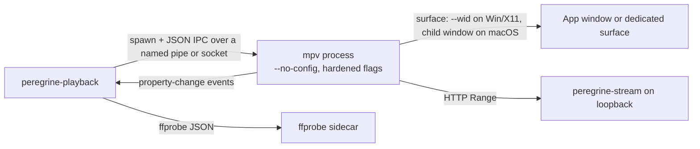

# Peregrine — Technology Stack

Decisions with the alternatives they beat and the reason. Exact versions are pinned in [DEPENDENCIES.md](./DEPENDENCIES.md) and frozen at Phase 0; this document is about *why* each layer is what it is. Per-decision records live in [adr/](./adr/).

---

## 1. Summary

| Layer | Choice | Rejected alternatives | Decisive reason |
| --- | --- | --- | --- |
| Shell | Tauri v2 | Electron, Qt, .NET MAUI, native Rust UI (egui/Iced/GPUI), Flutter | 10–15 MB installers versus 150 MB+, native webview per OS, a real Rust backend, and a genuine per-window permission model |
| UI framework | React 19 + TypeScript 7 (strict) | Svelte 5, Solid, Vue | The animation-heavy virtualized grid is the hardest UI problem here; React's virtualizer, gesture, and query ecosystems are the most mature, and the perf cost is paid down by virtualization and composite-only animation |
| Build | Vite 8 | Rspack, webpack, Turbopack | Fast HMR, first-class Tauri integration, no configuration tax |
| Styling | Tailwind CSS v4 + OKLCH CSS variables | CSS-in-JS (Emotion, styled-components), vanilla-extract, plain CSS modules | Zero runtime cost, tokens are real CSS custom properties so theme switching is an attribute swap with no re-render |
| Component primitives | Radix primitives, styled in-repo | shadcn copies, MUI, Mantine, Chakra | All shipped presets look like a web app; we need behaviour and accessibility only, with our own visual layer |
| Client state | TanStack Query + Zustand | Redux Toolkit, Jotai, SWR, TanStack DB | Server state and ephemeral UI state have different lifecycles; conflating them is the classic desktop-app performance bug |
| Rust runtime | tokio multi-thread | async-std, smol, threads only | Ecosystem gravity: sqlx, reqwest, axum, librqbit, and mdns all target tokio |
| Storage | SQLite + FTS5 via sqlx | sled, redb, RocksDB, DuckDB, a JSON file | Relational queries for a catalogue, FTS5 for search, WAL for concurrent reads, one file to back up, and every OS has tooling to inspect it |
| HTTP client | reqwest (rustls, HTTP/2, gzip/br) | hyper directly, ureq, curl bindings | Middleware for retry and cache, connection pooling, and no OpenSSL packaging pain with rustls |
| Media playback | mpv as a child process over JSON IPC | libmpv linked in-process, libvlc, ffmpeg decode in-process, HTML5 `<video>` | Crash isolation, no copyleft in our process (a separate executable is an aggregate), universal codec coverage, and no rebuild of the app to update it |
| Probing / remux | ffmpeg and ffprobe sidecars | pure-Rust demuxers (lofty, matroska, mp4 parsers) | ffprobe is the reference implementation for codec, HDR, and track metadata; pure-Rust parsers each cover a subset and none report HDR mastering metadata reliably |
| Torrent | librqbit in-process | libtorrent-rasterbar bindings, rtorrent over XML-RPC, a bundled aria2c | Pure Rust, per-file selection, sequential download support, DHT, and no C++ build or GPL boundary |
| Casting | Rust CASTV2 and UPnP adapters over an embedded axum server | Node `castv2-client` sidecar, chromium-hosted streaming | One process, no Node runtime, and we must control HTTP Range and HLS semantics ourselves anyway |
| Tests | cargo-nextest, insta, proptest, wiremock; vitest, Testing Library, Playwright, tauri-driver | cargo test only, Jest, Cypress | Fixture replay for providers, snapshot tests for normalization, property tests for parsers, real-browser E2E for the UI |
| Packaging | Tauri bundler + tauri-plugin-updater | electron-builder, custom scripts | Per-OS bundles, signed update manifests, and one command per platform |
| CI | GitHub Actions matrix | GitLab CI, Buildkite, Cirrus | Free for open source, macOS and Windows runners included, no infrastructure to run |

---

## 2. Shell: Tauri v2

| Requirement | How Tauri v2 meets it | Electron comparison |
| --- | --- | --- |
| Small, no-bloat installer | 10–15 MB plus sidecars; uses the OS webview | 150 MB+ because Chromium and Node ship with every app |
| Real backend | The core is Rust and is testable without a GUI | Node backend, no memory safety |
| Native window behaviour | Direct access to window APIs per OS | Available, but through a heavier abstraction layer |
| Permissions | Capability files granted per window | Process-level trust, coarser |
| IPC cost | Typed commands, serialized once | `ipcRenderer` with structured clone, comparable |

Costs we accept, and the mitigation:

- **Webview divergence.** Three engines (WKWebView, WebView2, WebKitGTK) mean rendering and scroll physics differ. Mitigation: Linux-specific font stack, effect budgets that assume no GPU compositing on WebKitGTK, and a per-OS visual regression check. See [research/desktop-ux.md](./research/desktop-ux.md).
- **Linux WebKitGTK bugs** (DMA-BUF failures, compositing flicker) are real and documented. Mitigation: ordered workarounds recorded in the research doc, and a `WEBKIT_DISABLE_DMABUF_RENDERER` escape hatch surfaced in Advanced settings.
- **No webview process isolation control** beyond what the platform gives. Mitigation: the highest-risk content — a YouTube trailer — runs in a separate sandboxed child webview with no IPC access.

Why not a native Rust GUI (egui, Iced, GPUI, Slint): the product goal is a Netflix-grade, animation-heavy poster grid with shared-element transitions, blurhash cross-fades, and per-OS typography. Those toolkits put every layout, animation, accessibility, and text-shaping primitive on us, and the accessibility story on all three OSes is the hardest part. That trade is wrong for this product; it would be right for a small utility.

Why not Flutter or Qt: Flutter's desktop text rendering and input handling do not feel native and it ships its own rendering engine; Qt means C++ (or PySide, which reintroduces a runtime) and GPL/LGPL commercial licensing complexity for a permissively-licensed open-source app.

---

## 3. Frontend

### Libraries and their job

| Concern | Library | Why |
| --- | --- | --- |
| Routing | TanStack Router | Type-safe routes and search params; the filter surface is URL state, and typed search params prevent a class of bugs |
| Server state | TanStack Query | Cache, stale-while-revalidate, optimistic updates, and persisted cache all in one place |
| Virtualization | TanStack Virtual | Handles 5 000-item grids and 500-item rails with fixed geometry |
| Ephemeral state | Zustand | Tiny, no provider tree, slices per feature |
| Animation | Motion | Layout and shared-element transitions declaratively, with a reduced-motion path |
| Primitives | Radix UI | Behaviour and accessibility without a visual opinion |
| Command palette | cmdk | Keyboard-first action surface |
| Forms | react-hook-form + zod | Settings forms with generated sections; validation mirrors the Rust registry |
| i18n | i18next + ICU messages | Extraction pipeline, plurals, locale-aware formatting |
| Icons | A single outlined set plus a product subset | No emoji-as-icon, consistent stroke weight |

### Deliberate omissions

| Not used | Why |
| --- | --- |
| A CSS-in-JS runtime | Every styled component costs render time; tokens live in CSS custom properties instead |
| A heavy component kit (MUI, Mantine, Chakra) | They look like a web app by default and fight a bespoke visual system |
| Redux | Server state and UI state are already separated; a global store adds ceremony and re-render risk |
| An ORM or GraphQL client | The IPC layer is the API; adding a second schema language is pure overhead |
| `localStorage` for anything authoritative | The Rust core owns persistence; the webview stores only throwaway UI state |

### Performance rules baked into the stack choice

1. Composite-only animation (`transform`, `opacity`); the lint rule rejects animating layout properties in feature code.
2. Image elements always carry intrinsic dimensions; blurhash is the placeholder; no spinners for images.
3. Grid tiles have fixed aspect ratios so the scrollbar never jumps and virtualization never re-measures.
4. One query per entity keyed by domain ID; rails read from cache then revalidate.
5. Everything longer than ~60 items is virtualized.

---

## 4. Rust core

| Concern | Crate | Role |
| --- | --- | --- |
| Async runtime | `tokio` | Multi-thread runtime, `spawn_blocking` for hashing, image decode, and SQLite writes |
| Database | `sqlx` (SQLite, offline mode) | Compile-time-checked queries with a checked-in query cache, async, migrations |
| HTTP | `reqwest` + `reqwest-middleware` | Connection pooling, rustls, compression, retry, and a cache middleware we own |
| Rate limiting | `governor` | Per-host token buckets that park on 429 rather than retry into the wall |
| Errors | `thiserror` in libraries, `anyhow` at the app boundary | Typed library errors, one place where context is added |
| Logging | `tracing` + `tracing-subscriber` + `tracing-appender` | Structured JSON, rotation, redaction layer |
| Serialization | `serde` + `serde_json` | Provider payloads and IPC DTOs |
| Type generation | `specta` + `tauri-specta` | One source of truth for Rust types and TS bindings. **No stable 2.x exists** — only `2.0.0-rc.25` — so both are pinned to that exact RC, and hand-written DTOs are the fallback if the RC proves unstable (`SPIKE-9`) |
| Time | `jiff` | Correct time zones and DST for air dates and schedules, which `chrono` handles poorly |
| IDs | `ulid` | Sortable IDs for jobs and events without a UUID version debate |
| Caching | `moka` | Bounded in-memory LRU for hot provider responses |
| Images | `image` + `fast_image_resize` + `blurhash` | Decode, resize to the requested variant, generate the placeholder |
| Filesystem | `notify`, `walkdir`/`jwalk`, `fs4`, `sysinfo` | Watch library roots, scan in parallel, check free space, report resource use |
| Secrets | `keyring`, `secrecy`, `zeroize` | OS keyring storage with in-memory protection and redaction |
| Discovery | `mdns-sd` for Chromecast, `rupnp` for DLNA | `ssdp` has been dead since 2018 and there is no `dlna` crate on crates.io; DLNA means `rupnp` discovery plus hand-rolled SOAP |
| Casting | `rust_cast` and a UPnP AV client | CASTV2 media namespace and DLNA AVTransport |
| HTTP server | `axum` + `tower-http` | Loopback and LAN media, subtitle, and HLS routes with Range support |
| Process control | `tokio::process` + a guard type | mpv and ffmpeg lifecycle with orphan reaping |

### Architectural rules that the stack enforces

- `peregrine-domain` depends on none of the above except `serde`, `jiff`, `ulid`, and `thiserror`. A `xtask check-arch` allowlist makes that mechanical.
- `#![forbid(unsafe_code)]` everywhere. No crate currently justifies an exception.
- Provider client types never escape their adapter module; they are converted to domain types at the boundary.
- No adapter is constructed inside a service; services take trait objects, which is what makes the fakes in `testkit` usable.

---

## 5. Media stack

### Playback: mpv as a child process

| Decision | Reason |
| --- | --- |
| Child process, not linked `libmpv` | A decoder or GPU-driver fault kills the video, not the app. We ship upstream's GPL mpv as a separate executable, which is an aggregate rather than a derivative work, so no copyleft reaches our code ([ADR 0013](./adr/0013-mpv-distribution-and-video-surface.md)). An LGPL-only mpv build was rejected because it has no X11 video output. mpv can be updated independently of an app release. |
| Surface per platform | `--wid` on Windows and X11; an app-positioned child window on macOS because `--wid` is unimplemented on Cocoa; a documented degraded hand-off on Wayland, which also forbids client-side positioning ([ADR 0013](./adr/0013-mpv-distribution-and-video-surface.md)) |
| ffmpeg build | LGPL-only: no `--enable-gpl`, no `--enable-nonfree`, no `--enable-version3`. Consequently **no libx264**, so casting transcodes with a hardware encoder or `libopenh264`, or refuses with an explanation ([ADR 0014](./adr/0014-ffmpeg-build-and-transcode.md)) |
| JSON IPC, not the render API | The render API exists to composite video into an app's own GL surface. We do not need that except on Wayland, where neither approach is clean, and the child-process path is far less code. |
| `--no-config` plus an explicit flag set | A user's global mpv config could load scripts into our session. We pin behaviour and disable script loading, external subtitle auto-load, and ytdl. |
| ffprobe for metadata, not pure-Rust parsers | Codec, profile, bit depth, HDR mastering metadata, channel layout, embedded subtitle streams, and chapters in one call. Pure-Rust options each cover a subset. |
| No transcoding on the desktop path | mpv decodes essentially everything directly. Transcode exists only for casting, where the renderer forces it. |

The VLC comparison, since VLC was a reference: VLC 4.0 removed the `libvlc_event_manager_t` API in favour of versioned callback structs, libVLC is LGPL-2.1 while the VLC application is GPL-2.0, and their media-player surface is far heavier than we need. VLC's `stream_t` read/peek/seek semantics are still the right abstraction to design our torrent byte source against. See [research/reference-codebases.md](./research/reference-codebases.md).

### Torrent: librqbit in-process

| Requirement | librqbit | libtorrent-rasterbar | aria2c or rtorrent sidecar |
| --- | --- | --- | --- |
| Memory safety | Rust | C++ | n/a |
| Build complexity on three OSes | None | C++ toolchain and Boost per platform | Bundle a GPL or LGPL binary |
| Per-file selection at add time | Yes | Yes | Partial |
| Sequential download with controllable read-ahead | Yes, and we drive priorities directly | Yes | Not designed for streaming |
| Proxy and interface binding | Supported | Yes | Supported |
| Licence boundary | Permissive, links cleanly | BSD, but a build burden | GPL/LGPL, must stay out of process |

In-process matters because the read-ahead policy reacts to the player's read position. Round-tripping that through a sidecar daemon is exactly the control loss that [research/reference-codebases.md](./research/reference-codebases.md) documents in both reference implementations, neither of which implements true streaming playback. That gap is a deliberate differentiator here: piece-level scheduling keyed to the demuxer's next-needed byte range. qBittorrent is the reference for torrent-session and queue management UX — separate rate limits, per-torrent priorities, ratio and time seeding limits, categories and tags, fastresume persistence, and fail-closed proxy and interface binding — and its Python search-plugin model is the concrete evidence against a plugin runtime in this application.

The `TorrentEngine` trait keeps a libtorrent-based adapter feasible if `SPIKE-3` finds a librqbit gap.

---

## 6. Storage: SQLite

| Why SQLite wins here | Detail |
| --- | --- |
| Relational catalogue | Titles, seasons, episodes, credits, and jobs are genuinely relational; a document store would push joins into application code |
| FTS5 | Built-in full-text search with BM25 ranking; a separate search engine would be a second process and a second index to keep consistent |
| WAL concurrency | Readers never block the writer, which matters while the UI queries during a download |
| One file | Backup, portable mode, and bug reports become tractable |
| Inspectable | Any user or maintainer can open it with standard tooling, which is worth a great deal for an open-source project |

Rejected: `sled` and `redb` (no query language, no FTS, and our access patterns are relational), RocksDB (a C++ dependency for no benefit at our scale), DuckDB (analytics-optimized, poor at the small transactional writes that dominate), and a JSON file (the classic route to a corrupted library).

Operational rules are in [DATA_MODEL.md](./DATA_MODEL.md) §5: one writer connection, readers pooled, WAL, `synchronous=NORMAL`, `busy_timeout`, and append-only migrations.

---

## 7. CI, tooling, and packaging

| Concern | Tool |
| --- | --- |
| Rust tests | `cargo-nextest`, `insta` snapshots, `proptest`, `wiremock`, `tempfile`, `rstest` |
| Benches | `criterion` with budget gates |
| Coverage | `cargo-llvm-cov` with per-crate thresholds |
| Fuzzing | `cargo-fuzz` targets for the parsers |
| Lint and supply chain | `clippy -D warnings`, `cargo-deny`, `cargo-audit`, `osv-scanner`, `cargo-machete`, `knip` |
| UI tests | `vitest`, Testing Library, `msw`, Playwright, `tauri-driver` where supported |
| Release | `tauri-action`, `git-cliff` for changelogs, CycloneDX SBOM, signed update manifests |
| Formatting | `rustfmt`, Prettier, EditorConfig |

---

## 8. Version and upgrade policy

| Item | Policy |
| --- | --- |
| MSRV | The current stable Rust minus two releases, stated in `Cargo.toml` and CI-verified |
| Node and pnpm | Pinned in `package.json` `engines` and CI; no floating majors |
| Frontend deps | Renovate grouped weekly; majors need a PR with a visual regression run |
| Rust deps | Renovate grouped weekly; majors need a CI pass, and any crate touching security or parsers needs a review note |
| Sidecars | mpv and ffmpeg pinned by exact version and checksum per OS, upgraded on a scheduled PR that runs the media fixture suite |
| Breaking changes | Expand-contract migrations only; an older app refuses to open a newer database and offers the backup |
| Update channels | `stable` and `beta`; the beta channel is opt-in and labelled in About and Diagnostics |

---

## 9. What this stack costs us

An honest list, because every choice has a bill:

- Three webview engines to keep visually consistent, with the worst behaviour on Linux WebKitGTK.
- Two languages and a generated binding step; a Rust type change requires regenerating TS (CI enforces it).
- No in-process video, so frame-perfect compositing of HTML over video requires care; the overlay is a separate layer, not a DOM sibling of the video texture.
- Casting requires remux or transcode work that a Chromecast-native app would get for free.
- mpv and a minimal ffprobe are large sidecars that ship in the base install; a full ffmpeg build is another 40–60 MB, which is why it is an on-demand component pack rather than a default download.
- SQLite single-writer discipline is real work in the scheduler, not a default we get for free.
